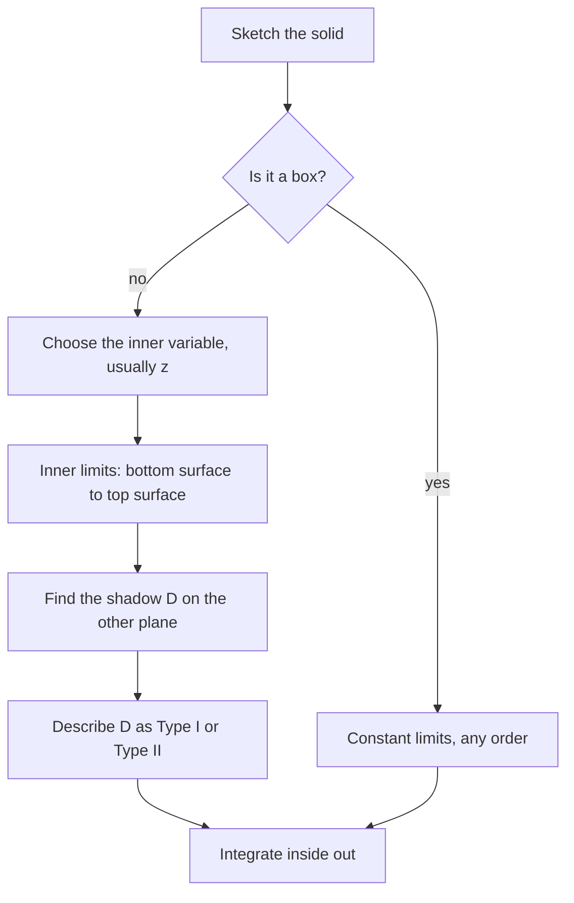

## Adding up over solids

A double integral adds up a quantity spread over a flat region. A **triple integral** adds
up a quantity spread through a solid: the mass of a block with varying density, the total
charge in a cloud, the average temperature in a room. The machinery is the same as before:
Riemann sums define it, Fubini's theorem turns it into three ordinary integrals, and the
real work is describing the region with the right limits.

## Definition and Fubini

Divide a box $B = [a, b]\times[c, d]\times[r, s]$ into small boxes of volume $\Delta V$,
sample $f$ in each, and sum. The limit of these sums is

$$\iiint_B f(x, y, z)\,dV = \lim\sum_{i,j,k} f(x_{ijk}^*, y_{ijk}^*, z_{ijk}^*)\,\Delta V.$$

**Fubini's theorem for boxes.** If $f$ is continuous on $B$, then

$$\iiint_B f\,dV = \int_r^s\int_c^d\int_a^b f(x, y, z)\,dx\,dy\,dz,$$

and any of the six orders of integration gives the same value. As always, work from the
inside out, holding the outer variables fixed.

### Example 1

Evaluate $\iiint_B xyz^2\,dV$ over $B = [0, 1]\times[-1, 2]\times[0, 3]$.

The integrand is a product and the limits are constants, so it factors:
$\left(\int_0^1 x\,dx\right)\left(\int_{-1}^2 y\,dy\right)\left(\int_0^3 z^2\,dz\right) = \tfrac12\cdot\tfrac32\cdot9 = \tfrac{27}{4}.$

## General regions

A solid $E$ is **type 1** if it lies between two surfaces over a region $D$ in the
$xy$-plane:

$$E = \{(x, y, z) : (x, y)\in D,\ u_1(x, y) \le z \le u_2(x, y)\}.$$

Then

$$\iiint_E f\,dV = \iint_D\left[\int_{u_1(x,y)}^{u_2(x,y)} f(x, y, z)\,dz\right]dA.$$

The recipe:

1. Identify the bottom and top surfaces: these are the $z$-limits. (A vertical line
   through the solid enters at the bottom and leaves at the top.)
2. Find $D$, the **projection** (shadow) of $E$ on the $xy$-plane, often by setting the top
   and bottom equal or by setting $z = 0$.
3. Describe $D$ as a Type I or Type II plane region (Lesson 22), giving the remaining limits.

Solids can equally be projected onto the $yz$- or $xz$-plane, with $x$ or $y$ as the inner
variable; choose whichever makes the description simplest.

The flowchart sums up the whole setup, including the easy case of a box.



### Example 2: the tetrahedron

Let $E$ be the tetrahedron bounded by the coordinate planes and the plane $x + y + z = 1$.
Find its volume and $\iiint_E z\,dV$.

1. Bottom $z = 0$, top $z = 1 - x - y$.
2. The shadow $D$ is where the top plane meets $z = 0$: the triangle $x \ge 0$, $y \ge 0$, $x + y \le 1$.

```plot
{"x": [-0.2, 1.3], "y": [-0.2, 1.3], "equal": true, "functions": [{"f": "1-x", "from": 0, "to": 1, "label": "x + y = 1"}], "shade": [{"f": "1-x", "from": 0, "to": 1}], "caption": "Projection of the tetrahedron on the xy-plane: 0 ≤ x ≤ 1, 0 ≤ y ≤ 1 − x"}
```

3. So $E$: $0 \le x \le 1$, $0 \le y \le 1 - x$, $0 \le z \le 1 - x - y$.
4. Volume $= \iiint_E 1\,dV = \displaystyle\int_0^1\int_0^{1-x}(1 - x - y)\,dy\,dx = \int_0^1\frac{(1 - x)^2}{2}\,dx = \frac16$.
5. $\displaystyle\iiint_E z\,dV = \int_0^1\int_0^{1-x}\frac{(1 - x - y)^2}{2}\,dy\,dx = \int_0^1\frac{(1 - x)^3}{6}\,dx = \frac{1}{24}$.

### Example 3: choosing the projection

Find the volume of the solid bounded by the parabolic cylinder $y = x^2$ and the planes
$z = 0$ and $y + z = 1$.

1. Bottom $z = 0$, top $z = 1 - y$ (which requires $y \le 1$).
2. Shadow: between $y = x^2$ and $y = 1$, for $-1 \le x \le 1$.
3. $V = \displaystyle\int_{-1}^{1}\int_{x^2}^{1}(1 - y)\,dy\,dx = \int_{-1}^1\left(\frac12 - x^2 + \frac{x^4}{2}\right)dx = 1 - \frac23 + \frac15 = \frac{8}{15}.$

```plot
{"x": [-1.4, 1.4], "y": [-0.2, 1.3], "equal": true, "functions": [{"f": "x^2", "label": "y = x²"}, {"f": "1", "label": "y = 1"}], "shade": [{"f": "1", "g": "x^2", "from": -1, "to": 1}], "caption": "Shadow of the solid on the xy-plane"}
```

## Applications

Everything from Lesson 24 carries over with $dV$ in place of $dA$. For a solid with density
$\rho(x, y, z)$:

- mass $m = \iiint_E\rho\,dV$;
- moments $M_{yz} = \iiint_E x\rho\,dV$, $M_{xz} = \iiint_E y\rho\,dV$, $M_{xy} = \iiint_E z\rho\,dV$ (each about a coordinate *plane*);
- center of mass $\bar x = M_{yz}/m$, $\bar y = M_{xz}/m$, $\bar z = M_{xy}/m$;
- average value $f_{\text{avg}} = \frac{1}{V(E)}\iiint_E f\,dV$.

For the uniform tetrahedron of Example 2, $\bar z = \dfrac{1/24}{1/6} = \dfrac14$, and by
symmetry $\bar x = \bar y = \tfrac14$: the centroid is the average of the four vertices.

### Example 4: projecting onto a different plane

Find the volume of the solid bounded by the paraboloid $y = x^2 + z^2$ and the plane $y = 4$.

This solid's axis is the $y$-axis, so slice in the $y$-direction instead: a line parallel to the $y$-axis enters at $y = x^2 + z^2$ and leaves at $y = 4$. The shadow on the $xz$-plane is the disk $x^2 + z^2 \le 4$. Then

$$V = \iint_{x^2+z^2\le4}(4 - x^2 - z^2)\,dA = \int_0^{2\pi}\int_0^2(4 - r^2)\,r\,dr\,d\theta = 8\pi,$$

using polar coordinates in the $xz$-plane. Slicing in $z$ instead would need square roots in the limits.

## Common mistakes

- Using the shadow's boundary as $z$-limits; $z$-limits come from the top and bottom surfaces.
- Letting outer limits depend on inner variables.
- Forgetting that the inner integral's result depends on the outer variables.
- Mixing up which plane a moment is taken about ($M_{xy}$ uses $z$).

## Key points

- $\iiint_E f\,dV$ is evaluated as three nested integrals; on a box any order works.
- Type 1 solid: $z$ from bottom surface to top surface, then integrate over the shadow $D$.
- Volume $= \iiint_E 1\,dV$; mass and center of mass follow the 2D pattern.
