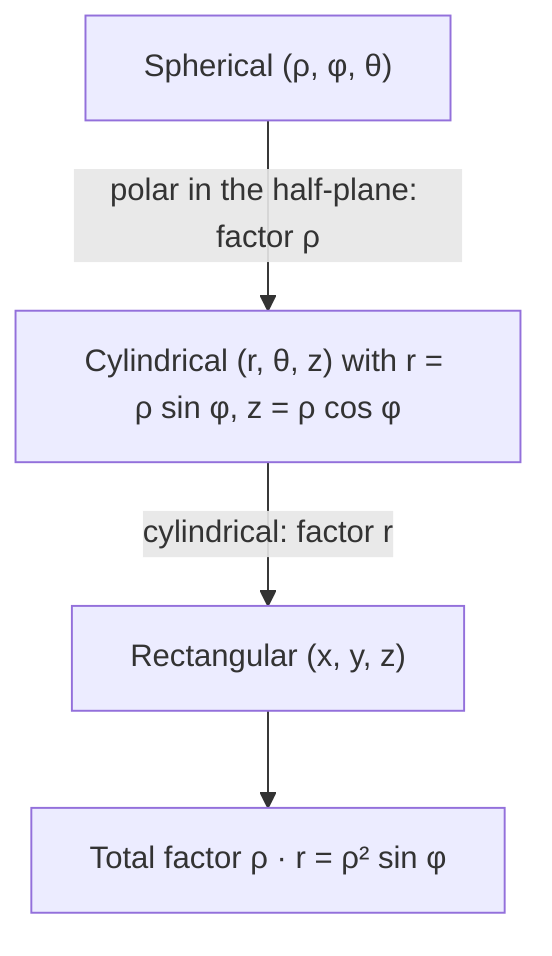

## Coordinates made to order

Lesson 28 opened with a promise: with the Jacobian you can design your own coordinates to fit
an awkward region. Most of its examples were in the plane. This lesson builds coordinate
systems for solids: linear ones for ellipsoids and slanted boxes, a coordinate system made
for a doughnut (a torus), and finally coordinates in four and more dimensions, where the
same Jacobian rule computes volumes nobody can picture. Along the way you will see *why*
the spherical factor is $\rho^2\sin\phi$ without computing a single $3\times3$ determinant.

## Linear changes of variables

The simplest substitutions are linear: $(x, y, z)$ is a fixed matrix $A$ times $(u, v, w)$.
All the partial derivatives are constants, so the Jacobian is the constant $\det A$, and
every volume is multiplied by the same factor $|\det A|$. This is the parallelepiped fact
from Lesson 4 in disguise: $A$ sends the unit cube to the parallelepiped spanned by its
columns, whose volume is $|\det A|$.

### Example 1: the ellipsoid

The solid ellipsoid $\dfrac{x^2}{a^2} + \dfrac{y^2}{b^2} + \dfrac{z^2}{c^2} \le 1$ is the image
of the unit ball $u^2 + v^2 + w^2 \le 1$ under $x = au$, $y = bv$, $z = cw$. The Jacobian is
$abc$, so

$$V = abc\cdot\frac43\pi = \frac43\pi abc.$$

The same substitution handles integrals. For the moment of inertia (Lesson 24) of a
uniform ellipsoid of density $\delta$ about the $z$-axis, we need $\iiint(x^2 + y^2)\,\delta\,dV$.
Over the unit ball, symmetry gives $\iiint u^2\,dV = \tfrac13\iiint(u^2 + v^2 + w^2)\,dV = \tfrac13\cdot\tfrac{4\pi}{5} = \tfrac{4\pi}{15}$
(the $\tfrac{4\pi}{5}$ is $\int\rho^2\,dV$ over the unit ball in spherical coordinates). So

$$I_z = \delta\,abc\iiint_{\text{ball}}(a^2u^2 + b^2v^2)\,dV = \delta\,abc\,(a^2 + b^2)\frac{4\pi}{15} = \frac{m(a^2 + b^2)}{5},$$

using $m = \tfrac43\pi abc\,\delta$. When $a = b = c$ this is the ball's $\tfrac25ma^2$.

### Example 2: a slanted box

Find the volume of the solid $E$ given by $0 \le x + y \le 1$, $0 \le y + z \le 2$,
$0 \le x + z \le 3$, and then $\iiint_E(x + y + z)\,dV$.

1. Each pair of parallel planes becomes a pair of coordinate planes if $u = x + y$, $v = y + z$, $w = x + z$. The new region is the box $[0, 1]\times[0, 2]\times[0, 3]$.
2. $\dfrac{\partial(u, v, w)}{\partial(x, y, z)} = \begin{vmatrix}1 & 1 & 0\\ 0 & 1 & 1\\ 1 & 0 & 1\end{vmatrix} = 1(1 - 0) - 1(0 - 1) + 0 = 2$, so $\left|\dfrac{\partial(x, y, z)}{\partial(u, v, w)}\right| = \dfrac12$.
3. $V = \dfrac12\cdot(1\cdot2\cdot3) = 3$.
4. Adding the three new variables, $u + v + w = 2(x + y + z)$, so the integrand is $\tfrac12(u + v + w)$ and
$$\iiint_E(x + y + z)\,dV = \int_0^3\int_0^2\int_0^1\frac{u + v + w}{2}\cdot\frac12\,du\,dv\,dw = \frac14\left(3 + 6 + 9\right) = \frac92.$$
(Each term is the box volume 6 times the average of that variable: $6\cdot\tfrac12$, $6\cdot1$, $6\cdot\tfrac32$.)

## Building Jacobians from pieces

If you change variables twice in a row, the stretch factors multiply. In matrix form the
chain rule says the Jacobian matrix of a composition is the product of the two Jacobian
matrices, and the determinant of a product is the product of the determinants. A special
case is the inverse: going there and back is the identity, with Jacobian 1, which is why
$\dfrac{\partial(x, y)}{\partial(u, v)}$ and $\dfrac{\partial(u, v)}{\partial(x, y)}$ are reciprocals.

This explains the spherical volume element. In the vertical half-plane through the
$z$-axis, the pair $(r, z)$ is given by polar-style coordinates: radius $\rho$, angle $\phi$
measured from the $z$-axis, with $r = \rho\sin\phi$ and $z = \rho\cos\phi$. Like any polar
coordinates, they stretch area by $\rho$. Then cylindrical coordinates stretch volume by $r$.



So $dV = r\,dr\,dz\,d\theta = (\rho\sin\phi)(\rho\,d\rho\,d\phi)\,d\theta = \rho^2\sin\phi\,d\rho\,d\phi\,d\theta$, with no
$3\times3$ determinant at all.

## Toroidal coordinates and the theorem of Pappus

A **torus** is the solid doughnut swept out when a disk of radius $a$, centered at distance
$R > a$ from the $z$-axis, is revolved about that axis. Rectangular limits for it are ugly.
Instead, copy the trick above: keep cylindrical $\theta$, and in the half-plane use polar
coordinates centered at the middle of the tube, $(r, z) = (R, 0)$:

$$r = R + s\cos\alpha,\qquad z = s\sin\alpha,\qquad 0 \le s \le a,\ 0 \le \alpha \le 2\pi,\ 0 \le \theta \le 2\pi.$$

These are **toroidal coordinates** (several different systems go by this name; this is the
simplest). The polar
step stretches area by $s$ and the cylindrical step by $r$, so

$$dV = s\,(R + s\cos\alpha)\;ds\,d\alpha\,d\theta.$$

The requirement $R > a$ keeps $r > 0$, so the map is one-to-one and the factor is positive.


### Example 3: the volume of a torus

$$V = \int_0^{2\pi}\int_0^{2\pi}\int_0^a s(R + s\cos\alpha)\,ds\,d\alpha\,d\theta = 2\pi\int_0^{2\pi}\left(\frac{Ra^2}{2} + \frac{a^3}{3}\cos\alpha\right)d\alpha = 2\pi\cdot\pi Ra^2 = 2\pi^2Ra^2.$$

The $\cos\alpha$ term integrates to zero: the outer half of the tube ($\cos\alpha > 0$, farther
from the axis) gets a bigger stretch factor and the inner half a smaller one, by exactly
the same amount. A torus
with $R = 3$ and $a = 1$ has volume $6\pi^2 \approx 59.2$.

Read the answer as $(\pi a^2)(2\pi R)$: the area of the disk times the distance its center
travels. That is a general fact. For any region $D$ in the half-plane $r \ge 0$, the solid
swept out by revolving $D$ about the $z$-axis has, in cylindrical coordinates,

$$V = \int_0^{2\pi}\iint_D r\,dA\,d\theta = 2\pi\iint_D r\,dA = 2\pi\bar r\,A,$$

where $A$ is the area of $D$ and $\bar r$ the distance of its centroid from the axis. This
is **Pappus's centroid theorem**, stated by Pappus of Alexandria in the early 300s AD and rediscovered
by Paul Guldin in the 1600s; with triple integrals the proof is one line.

### Example 4: Pappus without a triple integral

Revolve the triangle with vertices $(r, z) = (2, 0)$, $(4, 0)$, $(2, 3)$ about the $z$-axis.
Its area is $\tfrac12\cdot2\cdot3 = 3$, and its centroid is the average of the vertices,
$\bar r = \tfrac{2 + 4 + 2}{3} = \tfrac83$. So $V = 2\pi\cdot\tfrac83\cdot3 = 16\pi$. As a check,
the slanted edge is $z = \tfrac32(4 - r)$, and
$\displaystyle\int_2^4 2\pi r\cdot\tfrac32(4 - r)\,dr = 3\pi\left[2r^2 - \tfrac{r^3}{3}\right]_2^4 = 16\pi.$

## Beyond three dimensions

Nothing in the change of variables formula depends on there being three variables. An
integral over a region of $\mathbb R^n$ uses an $n\times n$ Jacobian, and "volume" means
$n$-dimensional volume. Two tools are enough to find the volume of the
**n-ball** $x_1^2 + \dots + x_n^2 \le a^2$.

*Scaling.* The map $x_i = a\,u_i$ has Jacobian $a^n$, so $V_n(a) = V_n(1)\,a^n$.

*Slicing off two variables.* Split the coordinates into the last two, with
$x_{n-1}^2 + x_n^2 = s^2$, and the other $n - 2$. For each point of the disk $s \le a$, the
other coordinates fill an $(n - 2)$-ball of radius $\sqrt{a^2 - s^2}$. Integrating that
slice's volume over the disk in polar coordinates gives, for $a = 1$,

$$V_n(1) = \int_0^{2\pi}\int_0^1 V_{n-2}(1)\,(1 - s^2)^{(n-2)/2}\,s\,ds\,d\theta = 2\pi V_{n-2}(1)\cdot\frac1n = \frac{2\pi}{n}V_{n-2}(1).$$

### Example 5: the four-dimensional ball

With $V_2(1) = \pi$: $V_4(1) = \dfrac{2\pi}{4}\cdot\pi = \dfrac{\pi^2}{2}$, so $V_4(a) = \dfrac{\pi^2a^4}{2}$. Directly,
$\displaystyle\int_0^{2\pi}\int_0^a\pi(a^2 - s^2)\,s\,ds\,d\theta = 2\pi\cdot\pi\left(\frac{a^4}{2} - \frac{a^4}{4}\right) = \frac{\pi^2a^4}{2}.$

Starting from $V_1(1) = 2$ (a segment) and $V_2(1) = \pi$, the recursion gives every unit
ball:

```plot
{"x": [0, 16], "y": [0, 6], "bars": [{"x": 1, "height": 2, "width": 0.7}, {"x": 2, "height": 3.1416, "width": 0.7}, {"x": 3, "height": 4.1888, "width": 0.7}, {"x": 4, "height": 4.9348, "width": 0.7}, {"x": 5, "height": 5.2638, "width": 0.7}, {"x": 6, "height": 5.1677, "width": 0.7}, {"x": 7, "height": 4.7248, "width": 0.7}, {"x": 8, "height": 4.0587, "width": 0.7}, {"x": 9, "height": 3.2985, "width": 0.7}, {"x": 10, "height": 2.5502, "width": 0.7}, {"x": 11, "height": 1.8841, "width": 0.7}, {"x": 12, "height": 1.3353, "width": 0.7}], "xLabel": "dimension n", "yLabel": "volume of the unit n-ball", "caption": "Volume of the unit ball in n dimensions: largest at n = 5 (about 5.26), then shrinking toward 0"}
```

The volume grows up to $n = 5$, where $V_5(1) = \tfrac{8\pi^2}{15} \approx 5.26$, and then
shrinks: once $n > 2\pi$ the factor $\tfrac{2\pi}{n}$ is less than 1, and the volumes head to 0.
Meanwhile the cube $[-1, 1]^n$ that contains the ball has volume $2^n$, so in high dimensions
the ball fills almost none of its box.

Scaling also shows where the volume of a high-dimensional ball sits. The fraction lying
within $\varepsilon$ of the surface is $1 - (1 - \varepsilon)^n$. For $n = 3$ and
$\varepsilon = 0.1$ that is about 27%; for $n = 10$ it is about 65%; and for $n = 100$, a
shell only 5% thick holds over 99% of the volume. Facts like these matter in statistics and
machine learning, where data often live in hundreds of dimensions.

## Common mistakes

- Using $\det A$ instead of $|\det A|$ when $A$ reverses orientation.
- Adding Jacobians of two successive substitutions instead of multiplying them.
- Using toroidal coordinates with $R < a$, where the tube crosses the axis and the map stops being one-to-one.
- In Pappus's theorem, using the distance traveled by a corner or edge instead of by the centroid.
- Assuming the unit-ball volume keeps growing with dimension.

## Key points

- A linear substitution $x = Au$ multiplies every volume by $|\det A|$; the ellipsoid has volume $\tfrac43\pi abc$.
- Jacobians of successive substitutions multiply; spherical = (polar in the half-plane, factor $\rho$) then (cylindrical, factor $r$).
- Toroidal coordinates: $dV = s(R + s\cos\alpha)\,ds\,d\alpha\,d\theta$; the torus has volume $2\pi^2Ra^2$.
- Pappus: volume of revolution $= 2\pi\bar r A$.
- $V_n(a) = V_n(1)a^n$ with $V_n(1) = \tfrac{2\pi}{n}V_{n-2}(1)$; $V_4(a) = \tfrac12\pi^2a^4$.
