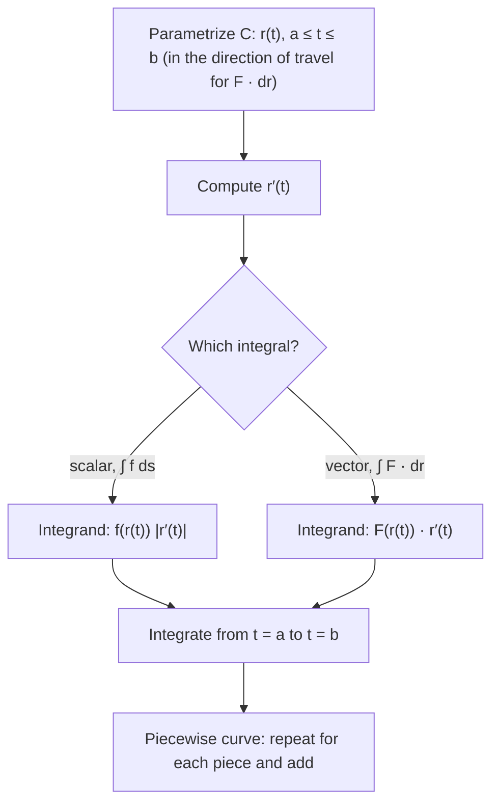

## Integrating along a curve

An ordinary integral adds up values along a straight interval of the $x$-axis. A **line integral** adds them up along a curve. There are two kinds, answering two different
questions:

- **Scalar line integral** $\int_C f\,ds$: add a quantity per unit length along the curve,
  for example the mass of a wire with variable density, or the area of a curved fence.
- **Vector line integral** $\int_C\mathbf F\cdot d\mathbf r$: add up the part of a vector field
  that points *along* the curve, for example the work done by a force on a particle moving
  along a path, or the circulation of a fluid around a loop.

In both cases the method is the same: parametrize the curve, and the line integral becomes an
ordinary integral in the parameter $t$.

## Scalar line integrals

Let $C$ be a smooth curve given by $\mathbf r(t)$, $a \le t \le b$. Chop $C$ into small arcs of
length $\Delta s$, multiply each by a value of $f$, and sum. In the limit, using
$ds = |\mathbf r'(t)|\,dt$ from Lesson 8:

$$\int_C f\,ds = \int_a^b f(\mathbf r(t))\,|\mathbf r'(t)|\,dt.$$

With $f = 1$ this is the arc length. If $f \ge 0$ is the density of a wire, it is the wire's
mass. The value does not depend on the parametrization or on the direction of travel.

### Example 1

Evaluate $\int_C xy^2\,ds$, where $C$ is the quarter of the circle $x^2 + y^2 = 4$ in the first quadrant.

1. Parametrize: $\mathbf r(t) = \langle 2\cos t, 2\sin t\rangle$, $0 \le t \le \tfrac\pi2$. Then $|\mathbf r'(t)| = 2$.
2. $\displaystyle\int_0^{\pi/2}(2\cos t)(4\sin^2t)(2)\,dt = 16\int_0^{\pi/2}\sin^2t\cos t\,dt = 16\cdot\frac{\sin^3t}{3}\Big|_0^{\pi/2} = \frac{16}{3}.$

## Work and vector line integrals

A force $\mathbf F$ moves a particle along $C$. Over a tiny step $\Delta\mathbf r$, the
work is about $\mathbf F\cdot\Delta\mathbf r$ (Lesson 3: force dotted with displacement).
Adding up gives the line integral of $\mathbf F$ along $C$:

$$W = \int_C\mathbf F\cdot d\mathbf r = \int_a^b\mathbf F(\mathbf r(t))\cdot\mathbf r'(t)\,dt.$$

Equivalently, $\int_C\mathbf F\cdot d\mathbf r = \int_C\mathbf F\cdot\mathbf T\,ds$: the
scalar line integral of the **tangential component** of $\mathbf F$. Only the part of the
force along the motion does work; a force perpendicular to the path does none.

The picture splits a force into these two parts at a point of the path.


**Orientation matters.** Reversing the direction of travel (written $-C$) flips the sign:
$\int_{-C}\mathbf F\cdot d\mathbf r = -\int_C\mathbf F\cdot d\mathbf r$. Pushing a box
uphill takes positive work; letting it slide down returns it.

In components, with $\mathbf F = \langle P, Q, R\rangle$ and $d\mathbf r = \langle dx, dy, dz\rangle$,
the same integral is written

$$\int_C\mathbf F\cdot d\mathbf r = \int_C P\,dx + Q\,dy + R\,dz,$$

where $dx = x'(t)\,dt$, and so on. This is the notation used in Green's theorem.

### Example 2

Find the work done by $\mathbf F(x, y) = \langle x^2,\, xy\rangle$ on a particle moving along the parabola $y = x^2$ from $(0, 0)$ to $(1, 1)$.

1. Parametrize: $\mathbf r(t) = \langle t, t^2\rangle$, $0 \le t \le 1$, so $\mathbf r'(t) = \langle 1, 2t\rangle$.
2. $\mathbf F(\mathbf r(t)) = \langle t^2,\, t\cdot t^2\rangle = \langle t^2, t^3\rangle$.
3. $W = \displaystyle\int_0^1(t^2\cdot1 + t^3\cdot2t)\,dt = \int_0^1(t^2 + 2t^4)\,dt = \frac13 + \frac25 = \frac{11}{15}.$

### Example 3: a different path

Now move from $(0, 0)$ to $(1, 1)$ along the straight segment $\mathbf r(t) = \langle t, t\rangle$.
Then $\mathbf F(\mathbf r(t)) = \langle t^2, t^2\rangle$, $\mathbf r' = \langle 1, 1\rangle$, and
$W = \int_0^1 2t^2\,dt = \tfrac23$.

Same endpoints, different work: for this field the line integral depends on the path. In
the next lesson we show that the fields for which it does not are exactly the conservative
fields (Lesson 29), so $\langle x^2, xy\rangle$ is not conservative.

```plot
{"x": [-0.2, 1.3], "y": [-0.2, 1.3], "equal": true, "vectorField": {"u": "x^2", "v": "x*y", "step": 0.2}, "functions": [{"f": "x^2", "from": 0, "to": 1}, {"f": "x", "from": 0, "to": 1, "dashed": true}], "labels": [{"at": [0.75, 0.3], "text": "y = x²: W = 11/15"}, {"at": [0.3, 0.75], "text": "y = x: W = 2/3"}], "caption": "The field ⟨x², xy⟩ does different work along two paths with the same ends"}
```

### Example 4: in space

Evaluate $\int_C\mathbf F\cdot d\mathbf r$ for $\mathbf F = \langle y, z, x\rangle$ along one turn of the helix $\mathbf r(t) = \langle\cos t, \sin t, t\rangle$, $0 \le t \le 2\pi$.

1. $\mathbf F(\mathbf r(t)) = \langle\sin t,\, t,\, \cos t\rangle$ and $\mathbf r'(t) = \langle -\sin t,\, \cos t,\, 1\rangle$.
2. Dot: $-\sin^2t + t\cos t + \cos t$.
3. Over $[0, 2\pi]$: $\int\sin^2t\,dt = \pi$, $\int t\cos t\,dt = \left[t\sin t + \cos t\right]_0^{2\pi} = 0$, $\int\cos t\,dt = 0$. So the integral is $-\pi$.

## Piecewise curves

If $C$ is made of smooth pieces $C_1, \dots, C_n$ joined end to end, integrate over each piece
with its own parametrization and add. A handy parametrization for the segment from
$\mathbf r_0$ to $\mathbf r_1$ is $\mathbf r(t) = (1 - t)\mathbf r_0 + t\mathbf r_1$, $0 \le t \le 1$.

## The procedure at a glance

Both kinds of line integral follow the same steps; they differ only in what multiplies $dt$.



## Common mistakes

- Forgetting $|\mathbf r'(t)|$ in a scalar line integral, or including it in $\int\mathbf F\cdot d\mathbf r$ (where $\mathbf r'(t)$ already appears).
- Not substituting the parametrization into $\mathbf F$ (leaving $x$'s and $y$'s in the integrand).
- Traversing the curve in the wrong direction for a vector line integral; this flips the sign.
- Assuming the work between two points is the same for every path.

## Key points

- $\int_C f\,ds = \int_a^b f(\mathbf r(t))\,|\mathbf r'(t)|\,dt$ (independent of direction).
- $\int_C\mathbf F\cdot d\mathbf r = \int_a^b\mathbf F(\mathbf r(t))\cdot\mathbf r'(t)\,dt = \int_C P\,dx + Q\,dy + R\,dz$ (changes sign with direction).
- Work is the line integral of force; only the tangential component contributes.
