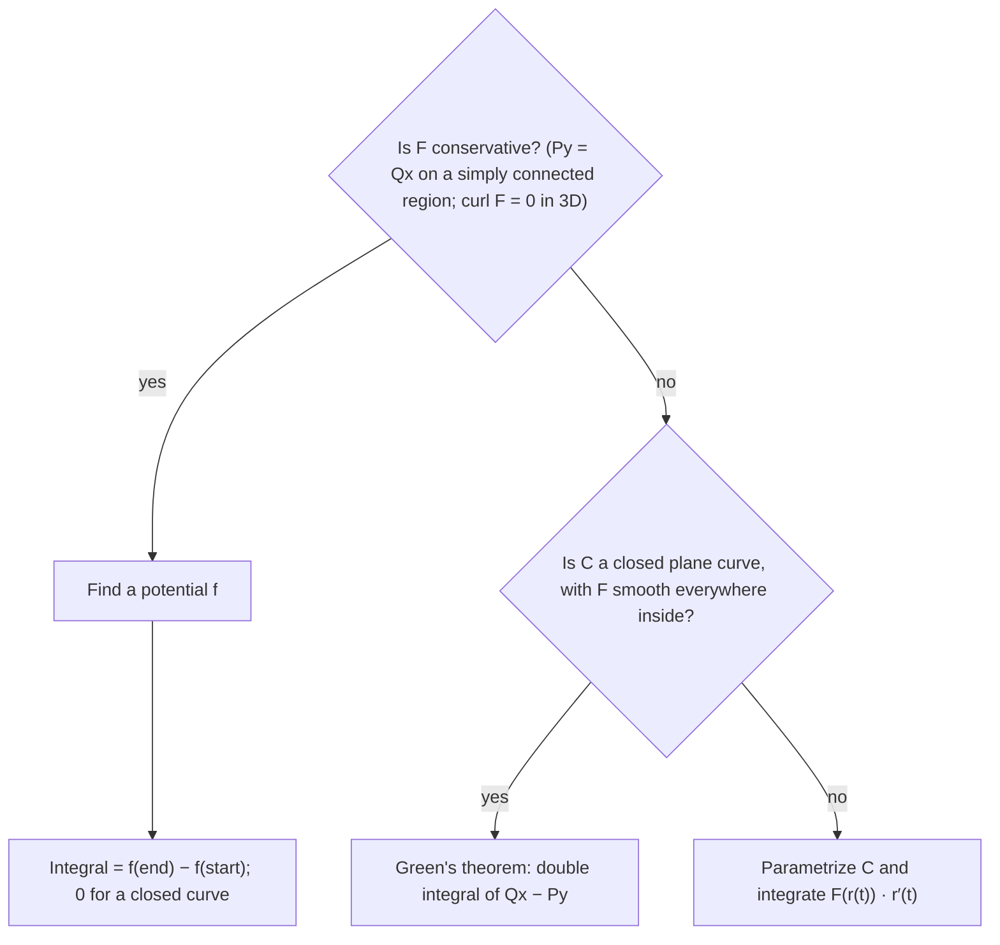

## A shortcut for some line integrals

The Fundamental Theorem of Calculus says $\int_a^b F'(x)\,dx = F(b) - F(a)$: to integrate a
derivative, just evaluate at the endpoints. For line integrals there is an exact analogue.
If the vector field is a gradient, its line integral depends only on where the path starts
and ends, not on the route. This lesson states that theorem, shows why it is true, gives a
test for when a field is a gradient, and shows how to find the potential function.

## The Fundamental Theorem for Line Integrals

**Theorem.** Let $C$ be a smooth curve $\mathbf r(t)$, $a \le t \le b$, and let $f$ be a
differentiable function whose gradient is continuous on $C$. Then

$$\int_C\nabla f\cdot d\mathbf r = f(\mathbf r(b)) - f(\mathbf r(a)).$$

*Why.* By the chain rule (Lesson 16),
$\dfrac{d}{dt}f(\mathbf r(t)) = \nabla f(\mathbf r(t))\cdot\mathbf r'(t)$. So the line integral
is $\int_a^b\frac{d}{dt}f(\mathbf r(t))\,dt$, which by the ordinary FTC is
$f(\mathbf r(b)) - f(\mathbf r(a))$.

The integrand is "the rate of change of $f$ along the curve," and adding up all the small
changes of $f$ gives its total change. In physics: if a force is $\mathbf F = \nabla f$, the
work it does equals the change in $f$. (Physicists write $\mathbf F = -\nabla U$ with $U$ the
**potential energy**, so work $= U(A) - U(B)$, the loss of potential energy.)

## Path independence and closed curves

We say $\int_C\mathbf F\cdot d\mathbf r$ is **independent of path** in a region $D$ if any two
paths in $D$ with the same initial and terminal points give the same value. The theorem
shows that conservative fields have path-independent integrals. Two consequences:

- If $C$ is a **closed curve** (it ends where it starts), then $\oint_C\nabla f\cdot d\mathbf r = f(\text{end}) - f(\text{start}) = 0$.
- Conversely, path independence is equivalent to every closed-loop integral being zero.
  (Two paths from $A$ to $B$ form a loop when one is reversed.)

And conversely again: if $\mathbf F$ is continuous on an open connected region and its line
integrals are path independent, then $\mathbf F$ is conservative. (Define
$f(x, y) = \int_{(a,b)}^{(x,y)}\mathbf F\cdot d\mathbf r$ along any path; its gradient turns
out to be $\mathbf F$.)

So for fields on such a region: *conservative ⇔ path independent ⇔ zero around every closed
loop*. The field $\langle x^2, xy\rangle$ of Lesson 30 gave $\tfrac{11}{15}$ and $\tfrac23$ on
two paths, so it is not conservative.


## Testing whether a field is conservative

If $\mathbf F = \langle P, Q\rangle = \nabla f$, then $P = f_x$ and $Q = f_y$, so by Clairaut's
theorem

$$\frac{\partial P}{\partial y} = f_{xy} = f_{yx} = \frac{\partial Q}{\partial x}.$$

This necessary condition is also sufficient when the domain has no holes:

**Test.** Let $\mathbf F = \langle P, Q\rangle$ have continuous first partials on an open
**simply connected** region $D$ (connected, and every closed curve in $D$ encloses only points
of $D$; informally, no holes). Then $\mathbf F$ is conservative on $D$ if and only if
$P_y = Q_x$ throughout $D$.

The difference is easy to see. In a disk, every loop can be shrunk to a point without leaving
the region. In an annulus, or in the plane with one point removed, a loop around the hole
cannot.


For $\mathbf F = \langle -y, x\rangle$: $P_y = -1 \ne 1 = Q_x$, so the rotation field is not
conservative. Indeed, around the unit circle it has circulation $2\pi$.

**Why the holes matter.** The field $\mathbf F = \left\langle\dfrac{-y}{x^2 + y^2},\, \dfrac{x}{x^2 + y^2}\right\rangle$
satisfies $P_y = Q_x$ everywhere except the origin, where it is undefined. Yet around the unit
circle its line integral is $\int_0^{2\pi}(\sin^2t + \cos^2t)\,dt = 2\pi \ne 0$. The domain (the
plane minus a point) is not simply connected, so the test does not apply.

In three dimensions the condition becomes $\operatorname{curl}\mathbf F = \mathbf 0$, which we
meet in Lesson 33: $R_y = Q_z$, $P_z = R_x$, $Q_x = P_y$.

## Finding a potential function

### Example 1

Show that $\mathbf F = \langle 3 + 2xy,\; x^2 - 3y^2\rangle$ is conservative, find a potential,
and evaluate $\int_C\mathbf F\cdot d\mathbf r$ along any path from $(1, 0)$ to $(2, 1)$.

1. Test: $P_y = 2x$ and $Q_x = 2x$. Equal, on the whole plane: conservative.
2. Integrate $P$ in $x$: $f = 3x + x^2y + g(y)$, where $g$ is an unknown function of $y$ (the
   "constant" of integration may depend on $y$).
3. Differentiate in $y$ and match $Q$: $f_y = x^2 + g'(y) = x^2 - 3y^2$, so $g'(y) = -3y^2$ and
   $g(y) = -y^3$ (plus any constant).
4. $f(x, y) = 3x + x^2y - y^3$. Check: $f_x = 3 + 2xy$ ✓, $f_y = x^2 - 3y^2$ ✓.
5. $\int_C\mathbf F\cdot d\mathbf r = f(2, 1) - f(1, 0) = (6 + 4 - 1) - 3 = 6$.

No parametrization needed, and the path is irrelevant.

### Example 2: three variables

Find a potential for $\mathbf F = \langle 2xz + y,\; x + z^2,\; x^2 + 2yz\rangle$ and evaluate the
work from $(0, 0, 0)$ to $(1, 2, 3)$.

1. $f = \int(2xz + y)\,dx = x^2z + xy + g(y, z)$.
2. $f_y = x + g_y = x + z^2$, so $g_y = z^2$ and $g = yz^2 + h(z)$.
3. $f_z = x^2 + 2yz + h'(z) = x^2 + 2yz$, so $h' = 0$; take $h = 0$.
4. $f = x^2z + xy + yz^2$, and the work is $f(1, 2, 3) - f(0, 0, 0) = 3 + 2 + 18 = 23$.

```plot
{"x": [-2, 2], "y": [-2, 2], "equal": true, "vectorField": {"u": "3+2*x*y", "v": "x^2-3*y^2", "step": 0.4}, "caption": "The conservative field ⟨3 + 2xy, x² − 3y²⟩ is the gradient of 3x + x²y − y³"}
```

## Conservation of energy

Suppose a particle of mass $m$ moves under a conservative force $\mathbf F = -\nabla U$. By
Newton's law, the work done equals the gain in **kinetic energy** $K = \tfrac12m|\mathbf v|^2$
(since $\mathbf F\cdot\mathbf r' = m\mathbf r''\cdot\mathbf r' = \tfrac{d}{dt}\tfrac12m|\mathbf r'|^2$).
By the fundamental theorem, it also equals the loss of potential energy. Therefore
$K(A) + U(A) = K(B) + U(B)$: total energy is conserved. That is where the word
"conservative" comes from.

## Which method for a line integral?

You now have three ways to evaluate $\int_C\mathbf F\cdot d\mathbf r$: parametrize (Lesson 30),
use a potential (this lesson), or, for a closed curve in the plane, Green's theorem (Lesson 32).
This chart shows how to choose.



## Common mistakes

- Using $f(\text{start}) - f(\text{end})$, which gives the wrong sign.
- Forgetting that the "constant" when integrating with respect to $x$ can be a function of $y$ (and $z$).
- Applying $P_y = Q_x$ on a region with a hole and concluding the field is conservative.
- Using the fundamental theorem on a non-conservative field.

## Key points

- $\int_C\nabla f\cdot d\mathbf r = f(\text{end}) - f(\text{start})$.
- Conservative ⇔ path independent ⇔ zero circulation around closed curves (open connected region).
- Test: $P_y = Q_x$ on a simply connected region (3D: curl $\mathbf F = \mathbf 0$).
- Find $f$ by integrating one component and matching the others.
