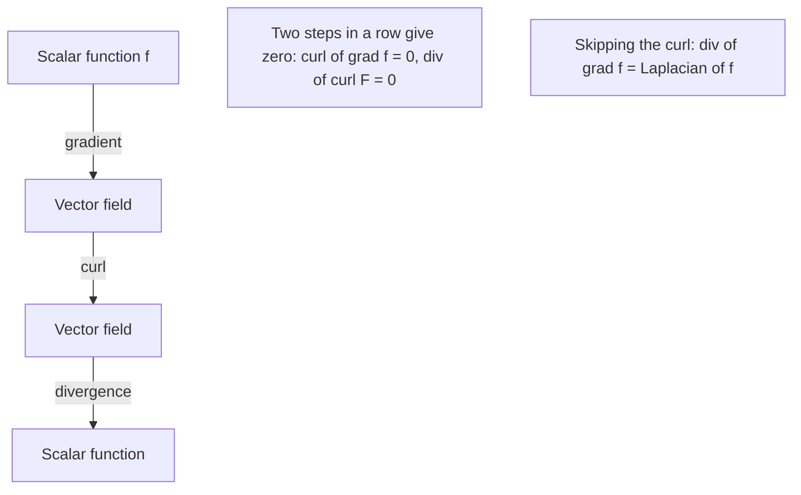

## Two derivatives of a vector field

A scalar function has one natural derivative, the gradient. A vector field has two
important ones. The **curl** measures how much the field swirls around a point, and the
**divergence** measures how much it spreads out from (or converges into) a point. They are the
local quantities that appear inside the big theorems: Stokes' theorem adds up curl over a
surface, and the Divergence theorem adds up divergence through a solid.

## The del operator

Write the vector differential operator

$$\nabla = \left\langle\frac{\partial}{\partial x},\, \frac{\partial}{\partial y},\, \frac{\partial}{\partial z}\right\rangle.$$

Applied to a scalar $f$ it gives the gradient $\nabla f$. Dotting or crossing it with a vector
field $\mathbf F = \langle P, Q, R\rangle$ gives the other two derivatives, by formally
applying the dot and cross product rules.

## Curl

$$\operatorname{curl}\mathbf F = \nabla\times\mathbf F = \begin{vmatrix}\mathbf i & \mathbf j & \mathbf k\\ \dfrac{\partial}{\partial x} & \dfrac{\partial}{\partial y} & \dfrac{\partial}{\partial z}\\ P & Q & R\end{vmatrix} = \left\langle R_y - Q_z,\;\; P_z - R_x,\;\; Q_x - P_y\right\rangle.$$

Notice the $\mathbf k$ component, $Q_x - P_y$: it is exactly the integrand in Green's
theorem. Curl is a vector.

**Meaning.** If $\mathbf F$ is the velocity of a fluid, place a tiny paddle wheel at a point.
It spins fastest when its axle points along $\operatorname{curl}\mathbf F$, and the length
$|\operatorname{curl}\mathbf F|$ is twice the angular speed of that spin. A field with
$\operatorname{curl}\mathbf F = \mathbf 0$ everywhere is called **irrotational**.

The picture shows the paddle wheel in the swirling field of Example 2 below. The fluid turns counterclockwise as seen from above, so the wheel spins counterclockwise too, and by the right-hand rule the curl points straight up its axle.


### Example 1

Find the curl of $\mathbf F = \langle x^2y,\; yz,\; xz^2\rangle$.

1. $\mathbf i$: $R_y - Q_z = 0 - y = -y$.
2. $\mathbf j$: $P_z - R_x = 0 - z^2 = -z^2$.
3. $\mathbf k$: $Q_x - P_y = 0 - x^2 = -x^2$.

So $\operatorname{curl}\mathbf F = \langle -y,\, -z^2,\, -x^2\rangle$.

### Example 2: a rotating fluid

For $\mathbf F = \langle -y, x, 0\rangle$ (rotation about the $z$-axis with angular speed 1),
$\operatorname{curl}\mathbf F = \langle 0 - 0,\; 0 - 0,\; 1 - (-1)\rangle = \langle 0, 0, 2\rangle$:
pointing along the axis of rotation (by the right-hand rule), with length twice the angular
speed.

```plot
{"x": [-3, 3], "y": [-3, 3], "equal": true, "vectorField": {"u": "-y", "v": "x", "step": 0.75}, "caption": "⟨−y, x⟩ swirls: curl = ⟨0, 0, 2⟩, divergence 0"}
```

## Curl and conservative fields

Two facts link curl to Lesson 31.

1. **Gradients have zero curl:** $\operatorname{curl}(\nabla f) = \mathbf 0$ for any $f$ with
   continuous second partials. (Each component is a difference of mixed partials, like
   $f_{zy} - f_{yz}$, which vanish by Clairaut.)
2. Conversely, if $\mathbf F$ is defined on all of $\mathbb R^3$ (or any simply connected
   region) with continuous partials and $\operatorname{curl}\mathbf F = \mathbf 0$, then
   $\mathbf F$ is conservative.

So "$\operatorname{curl}\mathbf F = \mathbf 0$" is the three-dimensional test for being a
gradient field.

### Example 3

Is $\mathbf F = \langle yz,\; xz + 2y,\; xy\rangle$ conservative? If so, find a potential.

1. $\operatorname{curl}\mathbf F = \langle x - x,\; y - y,\; z - z\rangle = \mathbf 0$ on all of $\mathbb R^3$: conservative.
2. $f = \int yz\,dx = xyz + g(y, z)$; $f_y = xz + g_y = xz + 2y$ gives $g = y^2 + h(z)$; $f_z = xy + h'(z) = xy$ gives $h' = 0$.
3. $f(x, y, z) = xyz + y^2$.

## Divergence

$$\operatorname{div}\mathbf F = \nabla\cdot\mathbf F = \frac{\partial P}{\partial x} + \frac{\partial Q}{\partial y} + \frac{\partial R}{\partial z}.$$

Divergence is a scalar.

**Meaning.** If $\mathbf F$ is the velocity of a fluid (or gas), $\operatorname{div}\mathbf F$ at
a point is the net rate at which fluid flows *out of* a tiny box around the point, per unit
volume. Positive divergence means a **source** (the fluid expands or is being added),
negative means a **sink**, and $\operatorname{div}\mathbf F = 0$ means the field is
**incompressible**: as much flows in as out.

```plot
{"x": [-3, 3], "y": [-3, 3], "equal": true, "vectorField": {"u": "x", "v": "y", "step": 0.75}, "caption": "⟨x, y⟩ spreads out: divergence 2 everywhere (in 3D, ⟨x, y, z⟩ has divergence 3), curl 0"}
```

### Example 4

For $\mathbf F = \langle x^2y,\; yz,\; xz^2\rangle$ (Example 1):
$\operatorname{div}\mathbf F = 2xy + z + 2xz$. At $(1, 1, 1)$ it is 5, a source; at $(-1, 1, 1)$ it
is $-2 + 1 - 2 = -3$, a sink.

## Identities

- $\operatorname{div}(\operatorname{curl}\mathbf F) = 0$ for smooth $\mathbf F$ (again by Clairaut). So a field with nonzero divergence cannot be the curl of anything.
- $\operatorname{div}(\nabla f) = f_{xx} + f_{yy} + f_{zz} = \nabla^2f$, the **Laplacian** of $f$. Functions with $\nabla^2f = 0$ are **harmonic**; they describe steady-state temperatures and electrostatic potentials in empty space.

The three derivatives fit together in a chain, and taking two steps of the chain in a row always gives zero:



## Common mistakes

- Getting the curl component order wrong; write out the determinant every time until it is automatic.
- Treating divergence as a vector or curl as a scalar.
- Concluding a field is conservative from $\operatorname{div}\mathbf F = 0$; the test uses curl.
- Forgetting that a 2D field $\langle P, Q\rangle$ is treated as $\langle P, Q, 0\rangle$, so its curl is $\langle 0, 0, Q_x - P_y\rangle$.

## Key points

- $\operatorname{curl}\mathbf F = \nabla\times\mathbf F = \langle R_y - Q_z,\, P_z - R_x,\, Q_x - P_y\rangle$ (rotation).
- $\operatorname{div}\mathbf F = \nabla\cdot\mathbf F = P_x + Q_y + R_z$ (expansion).
- $\operatorname{curl}\nabla f = \mathbf 0$, $\operatorname{div}\operatorname{curl}\mathbf F = 0$, $\operatorname{div}\nabla f = \nabla^2 f$.
- On $\mathbb R^3$: $\operatorname{curl}\mathbf F = \mathbf 0$ ⇔ $\mathbf F$ conservative.
