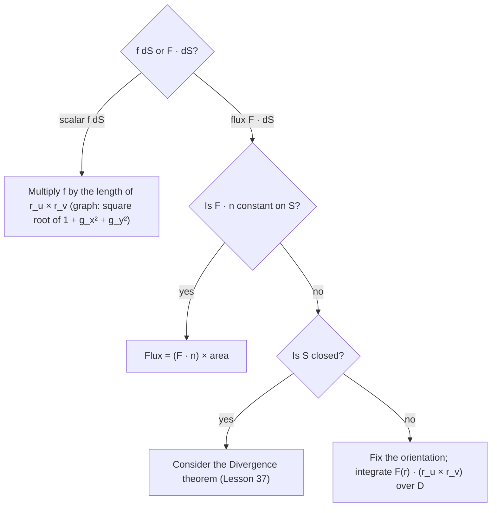

## From curves to surfaces

Line integrals come in two kinds: scalar ($\int_C f\,ds$) and vector ($\int_C\mathbf F\cdot d\mathbf r$).
Surface integrals do too. The scalar kind adds up a quantity spread over a surface (the mass of
a curved metal sheet, the total charge on a shell). The vector kind, called **flux**, measures
how much of a vector field passes *through* a surface: how much water flows through a net per
second, how much electric field pierces a closed surface. Flux is the quantity in Stokes'
theorem, the Divergence theorem, and Maxwell's equations.

## Scalar surface integrals

Let $S$ be given by $\mathbf r(u, v)$, $(u, v)\in D$. Chop $S$ into small patches of area
$\Delta S$, multiply by values of $f$, and add. Since $dS = |\mathbf r_u\times\mathbf r_v|\,du\,dv$
(Lesson 34):

$$\iint_S f(x, y, z)\,dS = \iint_D f(\mathbf r(u, v))\,|\mathbf r_u\times\mathbf r_v|\,dA.$$

With $f = 1$ this is the surface area. For a graph $z = g(x, y)$ over $D$:

$$\iint_S f\,dS = \iint_D f(x, y, g(x, y))\sqrt{1 + g_x^2 + g_y^2}\,dA.$$

### Example 1: a hemisphere

Evaluate $\iint_S z\,dS$ over the upper hemisphere $x^2 + y^2 + z^2 = a^2$, $z \ge 0$.

1. Use the sphere parametrization with $0 \le \phi \le \tfrac\pi2$; $z = a\cos\phi$ and $dS = a^2\sin\phi\,d\phi\,d\theta$.
2. $\displaystyle\int_0^{2\pi}\int_0^{\pi/2}a\cos\phi\cdot a^2\sin\phi\,d\phi\,d\theta = a^3\cdot2\pi\cdot\frac12 = \pi a^3.$

Dividing by the area $2\pi a^2$ gives the average height $\tfrac a2$ of the hemisphere's surface.

### Example 2: a slanted triangle

Evaluate $\iint_S x\,dS$, where $S$ is the part of the plane $z = 4 - 2x - 2y$ in the first octant.

1. $g_x = g_y = -2$, so $\sqrt{1 + 4 + 4} = 3$. The shadow $D$ is the triangle $x, y \ge 0$, $x + y \le 2$.
2. $\displaystyle\iint_S x\,dS = 3\iint_D x\,dA = 3\int_0^2 x(2 - x)\,dx = 3\left(4 - \frac83\right) = 4.$

## Orientation

To measure flow *through* a surface we must say which way counts as positive. A surface is
**orientable** if we can choose a unit normal $\mathbf n$ at every point that varies
continuously. (A Möbius strip is the famous non-orientable surface: travel once around it and
the normal comes back pointing the other way.) The choice is the surface's **orientation**.

- For a **closed surface** (the boundary of a solid, like a sphere), the standard orientation
  is the outward normal.
- For a graph $z = g(x, y)$, "upward" means a positive $z$-component.

For a parametric surface, $\mathbf r_u\times\mathbf r_v$ points to one side; if it points the
wrong way, use $\mathbf r_v\times\mathbf r_u$ instead.

## Flux

The **flux** of $\mathbf F$ across the oriented surface $S$ is

$$\iint_S\mathbf F\cdot d\mathbf S = \iint_S\mathbf F\cdot\mathbf n\,dS.$$

Only the normal component $\mathbf F\cdot\mathbf n$ counts: flow parallel to the surface does
not cross it. If $\mathbf F$ is the velocity of a fluid of density 1, the flux is the volume of
fluid crossing $S$ per unit time.

**Computing it.** With $\mathbf n = \dfrac{\mathbf r_u\times\mathbf r_v}{|\mathbf r_u\times\mathbf r_v|}$
and $dS = |\mathbf r_u\times\mathbf r_v|\,dA$, the lengths cancel:

$$\iint_S\mathbf F\cdot d\mathbf S = \iint_D\mathbf F(\mathbf r(u, v))\cdot(\mathbf r_u\times\mathbf r_v)\,dA.$$

For a graph $z = g(x, y)$ with upward orientation, $\mathbf r_x\times\mathbf r_y = \langle -g_x, -g_y, 1\rangle$, so with $\mathbf F = \langle P, Q, R\rangle$:

$$\iint_S\mathbf F\cdot d\mathbf S = \iint_D\left(-Pg_x - Qg_y + R\right)dA.$$

### Example 3: radial flow through a sphere

Find the outward flux of $\mathbf F = \langle x, y, z\rangle$ through the sphere of radius $a$.

On the sphere the outward unit normal is $\mathbf n = \tfrac1a\langle x, y, z\rangle$, so
$\mathbf F\cdot\mathbf n = \tfrac1a(x^2 + y^2 + z^2) = a$, constant. The flux is
$a\cdot\text{Area} = a\cdot4\pi a^2 = 4\pi a^3$. No parametrization needed when
$\mathbf F\cdot\mathbf n$ is constant on the surface.

### Example 4: through a paraboloid

Find the upward flux of $\mathbf F = \langle 0, 0, z\rangle$ through the paraboloid $z = 4 - x^2 - y^2$, $z \ge 0$.

1. $P = Q = 0$ and $R = z = 4 - x^2 - y^2$ on the surface, so the integrand is just $R$.
2. Over the disk $x^2 + y^2 \le 4$: $\displaystyle\int_0^{2\pi}\int_0^2(4 - r^2)\,r\,dr\,d\theta = 8\pi.$

### Example 5: a tilted field through a disk

Let $S$ be the disk $x^2 + y^2 \le 4$ in the plane $z = 0$, oriented upward, and
$\mathbf F = \langle 3, -1, 2\rangle$ (constant). Then $\mathbf n = \mathbf k$ and $\mathbf F\cdot\mathbf n = 2$,
so the flux is $2\cdot4\pi = 8\pi$. The horizontal parts of $\mathbf F$ slide along the disk and
contribute nothing.

```plot
{"x": [-3, 3], "y": [-1, 3], "equal": true, "segments": [{"from": [-2, 0], "to": [2, 0], "label": "disk S (edge view)"}, {"from": [-1, 0], "to": [0.5, 1], "arrow": true, "label": "F"}, {"from": [1, 0], "to": [1, 1], "arrow": true, "dashed": true, "label": "n"}, {"from": [-1, 0], "to": [-1, 1], "dashed": true}], "yLabel": "z", "caption": "Only the normal component of F carries flux through the surface"}
```

## Choosing a method

Before computing, decide which kind of integral you have and look for a shortcut:



## Common mistakes

- Leaving out $|\mathbf r_u\times\mathbf r_v|$ in a scalar surface integral (or including it in a flux integral, where it cancels).
- Using the wrong orientation; flux changes sign if the normal is reversed.
- Forgetting to substitute the surface equation into $\mathbf F$ (for a graph, replace $z$ by $g(x, y)$).
- Using $\langle g_x, g_y, -1\rangle$, which is the *downward* normal for a graph.

## Key points

- $\iint_S f\,dS = \iint_D f(\mathbf r)\,|\mathbf r_u\times\mathbf r_v|\,dA$; for a graph use $\sqrt{1 + g_x^2 + g_y^2}$.
- Flux: $\iint_S\mathbf F\cdot d\mathbf S = \iint_S\mathbf F\cdot\mathbf n\,dS = \iint_D\mathbf F(\mathbf r)\cdot(\mathbf r_u\times\mathbf r_v)\,dA$.
- Upward flux through $z = g(x, y)$: $\iint_D(-Pg_x - Qg_y + R)\,dA$.
- Closed surfaces are oriented outward by convention.
