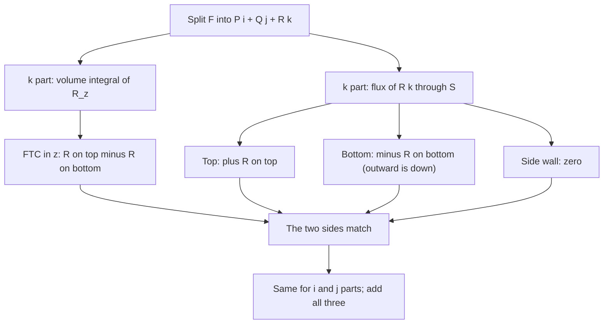

## From a sketch to a proof

Lessons 36 and 37 explained Stokes' theorem and the Divergence theorem by chopping a surface or solid into tiny pieces and letting the shared edges or faces cancel. That picture is the right intuition, but it is not a proof: "about equal on each tiny piece" has to be turned into "exactly equal", and that takes care. This lesson gives genuine proofs for the regions you meet in practice. Both proofs use only tools you already have: the Fundamental Theorem of Calculus, the flux formula for a graph from Lesson 35, Green's theorem, and the chain rule. Along the way you will see exactly where each hypothesis (closed surface, outward normal, continuous partial derivatives) is used, which is the best protection against misusing the theorems.

A little history. Lagrange used a version of the Divergence theorem in 1762 and Gauss used it in 1813; the Russian mathematician Mikhail Ostrogradsky gave the first general proof in 1826. Stokes' theorem first appeared in a letter from William Thomson (later Lord Kelvin) to George Stokes in 1850, and Stokes set it as a question on Cambridge's Smith's Prize examination in 1854, which is how it came to carry his name.

## Step 1: split the field into components

The Divergence theorem claims

$$\iint_S\mathbf F\cdot\mathbf n\,dS = \iiint_E\left(P_x + Q_y + R_z\right)dV$$

for $\mathbf F = \langle P, Q, R\rangle$. Both sides are linear in $\mathbf F$: write
$\mathbf F = P\,\mathbf i + Q\,\mathbf j + R\,\mathbf k$ and each side splits into three pieces. So it is
enough to prove three separate statements:

$$\iint_S P\,(\mathbf i\cdot\mathbf n)\,dS = \iiint_E P_x\,dV,\qquad \iint_S Q\,(\mathbf j\cdot\mathbf n)\,dS = \iiint_E Q_y\,dV,\qquad \iint_S R\,(\mathbf k\cdot\mathbf n)\,dS = \iiint_E R_z\,dV.$$

The three are proved the same way, so we prove the last one and the others follow by renaming the axes.

We assume $E$ is a **simple solid region**: it is a type 1 solid (Lesson 25), and also the matching type for the $x$- and $y$-directions. Balls, boxes, cylinders, cones and the solids between two paraboloids all qualify.

## Step 2: the $z$-part for a type 1 solid

Let $E = \{(x, y, z) : (x, y)\in D,\ u_1(x, y) \le z \le u_2(x, y)\}$.

**The volume side.** Integrate in $z$ first and use the Fundamental Theorem of Calculus:

$$\iiint_E R_z\,dV = \iint_D\left[\int_{u_1}^{u_2}\frac{\partial R}{\partial z}\,dz\right]dA = \iint_D\Big[R(x, y, u_2(x, y)) - R(x, y, u_1(x, y))\Big]dA.$$

**The surface side.** The boundary $S$ has up to three parts.

1. **Top $S_2$:** the graph $z = u_2(x, y)$. Outward is upward. By the upward-flux formula of Lesson 35 with $P = Q = 0$, $\iint_{S_2}R\,\mathbf k\cdot d\mathbf S = \iint_D R(x, y, u_2(x, y))\,dA$.
2. **Bottom $S_1$:** the graph $z = u_1(x, y)$. Outward is *downward*, so the sign flips: $\iint_{S_1}R\,\mathbf k\cdot d\mathbf S = -\iint_D R(x, y, u_1(x, y))\,dA$.
3. **Side $S_3$** (if there is one): a vertical wall above the boundary of $D$. Its normal is horizontal, so $\mathbf k\cdot\mathbf n = 0$ and it contributes nothing.

Adding the three parts gives exactly the volume side. ∎

Notice where the hypotheses were used. The FTC step needs $R_z$ continuous. The minus sign on the bottom comes from the *outward* orientation; with an inward normal the two sides would differ by a sign. And all of $S$ was needed: leave out the bottom, and the $-R(x, y, u_1)$ term has nowhere to come from.

### Example 1: watching the proof work

Let $E$ be the solid between the paraboloid $z = x^2 + y^2$ (bottom) and the plane $z = 4$ (top), and $\mathbf F = \langle 0, 0, z^2\rangle$. Check each line of the proof.

1. The shadow $D$ is where the surfaces meet: $x^2 + y^2 = 4$, the disk of radius 2.
2. Volume side: $R_z = 2z$, and integrating in $z$ first gives $\iint_D(16 - r^4)\,dA = \int_0^{2\pi}\int_0^2(16 - r^4)\,r\,dr\,d\theta = 2\pi\left(32 - \tfrac{32}{3}\right) = \tfrac{128\pi}{3}$.
3. Top ($z = 4$, normal up): $\iint_D 16\,dA = 16\cdot4\pi = 64\pi$.
4. Bottom ($z = r^2$, normal down): $-\iint_D(r^2)^2\,dA = -2\pi\cdot\tfrac{64}{6} = -\tfrac{64\pi}{3}$.
5. There is no side wall. Total flux: $64\pi - \tfrac{64\pi}{3} = \tfrac{128\pi}{3}$. ✓

The bottom term is negative even though $R = z^2 \ge 0$ everywhere: the field points up, and the outward normal on the bottom points down, so flux enters through the bottom.

## Step 3: Stokes' theorem for a graph

Now let $S$ be the graph $z = g(x, y)$ over a region $D$ to which Green's theorem applies, oriented upward, where $g$ has continuous second partial derivatives. The boundary $C$ of $S$ sits directly above the boundary $C_1$ of $D$; with the right-hand rule and upward normals, $C$ projects onto $C_1$ traversed counterclockwise.

**Push the line integral down to the plane.** Parametrize $C_1$ by $x(t)$, $y(t)$. Then $C$ is $\big(x(t), y(t), g(x(t), y(t))\big)$, and by the chain rule $dz = g_x\,dx + g_y\,dy$. Substituting,

$$\oint_C P\,dx + Q\,dy + R\,dz = \oint_{C_1}\big(P + Rg_x\big)\,dx + \big(Q + Rg_y\big)\,dy,$$

where $P$, $Q$, $R$ are evaluated at $(x, y, g(x, y))$. This is an ordinary line integral in the plane.

**Apply Green's theorem**, differentiating with the chain rule (every $z$ inside $P$, $Q$, $R$ is really $g(x, y)$):

$$\frac{\partial}{\partial x}\big(Q + Rg_y\big) = Q_x + Q_zg_x + (R_x + R_zg_x)g_y + Rg_{yx},$$
$$\frac{\partial}{\partial y}\big(P + Rg_x\big) = P_y + P_zg_y + (R_y + R_zg_y)g_x + Rg_{xy}.$$

Subtract. The $R_zg_xg_y$ terms cancel, and $Rg_{yx} - Rg_{xy} = 0$ by Clairaut's theorem (this is where continuous second partials of $g$ are needed). What remains is

$$(Q_x - P_y) - g_x(R_y - Q_z) - g_y(P_z - R_x).$$

**Compare with the flux of the curl.** With $\operatorname{curl}\mathbf F = \langle R_y - Q_z,\; P_z - R_x,\; Q_x - P_y\rangle$, the upward-flux integrand $-(\text{first})g_x - (\text{second})g_y + (\text{third})$ is exactly the same expression. So

$$\oint_C\mathbf F\cdot d\mathbf r = \iint_D\Big[(Q_x - P_y) - g_x(R_y - Q_z) - g_y(P_z - R_x)\Big]dA = \iint_S\operatorname{curl}\mathbf F\cdot d\mathbf S.\ ∎$$

A surface that is not a single graph can usually be cut into pieces that are graphs (over the $xy$-, $yz$- or $xz$-plane). The theorem holds on each piece, and the line integrals along the cuts cancel because neighboring pieces traverse them in opposite directions.

### Example 2: the proof's reduction in action

Let $S$ be the part of the plane $z = x + 2y$ above the unit disk, oriented upward, and $\mathbf F = \langle y,\; z,\; x\rangle$. Compute the circulation around the boundary three ways.

1. **Reduce to the plane.** On $S$: $P = y$, $Q = z = x + 2y$, $R = x$, with $g_x = 1$ and $g_y = 2$. The new components are $P + Rg_x = y + x$ and $Q + Rg_y = x + 2y + 2x = 3x + 2y$. Green's integrand: $\partial_x(3x + 2y) - \partial_y(x + y) = 3 - 1 = 2$. So the circulation is $2\cdot\pi = 2\pi$.
2. **Flux of the curl.** $\operatorname{curl}\mathbf F = \langle 0 - 1,\; 0 - 1,\; 0 - 1\rangle = \langle -1, -1, -1\rangle$. Upward integrand: $-(-1)(1) - (-1)(2) + (-1) = 2$. Again $2\pi$.
3. **Directly.** $\mathbf r(t) = \langle\cos t,\; \sin t,\; \cos t + 2\sin t\rangle$, and $\mathbf F\cdot\mathbf r' = -\sin^2t + 3\cos^2t + \sin t\cos t$. Over $[0, 2\pi]$ this integrates to $-\pi + 3\pi + 0 = 2\pi$. ✓

## Divergence without coordinates

Lesson 33 defined divergence by a formula in $x$, $y$, $z$ and then *claimed* it measures outflow per unit volume. The Divergence theorem proves the claim. Let $B_\epsilon$ be a small ball of radius $\epsilon$ centered at a point $P_0$, with volume $V_\epsilon$. Since $\operatorname{div}\mathbf F$ is continuous, its average over $B_\epsilon$ tends to its value at the center as $\epsilon\to0$, so

$$\operatorname{div}\mathbf F(P_0) = \lim_{\epsilon\to0}\frac{1}{V_\epsilon}\iiint_{B_\epsilon}\operatorname{div}\mathbf F\,dV = \lim_{\epsilon\to0}\frac{1}{V_\epsilon}\iint_{\partial B_\epsilon}\mathbf F\cdot\mathbf n\,dS.$$

The right side mentions no coordinates at all: just a field, a tiny surface and its outward normal. So divergence does not depend on how the axes are placed. In the same way, Lesson 36's limit formula makes curl coordinate-free. This is why physicists may compute $\operatorname{div}$ and $\operatorname{curl}$ in whichever coordinates suit the problem.

### Example 3: a shrinking cube

Find the outward flux of $\mathbf F = \langle x^3, 0, 0\rangle$ out of a cube of side $h$ centered at $(x_0, y_0, z_0)$, divide by the volume, and let $h\to0$.

1. Only the two faces perpendicular to the $x$-axis matter (on the other four, $\mathbf F\cdot\mathbf n = 0$). Each has area $h^2$.
2. Right face, $x = x_0 + \tfrac h2$, normal $\mathbf i$: flux $(x_0 + \tfrac h2)^3h^2$. Left face, normal $-\mathbf i$: flux $-(x_0 - \tfrac h2)^3h^2$.
3. Expanding, $(x_0 + \tfrac h2)^3 - (x_0 - \tfrac h2)^3 = 3x_0^2h + \tfrac{h^3}{4}$, so the flux is $3x_0^2h^3 + \tfrac{h^5}{4}$.
4. Divide by $h^3$: $3x_0^2 + \tfrac{h^2}{4}\to 3x_0^2$, which is $\operatorname{div}\mathbf F = 3x^2$ at the center. ✓

The $\tfrac{h^2}{4}$ is the error of the "tiny box" approximation. It vanishes in the limit, which is exactly what the tiny-pieces sketch assumed without proof.

## What the proofs do not cover

The proofs above are complete for simple solid regions and for surfaces that can be cut into graphs, which includes every example in this course. Fully general versions (for very irregular boundaries, or fields that are less smooth) need more advanced analysis; we are stating that, not proving it. In advanced courses, the FTC, Green, Stokes and Divergence theorems all become one statement, the **generalized Stokes theorem**, written $\int_{\partial M}\omega = \int_M d\omega$ in the language of differential forms. That is the "integral of a derivative equals the boundary term" pattern from Lesson 37, made exact in every dimension.

## Common mistakes

- Applying the Divergence theorem to $\mathbf x/|\mathbf x|^3$ on a ball around the origin. The proof's FTC step needs continuous partial derivatives throughout $E$; here they blow up at the origin, so the theorem does not apply (and indeed the flux is $4\pi$ while the divergence is 0 wherever it is defined).
- Forgetting the side wall or bottom of a type 1 solid when checking the theorem by hand. Each piece of the closed surface must be included, with its own outward normal.
- Dropping the $Rg_x$ and $Rg_y$ terms when pushing a line integral down to the plane: on a tilted curve $dz$ is not zero.
- Thinking the "tiny boxes" sketch is a proof. It is the idea; the proof needs the FTC (or a limit argument with error terms like the $\tfrac{h^2}{4}$ above).

## Key points

- Divergence theorem: split $\mathbf F$ into components; for the $\mathbf k$ part, the FTC in $z$ gives $R(\text{top}) - R(\text{bottom})$, matching the top flux, the bottom flux (outward is down) and a zero side.
- Stokes for a graph $z = g(x, y)$: substitute $dz = g_x\,dx + g_y\,dy$, apply Green's theorem, and the chain rule plus Clairaut turn the integrand into $\operatorname{curl}\mathbf F\cdot\langle -g_x, -g_y, 1\rangle$.
- Hypotheses matter: outward orientation gives the minus sign on the bottom; continuous partials are needed for the FTC and Clairaut steps.
- $\operatorname{div}\mathbf F(P_0) = \lim\frac{1}{V}\iint\mathbf F\cdot\mathbf n\,dS$: divergence is coordinate-free.
- All the big theorems are cases of the generalized Stokes theorem $\int_{\partial M}\omega = \int_M d\omega$.
