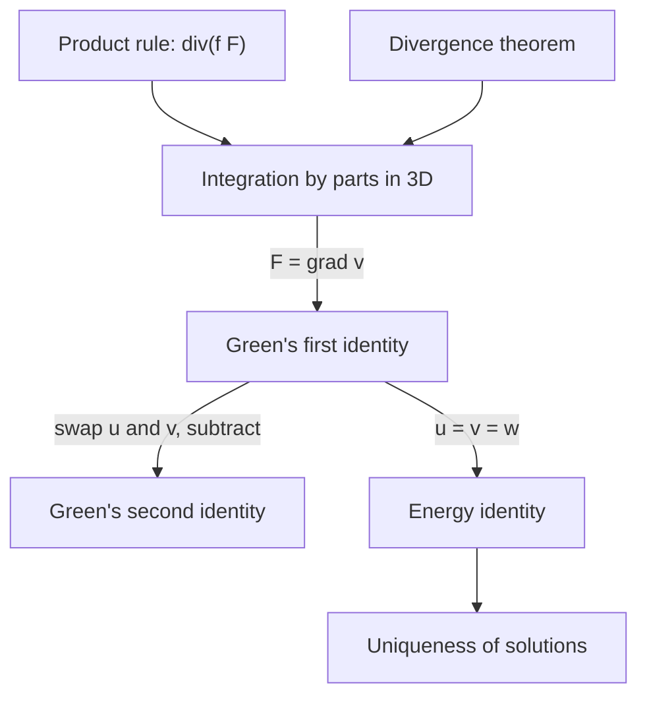

## Integration by parts, in space

In single-variable calculus, integration by parts is the product rule run through the Fundamental Theorem of Calculus: $\int_a^b fg'\,dx = \big[fg\big]_a^b - \int_a^b f'g\,dx$. Lesson 37 showed that the Divergence theorem is the three-dimensional FTC. So if we had a product rule for divergence, we could integrate by parts over solids. This lesson builds the product rules for $\nabla$, uses them to derive **Green's first identity** and **Green's second identity** (by George Green, the same Green as Green's theorem), and then uses those identities to answer a question that matters for every physical model: when does a boundary-value problem have only one solution? The functions here are the harmonic functions of Lesson 33 and the steady-state temperatures of Lesson 38.

Throughout, $f$, $g$, $u$, $v$ are scalar functions and $\mathbf F$, $\mathbf G$ vector fields, all with continuous second partial derivatives.

## Product rules for $\nabla$

Each rule follows from the ordinary product rule applied to each partial derivative.

| Rule | Formula |
|---|---|
| Gradient of a product | $\nabla(fg) = f\nabla g + g\nabla f$ |
| Divergence of $f\mathbf F$ | $\nabla\cdot(f\mathbf F) = \nabla f\cdot\mathbf F + f\,\nabla\cdot\mathbf F$ |
| Curl of $f\mathbf F$ | $\nabla\times(f\mathbf F) = \nabla f\times\mathbf F + f\,\nabla\times\mathbf F$ |
| Divergence of a cross product | $\nabla\cdot(\mathbf F\times\mathbf G) = \mathbf G\cdot(\nabla\times\mathbf F) - \mathbf F\cdot(\nabla\times\mathbf G)$ |
| Curl of a curl | $\nabla\times(\nabla\times\mathbf F) = \nabla(\nabla\cdot\mathbf F) - \nabla^2\mathbf F$ |

In the last row, $\nabla^2\mathbf F$ means the Laplacian of each component: $\langle\nabla^2P, \nabla^2Q, \nabla^2R\rangle$.

*Proof of the second rule.* With $\mathbf F = \langle P, Q, R\rangle$,

$$\nabla\cdot(f\mathbf F) = (fP)_x + (fQ)_y + (fR)_z = \big(f_xP + f_yQ + f_zR\big) + f\big(P_x + Q_y + R_z\big) = \nabla f\cdot\mathbf F + f\,\nabla\cdot\mathbf F.$$

The others are proved the same way, component by component. A good check on any of them is that every term has the same "type": in the fourth rule, both terms on the right are scalars, like the left side. Watch the minus sign there, which comes from $\mathbf F\times\mathbf G = -\mathbf G\times\mathbf F$.

### Example 1: two routes to one divergence

Find $\nabla\cdot(f\mathbf F)$ for $f = xyz$ and $\mathbf F = \langle x, y, z\rangle$.

1. **Product rule.** $\nabla f = \langle yz, xz, xy\rangle$, so $\nabla f\cdot\mathbf F = xyz + xyz + xyz = 3xyz$; and $\nabla\cdot\mathbf F = 3$, so $f\,\nabla\cdot\mathbf F = 3xyz$. Total $6xyz$.
2. **Directly.** $f\mathbf F = \langle x^2yz,\; xy^2z,\; xyz^2\rangle$, with divergence $2xyz + 2xyz + 2xyz = 6xyz$. ✓

### Example 2: the inverse-square field has zero divergence

Lesson 37 claimed $\nabla\cdot\left(\dfrac{\mathbf x}{|\mathbf x|^3}\right) = 0$ away from the origin. Write $r = |\mathbf x|$ and the field as $f\mathbf x$ with $f = r^{-3}$.

1. $\nabla r = \dfrac{\mathbf x}{r}$ (the gradient of distance is the outward unit vector), so by the chain rule $\nabla(r^{-3}) = -3r^{-4}\cdot\dfrac{\mathbf x}{r} = -3r^{-5}\mathbf x$.
2. $\nabla f\cdot\mathbf x = -3r^{-5}(\mathbf x\cdot\mathbf x) = -3r^{-5}r^2 = -3r^{-3}$, and $f\,\nabla\cdot\mathbf x = 3r^{-3}$.
3. The sum is $0$ for every $r \ne 0$. No messy quotient-rule algebra needed.

## Integration by parts in three dimensions

Apply the Divergence theorem to $f\mathbf F$ over a solid $E$ with outward-oriented boundary $S$, and expand with the product rule:

$$\iiint_E f\,\nabla\cdot\mathbf F\,dV = \iint_S f\,\mathbf F\cdot\mathbf n\,dS - \iiint_E\nabla f\cdot\mathbf F\,dV.$$

Compare $\int_a^b fg'\,dx = \big[fg\big]_a^b - \int_a^b f'g\,dx$: the derivative moves from one factor to the other, at the cost of a sign and a boundary term.

## Green's identities

Take $\mathbf F = \nabla v$, so $\nabla\cdot\mathbf F = \nabla^2v$. The quantity $\nabla v\cdot\mathbf n$ that appears on the boundary is the **normal derivative** $\dfrac{\partial v}{\partial n}$: the directional derivative of $v$ in the outward normal direction (Lesson 16). Rearranging gives

**Green's first identity:**
$$\iiint_E\left(u\,\nabla^2v + \nabla u\cdot\nabla v\right)dV = \iint_S u\,\frac{\partial v}{\partial n}\,dS.$$

Now write the same identity with $u$ and $v$ swapped and subtract. The $\nabla u\cdot\nabla v$ terms cancel:

**Green's second identity:**
$$\iiint_E\left(u\,\nabla^2v - v\,\nabla^2u\right)dV = \iint_S\left(u\,\frac{\partial v}{\partial n} - v\,\frac{\partial u}{\partial n}\right)dS.$$

### Example 3: checking the first identity

Check Green's first identity for $u = v = z$ on the unit ball.

1. $\nabla^2v = 0$ and $\nabla u\cdot\nabla v = \mathbf k\cdot\mathbf k = 1$, so the left side is the volume, $\tfrac43\pi$.
2. On the unit sphere $\mathbf n = \langle x, y, z\rangle$, so $\dfrac{\partial v}{\partial n} = \mathbf k\cdot\mathbf n = z$ and the integrand is $u\,\dfrac{\partial v}{\partial n} = z^2$.
3. With $z = \cos\phi$ and $dS = \sin\phi\,d\phi\,d\theta$: $\displaystyle\int_0^{2\pi}\int_0^\pi\cos^2\phi\,\sin\phi\,d\phi\,d\theta = 2\pi\cdot\frac23 = \frac{4\pi}{3}.$ ✓

(By symmetry $\iint x^2\,dS = \iint y^2\,dS = \iint z^2\,dS$, and the three add to $\iint 1\,dS = 4\pi$, which gives $\tfrac{4\pi}{3}$ with no integration at all.)

## Boundary-value problems and uniqueness

Steady-state temperatures, electrostatic potentials and the hydraulic head in steady groundwater flow all satisfy **Poisson's equation** $\nabla^2u = f$ inside a region, where $f$ is set by the sources (heat produced, charge present). With no sources it is **Laplace's equation** $\nabla^2u = 0$, whose solutions are the harmonic functions. To pin down a solution we also need information on the boundary $S$:

- the **Dirichlet problem** prescribes the values $u = h$ on $S$ (a fixed temperature on the surface);
- the **Neumann problem** prescribes the normal derivative $\dfrac{\partial u}{\partial n} = h$ on $S$ (a fixed heat flow through the surface).

**Uniqueness theorem.** Let $E$ be a solid region of the kind the Divergence theorem covers, all in one piece. The Dirichlet problem has at most one solution, and two solutions of the Neumann problem differ by a constant.

*Proof.* Suppose $u_1$ and $u_2$ both solve the problem, and let $w = u_1 - u_2$. Subtracting, $\nabla^2w = 0$ in $E$, and on $S$ either $w = 0$ (Dirichlet) or $\dfrac{\partial w}{\partial n} = 0$ (Neumann). Green's first identity with $u = v = w$ gives the **energy identity**

$$\iiint_E|\nabla w|^2\,dV = \iint_S w\,\frac{\partial w}{\partial n}\,dS - \iiint_E w\,\nabla^2w\,dV.$$

In both cases the right side is $0$. The integrand $|\nabla w|^2$ is continuous and never negative, so a zero integral forces $\nabla w = \mathbf 0$ everywhere: $w$ is constant on the connected region $E$. For Dirichlet, $w = 0$ on $S$, so the constant is 0 and $u_1 = u_2$. ∎

This is why physicists can solve such problems by any method at all, guessing included: once a function satisfies the equation and the boundary condition, it is *the* answer.

**A condition for Neumann problems.** In the first identity put the constant function 1 in place of $u$, and $u$ in place of $v$: $\iiint_E\nabla^2u\,dV = \iint_S\dfrac{\partial u}{\partial n}\,dS$. So the Neumann problem $\nabla^2u = f$, $\dfrac{\partial u}{\partial n} = h$ can only have a solution if

$$\iint_S h\,dS = \iiint_E f\,dV.$$

Physically: in a steady state, the net heat flow through the surface must balance the total source inside. For a harmonic function ($f = 0$) the flux of $\nabla u$ through every closed surface is zero.

### Example 4: a heated ball in steady state

A ball of radius 1 has a temperature $T$ with $\nabla^2T = -2$ inside (a uniform heat source; heat flux is $-k\nabla T$, Lesson 38). On the surface, $\dfrac{\partial T}{\partial n} = c$, a constant. For which $c$ can a steady state exist, and what is it?

1. Compatibility: $\iint_S c\,dS = \iiint_E(-2)\,dV$, so $4\pi c = -\tfrac{8\pi}{3}$ and $c = -\tfrac23$. The negative sign means $T$ decreases outward: heat leaves through the surface at exactly the rate it is produced.
2. Guess a radial solution $T = Ar^2 = A(x^2 + y^2 + z^2)$: $\nabla^2T = 6A = -2$ gives $A = -\tfrac13$.
3. Check the boundary: $\dfrac{\partial T}{\partial n} = \nabla T\cdot\mathbf n = -\tfrac23\langle x, y, z\rangle\cdot\langle x, y, z\rangle = -\tfrac23$ on the unit sphere. ✓
4. By the uniqueness theorem, every steady state is $T = -\tfrac13r^2 + C$; the constant is fixed only by knowing the temperature somewhere.

## One more fact about harmonic functions

Green's second identity, applied with $v = 1/r$ on a ball with a tiny ball removed around its center, leads to the **mean value property**: the value of a harmonic function at the center of a sphere equals its average over that sphere. We state it without the proof, which takes more space than we have. One consequence: a harmonic function cannot have a strict maximum inside its region (the center value would exceed every value around it), so a steady-state temperature with no heat sources is hottest somewhere on the boundary.

## Common mistakes

- Writing $\nabla\cdot(\mathbf F\times\mathbf G) = \mathbf G\cdot(\nabla\times\mathbf F) + \mathbf F\cdot(\nabla\times\mathbf G)$. The second term has a minus sign.
- Treating $\dfrac{\partial v}{\partial n}$ as a partial derivative in some coordinate $n$. It is $\nabla v\cdot\mathbf n$, with $\mathbf n$ the *outward* unit normal, so it changes from point to point on $S$.
- Losing the boundary term when integrating by parts. In 3D it is a surface integral, $\iint_S f\,\mathbf F\cdot\mathbf n\,dS$.
- Expecting a Neumann problem to have a unique solution. Adding a constant to a solution gives another one; and if the compatibility condition fails, there is no solution at all.
- Using the uniqueness proof on a region in several pieces: $\nabla w = \mathbf 0$ then only makes $w$ constant on each piece.

## Key points

- Product rules: $\nabla\cdot(f\mathbf F) = \nabla f\cdot\mathbf F + f\,\nabla\cdot\mathbf F$, $\nabla\times(f\mathbf F) = \nabla f\times\mathbf F + f\,\nabla\times\mathbf F$, $\nabla\cdot(\mathbf F\times\mathbf G) = \mathbf G\cdot\nabla\times\mathbf F - \mathbf F\cdot\nabla\times\mathbf G$.
- Product rule plus Divergence theorem gives integration by parts: $\iiint f\,\nabla\cdot\mathbf F = \iint f\,\mathbf F\cdot\mathbf n - \iiint\nabla f\cdot\mathbf F$.
- Green's first identity: $\iiint(u\nabla^2v + \nabla u\cdot\nabla v)\,dV = \iint u\,\partial_nv\,dS$. Second: $\iiint(u\nabla^2v - v\nabla^2u)\,dV = \iint(u\,\partial_nv - v\,\partial_nu)\,dS$.
- Dirichlet problems have at most one solution; Neumann solutions are unique up to a constant and need $\iint h\,dS = \iiint f\,dV$.
- Harmonic functions: zero flux of $\nabla u$ through closed surfaces, and the mean value property.
