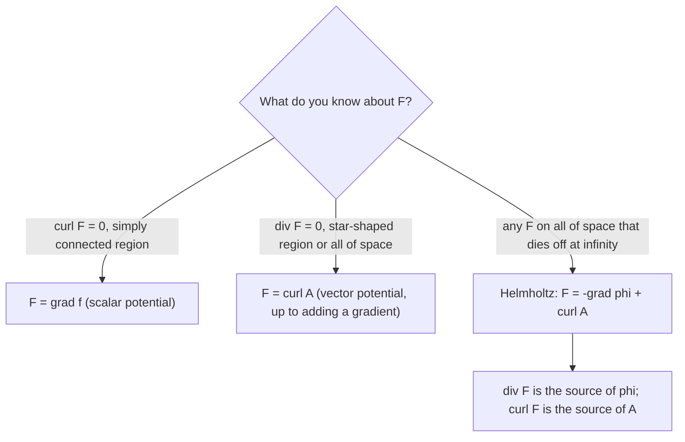

## Two zeros, two questions

Lesson 33 ended with a chain: gradient, then curl, then divergence, where two steps in a row always give zero.

$$\nabla\times(\nabla f) = \mathbf 0, \qquad \nabla\cdot(\nabla\times\mathbf A) = 0.$$

Both come from Clairaut's theorem. For the second, with $\mathbf A = \langle A_1, A_2, A_3\rangle$ having continuous second partials,

$$\nabla\cdot(\nabla\times\mathbf A) = (A_{3,y} - A_{2,z})_x + (A_{1,z} - A_{3,x})_y + (A_{2,x} - A_{1,y})_z = 0,$$

because the six mixed partials cancel in pairs ($A_{3,yx} = A_{3,xy}$ and so on). Here a subscript after the comma means a partial derivative: $A_{3,y} = \partial A_3/\partial y$.

Each identity gives a necessary condition. A field can only be a gradient if its curl is zero, and it can only be a curl if its divergence is zero. Lessons 31 and 33 answered the converse question for the first condition: on a simply connected region, curl-free fields are gradients, and the function $f$ with $\mathbf F = \nabla f$ is a **scalar potential**. This lesson answers the converse for the second condition. A field $\mathbf A$ with $\nabla\times\mathbf A = \mathbf F$ is a **vector potential** for $\mathbf F$, and a field with zero divergence is called **solenoidal**. We will see when a solenoidal field has a vector potential, how to build one, how far it is from unique, and finally Helmholtz's theorem: a field that dies off at infinity splits into a gradient plus a curl.

## Topology matters

Both converses can fail, and the way they fail is different.

**A curl-free field that is not a gradient.** The vortex field $\mathbf V = \dfrac{\langle -y, x, 0\rangle}{x^2 + y^2}$ on space minus the $z$-axis has curl $\mathbf 0$, but its circulation around a loop $C$ circling the axis is $2\pi$ (Lesson 31 and the winding-number honors lesson of Module 7). A gradient would give 0. The trouble is the loop: it cannot be shrunk to a point without crossing the missing line.

**A solenoidal field that is not a curl.** The inverse-square field $\mathbf E = \dfrac{\mathbf x}{|\mathbf x|^3}$ on space minus the origin has divergence 0 (Lesson 37), and its flux through the unit sphere $S$ is $4\pi$. But Lesson 36 showed that the flux of a curl through any closed surface is 0. So there is no $\mathbf A$ with $\nabla\times\mathbf A = \mathbf E$ on any region containing $S$. Here the obstruction is a closed *surface* that cannot be shrunk to a point without crossing the missing point.


The two kinds of hole are independent of each other, as the table shows.

| Region | Curl-free ⇒ gradient? | Solenoidal ⇒ curl? |
|---|---|---|
| All of $\mathbb R^3$, a ball, a box | yes | yes |
| Space minus a line | no ($\mathbf V$ above) | yes |
| Space minus a point | yes | no ($\mathbf E$ above) |

Space minus a point is simply connected (a loop can slide off the missing point), and $\mathbf E = \nabla(-1/|\mathbf x|)$ is a gradient there. On space minus the $z$-axis, $\mathbf V$ turns out to be a curl: Example 4 below finds a vector potential for it.

**The positive result** (the **Poincaré lemma** for solenoidal fields). If $\mathbf F$ has continuous partial derivatives and $\nabla\cdot\mathbf F = 0$ on all of $\mathbb R^3$, or on a box, a ball, or more generally a **star-shaped** region (one containing a point that can be joined to every other point of the region by a straight segment lying in the region), then $\mathbf F = \nabla\times\mathbf A$ for some $\mathbf A$ there. The exact condition for every solenoidal field on a region to be a curl ("every closed surface in the region bounds a solid inside the region") needs algebraic topology to state carefully, so this lesson sticks to star-shaped regions and all of space. That is a simplification, not the full theorem.

## Building a vector potential

### Method 1: solve the component equations

We want $\nabla\times\mathbf A = \langle P, Q, R\rangle$, that is,

$$A_{3,y} - A_{2,z} = P, \qquad A_{1,z} - A_{3,x} = Q, \qquad A_{2,x} - A_{1,y} = R.$$

That is three equations for three unknown functions, and there are many solutions, so we are free to impose one extra condition. Choose $A_3 = 0$. The first two equations become $A_{2,z} = -P$ and $A_{1,z} = Q$, which we integrate in $z$ starting from $z = 0$:

$$A_2 = -\int_0^z P(x, y, t)\,dt, \qquad A_1 = \int_0^z Q(x, y, t)\,dt + g(x, y),$$

where $g$ is a "constant" of integration (any function not depending on $z$). Now the third equation. Differentiating under the integral sign,

$$A_{2,x} - A_{1,y} = -\int_0^z\big(P_x + Q_y\big)(x, y, t)\,dt - g_y = \int_0^z R_z(x, y, t)\,dt - g_y = R(x, y, z) - R(x, y, 0) - g_y.$$

The middle step is exactly where $\nabla\cdot\mathbf F = 0$ is used: $-(P_x + Q_y) = R_z$. To finish we need $g_y = -R(x, y, 0)$, so take $g = -\displaystyle\int_0^y R(x, s, 0)\,ds$. The result:

$$\boxed{A_1 = \int_0^z Q(x, y, t)\,dt - \int_0^y R(x, s, 0)\,ds,\qquad A_2 = -\int_0^z P(x, y, t)\,dt,\qquad A_3 = 0.}$$

This works on all of $\mathbb R^3$ (and on any box containing the origin, since every segment the integrals run along stays in the box). So the construction itself proves the converse on those regions.

### Example 1: a polynomial field

Find a vector potential for $\mathbf F = \langle y^2, z^2, x^2\rangle$.

1. Check: $\nabla\cdot\mathbf F = 0 + 0 + 0 = 0$, on all of $\mathbb R^3$. A vector potential exists.
2. $A_2 = -\int_0^z y^2\,dt = -y^2z$.
3. $A_1 = \int_0^z t^2\,dt - \int_0^y x^2\,ds = \dfrac{z^3}{3} - x^2y$ (here $R(x, s, 0) = x^2$).
4. So $\mathbf A = \left\langle \dfrac{z^3}{3} - x^2y,\; -y^2z,\; 0\right\rangle$.
5. Check: $\nabla\times\mathbf A = \langle 0 - (-y^2),\; z^2 - 0,\; 0 - (-x^2)\rangle = \langle y^2, z^2, x^2\rangle$. ✓

### Method 2: an integral formula

On a region that is star-shaped about the origin there is also a one-line formula:

$$\mathbf A(\mathbf x) = \int_0^1 t\,\mathbf F(t\mathbf x)\times\mathbf x\;dt.$$

It integrates $\mathbf F$ along the segment from $\mathbf 0$ to $\mathbf x$, which is why the segment must stay in the region. (Proving that its curl is $\mathbf F$ takes a page of product rules and the condition $\nabla\cdot\mathbf F = 0$; we state it without proof.) Because of the cross product with $\mathbf x$, this $\mathbf A$ is always perpendicular to $\mathbf x$.

### Example 2: a uniform field, two ways

Let $\mathbf B = \langle 0, 0, 1\rangle$, a uniform field pointing up.

1. **Method 1.** $P = Q = 0$ and $R = 1$, so $A_2 = 0$ and $A_1 = -\int_0^y 1\,ds = -y$: $\mathbf A = \langle -y, 0, 0\rangle$. Check: $\nabla\times\mathbf A = \langle 0, 0, 0 - (-1)\rangle = \langle 0, 0, 1\rangle$. ✓
2. **Method 2.** $\mathbf B(t\mathbf x) = \mathbf B$, and $\int_0^1 t\,dt = \tfrac12$, so $\mathbf A' = \tfrac12\mathbf B\times\mathbf x = \tfrac12\langle -y, x, 0\rangle$. Its curl is $\tfrac12\langle 0, 0, 2\rangle = \langle 0, 0, 1\rangle$. ✓

In general, for any constant vector $\mathbf B$, $\tfrac12\mathbf B\times\mathbf x$ is a vector potential for $\mathbf B$. The two answers look nothing alike:

```plot
{"x": [-3, 3], "y": [-3, 3], "equal": true, "vectorField": {"u": "-y/2", "v": "x/2", "step": 0.75}, "caption": "A′ = ½⟨−y, x, 0⟩ seen from above: a swirl. Its curl is ⟨0, 0, 1⟩."}
```

```plot
{"x": [-3, 3], "y": [-3, 3], "equal": true, "vectorField": {"u": "-y", "v": "0", "step": 0.75}, "caption": "A = ⟨−y, 0, 0⟩ seen from above: a shear. Its curl is also ⟨0, 0, 1⟩."}
```

Both have the same circulation around every loop (Stokes: it equals the flux of $\mathbf B$ through the loop), even though the arrows differ. Their difference is $\mathbf A' - \mathbf A = \left\langle \tfrac y2, \tfrac x2, 0\right\rangle = \nabla\!\left(\tfrac{xy}{2}\right)$, a gradient. That is no accident.

## Gauge freedom

If $\nabla\times\mathbf A = \mathbf F$, then for any function $\chi$ with continuous second partials,

$$\nabla\times(\mathbf A + \nabla\chi) = \nabla\times\mathbf A + \nabla\times\nabla\chi = \mathbf F.$$

Replacing $\mathbf A$ by $\mathbf A + \nabla\chi$ is called a **gauge transformation**. Conversely, if $\mathbf A$ and $\mathbf A'$ are two vector potentials for $\mathbf F$ on a simply connected region, then $\nabla\times(\mathbf A' - \mathbf A) = \mathbf 0$, so $\mathbf A' - \mathbf A = \nabla\chi$ for some $\chi$ (Lesson 33). So on such a region a vector potential is determined exactly up to adding a gradient, much as a scalar potential is determined up to adding a constant. The freedom is much bigger, though: a whole function's worth instead of one number.

Since we are free to choose, we can ask $\mathbf A$ to satisfy an extra condition, called fixing the gauge. The most common choice is the **Coulomb gauge** $\nabla\cdot\mathbf A = 0$. It can always be reached: given any $\mathbf A$, solve Poisson's equation $\nabla^2\chi = -\nabla\cdot\mathbf A$; then $\nabla\cdot(\mathbf A + \nabla\chi) = \nabla\cdot\mathbf A + \nabla^2\chi = 0$. Even then, $\mathbf A$ is not completely pinned down: you may still add $\nabla h$ for any harmonic $h$.

### Example 3: moving to the Coulomb gauge

The potential of Example 1, $\mathbf A = \left\langle \tfrac{z^3}{3} - x^2y,\; -y^2z,\; 0\right\rangle$, has $\nabla\cdot\mathbf A = -2xy - 2yz$. Put it in the Coulomb gauge.

1. We need $\nabla^2\chi = 2xy + 2yz$. Try $\chi = \tfrac13x^3y$: $\nabla^2\chi = 2xy$. Likewise $\tfrac13yz^3$ has Laplacian $2yz$. So take $\chi = \tfrac13\left(x^3y + yz^3\right)$.
2. $\nabla\chi = \left\langle x^2y,\; \tfrac13(x^3 + z^3),\; yz^2\right\rangle$.
3. $\mathbf A + \nabla\chi = \left\langle \tfrac{z^3}{3},\; \tfrac{x^3}{3} + \tfrac{z^3}{3} - y^2z,\; yz^2\right\rangle$.
4. Check the divergence: $0 + (-2yz) + 2yz = 0$. ✓ Check the curl: $\langle z^2 - (z^2 - y^2),\; z^2 - 0,\; x^2 - 0\rangle = \langle y^2, z^2, x^2\rangle$. ✓

## The Helmholtz decomposition

Many fields are neither curl-free nor divergence-free. Helmholtz's theorem says that they are always a sum of one of each.

**Helmholtz decomposition**. Let $\mathbf F$ be a vector field on all of $\mathbb R^3$ with continuous second partial derivatives that dies off fast enough at infinity (for instance, $\mathbf F = \mathbf 0$ outside some ball). Then

$$\mathbf F = -\nabla\phi + \nabla\times\mathbf A,$$

with

$$\phi(\mathbf x) = \frac{1}{4\pi}\iiint_{\mathbb R^3}\frac{\nabla\cdot\mathbf F(\mathbf y)}{|\mathbf x - \mathbf y|}\,dV_{\mathbf y}, \qquad \mathbf A(\mathbf x) = \frac{1}{4\pi}\iiint_{\mathbb R^3}\frac{\nabla\times\mathbf F(\mathbf y)}{|\mathbf x - \mathbf y|}\,dV_{\mathbf y}.$$

The first part, $-\nabla\phi$, is curl-free; the second, $\nabla\times\mathbf A$, is divergence-free. (The minus sign in front of $\nabla\phi$ is the physics convention, as in $\mathbf E = -\nabla V$.) Read the formulas as "the divergence of $\mathbf F$ is the source of $\phi$, and the curl of $\mathbf F$ is the source of $\mathbf A$", exactly as charge density is the source of the electric potential. The precise decay needed is a technical matter; textbooks state slightly different sufficient conditions, so "dies off fast enough" is a simplification here.

**Where the formulas come from (a sketch).** Solve the vector Poisson equation $\nabla^2\mathbf W = \mathbf F$ one component at a time, with the same integral that gives a gravitational potential from a density (the honors lesson on gravity in the honors module): $\mathbf W(\mathbf x) = -\dfrac{1}{4\pi}\displaystyle\iiint\frac{\mathbf F(\mathbf y)}{|\mathbf x - \mathbf y|}\,dV_{\mathbf y}$. The curl-of-a-curl identity (from the honors lesson on Green's identities) then gives

$$\mathbf F = \nabla^2\mathbf W = \nabla(\nabla\cdot\mathbf W) - \nabla\times(\nabla\times\mathbf W),$$

a gradient plus a curl, with $\phi = -\nabla\cdot\mathbf W$ and $\mathbf A = -\nabla\times\mathbf W$. Moving the derivatives inside the integrals and integrating by parts (this is where the decay is needed, to kill the boundary terms at infinity) turns these into the formulas above. This $\mathbf A$ is the curl of something, so it is automatically in the Coulomb gauge.

**Uniqueness.** If we also require $\nabla\phi$ and $\nabla\times\mathbf A$ to tend to $\mathbf 0$ at infinity, the two parts are unique. Suppose $-\nabla\phi_1 + \nabla\times\mathbf A_1 = -\nabla\phi_2 + \nabla\times\mathbf A_2$ and let $\mathbf G = \nabla(\phi_1 - \phi_2) = \nabla\times(\mathbf A_1 - \mathbf A_2)$. Then $\mathbf G$ is both curl-free and divergence-free, so by the curl-of-a-curl identity $\nabla^2\mathbf G = \nabla(\nabla\cdot\mathbf G) - \nabla\times(\nabla\times\mathbf G) = \mathbf 0$: each component of $\mathbf G$ is harmonic on all of $\mathbb R^3$ and tends to 0 at infinity. By the maximum principle (the honors lesson on harmonic functions), on a huge ball each component lies between the smallest and largest values on the boundary sphere, which are close to 0; letting the ball grow gives $\mathbf G = \mathbf 0$. ∎

Without a condition at infinity, uniqueness fails. The constant field $\langle 1, 0, 0\rangle$ (which does not die off) is $\nabla x$, a pure gradient, and also $\nabla\times\langle 0, 0, y\rangle$, a pure curl.

**On a bounded region** $E$ a split into a curl-free part and a divergence-free part still exists, but the condition at infinity is replaced by a boundary condition. One standard choice: require the divergence-free part to be tangent to the boundary surface $S$. Then $\phi$ solves the Neumann problem $\nabla^2\phi = -\nabla\cdot\mathbf F$ in $E$, $\dfrac{\partial\phi}{\partial n} = -\mathbf F\cdot\mathbf n$ on $S$, whose compatibility condition from the honors lesson on Green's identities is exactly the Divergence theorem for $\mathbf F$. So $\nabla\phi$ is unique when $E$ is connected, and the rest is unique too.



## Physics: the magnetic vector potential

Magnetism is where vector potentials earn their keep. Since $\nabla\cdot\mathbf B = 0$ on all of space (no magnetic monopoles), $\mathbf B = \nabla\times\mathbf A$ for a **magnetic vector potential** $\mathbf A$. Faraday's law then says $\nabla\times\left(\mathbf E + \dfrac{\partial\mathbf A}{\partial t}\right) = \mathbf 0$, so $\mathbf E = -\nabla V - \dfrac{\partial\mathbf A}{\partial t}$ for a scalar potential $V$. In magnetostatics, Ampère's law $\nabla\times\mathbf B = \mu_0\mathbf J$ becomes $\nabla(\nabla\cdot\mathbf A) - \nabla^2\mathbf A = \mu_0\mathbf J$, and in the Coulomb gauge simply $\nabla^2\mathbf A = -\mu_0\mathbf J$: three copies of Poisson's equation, with solution $\mathbf A = \dfrac{\mu_0}{4\pi}\displaystyle\iiint\frac{\mathbf J(\mathbf y)}{|\mathbf x - \mathbf y|}\,dV_{\mathbf y}$ for currents confined to a bounded region. (The gauge is named after Coulomb because in it $V$ is given by the electrostatic Coulomb integral of the charge density at the same instant.) In quantum mechanics $\mathbf A$ turns out to have measurable effects even where $\mathbf B = \mathbf 0$ (the Aharonov–Bohm effect, predicted in 1959), but that is far beyond this course.

### Example 4: the long straight wire

Lesson 38 found the field of a long straight wire along the $z$-axis carrying current $I$: magnitude $\dfrac{\mu_0I}{2\pi r}$, circling the wire, that is, $\mathbf B = \dfrac{\mu_0I}{2\pi}\cdot\dfrac{\langle -y, x, 0\rangle}{x^2 + y^2}$, a multiple of the vortex field $\mathbf V$. Find a vector potential.

1. By symmetry, try $\mathbf A = \langle 0, 0, h(r)\rangle$ with $r = \sqrt{x^2 + y^2}$. Then $\nabla\times\mathbf A = \langle h_y, -h_x, 0\rangle = \dfrac{h'(r)}{r}\langle y, -x, 0\rangle$, using $r_x = x/r$, $r_y = y/r$.
2. Match to $\mathbf B$: $\dfrac{h'(r)}{r}\langle y, -x, 0\rangle = \dfrac{\mu_0I}{2\pi r^2}\langle -y, x, 0\rangle$ needs $h'(r) = -\dfrac{\mu_0I}{2\pi r}$, so $h = -\dfrac{\mu_0I}{2\pi}\ln r$ (plus any constant).
3. $\mathbf A = -\dfrac{\mu_0I}{2\pi}\ln r\;\mathbf k$, valid on space minus the wire. (Adding a constant to $h$ changes nothing: a small gauge transformation.)

With $\mu_0I/2\pi$ replaced by 1, this shows that the vortex field $\mathbf V$ is $\nabla\times(-\ln r\,\mathbf k)$, as promised in the table. Note that this $\mathbf A$ grows without bound far from the wire: an infinitely long wire is an idealization that the decaying Helmholtz formulas do not cover.

## A little history

The decomposition is named after Hermann von Helmholtz, whose 1858 paper on vortex motion in fluids ("On integrals of the hydrodynamic equations which correspond to vortex motions", in Crelle's *Journal für die reine und angewandte Mathematik*) split a fluid's velocity into an irrotational part and a part produced by its vortices. He noticed that the vorticity $\nabla\times\mathbf v$ produces velocity by the same law (the Biot–Savart law) by which a current produces a magnetic field, so he could borrow results from electromagnetism. George Stokes had already used the same decomposition in an 1849 paper on the theory of diffraction, so the name is one more case of a theorem named after someone who was not first.

## Common mistakes

- Concluding that a field is a curl just because its divergence is zero, without looking at the region. On space minus a point, $\mathbf x/|\mathbf x|^3$ is solenoidal but not a curl.
- Thinking the two kinds of hole are the same. A missing line blocks scalar potentials; a missing point blocks vector potentials.
- Expecting a unique vector potential. Any $\mathbf A + \nabla\chi$ works; "the" vector potential only makes sense after fixing a gauge, and even the Coulomb gauge leaves room for $\nabla h$ with $h$ harmonic.
- Dropping $g(x, y)$ in Method 1. Without the term $-\int_0^y R(x, s, 0)\,ds$, the third component of the curl is off by $R(x, y, 0)$.
- Using the Helmholtz formulas for a field that does not die off, such as a constant field. The integrals can diverge, and the split is not unique.

## Key points

- $\nabla\times\nabla f = \mathbf 0$ and $\nabla\cdot(\nabla\times\mathbf A) = 0$: curl-free is necessary for a scalar potential, divergence-free for a vector potential.
- The converses need topology: simply connected for scalar potentials; all of $\mathbb R^3$ or a star-shaped region (no cavities) for vector potentials.
- Method 1 ($A_3 = 0$): $A_1 = \int_0^zQ\,dt - \int_0^yR(x, s, 0)\,ds$, $A_2 = -\int_0^zP\,dt$. Method 2: $\mathbf A = \int_0^1 t\,\mathbf F(t\mathbf x)\times\mathbf x\,dt$. A uniform $\mathbf B$ has $\mathbf A = \tfrac12\mathbf B\times\mathbf x$.
- Gauge freedom: $\mathbf A \to \mathbf A + \nabla\chi$ leaves $\nabla\times\mathbf A$ unchanged; the Coulomb gauge is $\nabla\cdot\mathbf A = 0$.
- Helmholtz: a field that dies off at infinity is $-\nabla\phi + \nabla\times\mathbf A$, with $\nabla\cdot\mathbf F$ the source of $\phi$ and $\nabla\times\mathbf F$ the source of $\mathbf A$; unique if both parts vanish at infinity. Magnetism: $\mathbf B = \nabla\times\mathbf A$.
