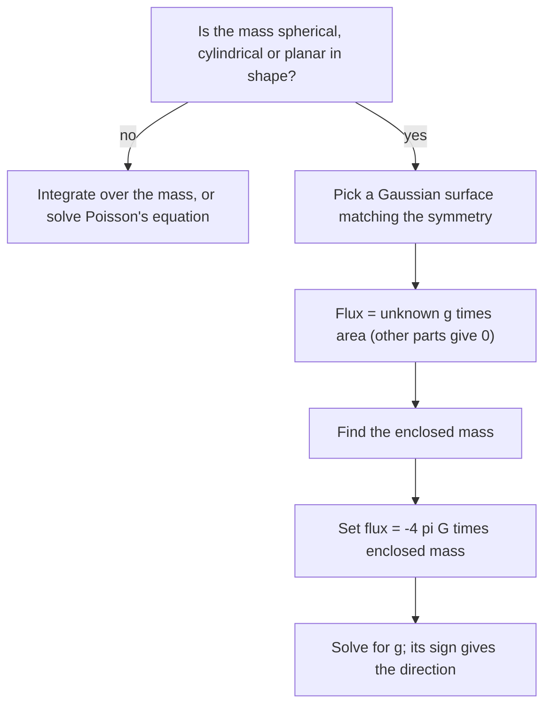

## Why may a planet be treated as a point?

The honors lesson on Kepler's laws, and every orbit problem in this course, quietly replaced
the Sun and the Earth by points. Newton needed that step too, and it bothered him: the Earth
is a ball 12,700 km across, and an apple near its surface is pulled by every piece of it,
some pieces close by and some on the far side. Why should all those pulls add up to exactly
the pull of one point at the center?

Newton answered with a geometric argument in the *Principia* (1687). This lesson answers it
with the tools of Module 8: Lesson 38 turned the inverse-square law of electricity into
Gauss's law, and gravity is also an inverse-square law. The same argument gives the field
outside and inside a planet, the field of a flat layer of rock, and a differential equation,
Poisson's equation, that ties the field to the density of matter at each point.

Notation: in this lesson $r$ is the distance from a center, $\rho$ is mass density
(kg/m³), and $\hat{\mathbf r} = \mathbf x/|\mathbf x|$ is the outward unit vector.

## Gauss's law for gravity

A point mass $M$ at the origin creates the **gravitational field**

$$\mathbf g = -\frac{GM}{|\mathbf x|^3}\,\mathbf x = -\frac{GM}{r^2}\,\hat{\mathbf r},$$

the force per kilogram on a test mass placed at $\mathbf x$. It has the same shape as the
electric field of a point charge, $\dfrac{q}{4\pi\varepsilon_0}\dfrac{\mathbf x}{|\mathbf x|^3}$, with
$\dfrac{q}{4\pi\varepsilon_0}$ replaced by $-GM$. Lesson 38 showed that the electric flux through any
closed surface around the charge is $q/\varepsilon_0 = 4\pi\cdot\dfrac{q}{4\pi\varepsilon_0}$. Making the
same replacement, the flux of $\mathbf g$ through any closed surface around $M$ is $4\pi(-GM)$,
and it is 0 through a closed surface that does not enclose $M$ (the divergence is 0 away from
the origin). Adding up many masses gives **Gauss's law for gravity**:

$$\iint_S\mathbf g\cdot d\mathbf S = -4\pi G\,M_{\text{enc}}.$$

The minus sign says gravity points *into* every surface that contains mass: mass is a sink of
the field, never a source. For a continuous density, $M_{\text{enc}} = \iiint_E\rho\,dV$, and the
Divergence theorem with the "true for every region, so true at every point" step of Lesson 38
gives the differential form

$$\nabla\cdot\mathbf g = -4\pi G\rho.$$

## The shell theorem

Gauss's law holds for any closed surface, but it only *finds* a field when symmetry makes the
flux easy to write down. Suppose the mass is **spherically symmetric**: the density depends
only on $r$. Then the field must be radial with a magnitude that depends only on $r$:
$\mathbf g = g(r)\,\hat{\mathbf r}$. (Any sideways component would pick out a direction, and a
symmetric ball has no preferred direction.) Take the Gaussian surface to be the sphere of
radius $r$. On it $\mathbf g\cdot\mathbf n = g(r)$ is constant, so the flux is $g(r)\cdot4\pi r^2$, and
Gauss's law gives

$$g(r) = -\frac{G\,M_{\text{enc}}(r)}{r^2}.$$

Only the mass *inside* radius $r$ matters. Two famous consequences make up the **shell
theorem**:

1. Outside a spherically symmetric body, $M_{\text{enc}}$ is the whole mass, so the field is exactly
   that of a point mass at the center. This is why a planet may be treated as a point.
2. Inside a hollow, uniform spherical shell, $M_{\text{enc}} = 0$, so the field is zero everywhere
   in the cavity. The near side of the shell pulls harder per kilogram, but the far side has
   more kilograms, and the two balance exactly.




### Example 1: inside a uniform planet

A planet of mass $M$ and radius $R$ has uniform density. Find $\mathbf g$ inside it.

1. The density is $\rho = M/(\tfrac43\pi R^3)$, so the mass inside radius $r < R$ is
   $\rho\cdot\tfrac43\pi r^3 = M\,r^3/R^3$.
2. Then $g(r) = -\dfrac{G}{r^2}\cdot\dfrac{Mr^3}{R^3} = -\dfrac{GM}{R^3}\,r$.

Inside, the field strength grows *linearly* from 0 at the center to $GM/R^2$ at the surface;
outside it falls off as $1/r^2$. Writing $g_0 = GM/R^2$ for the surface value, inside
$|\mathbf g| = g_0\,r/R$. Halfway to the center of a uniform Earth ($g_0 = 9.8$ m/s²) you would weigh
half as much: 4.9 m/s². (The real Earth is far from uniform: its core is several times denser
than its crust, and measured gravity actually *increases* a little as you go down through the
crust and mantle. The uniform ball is a model, not the Earth.)

```plot
{"x": [0, 3.2], "y": [0, 1.25], "functions": [{"f": "x", "from": 0, "to": 1, "label": "g₀ r/R inside"}, {"f": "1/x^2", "from": 1, "to": 3.2, "label": "g₀ R²/r² outside"}], "segments": [{"from": [1, 0], "to": [1, 1], "dashed": true, "label": "surface"}], "xLabel": "r / R", "yLabel": "|g| / g₀", "caption": "Field strength of a uniform ball: linear inside, inverse-square outside, largest at the surface"}
```

### Example 2: a tunnel through the planet

Drill a straight frictionless tunnel through the center of the uniform planet and drop a
stone in. Along the tunnel (the $x$-axis), Example 1 gives the force per kilogram
$-\dfrac{g_0}{R}x$, so Newton's second law reads

$$x''(t) = -\frac{g_0}{R}\,x.$$

That is simple harmonic motion with angular frequency $\omega = \sqrt{g_0/R}$ and period
$T = 2\pi\sqrt{R/g_0}$. For $R = 6.371\times10^6$ m and $g_0 = 9.81$ m/s²,
$T \approx 5063$ s, about 84.4 minutes, so the trip to the far side takes about 42 minutes.
That is the same as the period of a satellite skimming the surface, whose speed satisfies
$v^2/R = g_0$, so $T = 2\pi R/v = 2\pi\sqrt{R/g_0}$. (Simplified model: uniform density, no air
or friction, no rotation. A realistic density profile shortens the trip noticeably.)

## Newton's way: integrating over the shell

Gauss's law made the shell theorem look easy, but it leaned on symmetry. It is worth seeing
the direct computation once, both as a check and as a workout in spherical coordinates.
For a scalar it is easier to add up the **gravitational potential** $\Phi$ (potential
energy per kilogram), with $\mathbf g = -\nabla\Phi$; a point mass $m$ at distance $s$ contributes
$-Gm/s$. (Lesson 38 used the potential function $f = GMm/|\mathbf x|$ with $\mathbf F = \nabla f$;
physicists flip the sign so that $\Phi$ is an energy. The physics is identical.)

### Example 3: the potential of a shell

A thin uniform shell of radius $R$ and mass $M$ has surface density $\sigma = M/(4\pi R^2)$.
Find $\Phi$ at a point $P$ at distance $r$ from the center.

1. Put $P$ on the $z$-axis at $(0, 0, r)$. A patch of the shell at angle $\phi$ from the
   $z$-axis has area $dA = R^2\sin\phi\,d\phi\,d\theta$ and, by the law of cosines, distance
   $s = \sqrt{R^2 + r^2 - 2Rr\cos\phi}$ from $P$.
2. So $\Phi(r) = -G\sigma\displaystyle\int_0^{2\pi}\!\!\int_0^\pi\frac{R^2\sin\phi}{\sqrt{R^2 + r^2 - 2Rr\cos\phi}}\,d\phi\,d\theta$.
3. Substitute $w = R^2 + r^2 - 2Rr\cos\phi$, $dw = 2Rr\sin\phi\,d\phi$. As $\phi$ runs from 0 to
   $\pi$, $w$ runs from $(R - r)^2$ to $(R + r)^2$:
   $$\int_0^\pi\frac{\sin\phi\,d\phi}{\sqrt w} = \frac{1}{2Rr}\int_{(R-r)^2}^{(R+r)^2}w^{-1/2}\,dw = \frac{(R + r) - |R - r|}{Rr}.$$
4. Outside ($r > R$) the bracket is $2R$; inside ($r < R$) it is $2r$. With $2\pi R^2\sigma = M/2$:
   $$\Phi(r) = -\frac{GM}{r}\ (r > R), \qquad \Phi(r) = -\frac{GM}{R}\ (r < R).$$

Outside, the potential is that of a point mass at the center. Inside, it is *constant*, so
$\mathbf g = -\nabla\Phi = \mathbf 0$. Both parts of the shell theorem, with no symmetry argument at all.
Note the absolute value $|R - r|$: $\sqrt{(R - r)^2}$ is not $R - r$ when $r > R$.

## Poisson's equation

Combine $\nabla\cdot\mathbf g = -4\pi G\rho$ with $\mathbf g = -\nabla\Phi$:

$$\nabla^2\Phi = 4\pi G\rho.$$

This is **Poisson's equation** (Poisson, 1813). In empty space it becomes Laplace's equation
$\nabla^2\Phi = 0$: outside matter the potential is harmonic (Lesson 92 studies such
functions). Poisson's equation is the local, pointwise form of Newton's law of gravitation:
given the density everywhere, solving it gives the potential; given the potential, one
Laplacian gives the density.

For the uniform ball of Example 1 the potential inside is
$\Phi = \dfrac{GM}{2R^3}(r^2 - 3R^2)$. (Check: $-\Phi'(r) = -GMr/R^3$, the field of Example 1, and
at $r = R$ it equals $-GM/R$, matching the outside.) Since $r^2 = x^2 + y^2 + z^2$ has Laplacian 6,
$\nabla^2\Phi = \dfrac{GM}{2R^3}\cdot6 = \dfrac{3GM}{R^3}$, and $4\pi G\rho = 4\pi G\cdot\dfrac{3M}{4\pi R^3} = \dfrac{3GM}{R^3}$. ✓

### Example 4: a flat layer of rock

Geophysicists map buried rock by tiny changes in $g$. Model a wide flat layer of rock of
thickness $h$ and density $\rho$ as an infinite sheet with mass $\sigma = \rho h$ per unit area.
By symmetry $\mathbf g$ points straight toward the sheet with the same strength on both sides.
Use a Gaussian "pillbox", a short cylinder with end caps of area $A$ on either side of the
sheet. The curved side contributes nothing ($\mathbf g$ is parallel to it), and each cap
contributes $-|\mathbf g|A$, so

$$-2|\mathbf g|A = -4\pi G\sigma A \quad\Longrightarrow\quad |\mathbf g| = 2\pi G\sigma = 2\pi G\rho h,$$

*independent of the distance* from the sheet. For a 1 km layer of rock with
$\rho = 2700$ kg/m³, $|\mathbf g| = 2\pi(6.674\times10^{-11})(2.7\times10^6) \approx 1.13\times10^{-3}$ m/s², about
0.01% of normal gravity, easily measured by modern gravimeters. This slab formula is the
"Bouguer correction" of gravity surveys.

## Common mistakes

- Using Gauss's law to *find* a field without symmetry. For a cube of mass the law is still
  true, but $\mathbf g\cdot\mathbf n$ is not constant on any simple surface, so it gives one number,
  not the field.
- Counting all of a body's mass inside it. Only $M_{\text{enc}}(r)$, the mass closer to the center,
  sets the field at radius $r$.
- Dropping the absolute value in $\sqrt{(R - r)^2} = |R - r|$, which merges the inside and
  outside cases into one wrong formula.
- Sign slips: $\nabla\cdot\mathbf g = -4\pi G\rho$ but $\nabla^2\Phi = +4\pi G\rho$, because
  $\mathbf g = -\nabla\Phi$.
- Treating the real Earth as uniform when it matters: the uniform-ball results are a model.

## Key points

- Gauss's law for gravity: $\iint_S\mathbf g\cdot d\mathbf S = -4\pi G M_{\text{enc}}$; differential form $\nabla\cdot\mathbf g = -4\pi G\rho$.
- Spherical symmetry: $g(r) = -GM_{\text{enc}}(r)/r^2$. Outside, the body acts like a point mass at its center; inside a uniform shell, $\mathbf g = \mathbf 0$.
- Uniform ball: $|\mathbf g| = g_0r/R$ inside, so a tunnel through it gives simple harmonic motion with period $2\pi\sqrt{R/g_0}$.
- Direct integration over a shell gives $\Phi = -GM/r$ outside and the constant $-GM/R$ inside.
- Poisson's equation $\nabla^2\Phi = 4\pi G\rho$; in empty space $\Phi$ is harmonic. An infinite sheet gives $|\mathbf g| = 2\pi G\sigma$ at every distance.
