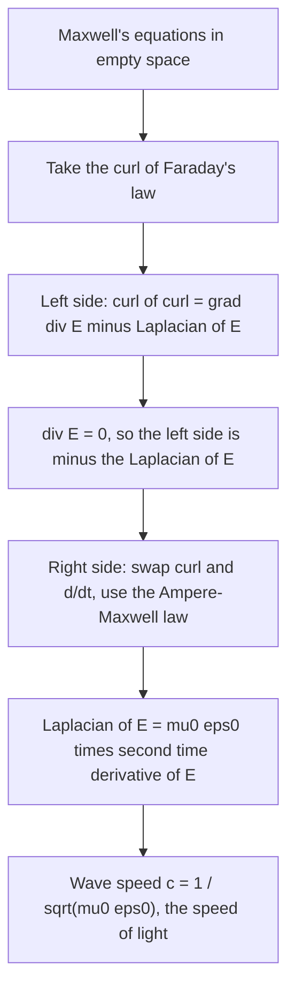

## From a table of laws to a prediction

Lesson 38 collected Maxwell's equations in a table and showed how the Divergence and Stokes
theorems turn each integral law into a differential one. Read as a list, the four laws look
like separate facts about charges, magnets and currents. This lesson shows what they do
*together*: in empty space, with no charges or currents anywhere, they still allow electric
and magnetic fields that keep each other alive and travel at one fixed speed. Computing that
speed from two constants measured with wires and capacitors gives the speed of light, one of
the great surprises in the history of physics.

All the work is vector calculus: one new identity for the curl of a curl, the
identity $\operatorname{div}(\operatorname{curl}\mathbf F) = 0$ from Lesson 33, and the Divergence theorem.
We use SI units and vacuum (empty space), as in Lesson 38.

## Why Maxwell needed an extra term

Before Maxwell, the magnetic law was Ampère's: $\nabla\times\mathbf B = \mu_0\mathbf J$. Take the
divergence of both sides. The left side is $\operatorname{div}(\operatorname{curl}\mathbf B) = 0$ for every smooth
field, so Ampère's law forces $\nabla\cdot\mathbf J = 0$. But charge is conserved, and the continuity
equation of Lesson 38 (with $\rho$ the charge density and $\mathbf J$ the current density) says

$$\frac{\partial\rho}{\partial t} + \nabla\cdot\mathbf J = 0.$$

So Ampère's law can only be right when charge densities never change. Charging a capacitor
breaks it: charge piles up on the plates. Maxwell's repair adds a term. By Gauss's law
$\rho = \varepsilon_0\nabla\cdot\mathbf E$, so $\dfrac{\partial\rho}{\partial t} = \nabla\cdot\left(\varepsilon_0\dfrac{\partial\mathbf E}{\partial t}\right)$ and
continuity becomes $\nabla\cdot\left(\mathbf J + \varepsilon_0\dfrac{\partial\mathbf E}{\partial t}\right) = 0$. The combination in
parentheses always has divergence zero, so it can safely equal $\frac{1}{\mu_0}\nabla\times\mathbf B$:

$$\nabla\times\mathbf B = \mu_0\mathbf J + \mu_0\varepsilon_0\frac{\partial\mathbf E}{\partial t}.$$

The new term (Maxwell called $\varepsilon_0\,\partial\mathbf E/\partial t$ the **displacement current**) says a
changing electric field makes a magnetic field, just as Faraday's law says a changing magnetic
field makes an electric one. That two-way coupling is what lets a wave carry itself.

## The curl of a curl

The key identity, for a field $\mathbf F$ with continuous second partials, is

$$\nabla\times(\nabla\times\mathbf F) = \nabla(\nabla\cdot\mathbf F) - \nabla^2\mathbf F,$$

where $\nabla^2\mathbf F$ (the **vector Laplacian**) means the Laplacian applied to each component:
$\nabla^2\mathbf F = \langle\nabla^2P, \nabla^2Q, \nabla^2R\rangle$ for $\mathbf F = \langle P, Q, R\rangle$.
It is proved by writing out the first component of both sides. The first component of
$\nabla\times(\nabla\times\mathbf F)$ is $(Q_x - P_y)_y - (P_z - R_x)_z = Q_{xy} - P_{yy} - P_{zz} + R_{xz}$.
Adding and subtracting $P_{xx}$ gives $(P_x + Q_y + R_z)_x - (P_{xx} + P_{yy} + P_{zz})$
(using Clairaut, $Q_{xy} = Q_{yx}$, $R_{xz} = R_{zx}$), which is the first component of the right side.
The other two components follow by cycling $x \to y \to z$.

### Example 1: checking the identity

Let $\mathbf F = \langle x^2y,\ yz,\ 0\rangle$.

- $\nabla\times\mathbf F = \langle 0 - y,\ 0 - 0,\ 0 - x^2\rangle = \langle -y, 0, -x^2\rangle$, and the curl of that is
  $\langle 0 - 0,\ 0 - (-2x),\ 0 - (-1)\rangle = \langle 0, 2x, 1\rangle$.
- $\nabla\cdot\mathbf F = 2xy + z$, so $\nabla(\nabla\cdot\mathbf F) = \langle 2y, 2x, 1\rangle$.
- $\nabla^2\mathbf F = \langle\nabla^2(x^2y), \nabla^2(yz), 0\rangle = \langle 2y, 0, 0\rangle$.

Right side: $\langle 2y, 2x, 1\rangle - \langle 2y, 0, 0\rangle = \langle 0, 2x, 1\rangle$. ✓

A useful special case: if $\nabla\cdot\mathbf F = 0$, then $\nabla\times(\nabla\times\mathbf F) = -\nabla^2\mathbf F$.

## The wave equation

In empty space $\rho = 0$ and $\mathbf J = \mathbf 0$, so the four equations are

$$\nabla\cdot\mathbf E = 0,\quad \nabla\cdot\mathbf B = 0,\quad \nabla\times\mathbf E = -\frac{\partial\mathbf B}{\partial t},\quad \nabla\times\mathbf B = \mu_0\varepsilon_0\frac{\partial\mathbf E}{\partial t}.$$

Take the curl of Faraday's law. On the left, the identity and $\nabla\cdot\mathbf E = 0$ give
$-\nabla^2\mathbf E$. On the right, swap the curl with $\partial/\partial t$ (allowed for smooth fields) and use the
fourth equation:

$$-\nabla^2\mathbf E = -\frac{\partial}{\partial t}(\nabla\times\mathbf B) = -\mu_0\varepsilon_0\frac{\partial^2\mathbf E}{\partial t^2}
\quad\Longrightarrow\quad \nabla^2\mathbf E = \mu_0\varepsilon_0\frac{\partial^2\mathbf E}{\partial t^2}.$$

The same steps, starting from the fourth equation, give the identical equation for $\mathbf B$.
This is the **wave equation** $\nabla^2u = \dfrac{1}{c^2}u_{tt}$ with

$$c = \frac{1}{\sqrt{\mu_0\varepsilon_0}} = \frac{1}{\sqrt{(1.25663706\times10^{-6})(8.85418782\times10^{-12})}} \approx 2.998\times10^{8}\text{ m/s}.$$

In one dimension the wave equation is $u_{zz} = u_{tt}/c^2$, and any $u = f(z - ct)$ solves it
(chain rule: $u_{zz} = f''$, $u_{tt} = c^2f''$): a shape moving in the $+z$ direction at speed
$c$ without changing (the PDE honors lesson of Module 3 derives d'Alembert's general solution). Maxwell saw in 1862, and worked out fully in his 1865 paper, that this
speed, computed from electrical measurements, agreed with the measured speed of light to
within the accuracy of the time. He concluded that light is an electromagnetic wave.
Heinrich Hertz produced and detected such waves at radio wavelengths in 1887–88.

## Plane waves

The simplest solutions are **plane waves**. Try

$$\mathbf E = E_0\cos(kz - \omega t)\,\mathbf i, \qquad \mathbf B = B_0\cos(kz - \omega t)\,\mathbf j,$$

where $k$ is the wave number (wavelength $\lambda = 2\pi/k$) and $\omega$ the angular frequency.

### Example 2: what the equations demand

Check all four equations and find what they force on $B_0$ and $\omega$.

1. $\nabla\cdot\mathbf E = \dfrac{\partial}{\partial x}\big(E_0\cos(kz - \omega t)\big) = 0$, and likewise $\nabla\cdot\mathbf B = 0$. Both hold.
2. Faraday. With $P = E_0\cos(kz - \omega t)$ the only component, $\nabla\times\mathbf E = \langle 0, P_z, -P_y\rangle = \langle 0, -kE_0\sin(kz - \omega t), 0\rangle$.
   And $-\dfrac{\partial\mathbf B}{\partial t} = \langle 0, -\omega B_0\sin(kz - \omega t), 0\rangle$. These agree when $kE_0 = \omega B_0$.
3. Ampère–Maxwell. $\nabla\times\mathbf B = \langle -(B_0\cos(kz - \omega t))_z, 0, 0\rangle = \langle kB_0\sin(kz - \omega t), 0, 0\rangle$,
   and $\mu_0\varepsilon_0\dfrac{\partial\mathbf E}{\partial t} = \langle \mu_0\varepsilon_0\omega E_0\sin(kz - \omega t), 0, 0\rangle$. They agree when $kB_0 = \mu_0\varepsilon_0\omega E_0$.
4. Divide the two conditions: $\dfrac{E_0}{B_0} = \dfrac{B_0}{\mu_0\varepsilon_0E_0}$, so $B_0^2 = \mu_0\varepsilon_0E_0^2$, that is
   $B_0 = E_0/c$, and then $\omega = kE_0/B_0 = ck$.

So the wave moves at speed $\omega/k = c$, the magnetic amplitude is the electric amplitude
divided by $c$, and the two fields rise and fall together (in phase).

The divergence equations are what make light **transverse**. For a plane wave traveling in
the direction of a vector $\mathbf k$, $\mathbf E = \mathbf E_0\cos(\mathbf k\cdot\mathbf x - \omega t)$ has
$\nabla\cdot\mathbf E = -(\mathbf k\cdot\mathbf E_0)\sin(\mathbf k\cdot\mathbf x - \omega t)$, which vanishes for all
$\mathbf x$ and $t$ only if $\mathbf k\cdot\mathbf E_0 = 0$. The field oscillates *across* the direction of
travel, never along it. Faraday's law then gives $\mathbf B = \dfrac{1}{\omega}\,\mathbf k\times\mathbf E$, perpendicular
to both. (Sound in air, by contrast, is a longitudinal wave.)

## Energy flow: the Poynting vector

Fields store energy, with density (joules per cubic meter)

$$u = \frac{\varepsilon_0}{2}|\mathbf E|^2 + \frac{1}{2\mu_0}|\mathbf B|^2,$$

and they move it. The product rule for a cross product,
$\nabla\cdot(\mathbf E\times\mathbf B) = \mathbf B\cdot(\nabla\times\mathbf E) - \mathbf E\cdot(\nabla\times\mathbf B)$, combined with
Faraday and Ampère–Maxwell, gives **Poynting's theorem** (J. H. Poynting, 1884):

$$\frac{\partial u}{\partial t} + \nabla\cdot\mathbf S = -\mathbf J\cdot\mathbf E, \qquad \mathbf S = \frac{1}{\mu_0}\,\mathbf E\times\mathbf B.$$

It has the shape of the continuity equation: $u$ plays the role of density and the
**Poynting vector** $\mathbf S$ is the energy flux (watts per square meter). The right side is the
rate at which the fields do work on charges. Integrated over a region with the Divergence
theorem: the energy inside decreases at the rate it flows out through the boundary plus the
rate it is handed to charges.

For the plane wave, $\mathbf S = \dfrac{E_0B_0}{\mu_0}\cos^2(kz - \omega t)\,\mathbf k$ points along the direction
of travel, as it should. The average of $\cos^2$ is $\tfrac12$, so the average power per area, the
**intensity**, is

$$I = \frac{E_0B_0}{2\mu_0} = \frac{E_0^2}{2\mu_0c} = \frac{c\,\varepsilon_0E_0^2}{2}.$$

### Example 3: the fields in sunlight

Above the atmosphere, sunlight delivers about $I = 1361$ W/m². Treat it as a single plane wave
(a simplification: sunlight is a mix of many frequencies and directions of polarization, so
$E_0$ here is an "effective" amplitude). Then

$$E_0 = \sqrt{\frac{2I}{c\varepsilon_0}} = \sqrt{\frac{2(1361)}{(2.998\times10^8)(8.854\times10^{-12})}} \approx 1.01\times10^3\text{ V/m},$$

and $B_0 = E_0/c \approx 3.38\times10^{-6}$ T, several times weaker than the Earth's own magnetic field (roughly 25 to 65 microtesla at
the surface). The
electric field is strong by everyday standards, but the magnetic field is tiny, which is
why the figure above exaggerates $\mathbf B$.

## Common mistakes

- Writing $\nabla\times(\nabla\times\mathbf F) = \nabla^2\mathbf F$, forgetting both the gradient-of-divergence term and the minus sign.
- Forgetting that the wave equation in empty space used $\rho = 0$ and $\mathbf J = \mathbf 0$; inside conductors or near charges, extra terms appear.
- Taking $|\mathbf B| = |\mathbf E|$ for a wave. In SI units $|\mathbf B| = |\mathbf E|/c$.
- Pointing $\mathbf S$ the wrong way: $\mathbf S = \mathbf E\times\mathbf B/\mu_0$ (in that order) points along the direction of travel.
- Using the peak value $E_0^2/(\mu_0c)$ of $|\mathbf S|$ as the intensity; the time average has a factor $\tfrac12$.

## Key points

- Maxwell's displacement-current term $\mu_0\varepsilon_0\,\partial\mathbf E/\partial t$ is required by $\operatorname{div}\operatorname{curl} = 0$ and conservation of charge.
- $\nabla\times(\nabla\times\mathbf F) = \nabla(\nabla\cdot\mathbf F) - \nabla^2\mathbf F$.
- In empty space $\mathbf E$ and $\mathbf B$ obey the wave equation with speed $c = 1/\sqrt{\mu_0\varepsilon_0} \approx 3.00\times10^8$ m/s.
- Plane waves are transverse, with $\mathbf E \perp \mathbf B \perp$ direction of travel, $B_0 = E_0/c$ and $\omega = ck$.
- Poynting's theorem $u_t + \nabla\cdot\mathbf S = -\mathbf J\cdot\mathbf E$; intensity $I = c\varepsilon_0E_0^2/2$.
