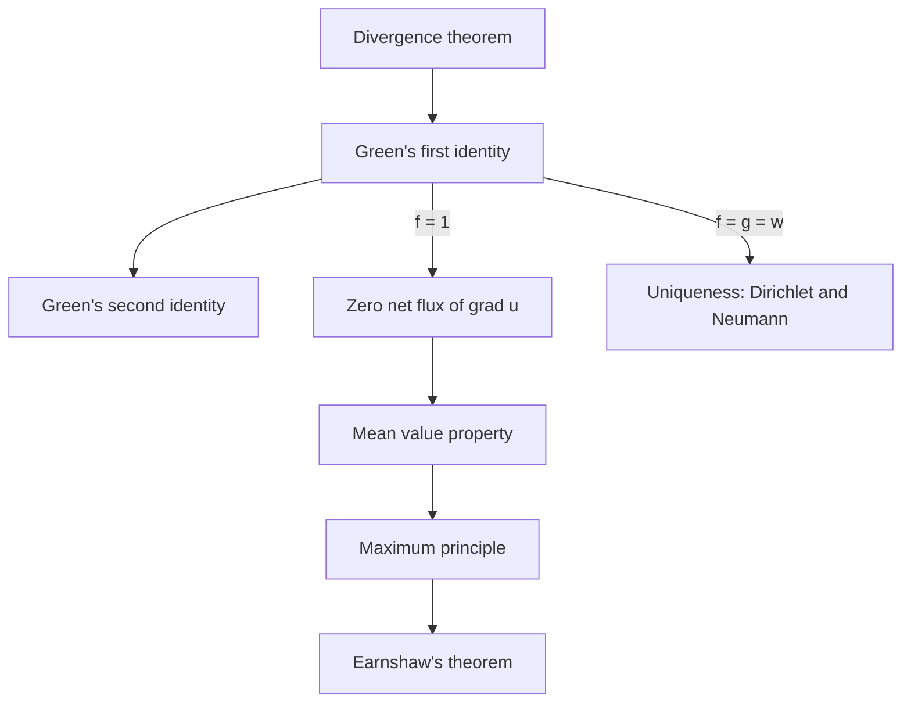

## One equation, many places

Laplace's equation $\nabla^2u = u_{xx} + u_{yy} + u_{zz} = 0$ keeps turning up. Lesson 38 met it
as the steady-state heat equation; Lesson 90 found that the gravitational potential obeys it
wherever there is no matter; the electrostatic potential obeys it wherever there is no charge.
A fourth source: a fluid flow that is irrotational has a velocity potential, $\mathbf v = \nabla\phi$
(Lesson 33: curl-free on all of space means a gradient), and if the fluid is also
incompressible, $0 = \nabla\cdot\mathbf v = \nabla^2\phi$. Lesson 33 named the solutions **harmonic**
functions.

This lesson proves three facts about every harmonic function, each with real consequences:
its value at a point is the average of its values on any sphere around that point; it has no
maxima or minima inside its region; and it is completely determined by its values on the
boundary. All three come from one tool, the Divergence theorem, packaged as Green's
identities.

## Green's identities

Let $f$ and $g$ have continuous second partials on a solid region $E$ with closed boundary
surface $S$ and outward unit normal $\mathbf n$. The product rule for divergence,
$\nabla\cdot(f\nabla g) = \nabla f\cdot\nabla g + f\,\nabla^2g$, and the Divergence theorem give
**Green's first identity**:

$$\iiint_E\left(f\,\nabla^2g + \nabla f\cdot\nabla g\right)dV = \iint_S f\,\nabla g\cdot\mathbf n\,dS.$$

Write the same identity with $f$ and $g$ swapped and subtract; the $\nabla f\cdot\nabla g$ terms
cancel, leaving **Green's second identity**:

$$\iiint_E\left(f\,\nabla^2g - g\,\nabla^2f\right)dV = \iint_S\left(f\,\nabla g - g\,\nabla f\right)\cdot\mathbf n\,dS.$$

(George Green published both in 1828, in an essay printed privately and sold to about fifty
subscribers; it was rediscovered years later and now underlies much of mathematical physics.)

The quantity $\nabla g\cdot\mathbf n$ is the directional derivative of $g$ in the outward normal
direction, the **normal derivative**, written $\partial g/\partial n$. Two special cases are worth
memorizing:

- $f = 1$: $\displaystyle\iiint_E\nabla^2g\,dV = \iint_S\frac{\partial g}{\partial n}\,dS$. For harmonic $g$ the right side is 0: **the net flux of $\nabla g$ out of any closed surface is zero.** In a steady temperature field, as much heat flows in as out.
- $f = g$: $\displaystyle\iiint_E\left(g\,\nabla^2g + |\nabla g|^2\right)dV = \iint_S g\,\frac{\partial g}{\partial n}\,dS$. This is the "energy" form used for uniqueness below.

## The mean value property

Let $u$ be harmonic on a region containing the ball of radius $R$ centered at $\mathbf p$. For
$0 < r \le R$ let $A(r)$ be the average of $u$ over the sphere $S_r$ of radius $r$ around
$\mathbf p$. Writing points of $S_r$ as $\mathbf p + r\boldsymbol\omega$ with $\boldsymbol\omega$ on the unit sphere $S_1$,

$$A(r) = \frac{1}{4\pi}\iint_{S_1}u(\mathbf p + r\boldsymbol\omega)\,dS_\omega.$$

Differentiate under the integral with the chain rule: $\dfrac{d}{dr}u(\mathbf p + r\boldsymbol\omega) = \nabla u\cdot\boldsymbol\omega$,
and $\boldsymbol\omega$ is exactly the outward normal of $S_r$. Scaling back to $S_r$ (areas grow by $r^2$),

$$A'(r) = \frac{1}{4\pi r^2}\iint_{S_r}\frac{\partial u}{\partial n}\,dS = \frac{1}{4\pi r^2}\iiint_{\text{ball}}\nabla^2u\,dV = 0.$$

So $A$ is constant, and as $r \to 0$ the average tends to $u(\mathbf p)$ by continuity. That is the
**mean value property**: *the value of a harmonic function at the center of any sphere inside
its region equals its average over that sphere.* (Averaging over the solid ball works too.)
In the plane the same argument gives averages over circles.

### Example 1: averages you can predict without integrating

(a) $u = x^2 - y^2 + 4xy$ is harmonic in the plane ($2 - 2 + 0 = 0$). Its average over the circle
of radius 3 centered at $(1, 2)$ is therefore $u(1, 2) = 1 - 4 + 8 = 5$. (Parametrizing the circle
and integrating confirms 5.)

(b) $u = x^2 + 2y^2 - 3z^2 + xy$ has $\nabla^2u = 2 + 4 - 6 = 0$. Its average over the sphere of
radius 2 centered at $(1, 1, 1)$ is $u(1, 1, 1) = 1 + 2 - 3 + 1 = 1$.

(c) The test fails without harmony: $v = x^2 + y^2 + z^2$ has $\nabla^2v = 6$, and its average over
the sphere of radius 2 centered at the origin is 4, not $v(\mathbf 0) = 0$. A positive Laplacian
pulls the average *above* the center value; that is the meaning of the Laplacian.

## The maximum principle

Suppose a harmonic $u$ on a connected region had a maximum at an interior point $\mathbf p$. On
every small sphere around $\mathbf p$, $u \le u(\mathbf p)$, but its average equals $u(\mathbf p)$.
An average of numbers that are all $\le M$ equals $M$ only if they all equal $M$ (for
continuous functions), so $u = u(\mathbf p)$ on every small sphere, hence on a whole ball around
$\mathbf p$. Spreading this from ball to ball across the connected region shows $u$ is constant.
This is the **maximum principle**:

*A harmonic function on a bounded connected region, continuous up to the boundary, takes its
maximum and minimum values on the boundary. If it takes either one at an interior point, it is
constant.*

Physically: a steady temperature has no interior hot spot (heat would flow away from it,
so it would not be steady). Compare the second-derivative test of Lesson 17: at an interior
critical point of a harmonic function of two variables, $f_{xx} = -f_{yy}$, so the two
second partials have opposite signs or are both zero, and $D = f_{xx}f_{yy} - f_{xy}^2 \le 0$.
The test can never report a strict local maximum or minimum.

**Earnshaw's theorem** (Samuel Earnshaw, 1842) is the same fact in physics. In a region with no
charge the electrostatic potential $V$ is harmonic, and a stable resting place for a test
charge $q$ would need a strict local minimum of its potential energy $qV$. Harmonic functions
have none, so *no arrangement of fixed charges can hold a charge in stable equilibrium by
electrostatic forces alone.* (The statement idealizes: it treats the test charge as a point
and the fields as static. Ion traps escape it with rapidly oscillating fields, and magnetic
levitation with feedback or diamagnetic materials.)

## Uniqueness

The **Dirichlet problem** asks for $u$ with $\nabla^2u = F$ in $E$ and prescribed values $u = h$ on
$S$ (a steady temperature with the boundary held at known temperatures; a potential with
the conductors held at known voltages). Suppose $u_1$ and $u_2$ both solve it. Their difference
$w = u_1 - u_2$ is harmonic with $w = 0$ on $S$. Green's first identity with $f = g = w$:

$$\iiint_E|\nabla w|^2\,dV = \iint_S w\,\frac{\partial w}{\partial n}\,dS - \iiint_E w\,\nabla^2w\,dV = 0 - 0 = 0.$$

A nonnegative continuous integrand with integral 0 is 0, so $\nabla w = \mathbf 0$: $w$ is constant,
and since it is 0 on $S$, $w = 0$. **The Dirichlet problem has at most one solution.** So if
you can guess a solution, by symmetry, a formula or luck, it is *the* solution.

If instead the normal derivative $\partial u/\partial n = h$ is prescribed (the **Neumann problem**: a
known heat flux through the boundary), the same argument shows two solutions differ by a
constant. The case $f = 1$ above also gives a condition for a solution to exist:
$\iint_S h\,dS = \iiint_E F\,dV$. For a harmonic $u$, the boundary flux must total zero.

### Example 2: a steady temperature in a ball

The surface of the unit ball is held at temperature $z^2$ (in suitable units). Find the
steady temperature inside, and the temperature at the center.

1. Guess: $z^2$ itself is not harmonic ($\nabla^2z^2 = 2$), so look for a harmonic polynomial that
   equals $z^2$ on the sphere. On the sphere $x^2 + y^2 = 1 - z^2$, so we may trade
   $x^2 + y^2$ for $1 - z^2$ freely. Try $u = a + b(2z^2 - x^2 - y^2)$: its Laplacian is
   $b(4 - 2 - 2) = 0$ for every $a, b$.
2. On the sphere, $u = a + b(2z^2 - 1 + z^2) = (a - b) + 3bz^2$. Matching $z^2$ needs $3b = 1$ and
   $a = b$, so $a = b = \tfrac13$:
   $$u = \frac{1 + 2z^2 - x^2 - y^2}{3}.$$
3. By uniqueness this is the only solution. The center temperature is $u(\mathbf 0) = \tfrac13$.

Check with the mean value property: $u(\mathbf 0)$ must equal the average of $z^2$ over the unit
sphere. In spherical coordinates
$\dfrac{1}{4\pi}\displaystyle\int_0^{2\pi}\!\!\int_0^\pi\cos^2\phi\,\sin\phi\,d\phi\,d\theta = \dfrac{1}{4\pi}\cdot\dfrac{4\pi}{3} = \dfrac13$. ✓
And by the maximum principle the temperature inside stays between the boundary extremes 0 and 1.

## Common mistakes

- Applying the mean value property to a function that is not harmonic, or to a sphere that leaves the region where $u$ is harmonic (for example a sphere around the origin for $1/|\mathbf x|$).
- Dropping a term of Green's first identity; derive it from $\nabla\cdot(f\nabla g) = \nabla f\cdot\nabla g + f\nabla^2g$ when unsure.
- Concluding from the maximum principle that a harmonic function has no critical points; it can have saddles ($x^2 - y^2$ at the origin), just no interior maxima or minima.
- Expecting the Neumann problem to determine $u$ exactly; it fixes $u$ only up to an added constant, and needs zero total boundary flux when $\nabla^2u = 0$.

## Key points

- Green's first identity: $\iiint_E(f\nabla^2g + \nabla f\cdot\nabla g)\,dV = \iint_S f\,\partial g/\partial n\,dS$; the second identity follows by symmetry.
- Mean value property: a harmonic function's value at a point equals its average over any sphere (or ball) centered there inside its region.
- Maximum principle: a nonconstant harmonic function has its maximum and minimum only on the boundary; Earnshaw's theorem follows.
- The Dirichlet problem has at most one solution; the Neumann problem's solutions differ by constants.
