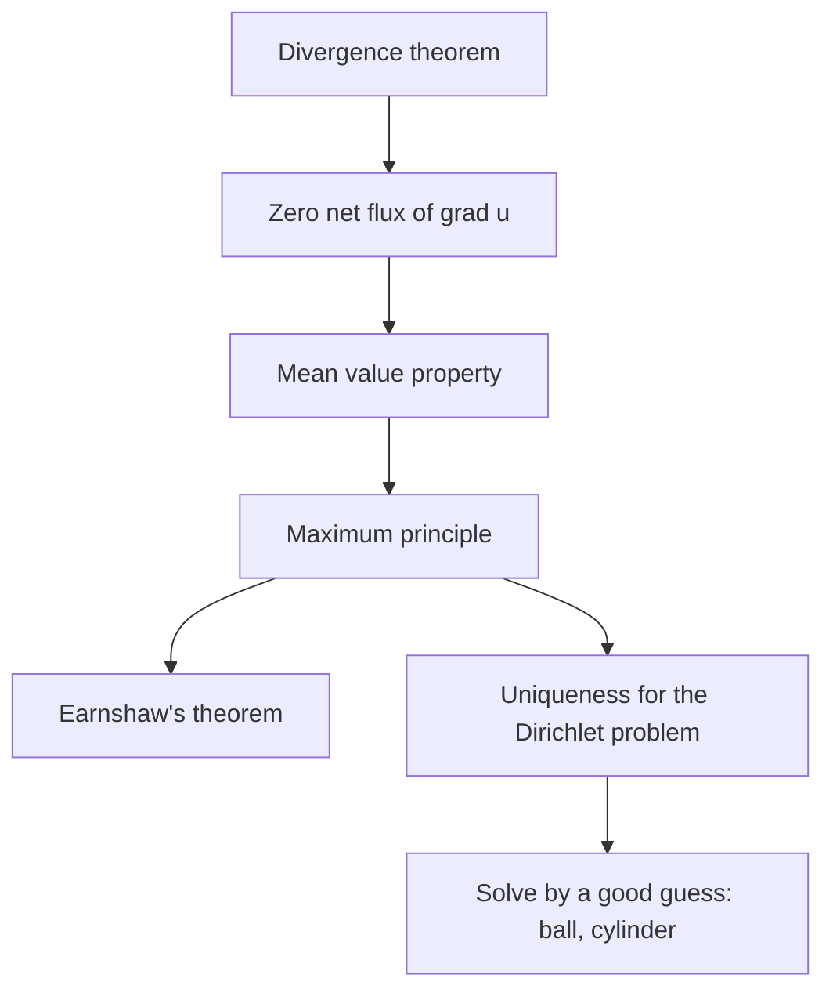

## One equation, many places

Laplace's equation $\nabla^2u = u_{xx} + u_{yy} + u_{zz} = 0$ keeps turning up. Lesson 38 met it
as the steady-state heat equation; Lesson 90 found that the gravitational potential obeys it
wherever there is no matter; the electrostatic potential obeys it wherever there is no charge.
Its solutions are the **harmonic** functions of Lesson 33.

Two honors lessons have already met these functions: the one on partial differential
equations (Module 3) stated the **mean value property** without proof, and the one on Green's
identities (after Lesson 38) proved that a Dirichlet problem has at most one solution. This
lesson proves the mean value property, derives from it the **maximum principle** and a famous
impossibility theorem in physics, and then puts uniqueness to work on a fourth home of
Laplace's equation: the smooth flow of a fluid around an obstacle.

## Zero flux, then mean values

Let $u$ be harmonic on a region containing a solid ball $B$ with boundary sphere $S$. The
Divergence theorem applied to the field $\nabla u$ gives

$$\iint_S\frac{\partial u}{\partial n}\,dS = \iint_S\nabla u\cdot\mathbf n\,dS = \iiint_B\nabla^2u\,dV = 0.$$

(This is Green's first identity with the function 1 in the first slot.) The net flux of
$\nabla u$ out of every closed surface is zero: in a steady temperature field, as much heat
flows in as out.

Now fix a center $\mathbf p$ and, for $0 < r \le R$, let $A(r)$ be the average of $u$ over the sphere
$S_r$ of radius $r$ around $\mathbf p$. Writing points of $S_r$ as $\mathbf p + r\boldsymbol\omega$ with
$\boldsymbol\omega$ on the unit sphere $S_1$,

$$A(r) = \frac{1}{4\pi}\iint_{S_1}u(\mathbf p + r\boldsymbol\omega)\,dS_\omega.$$

Differentiate under the integral with the chain rule: $\dfrac{d}{dr}u(\mathbf p + r\boldsymbol\omega) = \nabla u\cdot\boldsymbol\omega$,
and $\boldsymbol\omega$ is exactly the outward normal of $S_r$. Scaling back up to $S_r$ (areas grow by
$r^2$),

$$A'(r) = \frac{1}{4\pi r^2}\iint_{S_r}\frac{\partial u}{\partial n}\,dS = 0.$$

So $A$ is constant, and as $r \to 0$ the average tends to $u(\mathbf p)$ by continuity. That proves
the mean value property: *the value of a harmonic function at the center of any sphere
inside its region equals its average over that sphere.* (Averaging over the solid ball works
too, and in the plane the same argument gives averages over circles.)


### Example 1: averages you can predict without integrating

(a) $u = x^2 - y^2 + 4xy$ is harmonic in the plane ($2 - 2 + 0 = 0$). Its average over the circle
of radius 3 centered at $(1, 2)$ is therefore $u(1, 2) = 1 - 4 + 8 = 5$. (Parametrizing the circle
and integrating confirms 5.)

(b) $u = x^2 + 2y^2 - 3z^2 + xy$ has $\nabla^2u = 2 + 4 - 6 = 0$. Its average over the sphere of
radius 2 centered at $(1, 1, 1)$ is $u(1, 1, 1) = 1 + 2 - 3 + 1 = 1$.

(c) The shortcut fails without harmony: $v = x^2 + y^2 + z^2$ has $\nabla^2v = 6$, and its average
over the sphere of radius 2 centered at the origin is 4, not $v(\mathbf 0) = 0$. A positive
Laplacian pulls sphere averages *above* the center value; that is what the Laplacian measures.

## The maximum principle

Suppose a harmonic $u$ on a connected region had a maximum at an interior point $\mathbf p$. On
every small sphere around $\mathbf p$, $u \le u(\mathbf p)$, yet the average equals $u(\mathbf p)$. A
continuous function that is $\le M$ on a sphere and averages exactly $M$ must equal $M$ all over
it, so $u = u(\mathbf p)$ on every small sphere, hence on a whole ball around $\mathbf p$. Spreading
this from ball to overlapping ball across the connected region shows $u$ is constant. This is the
**maximum principle**:

*A harmonic function on a bounded connected region, continuous up to the boundary, takes its
maximum and minimum values on the boundary. If it takes either one at an interior point, it is
constant.*

It gives a second proof of uniqueness for the Dirichlet problem: if $u_1$ and $u_2$ are harmonic
with the same boundary values, then $w = u_1 - u_2$ is harmonic and 0 on the boundary, so its
maximum and its minimum are both 0, and $w = 0$ everywhere.

It also connects to the second-derivative test of Lesson 17. At a critical point of a harmonic
function of two variables, $f_{xx} = -f_{yy}$, so $D = f_{xx}f_{yy} - f_{xy}^2 = -f_{xx}^2 - f_{xy}^2 \le 0$:
the test can report a saddle or be inconclusive, but never a strict local maximum or minimum.

**Earnshaw's theorem** (Samuel Earnshaw, 1842) is the same fact in physics. In a region with
no charge the electrostatic potential $V$ is harmonic, and a stable resting place for a test
charge $q$ would need a strict local minimum of its potential energy $qV$. Harmonic functions
have none, so *no arrangement of fixed charges can hold a charge in stable equilibrium by
electrostatic forces alone.* (The statement idealizes: it treats the test charge as a point and
the fields as static. Ion traps get around it with rapidly oscillating fields, and magnetic
levitation with feedback or diamagnetic materials.)



### Example 2: a steady temperature in a ball

The surface of the unit ball is held at temperature $z^2$ (in suitable units). Find the
steady temperature inside, and the temperature at the center.

1. $z^2$ itself is not harmonic ($\nabla^2z^2 = 2$), so look for a harmonic polynomial that
   equals $z^2$ on the sphere, where $x^2 + y^2 = 1 - z^2$. Try $u = a + b(2z^2 - x^2 - y^2)$: its
   Laplacian is $b(4 - 2 - 2) = 0$ for every $a, b$.
2. On the sphere, $u = a + b(2z^2 - 1 + z^2) = (a - b) + 3bz^2$. Matching $z^2$ needs $3b = 1$ and
   $a = b$, so $a = b = \tfrac13$:
   $$u = \frac{1 + 2z^2 - x^2 - y^2}{3}.$$
3. By uniqueness this is the only solution. The center temperature is $u(\mathbf 0) = \tfrac13$.

Check with the mean value property: $u(\mathbf 0)$ must equal the average of $z^2$ over the unit
sphere, $\dfrac{1}{4\pi}\displaystyle\int_0^{2\pi}\!\!\int_0^\pi\cos^2\phi\,\sin\phi\,d\phi\,d\theta = \dfrac{1}{4\pi}\cdot\dfrac{4\pi}{3} = \dfrac13$. ✓
And by the maximum principle the temperature inside stays between the boundary extremes 0 and 1.

## Potential flow

Picture water moving steadily and smoothly past an obstacle. If the flow has no swirl,
$\nabla\times\mathbf v = \mathbf 0$, then on a simply connected region $\mathbf v = \nabla\phi$ for a
**velocity potential** $\phi$ (Lesson 31). If the water is also incompressible,
$0 = \nabla\cdot\mathbf v = \nabla^2\phi$. So $\phi$ is harmonic, and the whole flow is found by
solving Laplace's equation; this model is called **potential flow**. At a solid wall the water
can slide along but not pass through, so the normal velocity is zero:
$\partial\phi/\partial n = \nabla\phi\cdot\mathbf n = 0$, a Neumann condition. Its solutions are unique up
to an added constant in $\phi$, which doesn't change $\mathbf v$. (Potential flow ignores
viscosity, so it is a model of an ideal fluid; real flows behave this way only away from walls
and wakes.)

### Example 3: flow past a cylinder

Far from a long cylinder of radius $a$, water moves uniformly with speed $U$ in the $x$-direction
($\phi \approx Ux$). Treat it as a flow in the plane and use polar coordinates. Show that

$$\phi = U\left(r + \frac{a^2}{r}\right)\cos\theta$$

works, and find the speed on the cylinder.

1. *Harmonic.* In the PDE honors lesson, $r^n\cos n\theta$ was harmonic; the computation there
   works for any integer $n$. Here $r\cos\theta$ is the case $n = 1$ and $r^{-1}\cos\theta = r^{-1}\cos(-\theta)$
   the case $n = -1$. So $\phi$ is harmonic for $r > 0$.
2. *Far away.* As $r \to \infty$ the $a^2/r$ term fades and $\phi \approx Ur\cos\theta = Ux$. ✓
3. *Wall.* The normal to the cylinder is radial: $\dfrac{\partial\phi}{\partial r} = U\left(1 - \dfrac{a^2}{r^2}\right)\cos\theta$,
   which is 0 at $r = a$. ✓ By uniqueness, this is the flow.
4. *Speed on the wall.* The velocity there is purely tangential, with component
   $\dfrac1r\dfrac{\partial\phi}{\partial\theta} = -\dfrac{U}{a}(a + a)\sin\theta = -2U\sin\theta$. The speed $2U|\sin\theta|$ is 0 at
   the front and back ($\theta = \pi$ and $0$, the **stagnation points**) and $2U$ at the top and
   bottom: the water speeds up to twice the free-stream speed as it squeezes around the sides.

```plot
{"x": [-3.2, 3.2], "y": [-2.4, 2.4], "equal": true, "curves": [{"x": "cos(t)", "y": "sin(t)", "t": [0, "2pi"], "label": "cylinder"}, {"x": "(0.3/sin(t) + sqrt(0.09/sin(t)^2 + 4))/2*cos(t)", "y": "(0.3/sin(t) + sqrt(0.09/sin(t)^2 + 4))/2*sin(t)", "t": [0.12, 3.02]}, {"x": "(0.9/sin(t) + sqrt(0.81/sin(t)^2 + 4))/2*cos(t)", "y": "(0.9/sin(t) + sqrt(0.81/sin(t)^2 + 4))/2*sin(t)", "t": [0.3, 2.84]}, {"x": "(1.7/sin(t) + sqrt(2.89/sin(t)^2 + 4))/2*cos(t)", "y": "(1.7/sin(t) + sqrt(2.89/sin(t)^2 + 4))/2*sin(t)", "t": [0.55, 2.59]}, {"x": "(-0.3/sin(t) + sqrt(0.09/sin(t)^2 + 4))/2*cos(t)", "y": "(-0.3/sin(t) + sqrt(0.09/sin(t)^2 + 4))/2*sin(t)", "t": [3.26, 6.16]}, {"x": "(-0.9/sin(t) + sqrt(0.81/sin(t)^2 + 4))/2*cos(t)", "y": "(-0.9/sin(t) + sqrt(0.81/sin(t)^2 + 4))/2*sin(t)", "t": [3.44, 5.98]}, {"x": "(-1.7/sin(t) + sqrt(2.89/sin(t)^2 + 4))/2*cos(t)", "y": "(-1.7/sin(t) + sqrt(2.89/sin(t)^2 + 4))/2*sin(t)", "t": [3.69, 5.73]}], "segments": [{"from": [-3.2, 0], "to": [-1, 0]}, {"from": [1, 0], "to": [3.2, 0]}], "points": [{"at": [-1, 0], "label": "stagnation"}, {"at": [1, 0]}], "caption": "Potential flow past a cylinder (a = 1, U = 1, flow left to right): streamlines crowd together above and below, where the speed reaches 2U"}
```

The flow is symmetric front to back. Bernoulli's principle for an ideal fluid (pressure is
lower where the speed is higher, along a streamline) then makes the pressure symmetric front to
back too, so the model predicts *no drag at all* on the cylinder. This is **d'Alembert's
paradox** (1752): real fluids do push on obstacles, because viscosity, however small, makes the
flow separate from the back of the cylinder and leave a wake. The paradox is a lesson about
models, not a flaw in the mathematics.

## Common mistakes

- Applying the mean value property to a function that is not harmonic, or to a sphere that leaves the region where $u$ is harmonic (for example a sphere around the origin for $1/|\mathbf x|$, or around the inside of the cylinder for Example 3's $\phi$).
- Concluding from the maximum principle that a harmonic function has no critical points; it can have saddles ($x^2 - y^2$ at the origin), just no interior maxima or minima.
- Requiring $\phi = 0$ on a wall in potential flow. The wall condition is on the *normal derivative*, $\partial\phi/\partial n = 0$.
- Using potential flow where it does not apply: it assumes no viscosity and no swirl, so it misses drag and wakes.

## Key points

- For harmonic $u$, $\nabla u$ has zero net flux through every closed surface, and $u$ at a point equals its average over any sphere (or ball) centered there inside its region.
- Maximum principle: a nonconstant harmonic function has its maximum and minimum only on the boundary. It gives uniqueness for the Dirichlet problem and Earnshaw's theorem.
- Irrotational, incompressible flow: $\mathbf v = \nabla\phi$ with $\nabla^2\phi = 0$ and $\partial\phi/\partial n = 0$ on walls.
- Flow past a cylinder: $\phi = U(r + a^2/r)\cos\theta$; speed $2U|\sin\theta|$ on the wall, stagnation points front and back, and (in this ideal model) no drag.
