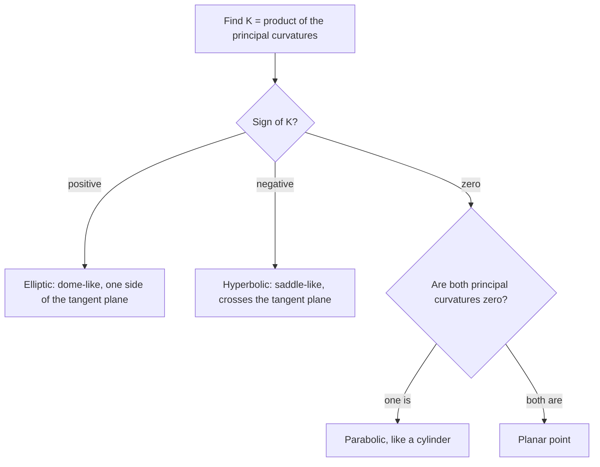

## How curved is a surface?

Lesson 8 measured how sharply a *curve* bends with one number, its curvature $\kappa$. A surface
can bend differently in different directions: a cylinder is curved around its axis and
straight along it; a saddle curves up in one direction and down in another. This lesson
builds the standard measure, the **Gaussian curvature** $K$, from tools you already have (the
Hessian and its eigenvalues from the Module 4 honors lesson, parametric surfaces from
Lesson 34, surface integrals from Lesson 35), and ends with one of the most striking results
in mathematics: integrate $K$ over a closed surface and the answer depends only on how many
holes the surface has.

## Normal curvature and principal curvatures

At a point $P$ of a smooth surface, take the unit normal $\mathbf n$ and a unit tangent vector
$\mathbf u$. The plane through $P$ containing $\mathbf n$ and $\mathbf u$ cuts the surface in a curve, the
*normal section* in direction $\mathbf u$. Its curvature, counted positive if it bends toward
$\mathbf n$ and negative if it bends away, is the **normal curvature** $\kappa(\mathbf u)$.

As $\mathbf u$ turns around $P$, $\kappa(\mathbf u)$ varies between a largest value $\kappa_1$ and a smallest
value $\kappa_2$, the **principal curvatures**. Their product is the Gaussian curvature, and
their average the **mean curvature**:

$$K = \kappa_1\kappa_2, \qquad H = \frac{\kappa_1 + \kappa_2}{2}.$$

(Flipping $\mathbf n$ flips the sign of both $\kappa_1$ and $\kappa_2$, so $H$ changes sign but $K$ does
not: the sign of $K$ is a property of the surface, not of a choice.)

## Computing them with the Hessian

Turn and shift the axes so that $P$ is the origin and the tangent plane is the $xy$-plane.
Near $P$ the surface is a graph $z = f(x, y)$ with $f(0, 0) = 0$ and $\nabla f(0, 0) = \mathbf 0$, and
$\mathbf n = \mathbf k$. In the direction $\mathbf u = \langle\cos\theta, \sin\theta\rangle$ the normal section is
$z(s) = f(s\cos\theta, s\sin\theta)$. By the chain rule twice, $z''(0) = \mathbf u^{T}\mathcal H\,\mathbf u$, where
$\mathcal H$ is the Hessian matrix of $f$ at the origin. A plane curve with slope 0 at a point has
curvature $|z''|$ there (Lesson 8: $\kappa = |z''|/(1 + z'^2)^{3/2}$), and the sign says whether it
bends up toward $\mathbf k$. So

$$\kappa(\mathbf u) = \mathbf u^{T}\mathcal H\,\mathbf u.$$

The normal curvature is the quadratic form of the Hessian on unit vectors. Its largest and
smallest values are the eigenvalues of $\mathcal H$ (the quadratic-forms lesson of Module 1), taken in
the directions of the eigenvectors, which are perpendicular. Hence:

- the principal curvatures are the **eigenvalues** of $\mathcal H$, and the principal directions are its eigenvectors;
- $K = \kappa_1\kappa_2 = \det\mathcal H = f_{xx}f_{yy} - f_{xy}^2$, the discriminant $D$ of the second-derivative test;
- in principal axes, $\kappa(\theta) = \kappa_1\cos^2\theta + \kappa_2\sin^2\theta$ (**Euler's theorem**, Euler, 1760s).

So the sign of $K$ classifies the point just as $D$ classified critical points: $K > 0$ means
the surface bends the same way in every direction (an **elliptic point**, like the top of a
dome), $K < 0$ means it bends up in some directions and down in others (a **hyperbolic
point**, saddle-shaped), and $K = 0$ means at least one principal curvature is 0 (a cylinder,
or a flat **planar point** if both are 0).

### Example 1: a saddle in disguise

Find the principal curvatures of $z = x^2 + 4xy + y^2$ at the origin.

1. $f_x = f_y = 0$ at the origin, so the tangent plane is horizontal. The Hessian is
   $\mathcal H = \begin{bmatrix}2 & 4\\ 4 & 2\end{bmatrix}$.
2. Eigenvalues: $\det(\mathcal H - \lambda I) = (2 - \lambda)^2 - 16 = 0$, so $\lambda = 6$ or $\lambda = -2$,
   with eigenvectors $\langle 1, 1\rangle$ and $\langle 1, -1\rangle$.
3. $\kappa_1 = 6$ along the line $y = x$ and $\kappa_2 = -2$ along $y = -x$. Then $K = -12$ (check:
   $\det\mathcal H = 4 - 16 = -12$) and $H = 2$.

Along the $x$- and $y$-axes the surface bends *up* ($z = x^2$, $z = y^2$), so it looks like a bowl
from those two directions, but along $y = -x$ it is $z = -2x^2$, bending down. The point is
hyperbolic.




## A formula for any graph

When the tangent plane is not horizontal, the same idea, corrected for the tilt, gives for
the graph $z = f(x, y)$

$$K = \frac{f_{xx}f_{yy} - f_{xy}^2}{\left(1 + f_x^2 + f_y^2\right)^2}.$$

(We state it without proof; at a point where $\nabla f = \mathbf 0$ it reduces to $\det\mathcal H$.)

### Example 2: the sphere and the paraboloid

For the upper hemisphere $z = \sqrt{R^2 - x^2 - y^2}$, at the top point $f_x = f_y = 0$,
$f_{xx} = f_{yy} = -1/R$ and $f_{xy} = 0$, so $K = 1/R^2$. Carrying out the general formula at any
other point gives $1/R^2$ again (the algebra simplifies completely; try it with a computer
algebra system). The sphere is curved the same amount everywhere, and a bigger sphere is
flatter: Earth, with $R \approx 6371$ km, has $K \approx 2.5\times10^{-8}$ km⁻².

For the paraboloid $z = x^2 + y^2$: $f_{xx} = f_{yy} = 2$, $f_{xy} = 0$, so
$K = \dfrac{4}{(1 + 4x^2 + 4y^2)^2}$. It is 4 at the bottom and $4/25 = 0.16$ at $(1, 0)$: the bowl
flattens as it rises.

## Gauss's remarkable theorem

Gauss proved in 1827 that $K$, although defined through the way the surface sits in space,
can be computed from distances and angles measured *within* the surface alone. He called this
the **Theorema Egregium** ("remarkable theorem"). We state it without proof. It means a
creature living in the surface could detect $K$ without ever leaving it, and that bending a
surface without stretching it never changes $K$.

The principal curvatures by themselves are *not* intrinsic. A flat sheet of paper has
$\kappa_1 = \kappa_2 = 0$; rolled into a cylinder of radius $r$ it has $\kappa_1 = 1/r$, $\kappa_2 = 0$; but
$K = 0$ both times, as it must be, since rolling doesn't stretch the paper. Two consequences:

- No map of any part of the Earth onto flat paper can keep all distances correct, because
  the sphere has $K = 1/R^2 \ne 0$ and the plane has $K = 0$. Every map projection distorts something.
- A slice of pizza is flat ($K = 0$). Fold it into a U across its width and, since $K$ must
  stay 0, it can no longer bend down along its length, so it stops drooping. (A popular
  illustration, and a correct one.)

## The Gauss–Bonnet theorem

A **geodesic** on a surface is a curve that is as straight as the surface allows, locally the
shortest path; on a sphere the geodesics are great circles. A **geodesic triangle** has three
geodesic sides. On a plane its angles add to $\pi$. On a curved surface they don't, and the
error is exactly the total curvature inside: for a geodesic triangle $T$ with angles $\alpha$,
$\beta$, $\gamma$,

$$\alpha + \beta + \gamma = \pi + \iint_T K\,dA.$$

Gauss proved this in the same 1827 work; Pierre Ossian Bonnet extended it in 1848 to regions
bounded by any curves (adding a term for how much the boundary itself turns).

### Example 3: a triangle with three right angles

On a sphere of radius $R$, take the triangle cut out by the equator and two meridians $90^\circ$
apart: the region $x, y, z \ge 0$, one eighth of the sphere. Each of its three angles is a
right angle, so the angle sum is $3\pi/2$, which exceeds $\pi$ by $\pi/2$. The theorem
predicts $\iint_T\frac{1}{R^2}\,dA = \dfrac{\text{area}}{R^2} = \dfrac{\pi}{2}$, so the area is $\tfrac{\pi R^2}{2}$. Check:
$\tfrac18\cdot4\pi R^2 = \tfrac{\pi R^2}{2}$. ✓


On any sphere the angle excess equals area divided by $R^2$. A geodesic triangle on the Earth
whose angles add to $180.5^\circ$ encloses
$\left(0.5\cdot\tfrac{\pi}{180}\right)(6371\text{ km})^2 \approx 354{,}000$ km², about the size of Germany. On a
saddle-shaped surface ($K < 0$) the angles of a triangle add to *less* than $\pi$.

## The global theorem

Now integrate $K$ over a whole closed surface $S$. Cut it into small geodesic triangles, $F$ of
them with $E$ edges and $V$ vertices, and add the triangle formula over all of them. The
interior angles around each vertex add to $2\pi$, so the angles contribute $2\pi V$; there are
$F$ copies of $\pi$; and each edge borders two triangles, so $3F = 2E$. Putting these together:

$$\iint_S K\,dA = 2\pi V - \pi F = 2\pi(V - E + F) = 2\pi\chi(S).$$

The number $\chi(S) = V - E + F$ is the **Euler characteristic** (Euler's polyhedron
formula, 1750s, says $V - E + F = 2$ for a convex polyhedron: a cube has $8 - 12 + 6 = 2$). It
depends only on the shape's topology, not on how it is cut up: $\chi = 2$ for a sphere, 0 for a
torus, and $2 - 2g$ for a surface with $g$ holes. This is the **Gauss–Bonnet theorem** for
closed surfaces. Every surface shaped like a sphere, from an egg to a potato, has total
curvature exactly $4\pi$: dent it in one place and the curvature elsewhere must compensate.
(The argument above is a sketch: it assumes the surface can be cut into geodesic triangles.)

### Example 4: the torus

Parametrize the torus with tube radius $b$ around a circle of radius $a > b$:
$\mathbf r(u, v) = \langle(a + b\cos v)\cos u,\ (a + b\cos v)\sin u,\ b\sin v\rangle$, $0 \le u, v \le 2\pi$.
A computation with the parametric-surface formulas gives

$$K = \frac{\cos v}{b(a + b\cos v)}, \qquad dA = b(a + b\cos v)\,du\,dv.$$

So $\iint K\,dA = \displaystyle\int_0^{2\pi}\!\!\int_0^{2\pi}\cos v\,du\,dv = 0 = 2\pi\chi$, with $\chi = 0$. ✓
The outer half ($\cos v > 0$, dome-like) has total curvature $+4\pi$ and the inner half
(saddle-like, around the hole) has $-4\pi$; they cancel.

```plot
{"x": [-3.3, 3.3], "y": [-1.2, 0.5], "functions": [{"f": "cos(x)/(2 + cos(x))", "label": "K(v), a = 2, b = 1"}], "shade": [{"f": "cos(x)/(2 + cos(x))", "from": -1.5708, "to": 1.5708}], "xLabel": "v (0 = outer equator, ±π = inner equator)", "yLabel": "K", "caption": "Gaussian curvature of a torus: positive on the outer half, negative on the inner half"}
```

## Common mistakes

- Treating $K$ as the curvature in one direction; it is the *product* of the largest and smallest normal curvatures.
- Using $f_{xx}f_{yy} - f_{xy}^2$ alone at a point where the tangent plane is tilted; the denominator $(1 + f_x^2 + f_y^2)^2$ is needed unless $\nabla f = \mathbf 0$.
- Calling a cylinder "flat" in every sense: its $K$ is 0, but its mean curvature is not.
- Reading off principal curvatures from $f_{xx}$ and $f_{yy}$ alone; with $f_{xy} \ne 0$ they are the eigenvalues of the whole Hessian.
- Applying the triangle formula to triangles whose sides are not geodesics (for example a "triangle" with a side along a circle of latitude other than the equator).

## Key points

- At a point with horizontal tangent plane, normal curvature is $\mathbf u^T\mathcal H\mathbf u$; principal curvatures are the eigenvalues of the Hessian, and $K = \det\mathcal H$.
- For a graph, $K = (f_{xx}f_{yy} - f_{xy}^2)/(1 + f_x^2 + f_y^2)^2$. Sphere: $K = 1/R^2$. The sign of $K$ separates elliptic, hyperbolic and parabolic or planar points.
- Theorema Egregium: $K$ is intrinsic, unchanged by bending without stretching; so no flat map of the sphere preserves distances.
- Geodesic triangle: $\alpha + \beta + \gamma = \pi + \iint_T K\,dA$.
- Closed surface: $\iint_S K\,dA = 2\pi\chi(S)$, with $\chi = 2$ (sphere), 0 (torus), $2 - 2g$ in general.
