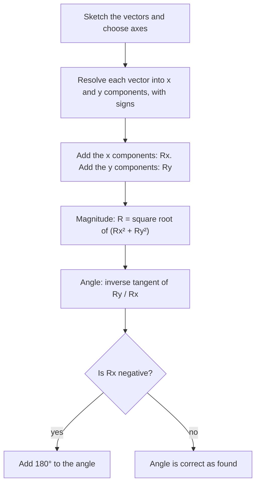

## Quantities with direction

Some quantities are fully described by one number and a unit: mass, temperature, time, energy. These are **scalars**. Others need a direction as well: walking 3 km is not the same trip as walking 3 km north. A **vector** has a magnitude (size, never negative) and a direction. Displacement, velocity, acceleration, force and momentum are all vectors, so nearly every mechanics problem in this course starts by handling vectors correctly.

We write vectors in bold or with an arrow, $\vec A$, and the magnitude as $|\vec A|$ or plain $A$. Geometrically, a vector is an arrow: its length is the magnitude and it points in its direction. Moving the arrow without rotating or stretching it gives the same vector.

## Adding vectors geometrically

To add $\vec A + \vec B$, place the tail of $\vec B$ at the head of $\vec A$; the **resultant** runs from the tail of $\vec A$ to the head of $\vec B$ (the tip-to-tail method). Order doesn't matter: $\vec A + \vec B = \vec B + \vec A$. To subtract, add the opposite: $\vec A - \vec B = \vec A + (-\vec B)$, where $-\vec B$ has the same length as $\vec B$ and points the opposite way.

```shape
{"segments": [{"from": [0, 0], "to": [4, 0], "arrow": true, "label": "A"}, {"from": [4, 0], "to": [4, 3], "arrow": true, "label": "B"}, {"from": [0, 0], "to": [4, 3], "arrow": true, "dashed": true}], "labels": [{"at": [1.55, 1.95], "text": "A + B"}], "caption": "Tip to tail: walk 4 units east, then 3 north; the resultant is 5 units long"}
```

Subtraction looks like this: to find $\vec A - \vec B$, flip $\vec B$ and add it tip to tail.

```shape
{"segments": [{"from": [0, 0], "to": [4, 0], "arrow": true, "label": "A"}, {"from": [4, 0], "to": [4, -3], "arrow": true, "label": "−B"}, {"from": [0, 0], "to": [4, -3], "arrow": true, "dashed": true}], "labels": [{"at": [1.55, -1.95], "text": "A − B"}], "caption": "Subtracting: with A = 4 units east and B = 3 units north, add −B (3 units south); A − B is 5 units long, pointing south of east"}
```

Multiplying a vector by a scalar $c$ stretches it by $|c|$, and a negative $c$ also reverses it.

## Components

Drawing is good for intuition but poor for precision. Instead, we break a vector into **components** along perpendicular axes. If $\vec A$ has magnitude $A$ and makes angle $\theta$ with the $+x$ axis (measured counterclockwise),

$$A_x = A\cos\theta, \qquad A_y = A\sin\theta.$$

These come straight from the right triangle whose hypotenuse is $\vec A$. The picture shows the triangle: the $x$ component runs along the $x$ axis, the $y$ component climbs from its end to the tip of $\vec A$, and the angle $\theta$ sits at the tail.


Components are signed numbers: a vector pointing into the second quadrant has $A_x < 0$ and $A_y > 0$.

Going back, the Pythagorean theorem and the tangent give

$$A = \sqrt{A_x^2 + A_y^2}, \qquad \tan\theta = \frac{A_y}{A_x}.$$

Careful with the angle: a calculator's $\tan^{-1}$ returns values between $-90^\circ$ and $90^\circ$, so if $A_x < 0$ you must add $180^\circ$. Always sketch the vector to see which quadrant it's in.

With **unit vectors** $\hat\imath$ and $\hat\jmath$ (length 1, pointing along $+x$ and $+y$; $\hat k$ along $+z$), a vector is written $\vec A = A_x\hat\imath + A_y\hat\jmath$. Adding vectors then means adding components:

$$\vec A + \vec B = (A_x + B_x)\,\hat\imath + (A_y + B_y)\,\hat\jmath.$$

That works because addition is done separately along each independent direction.

Every vector-addition problem follows the same procedure:



### Example 1

A hiker walks 5.0 km at $30^\circ$ north of east, then 3.0 km due north. Find the total displacement.

Components of the first leg: $A_x = 5.0\cos 30^\circ = 4.33$ km, $A_y = 5.0\sin 30^\circ = 2.50$ km. Second leg: $B_x = 0$, $B_y = 3.0$ km.

Sum: $R_x = 4.33$ km, $R_y = 5.50$ km.

Magnitude: $R = \sqrt{4.33^2 + 5.50^2} = \sqrt{18.75 + 30.25} = 7.0$ km.

Direction: $\theta = \tan^{-1}(5.50/4.33) = 51.8^\circ$ north of east. Both components are positive, so the calculator angle is already in the right quadrant.

### Example 2

$\vec A = 3\hat\imath - 4\hat\jmath$ and $\vec B = -1\hat\imath + 2\hat\jmath$ (meters). Find $\vec C = 2\vec A - \vec B$ and its magnitude.

$2\vec A = 6\hat\imath - 8\hat\jmath$; subtracting $\vec B$ gives $\vec C = 7\hat\imath - 10\hat\jmath$ m. Its magnitude is $\sqrt{49 + 100} = \sqrt{149} \approx 12.2$ m, and it points $\tan^{-1}(-10/7) = -55^\circ$, that is, $55^\circ$ below the $+x$ axis.

## Choosing axes

Axes are your choice; physics doesn't care. Pick them to make the work easy. For a block on a ramp, tilt the axes so $x$ runs along the ramp: then the motion is along one axis and only gravity needs splitting. You will see this trick again in the friction lesson.

## Multiplying two vectors

Later lessons combine two vectors into a product in two different ways. You only need the ideas here; each gets real use when it appears (work, torque, magnetic force).

The **dot product** (scalar product) gives a number:

$$\vec A \cdot \vec B = AB\cos\phi = A_xB_x + A_yB_y + A_zB_z,$$

where $\phi$ is the angle between the vectors when placed tail to tail ($A_z$ and $B_z$ are the components along a third axis, $z$, when there is one). It measures how much two vectors point the same way: it's positive for $\phi < 90^\circ$, zero for perpendicular vectors, negative for $\phi > 90^\circ$. Another way to read $AB\cos\phi$: it is $A$ times the component of $\vec B$ along $\vec A$. Work, $W = Fd\cos\phi$, is a dot product: only the part of the force along the motion counts.

The **cross product** (vector product) gives a vector perpendicular to both, with magnitude

$$|\vec A \times \vec B| = AB\sin\phi,$$

and direction set by the **right-hand rule**: point your fingers along $\vec A$, curl them toward $\vec B$, and your thumb points along $\vec A \times \vec B$. Reversing the order reverses the direction: $\vec B\times\vec A = -\vec A\times\vec B$. Parallel vectors ($\phi = 0$) have a zero cross product; perpendicular ones give the largest, $AB$. Torque and the magnetic force on a moving charge are cross products, which is why both use $\sin\phi$ and a right-hand rule.

### Example 3

Find the angle between $\vec A = 2\hat\imath + 1\hat\jmath + 2\hat k$ and $\vec B = 1\hat\imath + 4\hat\jmath - 1\hat k$, and the magnitude of $\vec A \times \vec B$.

Dot product: $2(1) + 1(4) + 2(-1) = 4$. Magnitudes: $A = \sqrt{4+1+4} = 3$ and $B = \sqrt{1+16+1} = \sqrt{18} = 4.243$. So $\cos\phi = \dfrac{4}{3(4.243)} = 0.314$ and $\phi = 71.7^\circ$.

Cross-product magnitude: $AB\sin\phi = 3(4.243)\sin 71.7^\circ = 12.1$.

### Example 4

A vector $\vec A$ points east and $\vec B$ points north, both in a horizontal plane. Which way does $\vec A \times \vec B$ point, and which way does $\vec B \times \vec A$ point?

Fingers east, curl them toward north (counterclockwise seen from above): the thumb points straight up. So $\vec A\times\vec B$ points up, out of the ground, and $\vec B\times\vec A$ points straight down. In unit-vector language, with $x$ east, $y$ north and $z$ up, $\hat\imath\times\hat\jmath = \hat k$.

## Common mistakes

- Adding magnitudes instead of components: 3 m east plus 4 m north is 5 m, not 7 m.
- Using $\sin$ for the $x$ component when the angle is measured from the $x$ axis (or forgetting to swap when the angle is from the $y$ axis).
- Trusting $\tan^{-1}$ blindly when $A_x$ is negative.
- Mixing degree and radian mode on the calculator.
- Writing $\vec B \times \vec A$ for $\vec A\times\vec B$, which flips the sign.

## Key points

- Scalars have magnitude only; vectors have magnitude and direction.
- $A_x = A\cos\theta$, $A_y = A\sin\theta$ (angle from $+x$); $A = \sqrt{A_x^2 + A_y^2}$.
- Add vectors by adding components; choose axes that simplify the problem.
- $\vec A\cdot\vec B = AB\cos\phi$ (a scalar); $|\vec A\times\vec B| = AB\sin\phi$, direction by the right-hand rule.
