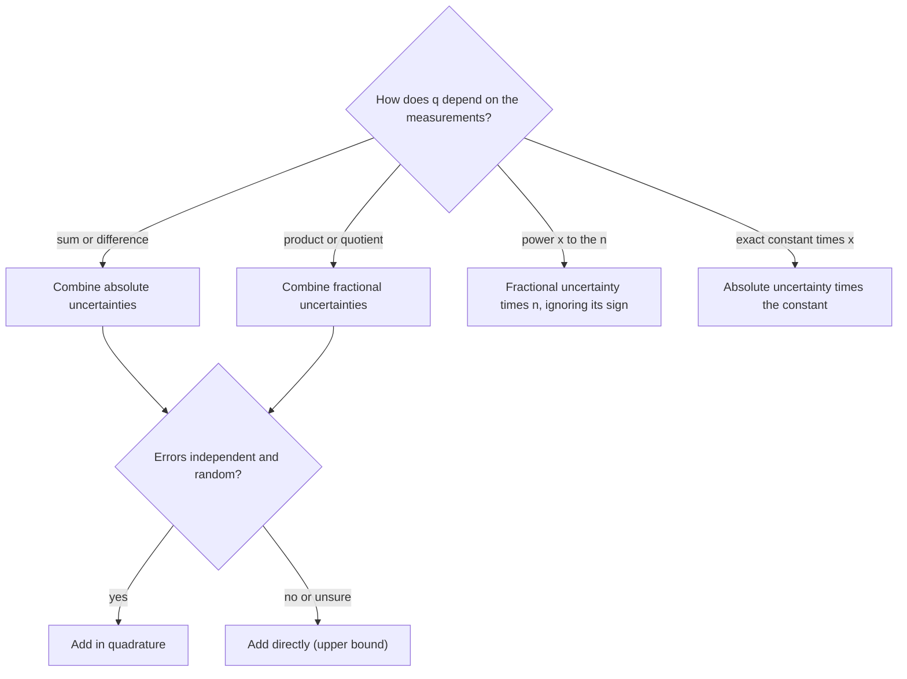

## Beyond significant figures

The measurement lesson used significant figures to keep results honest: a result can't be more precise than its weakest input. Significant figures are a quick shorthand, but they only say roughly how precise a number is. Laboratories, engineers and every scientific paper state precision directly, as a best value plus or minus an uncertainty, such as $L = 12.3 \pm 0.1$ cm. This lesson shows where those uncertainties come from, how to combine them when measured values go into a formula, and how to decide whether two results agree. It is the toolkit behind every lab report in this course and in AP Physics.

## Stating a measurement

A measured value is written as

$$\text{(best value)} \pm \text{(uncertainty)}, \quad \text{for example } m = 52.4 \pm 0.2\text{ g}.$$

The **absolute uncertainty**, here 0.2 g, has the same unit as the value and says how far the true value plausibly lies from the best value. It is not a guarantee: it describes a likely range, not a hard wall. The **fractional uncertainty** (also called relative uncertainty) divides by the value: $0.2/52.4 = 0.0038$, or 0.38% as a **percent uncertainty**. Fractional uncertainty has no unit, so it lets you compare the quality of very different measurements: a 0.2 g uncertainty is excellent for a 52 g mass and useless for a 0.5 g one.

Where does the first uncertainty come from? For a single reading, it comes from the instrument and from you:

- An analog scale (ruler, dial, thermometer) is often read to about half its smallest division, so a millimeter ruler gives about $\pm 0.5$ mm. If the object's edges are fuzzy or the pointer wobbles, the honest uncertainty is larger.
- A digital display is usually taken as $\pm 1$ in its last digit, unless the manufacturer states an accuracy, which is often worse.

These are common conventions, not laws; labs and textbooks differ, and what matters is to state what you used.

Two rounding conventions keep results readable. Round the uncertainty to one significant figure (two if its first digit is 1), then round the best value to the same decimal place. A calculator result of $9.8021 \pm 0.0599$ m/s² becomes $9.80 \pm 0.06$ m/s². Writing $9.8021 \pm 0.06$ claims digits the uncertainty has already wiped out.

## Random and systematic errors

"Error" in physics means the difference between a measurement and the true value, not a blunder. There are two kinds, and they behave very differently.

A **random error** pushes repeated readings up and down unpredictably: reaction time on a stopwatch, a needle that jitters, small air currents. Random errors produce scatter, so they show up when you repeat the measurement, and averaging many readings reduces their effect.

A **systematic error** pushes every reading the same way by about the same amount: a scale that reads 3 g with nothing on it, a ruler with a worn end, measuring a pendulum's length to the top of the bob instead of its center. Repeating the measurement shows no sign of it, and averaging doesn't help at all. You find systematic errors by checking instruments against known standards, by measuring the same quantity a different way, and by thinking hard about the setup.

The four targets from the measurement lesson show the difference. Random error spreads the dots; systematic error moves the whole cluster.


## Repeated measurements: mean and standard deviation

When random error dominates, take several readings. The best value is their mean, $\bar x = \tfrac{1}{n}\sum x_i$. The spread of the readings is measured by the sample **standard deviation**

$$s = \sqrt{\frac{\sum (x_i - \bar x)^2}{n - 1}},$$

roughly the typical distance of one reading from the mean. (Dividing by $n - 1$ rather than $n$ corrects for the fact that the mean was computed from the same data; with only a few readings it makes $s$ noticeably larger.)

The standard deviation describes a single reading, but the mean is better than any single reading, because random errors partly cancel when you average. Its uncertainty is the **standard error of the mean**

$$s_{\bar x} = \frac{s}{\sqrt n}.$$

The $\sqrt n$ is a law of diminishing returns: four times as many readings halve the uncertainty, and a hundred times as many cut it to a tenth. It also only fights random error. A thousand readings with a miscalibrated stopwatch give a very precise wrong answer.

### Example 1

Five stopwatch timings of one pendulum swing cycle are 2.03, 1.98, 2.06, 2.01 and 1.97 s. Report the period with its uncertainty.

*Mean:* the sum is 10.05 s, so $\bar T = 10.05/5 = 2.010$ s.

*Deviations from the mean:* $+0.02, -0.03, +0.05, 0.00, -0.04$ s. Their squares add to $0.0004 + 0.0009 + 0.0025 + 0 + 0.0016 = 0.0054\text{ s}^2$.

*Standard deviation:* $s = \sqrt{0.0054/4} = \sqrt{0.00135} = 0.037$ s. A single timing is typically off by about 0.04 s, which is about the size of human reaction-time scatter.

*Standard error:* $s_{\bar T} = 0.037/\sqrt5 = 0.016$ s.

Result: $T = 2.010 \pm 0.016$ s. The uncertainty starts with a 1, so it keeps two significant figures, and the mean is given to the same decimal place.

## Propagating uncertainty through a formula

Most results are calculated, not read directly: a density from a mass and a volume, $g$ from a length and a period. **Propagation of uncertainty** answers the question: how uncertain is the result, given the uncertainties of the inputs?

*Sums and differences.* If $q = x + y$ or $q = x - y$, the absolute uncertainties combine. In the worst case both errors push the same way, so $\delta q = \delta x + \delta y$. But if the errors are independent and random, they are unlikely to both be at their extremes in the same direction, and the standard rule is **adding in quadrature**:

$$\delta q = \sqrt{(\delta x)^2 + (\delta y)^2}.$$

A useful picture (an analogy, not a proof): independent errors combine like perpendicular vectors, so the total is found with the Pythagorean theorem. The proof comes from statistics, where the variances (squared spreads) of independent errors add. Note that subtraction does not subtract uncertainties: $q = x - y$ is uncertain by the same amount as $x + y$.

*Products and quotients.* If $q = xy$ or $q = x/y$, the *fractional* uncertainties combine, in quadrature for independent errors:

$$\frac{\delta q}{|q|} = \sqrt{\left(\frac{\delta x}{x}\right)^2 + \left(\frac{\delta y}{y}\right)^2}.$$

Why fractional? Write each input as its best value times a small factor, $x(1 + a)$ and $y(1 + b)$, where $a$ and $b$ are the fractional errors. Then $xy(1 + a)(1 + b) = xy(1 + a + b + ab) \approx xy(1 + a + b)$, because $ab$ is tiny. The fractional errors add, so fractional uncertainties are what combine. Division gives the same result, since $1/(1 + b) \approx 1 - b$.

*Powers.* If $q = x^n$, then $\dfrac{\delta q}{|q|} = |n|\,\dfrac{\delta x}{|x|}$. Squaring a length doubles its fractional uncertainty. Do not treat $x^2 = x \cdot x$ as two independent factors and add in quadrature: both factors carry the *same* error, so it adds directly.

*Exact constants.* If $q = Cx$ with $C$ exact (like $2\pi$ or $\tfrac12$), then $\delta q = |C|\,\delta x$ and the fractional uncertainty is unchanged.



### Example 2

A student measures a pendulum's length as $L = 0.800 \pm 0.002$ m and its period as $T = 1.795 \pm 0.005$ s, and uses $g = 4\pi^2 L/T^2$. Find $g$ and its uncertainty.

*Best value:* $g = 4\pi^2(0.800)/(1.795)^2 = 31.583/3.222 = 9.802$ m/s².

*Fractional uncertainties of the inputs:* $\delta L/L = 0.002/0.800 = 0.25\%$; $\delta T/T = 0.005/1.795 = 0.279\%$.

*The power:* $T$ is squared, so it contributes $2 \times 0.279\% = 0.557\%$. The $4\pi^2$ is exact and contributes nothing.

*Combine in quadrature:* $\sqrt{0.25^2 + 0.557^2}\,\% = 0.611\%$, so $\delta g = 0.00611 \times 9.802 = 0.060$ m/s².

Result: $g = 9.80 \pm 0.06$ m/s². Adding directly instead would give $0.25\% + 0.557\% = 0.81\%$, or $\pm 0.08$ m/s², a more cautious upper bound. Notice that the period, though measured to better than 0.3%, contributes most of the uncertainty because it is squared. To improve this experiment, time more swings.

### Example 3

A beaker weighs $148.9 \pm 0.2$ g empty and $152.4 \pm 0.2$ g with a little liquid in it. How much liquid is there, and how precisely is it known?

*Value:* $152.4 - 148.9 = 3.5$ g.

*Uncertainty:* a difference, so combine absolute uncertainties: $\sqrt{0.2^2 + 0.2^2} = 0.28 \approx 0.3$ g.

Result: $3.5 \pm 0.3$ g, a fractional uncertainty of $0.3/3.5 \approx 8\%$, even though each weighing was good to about 0.13%. Subtracting two nearly equal numbers keeps their absolute uncertainty but shrinks the value, so the fractional uncertainty balloons. The cure is to measure the small quantity more directly (here, a larger sample or a more precise balance).

## Do two results agree?

Uncertainties let you compare results honestly. A common rule of thumb: two values agree if their difference is smaller than about their combined uncertainty, $\sqrt{\delta_1^2 + \delta_2^2}$; a difference of more than two or three times the combined uncertainty is a real discrepancy that needs explaining. Between those, the result is suggestive but not conclusive. (These thresholds are conventions; statistics makes them precise.)

When a trusted reference value exists, labs also quote the **percent error**:

$$\text{percent error} = \frac{|\text{measured} - \text{accepted}|}{\text{accepted}} \times 100\%.$$

Percent error says how far off you were; the uncertainty says how far off you *expected* to be. A good lab report compares the two.

### Example 4

Student A finds $g = 9.80 \pm 0.06$ m/s². Student B, with similar equipment, finds $g = 9.62 \pm 0.05$ m/s². Do they agree?

Difference: $0.18$ m/s². Combined uncertainty: $\sqrt{0.06^2 + 0.05^2} = 0.078$ m/s². The difference is $0.18/0.078 = 2.3$ times the combined uncertainty, so the results probably disagree. Against an accepted local value of 9.80 m/s², A's percent error is about 0% and B's is $0.18/9.80 = 1.8\%$, more than three times B's own stated uncertainty of about 0.5%. That points to a systematic error in B's experiment. A likely culprit: B measured the string length only to the top of the bob rather than to its center. Too short a length gives too small a $g$.

## Uncertainty on graphs

On a graph, each point's uncertainty is drawn as an **error bar**, a line through the point covering best value ± uncertainty. A good straight-line fit should pass through most error bars (roughly two-thirds of them, if the bars are one standard error long). Graphs also let you combine many measurements: plotting $T^2$ against $L$ for a pendulum gives a straight line through the origin with slope $4\pi^2/g$, so $g = 4\pi^2/\text{slope}$.

```plot
{"x": [0, 1.1], "y": [0, 4.5], "xLabel": "length L (m)", "yLabel": "period squared T² (s²)", "functions": [{"f": "4.03*x", "label": "best fit: slope 4.03 s²/m", "from": 0, "to": 1.05}], "points": [{"at": [0.2, 0.82]}, {"at": [0.4, 1.59]}, {"at": [0.6, 2.43]}, {"at": [0.8, 3.2]}, {"at": [1.0, 4.05]}], "segments": [{"from": [0.2, 0.67], "to": [0.2, 0.97]}, {"from": [0.185, 0.67], "to": [0.215, 0.67]}, {"from": [0.185, 0.97], "to": [0.215, 0.97]}, {"from": [0.4, 1.44], "to": [0.4, 1.74]}, {"from": [0.385, 1.44], "to": [0.415, 1.44]}, {"from": [0.385, 1.74], "to": [0.415, 1.74]}, {"from": [0.6, 2.28], "to": [0.6, 2.58]}, {"from": [0.585, 2.28], "to": [0.615, 2.28]}, {"from": [0.585, 2.58], "to": [0.615, 2.58]}, {"from": [0.8, 3.05], "to": [0.8, 3.35]}, {"from": [0.785, 3.05], "to": [0.815, 3.05]}, {"from": [0.785, 3.35], "to": [0.815, 3.35]}, {"from": [1.0, 3.9], "to": [1.0, 4.2]}, {"from": [0.985, 3.9], "to": [1.015, 3.9]}, {"from": [0.985, 4.2], "to": [1.015, 4.2]}], "caption": "Pendulum data with ±0.15 s² error bars; slope 4.03 s²/m gives g = 4π²/4.03 ≈ 9.79 m/s²"}
```

A line that misses many error bars by a lot means either the uncertainties were underestimated or the model is wrong (for a pendulum, large swing angles make the simple formula fail).

## Common mistakes

- Subtracting uncertainties when values are subtracted. Uncertainties never cancel; $\delta(x - y)$ is the same as $\delta(x + y)$.
- Combining absolute uncertainties for a product (adding 0.002 m to 0.005 s makes no sense: the units don't even match). Products and quotients use fractional uncertainties.
- Forgetting the power: a squared quantity contributes twice its fractional uncertainty.
- Quoting the standard deviation of single readings as the uncertainty of the mean, or dividing by $\sqrt n$ and thinking that removes systematic error.
- Keeping too many digits: $9.8021 \pm 0.0599$ should be $9.80 \pm 0.06$.
- Calling any disagreement "human error." Name the specific random or systematic cause and how it would shift the result.

## Key points

- Report measurements as best value ± uncertainty; round the uncertainty to one significant figure (two if it starts with 1) and the value to match.
- Random errors scatter readings and shrink with averaging; systematic errors shift every reading and don't.
- For repeated readings: best value $\bar x$, spread $s$, uncertainty of the mean $s/\sqrt n$.
- Sums and differences: combine absolute uncertainties. Products and quotients: combine fractional uncertainties. Powers: multiply the fractional uncertainty by $|n|$. Use quadrature for independent random errors.
- Two results agree if their difference is within about their combined uncertainty.
