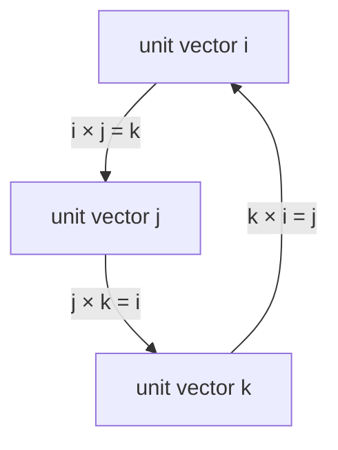

## From magnitudes to components

The vectors lesson introduced the dot product through its component formula and the cross product through its magnitude $AB\sin\phi$ and the right-hand rule. That is enough for problems where you know the angle between two vectors. In three-dimensional problems you usually know components instead: a force of $(6, 2, -3)$ N, a position of $(0.20, 0.10, 0)$ m. This lesson builds the tools for working directly with components: unit vectors in any direction, projections, the cross product in components, the geometric meaning of both products, and what happens to components when you tilt the axes. You will use every one of them later, for work, torque, angular momentum and the magnetic force.

## Unit vectors in any direction

The vectors $\hat\imath$, $\hat\jmath$, $\hat k$ mark the axes, but any direction can have a unit vector. Divide a vector by its own magnitude:

$$\hat A = \frac{\vec A}{A}, \qquad A = \sqrt{A_x^2 + A_y^2 + A_z^2}.$$

The result has length 1 and points the same way as $\vec A$. Its components are the cosines of the angles $\alpha$, $\beta$, $\gamma$ that $\vec A$ makes with the $x$, $y$ and $z$ axes:

$$\hat A = (\cos\alpha,\ \cos\beta,\ \cos\gamma), \qquad \cos\alpha = \frac{A_x}{A},\ \cos\beta = \frac{A_y}{A},\ \cos\gamma = \frac{A_z}{A}.$$

These are the **direction cosines** of $\vec A$. Because $\hat A$ has length 1, they satisfy $\cos^2\alpha + \cos^2\beta + \cos^2\gamma = 1$, a 3D version of $\cos^2\theta + \sin^2\theta = 1$. The formula $\cos\alpha = A_x/A$ is just the dot product $\hat A \cdot \hat\imath$: the dot product with a unit vector picks out a component.

## Projections

That last idea generalizes. The component of $\vec B$ along *any* direction $\hat A$ is $\vec B \cdot \hat A$. This number is the **scalar projection** of $\vec B$ onto $\vec A$:

$$B_{\parallel} = \vec B\cdot\hat A = \frac{\vec A\cdot\vec B}{A} = B\cos\phi.$$

It is positive when $\vec B$ leans the same way as $\vec A$ and negative when it leans backward. Multiplying it by $\hat A$ gives the **vector projection**, the part of $\vec B$ that lies along $\vec A$:

$$\vec B_{\parallel} = \left(\frac{\vec A\cdot\vec B}{A^2}\right)\vec A.$$

Whatever is left over, $\vec B_{\perp} = \vec B - \vec B_{\parallel}$, is perpendicular to $\vec A$. So every vector splits uniquely into a part along a chosen direction and a part perpendicular to it. This is exactly what you do on a ramp (parts of gravity along and into the slope) and in work problems (only the part of the force along the motion does work).

### Example 1

A force $\vec F = 6\hat\imath + 2\hat\jmath - 3\hat k$ N acts on an object that moves through $\vec d = 2\hat\imath - \hat\jmath + 2\hat k$ m. Find the work done, the angle between force and displacement, and the parts of $\vec F$ along and perpendicular to the motion.

*Work:* $W = \vec F\cdot\vec d = 6(2) + 2(-1) + (-3)(2) = 12 - 2 - 6 = 4$ J.

*Magnitudes:* $F = \sqrt{36 + 4 + 9} = 7$ N and $d = \sqrt{4 + 1 + 4} = 3$ m.

*Angle:* $\cos\phi = \dfrac{4}{7 \times 3} = 0.190$, so $\phi = 79.0^\circ$. The force is nearly perpendicular to the motion, which is why it does so little work.

*Scalar projection:* $F_\parallel = \vec F\cdot\vec d/d = 4/3 = 1.33$ N. Check: $W = F_\parallel d = 1.33 \times 3 = 4$ J.

*Vector projection:* $\vec F_\parallel = \tfrac{4}{9}(2\hat\imath - \hat\jmath + 2\hat k) = 0.889\hat\imath - 0.444\hat\jmath + 0.889\hat k$ N.

*Perpendicular part:* $\vec F_\perp = \vec F - \vec F_\parallel = 5.111\hat\imath + 2.444\hat\jmath - 3.889\hat k$ N. Check: $\vec F_\perp\cdot\vec d = 10.222 - 2.444 - 7.778 = 0$, so it really is perpendicular to the motion.

## The cross product in components

The cross product obeys the distributive law, $\vec A\times(\vec B + \vec C) = \vec A\times\vec B + \vec A\times\vec C$, so we can multiply out $(A_x\hat\imath + A_y\hat\jmath + A_z\hat k)\times(B_x\hat\imath + B_y\hat\jmath + B_z\hat k)$ term by term. That needs the nine products of unit vectors:

- A vector crossed with itself is zero ($\sin 0 = 0$): $\hat\imath\times\hat\imath = \hat\jmath\times\hat\jmath = \hat k\times\hat k = 0$.
- Going forward around the cycle $\hat\imath \to \hat\jmath \to \hat k \to \hat\imath$ gives the third one: $\hat\imath\times\hat\jmath = \hat k$, $\hat\jmath\times\hat k = \hat\imath$, $\hat k\times\hat\imath = \hat\jmath$.
- Going backward gives minus the third one: $\hat\jmath\times\hat\imath = -\hat k$, and so on.



Collecting the six nonzero terms:

$$\vec A\times\vec B = (A_yB_z - A_zB_y)\,\hat\imath + (A_zB_x - A_xB_z)\,\hat\jmath + (A_xB_y - A_yB_x)\,\hat k.$$

The pattern is easier to remember than the formula. The $x$ component uses only $y$ and $z$; the $y$ component uses $z$ and $x$; the $z$ component uses $x$ and $y$, always in the cyclic order, "forward product minus backward product." If you have met determinants, the formula is the $3\times3$ determinant with $\hat\imath$, $\hat\jmath$, $\hat k$ in the top row, $\vec A$ in the second and $\vec B$ in the third.

Two checks catch most arithmetic slips: the result must be perpendicular to both inputs (its dot product with each is zero), and its magnitude must equal $AB\sin\phi$.

### Example 2

Find $\vec C = \vec A\times\vec B$ for $\vec A = 2\hat\imath + \hat\jmath + 2\hat k$ and $\vec B = \hat\imath + 4\hat\jmath - \hat k$ (the vectors from Example 3 of the vectors lesson).

- $C_x = A_yB_z - A_zB_y = (1)(-1) - (2)(4) = -9$
- $C_y = A_zB_x - A_xB_z = (2)(1) - (2)(-1) = 4$
- $C_z = A_xB_y - A_yB_x = (2)(4) - (1)(1) = 7$

So $\vec C = -9\hat\imath + 4\hat\jmath + 7\hat k$.

*Checks:* $\vec A\cdot\vec C = -18 + 4 + 14 = 0$ and $\vec B\cdot\vec C = -9 + 16 - 7 = 0$, so $\vec C$ is perpendicular to both. Its magnitude is $\sqrt{81 + 16 + 49} = \sqrt{146} = 12.1$, matching the $AB\sin\phi = 12.1$ found from the angle in the vectors lesson.

## What the products mean geometrically

The cross product's magnitude is an area. Draw $\vec A$ and $\vec B$ from the same point and complete the parallelogram. Its base is $A$ and its height is $B\sin\phi$, so

$$\text{area of parallelogram} = AB\sin\phi = |\vec A\times\vec B|.$$

The triangle with sides $\vec A$ and $\vec B$ has half that area. The direction of $\vec A\times\vec B$ is perpendicular to the parallelogram, so the cross product describes a flat surface completely: its size and which way it faces. (You'll use this idea for the area vector in Gauss's law.)


Combining both products gives the **scalar triple product** $\vec A\cdot(\vec B\times\vec C)$. Its absolute value is the volume of the slanted box (parallelepiped) with edges $\vec A$, $\vec B$, $\vec C$: $|\vec B\times\vec C|$ is the area of the base, and the dot product with $\vec A$ picks out the height of the box above that base. Two consequences:

- If the triple product is zero, the box is flat: the three vectors lie in one plane.
- The order can be cycled without changing the value, $\vec A\cdot(\vec B\times\vec C) = \vec B\cdot(\vec C\times\vec A) = \vec C\cdot(\vec A\times\vec B)$, but swapping two vectors flips the sign.

### Example 3

A wrench applies a force $\vec F = 30\hat\jmath + 40\hat k$ N at position $\vec r = 0.20\hat\imath + 0.10\hat\jmath$ m from a bolt. The torque about the bolt is $\vec\tau = \vec r\times\vec F$ (you'll study torque in the rotation module). Find it.

- $\tau_x = r_yF_z - r_zF_y = (0.10)(40) - (0)(30) = 4.0$ N·m
- $\tau_y = r_zF_x - r_xF_z = (0)(0) - (0.20)(40) = -8.0$ N·m
- $\tau_z = r_xF_y - r_yF_x = (0.20)(30) - (0.10)(0) = 6.0$ N·m

So $\vec\tau = 4.0\hat\imath - 8.0\hat\jmath + 6.0\hat k$ N·m, with magnitude $\sqrt{16 + 64 + 36} = \sqrt{116} = 10.8$ N·m. Check: $\vec\tau\cdot\vec r = 0.8 - 0.8 + 0 = 0$ and $\vec\tau\cdot\vec F = -240 + 240 = 0$.

### Example 4

Find the volume of the box with edges $\vec A = 2\hat\imath$, $\vec B = \hat\imath + 3\hat\jmath$, $\vec C = \hat\imath + \hat\jmath + 4\hat k$ (in meters).

$\vec B\times\vec C = (3\cdot4 - 0\cdot1)\hat\imath + (0\cdot1 - 1\cdot4)\hat\jmath + (1\cdot1 - 3\cdot1)\hat k = 12\hat\imath - 4\hat\jmath - 2\hat k$.

$\vec A\cdot(\vec B\times\vec C) = 2(12) + 0 + 0 = 24$, so the volume is 24 m³.

Check another way: $\vec A$ and $\vec B$ lie in the $xy$ plane and span a parallelogram with base 2 and height 3 (area 6 m²), and $\vec C$ rises 4 m above that plane: $6 \times 4 = 24$ m³.

## Tilting the axes

Axes are a choice, and the vectors lesson recommended tilting them on a ramp. Here is the general rule. If new axes $x'$ and $y'$ are the old ones rotated counterclockwise by an angle $\alpha$, their unit vectors are $\hat x' = (\cos\alpha, \sin\alpha)$ and $\hat y' = (-\sin\alpha, \cos\alpha)$. A component along an axis is a dot product with that axis's unit vector, so

$$A_{x'} = A_x\cos\alpha + A_y\sin\alpha, \qquad A_{y'} = -A_x\sin\alpha + A_y\cos\alpha.$$

The components change, but the vector does not: $A_{x'}^2 + A_{y'}^2 = A_x^2 + A_y^2$ (expand and use $\cos^2\alpha + \sin^2\alpha = 1$). Lengths, angles between vectors, and dot products come out the same in every set of axes. Physical laws are written with vectors precisely so that they don't depend on how you happen to orient your axes.

```shape
{"polygons": [{"points": [[0, 0], [10, 0], [10, 5.774]]}, {"points": [[4.654, 2.687], [5.346, 3.087], [4.946, 3.78], [4.254, 3.38]]}], "segments": [{"from": [4.8, 3.233], "to": [6.878, 4.433], "arrow": true}, {"from": [4.8, 3.233], "to": [3.6, 5.312], "arrow": true}, {"from": [4.8, 3.233], "to": [4.8, 0.833], "arrow": true}, {"from": [4.8, 3.233], "to": [3.761, 2.633], "arrow": true, "dashed": true}, {"from": [4.8, 3.233], "to": [5.839, 1.433], "arrow": true, "dashed": true}], "labels": [{"at": [1.6, 0.35], "text": "θ"}, {"at": [6.65, 4.85], "text": "x′"}, {"at": [4.0, 5.45], "text": "y′"}, {"at": [5.2, 0.95], "text": "W"}, {"at": [3.0, 3.15], "text": "W sin θ"}, {"at": [6.75, 1.45], "text": "W cos θ"}], "caption": "Tilted axes on a ramp at angle θ: the weight W splits into W sin θ down the slope and W cos θ into the surface"}
```

### Example 5

A 5.0 kg box sits on a ramp inclined at $30^\circ$. Its weight is $\vec W = (0, -49)$ N in ordinary axes. Find its components along the ramp ($x'$, pointing up the slope) and perpendicular to it ($y'$, pointing away from the surface).

The $x'$ axis is rotated $\alpha = 30^\circ$ from $x$.

$W_{x'} = 0\cdot\cos30^\circ + (-49)\sin30^\circ = -24.5$ N (down the slope).

$W_{y'} = -0\cdot\sin30^\circ + (-49)\cos30^\circ = -42.4$ N (into the surface).

Check: $\sqrt{24.5^2 + 42.4^2} = 49$ N, the same magnitude. These are the familiar $mg\sin\theta$ and $mg\cos\theta$ of the friction lesson, now coming out of one general formula.

## Common mistakes

- Breaking the cyclic pattern in the cross product, for example writing $C_y = A_xB_z - A_zB_x$, which has the wrong sign. Always check that the result is perpendicular to both inputs.
- Forgetting to divide by the magnitude: $\vec A\cdot\vec B$ is not the component of $\vec B$ along $\vec A$ unless $A = 1$.
- Using $A$ instead of $A^2$ in the vector projection $(\vec A\cdot\vec B/A^2)\vec A$.
- Treating a negative triple product as an error. Its sign depends on the order of the vectors; the volume is its absolute value.
- Thinking that components are the vector itself. Rotating the axes changes the components but not the vector, its length or the physics.

## Key points

- Unit vector: $\hat A = \vec A/A$; its components are the direction cosines, whose squares add to 1.
- Scalar projection of $\vec B$ on $\vec A$: $\vec A\cdot\vec B/A$. Vector projection: $(\vec A\cdot\vec B/A^2)\vec A$; the remainder is perpendicular to $\vec A$.
- $\vec A\times\vec B = (A_yB_z - A_zB_y,\ A_zB_x - A_xB_z,\ A_xB_y - A_yB_x)$; check that it is perpendicular to both.
- $|\vec A\times\vec B|$ is the area of the parallelogram on $\vec A$ and $\vec B$; $|\vec A\cdot(\vec B\times\vec C)|$ is the volume of the box on all three, and zero means the vectors are coplanar.
- Rotating axes by $\alpha$: $A_{x'} = A_x\cos\alpha + A_y\sin\alpha$, $A_{y'} = -A_x\sin\alpha + A_y\cos\alpha$; magnitudes and dot products don't change.
