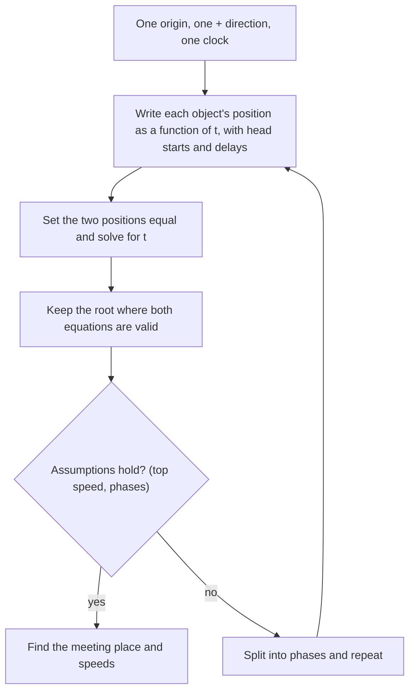

## One clock, two objects

The constant-acceleration lesson followed one object at a time. Many real questions involve two: a police car chasing a speeder, a car closing on a slower truck, two trains on the same track. The physics is no harder (each object still obeys $x = x_0 + v_0t + \tfrac12at^2$), but the bookkeeping is, and most mistakes in these problems are bookkeeping mistakes. This lesson gives a method that works every time, a second method borrowed from the relative-motion lesson that is often faster, and then applies both to a question every driver faces: how much room do you need to stop?

## Writing both motions on one set of axes

The rule is simple: *one origin, one positive direction, one clock*, shared by both objects. Write each object's position as a function of that common time $t$. Two objects are side by side when their positions are equal, so a **meeting time** is a solution of

$$x_A(t) = x_B(t).$$

Head starts go into $x_0$; a late start goes into the time (an object that starts moving at $t = 2$ s has positions in terms of $t - 2$, or you can restart the clock at that moment and give the other object its head start). Because the positions are usually quadratic in $t$, the meeting condition is usually a quadratic equation, and its two roots need interpreting: a root that falls before an object started, or after an assumption stopped holding, is not a real meeting.



### Example 1

A car speeding at a steady 25 m/s passes a parked police car. At that instant the police car starts from rest with a constant acceleration of 2.5 m/s². When and where does it catch the speeder, and how fast is it going then?

Origin at the police car, $+x$ along the road, $t = 0$ as the speeder passes:

$$x_S = 25t, \qquad x_P = \tfrac12(2.5)t^2 = 1.25t^2.$$

Setting them equal: $1.25t^2 = 25t$, so $t(1.25t - 25) = 0$. The root $t = 0$ is the passing moment itself; the catch is at $t = 25/1.25 = 20$ s. Position: $x = 25(20) = 500$ m. The police car's speed: $v = 2.5(20) = 50$ m/s.

That 50 m/s is exactly twice the speeder's speed, and it is no accident. Both cars covered the same distance in the same time, so their *average* velocities were equal. The police car's average velocity, for constant acceleration from rest, is half its final velocity, so its final velocity must be $2 \times 25$ m/s. The $v$–$t$ graph shows the same thing: the areas under the two lines are equal at the catch.

```plot
{"x": [0, 24], "y": [0, 700], "xLabel": "t (s)", "yLabel": "x (m)", "functions": [{"f": "25*x", "from": 0, "to": 24, "label": "speeder"}, {"f": "1.25*x^2", "from": 0, "to": 21.5, "label": "police", "dashed": true}], "points": [{"at": [20, 500]}], "labels": [{"at": [7, 560], "text": "catch (dot): 20 s, 500 m"}], "caption": "Positions of the two cars: they meet where the line and the parabola cross"}
```

```plot
{"x": [0, 24], "y": [0, 60], "xLabel": "t (s)", "yLabel": "v (m/s)", "functions": [{"f": "25", "from": 0, "to": 23, "label": "speeder"}, {"f": "2.5*x", "from": 0, "to": 22, "label": "police", "dashed": true}], "points": [{"at": [10, 25]}], "labels": [{"at": [6.5, 35], "text": "dot: equal speeds, largest gap"}], "caption": "Velocities: at 20 s the triangle under the police line has the same area as the rectangle under the speeder's"}
```

The second graph also answers a question students often get wrong: when is the speeder farthest ahead? Not at the start, and not at the catch, but at $t = 10$ s, when the two speeds are equal. Before that the speeder is faster and the gap grows; after it the police car is faster and the gap shrinks. (Gap at 10 s: $250 - 125 = 125$ m.)

### Example 2

Now make it more realistic. The police car starts 2.0 s after the speeder passes, accelerates at 2.5 m/s², but only until it reaches its pursuit speed of 35 m/s, which it then holds. When and where does it catch the 25 m/s speeder?

Restart the clock when the police car starts. The speeder then has a head start of $25 \times 2.0 = 50$ m.

First test the simple model. With no speed limit, $1.25t^2 = 50 + 25t$ gives $t = 21.8$ s, at which moment the police car would be doing $2.5 \times 21.8 = 54.6$ m/s. That breaks the 35 m/s assumption, so this root is not the answer, and the motion must be split into phases.

Phase 1 (accelerating): it reaches 35 m/s at $t_1 = 35/2.5 = 14.0$ s, having gone $\tfrac12(2.5)(14.0)^2 = 245$ m. The speeder is then at $50 + 25(14.0) = 400$ m, still 155 m ahead, so there was no catch during phase 1.

Phase 2 (both at constant speed): the gap of 155 m closes at $35 - 25 = 10$ m/s, taking 15.5 s. The catch is at $t = 14.0 + 15.5 = 29.5$ s after the police car starts, at $245 + 35(15.5) = 787.5 \approx 788$ m from the start. Check with the speeder: $50 + 25(29.5) = 787.5$ m. They agree.

## The relative-frame shortcut

When one object moves at constant velocity, ride along with it. In its frame, the other object's velocity is the difference of the two velocities, and (because frames moving at constant velocity agree on acceleration) its acceleration is unchanged. A two-object problem becomes a one-object problem.

### Example 3

A car traveling at 30 m/s comes up behind a truck doing a steady 12 m/s in the same lane. When the gap is 40 m, the driver brakes at 5.0 m/s². (a) Does the car hit the truck? (b) Repeat if the driver needs a **reaction time** of 0.50 s before braking begins.

In the truck's frame, the truck is parked and the car approaches at $30 - 12 = 18$ m/s, slowing at 5.0 m/s². The car avoids a collision if it stops (relative to the truck) within the gap. Its relative stopping distance is

$$\frac{18^2}{2(5.0)} = 32.4 \text{ m}.$$

(a) $32.4 < 40$ m: no collision. The closest approach is $40 - 32.4 = 7.6$ m, reached when the car's speed has dropped to the truck's 12 m/s. (In the ground frame the car travels much farther than 32.4 m; the truck keeps moving away the whole time.)

(b) During the reaction time the car closes the gap at 18 m/s without braking: $18 \times 0.50 = 9.0$ m. Only 31.0 m remain, less than the 32.4 m needed, so the car hits the truck. Solving $31.0 = 18t - 2.5t^2$ gives $t = 2.85$ s after braking starts, when the relative speed is still $18 - 5.0(2.85) = 3.7$ m/s (about 13 km/h). To avoid it the driver would need $a = 18^2/(2 \times 31.0) = 5.2$ m/s².

Half a second of inattention turned a 7.6 m margin into a collision. That is the arithmetic behind "don't tailgate".

## Stopping distance

A driver who sees a hazard does nothing useful for the reaction time $t_r$ (seeing, deciding, moving a foot to the brake), so the car keeps going at its original speed. Then it brakes. The **stopping distance** is the sum of the two parts:

$$d = \underbrace{v t_r}_{\text{reaction distance}} + \underbrace{\frac{v^2}{2a}}_{\text{braking distance}}.$$

The **reaction distance** grows in proportion to speed; the **braking distance** grows with the square of speed. At low speed reaction dominates; at highway speed braking does. The table uses $t_r = 1.5$ s and $a = 7.0$ m/s², a typical value for a hard stop on dry pavement (both numbers vary a lot between drivers, cars, tires and roads; they are illustrative, not standards).

| Speed (km/h) | Speed (m/s) | Reaction distance (m) | Braking distance (m) | Stopping distance (m) |
|---|---|---|---|---|
| 30 | 8.3 | 12.5 | 5.0 | 17.5 |
| 50 | 13.9 | 20.8 | 13.8 | 34.6 |
| 70 | 19.4 | 29.2 | 27.0 | 56.2 |
| 90 | 25.0 | 37.5 | 44.6 | 82.1 |
| 110 | 30.6 | 45.8 | 66.7 | 112.5 |

```plot
{"x": [0, 120], "y": [0, 130], "xLabel": "speed (km/h)", "yLabel": "distance (m)", "functions": [{"f": "(x/3.6)*1.5", "from": 0, "to": 115, "label": "reaction", "dashed": true}, {"f": "(x/3.6)*1.5 + (x/3.6)^2/14", "from": 0, "to": 115, "label": "stopping"}], "caption": "Stopping distance (solid) and its reaction part (dashed) for a 1.5 s reaction time and 7.0 m/s² braking; the gap between them is the braking distance"}
```

Going from 50 to 70 km/h, 40% faster, raises the stopping distance by about 62%. US highway designers, wanting a margin for nearly every driver, assume a generous 2.5 s reaction time and a gentle 3.4 m/s² deceleration when they work out how far ahead a driver must be able to see.

## The yellow-light dilemma

A light turns yellow as you approach. You can stop if your stopping distance fits before the stop line. In the simple model used here, you can go if, at constant speed, you clear the far side of the intersection before the light turns red. There may be a stretch of road where you can do neither: the **dilemma zone**, analyzed by Gazis, Herman and Maradudin in 1960.

### Example 4

A car approaches at 15 m/s (54 km/h). The driver's reaction time is 1.0 s and the car brakes at 5.0 m/s². The yellow lasts 3.0 s and the intersection is 15 m wide. Ignore the car's length.

Stopping needs $15(1.0) + \dfrac{15^2}{2(5.0)} = 15 + 22.5 = 37.5$ m, so the driver can stop only if the light changes at least 37.5 m before the line.

Going: in 3.0 s the car covers $15 \times 3.0 = 45$ m, which must include the 15 m of intersection, so the car clears only if the light changes within $45 - 15 = 30$ m of the line.

Between 30 m and 37.5 m from the line, the driver can do neither: that 7.5 m stretch is the dilemma zone.


The zone disappears if the yellow is long enough that $v t_y - W \ge v t_r + v^2/(2a)$; here that needs $t_y \ge 3.5$ s. Real signal timing uses the same physics, split in two: a yellow long enough to stop comfortably or reach the line (engineers use about 1 s of reaction and a comfortable 3 m/s², not an emergency stop), then a short all-red interval during which cars already in the intersection clear it. Rules about entering on yellow differ between places, so treat this example as a model of the physics, not of any traffic law.

## Common mistakes

- Using a different origin or clock for each object, so the "meeting" equation compares positions measured from different places.
- Forgetting the head start (or the delay) when one object starts later.
- Accepting a root without checking it: a negative time, or a time when an assumption such as a top speed has already failed.
- Thinking the gap is largest at the start; it is largest when the speeds are equal.
- In the moving frame, using the absolute speed instead of the difference of speeds.
- Leaving out the reaction distance, which is the larger part of stopping distance at town speeds.

## Key points

- Give both objects one origin, one positive direction and one clock; they meet where $x_A(t) = x_B(t)$.
- Check each root against the assumptions; if one fails, split the motion into phases.
- A chaser starting from rest at constant acceleration catches a constant-speed object when its speed is twice that object's speed.
- If one object moves at constant velocity, its frame turns the chase into a one-object problem with the relative velocity and the same acceleration.
- Stopping distance $= vt_r + v^2/(2a)$: reaction distance grows with $v$, braking distance with $v^2$.
- A dilemma zone exists when the yellow is too short for the distance a car can neither stop in nor clear.
