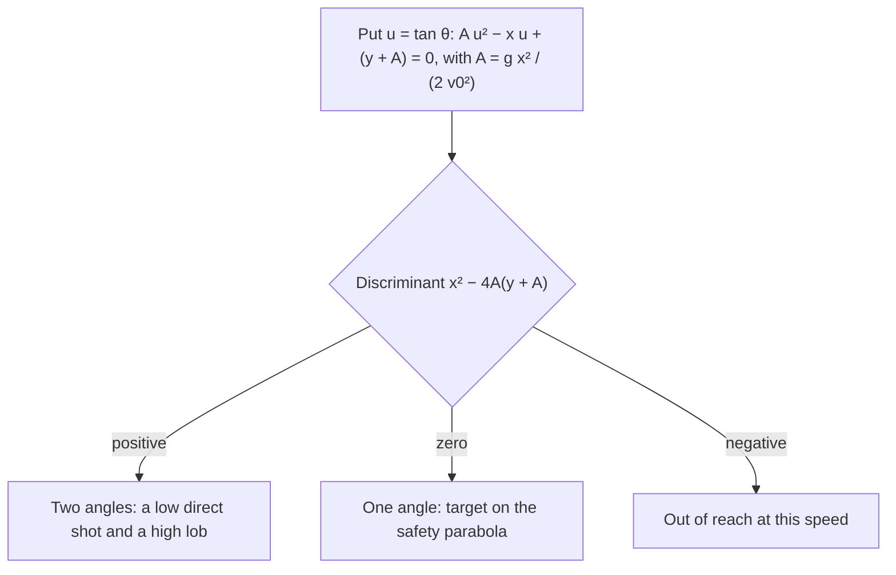

## Turning the question around

The projectile lesson asked: given the launch, where does it land? Archers, basketball players, firefighters and artillery crews face the reverse question: given a target, how should I launch? With the launch speed fixed (a hose, a cannon, a strong but limited arm), the only choice is the angle, and that turns out to be a quadratic problem with zero, one or two answers. The same algebra shows how far *any* shot can possibly reach, why a shot from a height should go out lower than $45^\circ$, and how to handle a launch up or down a hill. As in the core lesson, air resistance is ignored throughout, $g = 9.8$ m/s², and $y$ is measured up from the launch point.

## The angle to hit a target

Eliminating $t$ from $x = v_0\cos\theta\,t$ and $y = v_0\sin\theta\,t - \tfrac12gt^2$ gave the path

$$y = x\tan\theta - \frac{g x^2}{2v_0^2\cos^2\theta}.$$

The trick is the identity $\dfrac{1}{\cos^2\theta} = 1 + \tan^2\theta$, which leaves only one trig function. Write $u = \tan\theta$ and $A = \dfrac{gx^2}{2v_0^2}$ (a positive number once the target is known):

$$y = xu - A(1 + u^2) \quad\Longrightarrow\quad A u^2 - x u + (y + A) = 0.$$

This is a quadratic in $u$. Its discriminant $x^2 - 4A(y + A)$ decides everything:



The two-angle case is familiar from level ground, where complementary angles give the same range. The low shot arrives sooner and flatter; the **lob** stays up longer and comes down steeply, which is why a basketball shot or a mortar uses the high one.

### Example 1

A ball can be thrown at 20 m/s. At what angles must it be thrown to land on a ledge 30 m away and 5.0 m above the launch point?

$A = \dfrac{9.8(30)^2}{2(20)^2} = \dfrac{8820}{800} = 11.025$ m. The quadratic is

$$11.025u^2 - 30u + 16.025 = 0.$$

Discriminant: $30^2 - 4(11.025)(16.025) = 900 - 706.7 = 193.3 > 0$, so two angles work:

$$u = \frac{30 \pm \sqrt{193.3}}{2(11.025)} = \frac{30 \pm 13.90}{22.05}, \qquad u = 0.730 \text{ or } 1.991.$$

So $\theta = \tan^{-1}(0.730) = 36.1^\circ$ or $\theta = \tan^{-1}(1.991) = 63.3^\circ$. The flight times, $t = x/(v_0\cos\theta)$, are 1.86 s and 3.34 s. Check the low shot: $30(0.730) - 11.025(1 + 0.730^2) = 21.90 - 16.90 = 5.0$ m. It works.

## The safety parabola: everything within reach

Which targets can be hit at all? Those where the discriminant is not negative: $x^2 \ge 4A(y + A)$. Dividing by $4A$ and putting $A$ back in,

$$y \le \frac{v_0^2}{2g} - \frac{g x^2}{2v_0^2}.$$

The boundary curve is itself a downward parabola, called the **safety parabola** (or envelope): every trajectory at speed $v_0$ touches it at exactly one point and never crosses it. Points under it can be hit at two angles, points on it at one, points above it not at all. Two checks: at $x = 0$ it gives the height of a straight-up throw, $v_0^2/(2g)$; at $y = 0$ it gives $x = v_0^2/g$, the level-ground range at $45^\circ$.

```plot
{"x": [0, 44], "y": [0, 23], "equal": true, "xLabel": "x (m)", "yLabel": "y (m)", "functions": [{"f": "20.408 - 0.01225*x^2", "from": 0, "to": 40.82, "dashed": true}, {"f": "x*tand(30) - 9.8*x^2/(800*cosd(30)^2)", "from": 0, "to": 35.35}, {"f": "x - 9.8*x^2/400", "from": 0, "to": 40.82}, {"f": "x*tand(60) - 9.8*x^2/(800*cosd(60)^2)", "from": 0, "to": 35.35}, {"f": "x*tand(75) - 9.8*x^2/(800*cosd(75)^2)", "from": 0, "to": 20.41}], "points": [{"at": [30, 5]}], "labels": [{"at": [34, 17], "text": "safety parabola (dashed)"}, {"at": [25.6, 5.6], "text": "target →"}], "caption": "Paths at 20 m/s for 30°, 45°, 60° and 75°: each touches the dashed safety parabola once; the ledge target of Example 1 lies inside it"}
```

On a double root the quadratic gives $u = \dfrac{x}{2A} = \dfrac{v_0^2}{gx}$, so the one angle that reaches a boundary point has $\tan\theta = v_0^2/(gx)$.

### Example 2

From the top of a cliff 20 m high, a stone is thrown at 20 m/s. What is the farthest it can land from the base, and at what angle should it be thrown? Compare with a $45^\circ$ throw.

The landing point is at $y = -20$ m. The farthest landing point is on the safety parabola:

$$-20 = \frac{20^2}{2(9.8)} - \frac{9.8x^2}{2(20)^2} \;\Rightarrow\; 0.01225x^2 = 20.41 + 20 = 40.41 \;\Rightarrow\; x = 57.4 \text{ m}.$$

The angle: $\tan\theta = \dfrac{v_0^2}{gx} = \dfrac{400}{9.8(57.4)} = 0.711$, so $\theta = 35.4^\circ$.

At $45^\circ$: $v_{0x} = v_{0y} = 14.14$ m/s, and $-20 = 14.14t - 4.9t^2$ gives $t = 3.93$ s, so $x = 55.5$ m, about 2 m shorter. In general the best angle from a height $h$ satisfies $\tan\theta = v_0/\sqrt{v_0^2 + 2gh}$, always below $45^\circ$: the stone has extra time to fall, so it pays to trade height for horizontal speed. This is one reason shot-putters, who release about 2 m up, throw well below $45^\circ$ (another is that people can throw faster at lower angles).

## Launching on a slope

Suppose the ground itself slopes up at angle $\alpha$, so it is the line $y = x\tan\alpha$, and the projectile is launched from a point on it at angle $\theta$ above the horizontal.


Landing means the path meets the slope: $x\tan\alpha = x\tan\theta - \dfrac{gx^2}{2v_0^2\cos^2\theta}$. Dividing by $x$ (the root $x = 0$ is the launch):

$$x = \frac{2v_0^2\cos^2\theta\,(\tan\theta - \tan\alpha)}{g}, \qquad d = \frac{x}{\cos\alpha}.$$

With the sum and product formulas from trigonometry this simplifies to $d = \dfrac{v_0^2\,[\sin(2\theta - \alpha) - \sin\alpha]}{g\cos^2\alpha}$. Only $\sin(2\theta - \alpha)$ depends on the launch angle, and it is largest when $2\theta - \alpha = 90^\circ$:

$$\theta_{\text{best}} = 45^\circ + \frac{\alpha}{2}, \qquad d_{\max} = \frac{v_0^2}{g(1 + \sin\alpha)}.$$

The best direction bisects the angle between the slope and the vertical. For a level slope ($\alpha = 0$) everything reduces to the familiar $45^\circ$ and $v_0^2/g$. For a downhill slope put in a negative $\alpha$: the best angle drops below $45^\circ$ and the reach grows.

### Example 3

A ball is thrown at 15 m/s, $50^\circ$ above the horizontal, up a hill that slopes at $20^\circ$. How far up the slope does it land, and how far could it go at the best angle?

$x = \dfrac{2(15)^2\cos^2 50^\circ(\tan 50^\circ - \tan 20^\circ)}{9.8} = \dfrac{450(0.4132)(1.1918 - 0.3640)}{9.8} = 15.7$ m, so $d = 15.7/\cos 20^\circ = 16.7$ m along the slope. Check: the flight time is $15.7/(15\cos 50^\circ) = 1.63$ s, and the height then is $11.49(1.63) - 4.9(1.63)^2 = 5.72$ m, which equals $15.7\tan 20^\circ = 5.72$ m. It is on the slope.

Best angle: $45^\circ + 10^\circ = 55^\circ$, giving $d_{\max} = \dfrac{225}{9.8(1 + \sin 20^\circ)} = \dfrac{225}{13.15} = 17.1$ m. The $50^\circ$ throw was close to the best.

## Aim straight at a falling target

A classic demonstration, often called the monkey and the hunter: a launcher is aimed straight at a target hanging some distance away, and the target is released at the instant of firing. Without gravity the projectile would fly along the line of sight and hit the target where it hung. With gravity, both the projectile and the target fall $\tfrac12gt^2$ below where they would otherwise be, at every instant. So when the projectile reaches the target's horizontal position, both have dropped the same distance: it hits, whatever the launch speed, as long as it gets there before the target reaches the ground.

### Example 4

A dart is aimed straight at a target 20 m away horizontally and 10 m up, and fired at 25 m/s as the target is dropped. Where do they meet?

The aim angle has $\tan\theta = 10/20$, so $\theta = 26.6^\circ$ and $v_{0x} = 25\cos 26.6^\circ = 22.4$ m/s. The dart reaches $x = 20$ m at $t = 20/22.4 = 0.894$ s. Both have fallen $\tfrac12(9.8)(0.894)^2 = 3.92$ m, so they meet $10 - 3.92 = 6.08$ m above the ground. (A launch slower than about 15.7 m/s would fail: the target would hit the ground first.)


## Common mistakes

- Solving for $\theta$ with only $\sin\theta$ or only $\cos\theta$ and getting stuck; use $1/\cos^2\theta = 1 + \tan^2\theta$ to get a quadratic in $\tan\theta$.
- Keeping one root of the quadratic and forgetting the lob, or reporting two angles when the discriminant is negative.
- Using $45^\circ$ for the best angle from a cliff or on a slope; it is best only when launch and landing heights match.
- On a slope, measuring the launch angle from the slope in one formula and from the horizontal in another.
- Thinking that aiming at a falling target needs a correction for gravity; the projectile and the target fall together.

## Key points

- To hit $(x, y)$ at speed $v_0$: $A\tan^2\theta - x\tan\theta + (y + A) = 0$ with $A = gx^2/(2v_0^2)$; two, one or no angles.
- Reachable points lie under the safety parabola $y = \dfrac{v_0^2}{2g} - \dfrac{gx^2}{2v_0^2}$.
- From a height, the best angle is below $45^\circ$: $\tan\theta = v_0/\sqrt{v_0^2 + 2gh}$.
- On a slope of angle $\alpha$: best launch $45^\circ + \alpha/2$ from the horizontal, $d_{\max} = v_0^2/[g(1 + \sin\alpha)]$.
- A projectile aimed straight at a target released at the instant of firing hits it, if it arrives before the target lands.
