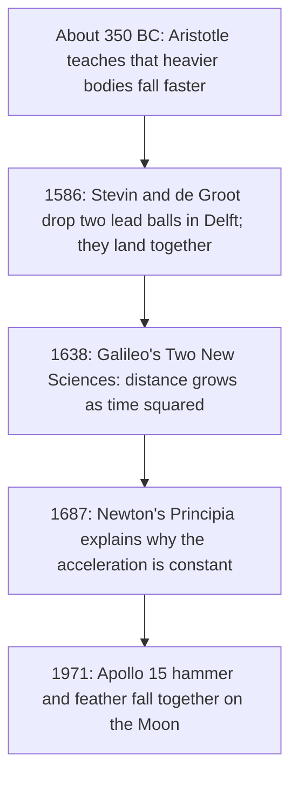

## A claim worth checking

The constant-acceleration lesson stated, as a fact, that every object falling freely near Earth speeds up at the same steady 9.8 m/s², whatever its mass. That fact is neither obvious nor old. For about two thousand years the standard teaching was different, and the evidence that overturned it had to be built with clever experiments, because a dropped stone hits the ground in well under a second and nobody had a clock that could time it. This lesson follows that evidence, and shows how you can test the same law today with a ruler, a stopwatch app and a graph.



## The old view and the first doubts

Aristotle taught, roughly, that a heavy body falls faster than a light one, in proportion to its weight, and that a falling body moves at a speed set by its weight and the medium it falls through. (This is a simplified summary of a subtle philosophy, but it is the part later scientists argued with.) Everyday experience seems to agree: a stone does beat a leaf.

Galileo attacked the idea with a thought experiment. Tie a heavy stone to a light one. If light things fall slower, the light stone should hold the heavy one back, so the pair falls slower than the heavy stone alone. But the pair is heavier than the heavy stone, so it should fall faster. Both conclusions can't be right, so the premise is wrong. The leaf loses to the stone because of air, not weight.

Experiments agreed. In 1586 the Flemish engineer Simon Stevin reported that he and Jan Cornets de Groot dropped two lead balls, one about ten times heavier than the other, about 30 feet from a church tower in Delft, and heard them hit a board below at the same moment. The more famous story of Galileo dropping balls from the Leaning Tower of Pisa comes from his student and biographer Vincenzo Viviani, written long afterward; historians doubt it happened as told. In 1971, on the airless Moon, Apollo 15 commander David Scott dropped a hammer and a feather together on live television, and they landed together.

## Slowing gravity down: the inclined plane

Showing that objects fall *together* is easier than showing *how* they fall. Galileo's answer, described in his *Two New Sciences* (1638), was to "dilute" gravity: let a ball roll down a long, gently sloping, smooth groove. The motion is the same kind as free fall, only slower, so it can be timed. He timed it with a water clock, weighing the water that flowed out of a container while the ball rolled.

His result: starting from rest, the distance covered is proportional to the **square** of the time. In 2 time units the ball goes 4 times as far as in 1, in 3 units 9 times as far. Equivalently, the distances covered in successive equal intervals go as the odd numbers 1, 3, 5, 7, …, a pattern called the **odd-number rule**.


### Why constant acceleration gives the odd-number rule

From rest with constant acceleration $a$, the distance after time $t$ is $\tfrac12at^2$. Take equal intervals of length $\tau$. The distance covered during the $n$th interval is

$$d_n = \tfrac12a(n\tau)^2 - \tfrac12a\big((n - 1)\tau\big)^2 = \tfrac12a\tau^2\,(2n - 1).$$

So $d_1 : d_2 : d_3 : \dots = 1 : 3 : 5 : \dots$. The argument also runs backward: if the interval distances follow the odd numbers, the speed is gaining the same amount in every interval, which is what constant acceleration means. Checking the odd-number rule is therefore a test of constant acceleration that needs only equal time intervals and a ruler, with no need to know the size of the time unit.

### Example 1

A ball falls freely from rest. How far does it fall in each of the first four 0.10 s intervals? ($g = 9.8$ m/s²)

$\tfrac12g\tau^2 = \tfrac12(9.8)(0.10)^2 = 0.049$ m $= 4.9$ cm. The intervals cover $4.9 \times 1, 3, 5, 7$: that is 4.9 cm, 14.7 cm, 24.5 cm and 34.3 cm, for a total of 78.4 cm $= 4.9 \times 16$ cm after 0.40 s.

### Example 2

In a Galileo-style experiment a ball rolls 0.30 m down a ramp in the first second after release. Predict the distance it covers in the second second, its total distance after 3.0 s, and its acceleration.

By the odd-number rule the second second covers $3 \times 0.30 = 0.90$ m. After 3 s the total is $3^2 \times 0.30 = 2.7$ m (check: $0.30 + 0.90 + 1.50 = 2.70$). From $0.30 = \tfrac12a(1.0)^2$, $a = 0.60$ m/s², far smaller than $g$, which is exactly why the ramp made timing possible.

Why is the acceleration on a ramp constant and smaller than $g$? The forces lesson (next module) shows that an object sliding without friction down an incline of angle $\theta$ has $a = g\sin\theta$. A rolling ball accelerates less again, because some of the effect of gravity goes into making it spin (for a solid ball, $a = \tfrac57 g\sin\theta$, as the rolling lesson shows), but the acceleration is still constant, so the times-squared law still holds. A ramp angle of a few degrees is enough to slow things down by a factor of ten or more.

## Measuring g today: make the graph a straight line

Modern labs drop an object through light gates (a **photogate** is a beam of light and a detector that records the instant something blocks the beam) or track it with a motion sensor or video. A good way to analyze the data is to arrange it so the theory predicts a straight line, a technique called linearizing.

The model $h = \tfrac12gt^2$ is not a line in $h$ against $t$. But plotted against $t^2$ it is: $h = \left(\tfrac12g\right)(t^2)$ has the form $y = mx$ with slope $m = \tfrac12g$. A straight line through the origin confirms the model, and the slope measures $g = 2m$. A best-fit line uses every data point, so random timing errors partly cancel.

### Example 3

A student drops a ball from rest through a photogate placed at five heights below the release point and records the fall times:

| $h$ (m) | 0.20 | 0.40 | 0.60 | 0.80 | 1.00 |
|---|---|---|---|---|---|
| $t$ (s) | 0.203 | 0.286 | 0.350 | 0.404 | 0.452 |
| $t^2$ (s²) | 0.0412 | 0.0818 | 0.1225 | 0.1632 | 0.2043 |

Find $g$.

```plot
{"x": [0, 0.23], "y": [0, 1.15], "xLabel": "t² (s²)", "yLabel": "h (m)", "functions": [{"f": "4.907*x - 0.0016", "from": 0, "to": 0.22, "label": "best fit"}], "points": [{"at": [0.0412, 0.2]}, {"at": [0.0818, 0.4]}, {"at": [0.1225, 0.6]}, {"at": [0.1632, 0.8]}, {"at": [0.2043, 1.0]}], "caption": "Height against time squared: a straight line through (nearly) the origin, slope 4.91 m/s²"}
```

The points lie on a straight line through (nearly) the origin, confirming $h \propto t^2$. Slope from the first and last points: $\dfrac{1.00 - 0.20}{0.2043 - 0.0412} = \dfrac{0.80}{0.1631} = 4.90$ m/s². A least-squares fit (calculator or spreadsheet) gives slope 4.91 m/s² and intercept $-0.002$ m, close to zero as the model predicts. So $g = 2 \times 4.91 = 9.81$ m/s². A clearly nonzero intercept would point to a systematic error, such as a gate that starts the timer a little late.

Note what the straight line tells you that a single drop cannot: one drop gives a value of $g$ by assuming the model, while five drops on a line *test* the model.

### Example 4: measuring your own reaction time

A friend holds a ruler vertically with its zero mark between your open fingers, then lets go without warning. You catch it after it has fallen 18 cm. What is your reaction time?

The ruler falls freely from rest, so $d = \tfrac12gt^2$ and $t = \sqrt{2d/g} = \sqrt{2(0.18)/9.8} = 0.19$ s. This simple test measures only the reaction to an expected event with your hand already in place; reaction times in traffic, where a driver must notice, decide and move a foot, are several times longer, which is why stopping-distance calculations use 1 s or more.

## How constant is g?

"Constant" means constant during a fall of a few meters. Over Earth's surface, the measured free-fall acceleration varies from about 9.78 m/s² at the equator to about 9.83 m/s² at the poles (because of Earth's spin and its slightly flattened shape), and it decreases slowly with altitude. For calculations and for defining units, scientists use a fixed **standard gravity**, $g_n = 9.80665$ m/s² exactly. The course's 9.8 m/s² is that value to two significant figures.

## Common mistakes

- Expecting equal distances in equal times; for constant acceleration from rest they grow as 1, 3, 5, 7.
- Applying the odd-number rule when the object does not start from rest at the first mark.
- Plotting $h$ against $t$ and trying to read $g$ from a curve; plot against $t^2$ and use the slope.
- Forgetting the factor of 2: the slope of $h$ against $t^2$ is $g/2$, not $g$.
- Thinking a ramp changes the kind of motion; it lowers the acceleration but keeps it constant.

## Key points

- Without air resistance, all bodies fall with the same constant acceleration; air explains why a leaf loses to a stone.
- Galileo slowed free fall on an inclined plane and found distance $\propto t^2$.
- From rest at constant acceleration, distances in successive equal intervals go as $1 : 3 : 5 : 7 : \dots$ (the odd-number rule), because $d_n = \tfrac12a\tau^2(2n - 1)$.
- Linearize to test a model: $h$ against $t^2$ is a straight line of slope $g/2$.
- A dropped ruler measures reaction time: $t = \sqrt{2d/g}$.
- $g$ ranges from about 9.78 to 9.83 m/s² over Earth's surface; standard gravity is 9.80665 m/s².
