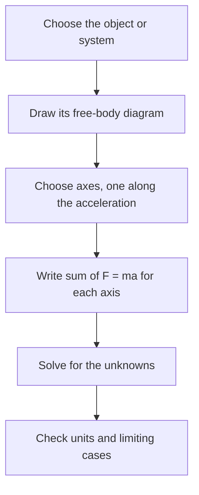

## From describing motion to explaining it

Kinematics told us how to describe motion. Dynamics asks why objects move the way they do, and Newton's three laws answer that for everything from falling apples to orbiting satellites. The central quantity is **force**: a push or pull exerted by one object on another, measured in newtons (N). Forces are vectors, so all the component methods from the vectors lesson come straight back.

## Newton's first law

An object stays at rest, or keeps moving in a straight line at constant speed, unless a net force acts on it. This is **Newton's first law**, the law of **inertia**: the tendency of matter to keep its current velocity. A hockey puck sliding on ice slows only because of small friction forces; with none, it would glide forever.

The first law corrects an intuition many people hold: that motion needs a force to sustain it. It doesn't. A force is needed to *change* motion. The law also defines the frames we work in: it holds in inertial frames (non-accelerating ones). In an accelerating car, a coffee cup slides backward with no force pushing it; that's the car accelerating out from under it.

## Newton's second law

The **net force** $\vec F_{\text{net}} = \sum\vec F$ is the vector sum of all forces on an object. **Newton's second law** says

$$\sum \vec F = m\vec a.$$

The acceleration points the same way as the net force, and the **mass** $m$ measures how strongly the object resists acceleration. The same push gives a shopping cart a large acceleration and a car a tiny one. This is also where the newton comes from: 1 N gives 1 kg an acceleration of 1 m/s².

Because it is a vector equation, it is really one equation per axis:

$$\sum F_x = ma_x, \qquad \sum F_y = ma_y.$$

If the net force is zero, $\vec a = 0$, and the object is in **equilibrium** (at rest, or moving at constant velocity; both count).

## Weight and the normal force

The **weight** of an object is the gravitational force Earth exerts on it, $\vec W = m\vec g$, magnitude $mg$, pointing down. Mass is in kilograms and is the same everywhere; weight is a force in newtons and depends on the local $g$. A 70 kg astronaut weighs 686 N on Earth and about 113 N on the Moon, where $g = 1.62$ m/s², but her mass is 70 kg in both places.

When an object presses on a surface, the surface pushes back perpendicular to itself. This is the **normal force** $\vec n$ ("normal" means perpendicular). It is whatever size is needed to stop the object sinking into the surface, so don't assume $n = mg$; find it from Newton's second law in the perpendicular direction. A book on a flat table has $n = mg$, but push down on the book and $n$ grows; tilt the table and $n$ shrinks.

## Newton's third law

Forces come in pairs. If object A exerts a force on B, then B exerts a force on A of equal magnitude and opposite direction:

$$\vec F_{\text{A on B}} = -\vec F_{\text{B on A}}.$$

This is **Newton's third law**. The two forces of a pair act on *different* objects, so they never cancel each other in a single object's free-body diagram. When you push on a wall, the wall pushes back on you equally. When Earth pulls a falling apple down with force $mg$, the apple pulls Earth up with force $mg$; Earth's enormous mass makes its acceleration immeasurably small.

The picture below pulls the objects apart so you can see each pair. Each arrow belongs to the object it starts on: two forces act on the book, and their partners act on the table and on Earth.


A classic confusion: the weight of a book on a table and the normal force on the book are equal and opposite, but they are not a third-law pair. They act on the same object (the book), and they are different kinds of force. The third-law partner of the book's weight is the book's pull on Earth; the partner of the normal force is the book pushing down on the table.

## Free-body diagrams

A **free-body diagram** (FBD) isolates one object and shows every force acting *on* it, as arrows starting from the object. It is the single most important step in a dynamics problem. A reliable method:

1. Choose the object (or system) and draw it as a dot or simple box.
2. Draw its weight, $mg$ downward.
3. Go around the object's boundary: everything touching it can exert a force (normal force, friction, tension in an attached rope, an applied push).
4. Add any non-contact forces (electric, magnetic) if relevant.
5. Choose axes, ideally with one along the acceleration.
6. Write $\sum F_x = ma_x$ and $\sum F_y = ma_y$, and solve.

Never put "$ma$" on the diagram as a force; it's the result of the forces, not one of them.

The whole method, from choosing the object to the answer, as a chart:



```shape
{"polygons": [{"points": [[-0.5, -0.5], [0.5, -0.5], [0.5, 0.5], [-0.5, 0.5]]}], "segments": [{"from": [0, 0.5], "to": [0, 2.2], "arrow": true, "label": "n"}, {"from": [0, -0.5], "to": [0, -2.2], "arrow": true, "label": "mg"}, {"from": [0.5, 0], "to": [2.4, 0], "arrow": true, "label": "F (applied)"}, {"from": [-0.5, 0], "to": [-1.4, 0], "arrow": true, "label": "f (friction)"}], "caption": "Free-body diagram of a box pushed across a floor"}
```

### Example 1

A 12 kg crate on a frictionless floor is pulled by a rope with tension 60 N directed $30^\circ$ above horizontal. Find the acceleration and the normal force.

Forces on the crate: weight $mg = 117.6$ N down, normal force $n$ up, tension 60 N at $30^\circ$.

$x$: $60\cos 30^\circ = 12a$, so $a = \dfrac{51.96}{12} = 4.33$ m/s².

$y$: the crate doesn't leave the floor, so $a_y = 0$: $n + 60\sin 30^\circ - 117.6 = 0$, giving $n = 117.6 - 30 = 87.6$ N. The upward pull of the rope reduces the normal force.

### Example 2: apparent weight in an elevator

A 60 kg person stands on a bathroom scale in an elevator. What does the scale read when the elevator (a) accelerates upward at 2.0 m/s², (b) moves up at constant speed, (c) accelerates downward at 2.0 m/s²?

The scale reads the normal force $n$ it exerts. Take up as positive: $n - mg = ma$, so $n = m(g + a)$.

(a) $n = 60(9.8 + 2.0) = 708$ N, heavier than her true weight of 588 N.

(b) $a = 0$, so $n = 588$ N. Constant velocity is equilibrium.

(c) $a = -2.0$: $n = 60(7.8) = 468$ N. If the cable snapped ($a = -g$), the scale would read zero: she would feel weightless, though gravity still acts on her fully. This **apparent weight** is what your body senses.

## Reasoning with proportions

Many questions about the second law need no numbers at all. Since $a = F_{\text{net}}/m$, acceleration is proportional to the net force and inversely proportional to the mass. Double the net force on the same object and the acceleration doubles; put the same net force on twice the mass and the acceleration halves.

### Example 3

A net force gives a cart an acceleration of 2.0 m/s². The net force is tripled and the cart is loaded so that its mass doubles. What is the new acceleration?

$a_{\text{new}} = \dfrac{3F}{2m} = \tfrac32\cdot\dfrac{F}{m} = 1.5 \times 2.0 = 3.0$ m/s². No individual values of $F$ or $m$ were needed, only the ratios.

## Systems of objects

When objects move together, you can apply the second law to the whole group or to any one member. For the whole group, forces the members exert on each other come in third-law pairs inside the system and cancel, so only outside forces count.

### Example 4

Boxes A (4.0 kg) and B (2.0 kg) sit side by side on a frictionless floor. A 30 N horizontal push on A moves both. Find their acceleration and the force A exerts on B.

Whole system (6.0 kg): the only horizontal outside force is the 30 N push, so $a = 30/6.0 = 5.0$ m/s².

Box B alone: the only horizontal force on it is the push from A, so $F_{\text{A on B}} = m_B a = 2.0(5.0) = 10$ N. By the third law B pushes back on A with 10 N, so the net force on A is $30 - 10 = 20$ N $= 4.0(5.0)$ ✓. The push from A on B is not 30 N: part of the 30 N goes into accelerating A itself.

Newton himself stated the second law in terms of momentum, $\vec F_{\text{net}} = \Delta\vec p/\Delta t$ with $\vec p = m\vec v$; for constant mass this is the same as $m\vec a$. You'll use that form in the momentum lesson.

## Common mistakes

- Thinking a moving object must have a net force in its direction of motion.
- Assuming $n = mg$ in every problem.
- Treating weight and normal force as a third-law pair.
- Drawing forces that the object exerts on others in its own free-body diagram.
- Including "$ma$" or "the force of motion" as a force.

## Key points

- First law: no net force, no change in velocity. Second law: $\sum\vec F = m\vec a$, one equation per axis. Third law: forces come in equal and opposite pairs on different objects.
- Weight $= mg$ downward; the normal force is perpendicular to the surface and found from the equations.
- Always draw a free-body diagram before writing equations.
- $a \propto F_{\text{net}}$ and $a \propto 1/m$: use ratios for "what if" questions.
- For objects moving together, internal forces cancel: $a = F_{\text{ext}}/m_{\text{total}}$.
