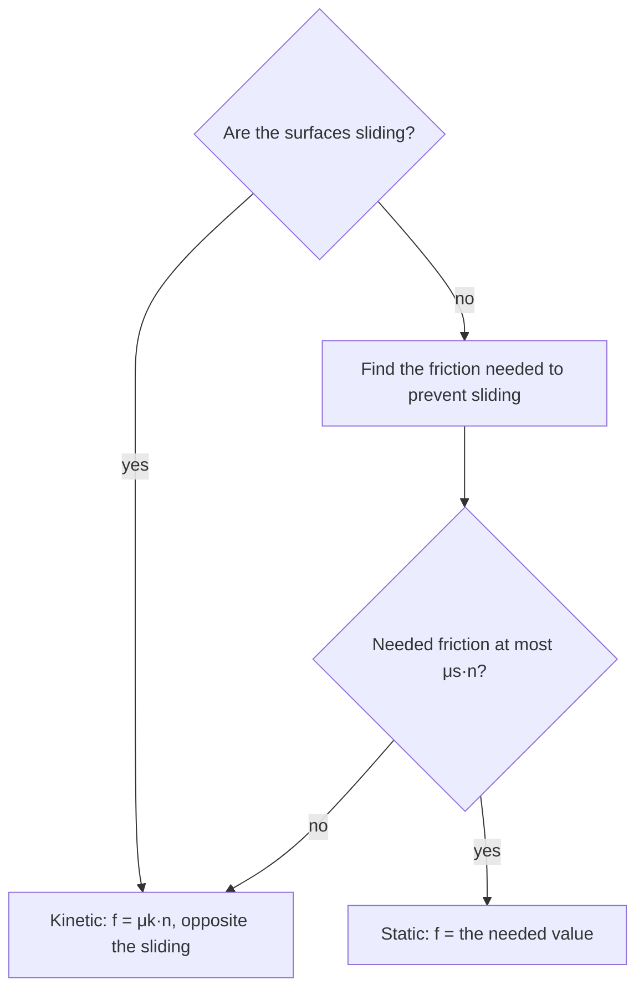

## Why things stop

Push a book across a table and it slows to a stop. The first law says something must be acting on it, and that something is **friction**: a force that surfaces in contact exert parallel to their surfaces, opposing sliding (or the tendency to slide). This lesson adds friction to Newton's second law and then puts it to work on the inclined plane, the standard testing ground for free-body diagrams.

## Kinetic and static friction

Microscopically, even polished surfaces are rough, and contact points form temporary bonds. Two empirical rules describe the result well enough for most purposes.

**Kinetic friction** acts when surfaces slide over each other. Its magnitude is

$$f_k = \mu_k n,$$

where $n$ is the normal force and $\mu_k$ is the **coefficient of kinetic friction**, a dimensionless number depending on the pair of surfaces (rubber on dry concrete is about 0.7, steel on ice about 0.03). It points opposite to the sliding velocity, and to a good approximation it doesn't depend on speed or contact area.

**Static friction** acts when surfaces are not sliding but something is trying to make them. It adjusts to whatever value keeps the surfaces stuck, up to a maximum:

$$f_s \le \mu_s n.$$

The **coefficient of static friction** $\mu_s$ is usually larger than $\mu_k$, which is why it takes more force to start a heavy box moving than to keep it moving. The key subtlety: $f_s = \mu_s n$ only at the verge of slipping. A box that you're pushing with 20 N without moving it has 20 N of static friction, no matter how large $\mu_s n$ is.

A graph shows how the two kinds fit together. Push a resting box with a slowly growing force: static friction grows with your push, matching it exactly, until it reaches $\mu_s n$. Then the box breaks free and friction drops to the smaller, roughly constant $\mu_k n$.

```plot
{"x": [0, 100], "y": [0, 70], "xLabel": "applied force (N)", "yLabel": "friction force (N)", "functions": [{"f": "x", "from": 0, "to": 50, "label": "static: f = F"}, {"f": "35", "from": 50, "to": 100, "label": "kinetic: μk n"}], "segments": [{"from": [50, 50], "to": [50, 35], "dashed": true}], "points": [{"at": [50, 50], "label": "μs n"}], "caption": "Friction on a box pushed with a growing force (here μs n = 50 N and μk n = 35 N): static friction matches the push up to μs n, then the box slides and friction drops to μk n"}
```

To decide which rule to use in a problem, follow this chart:



Friction depends on $n$, not on the weight. Pull up on a sled rope and $n$ drops, and so does the friction.

### Example 1

A 25 kg box rests on a floor with $\mu_s = 0.50$ and $\mu_k = 0.35$. (a) What horizontal force is needed to start it moving? (b) If you keep pushing with that force once it slides, what is its acceleration?

Normal force: $n = mg = 25(9.8) = 245$ N (no vertical forces besides $n$ and $mg$).

(a) Maximum static friction: $\mu_s n = 0.50(245) = 122.5$ N. You need just over 122.5 N.

(b) Once sliding, friction drops to $f_k = 0.35(245) = 85.75$ N. Net force: $122.5 - 85.75 = 36.75$ N, so $a = 36.75/25 = 1.47$ m/s².

## The inclined plane

An object on a ramp tilted at angle $\theta$ is the classic problem where good axes matter. Tilt the axes: $x$ along the slope (down the slope positive is often convenient), $y$ perpendicular to it. Then the normal force and friction lie along the axes, and only the weight needs splitting.

```shape
{"polygons": [{"points": [[0, 0], [6, 0], [6, 3.464]]}, {"points": [[3.118, 1.8], [3.81, 2.2], [3.41, 2.893], [2.718, 2.493]]}], "segments": [{"from": [3.264, 2.346], "to": [3.264, 0.346], "arrow": true}, {"from": [3.264, 2.346], "to": [2.398, 3.846], "arrow": true}, {"from": [3.264, 2.346], "to": [4.303, 2.946], "arrow": true}, {"from": [3.264, 2.346], "to": [2.398, 1.846], "arrow": true, "dashed": true}, {"from": [3.264, 2.346], "to": [4.13, 0.846], "arrow": true, "dashed": true}], "labels": [{"at": [3.6, 0.6], "text": "mg"}, {"at": [2.2, 3.95], "text": "n"}, {"at": [4.55, 3.1], "text": "f"}, {"at": [1.65, 1.75], "text": "mg sin θ"}, {"at": [4.85, 0.75], "text": "mg cos θ"}, {"at": [1.2, 0.25], "text": "θ = 30°"}], "caption": "Block on a 30° incline: weight mg splits into mg sin θ down the slope and mg cos θ into the slope (dashed); n balances mg cos θ and friction f points up the slope"}
```

The weight makes angle $\theta$ with the $-y$ axis (the same angle as the incline, because both pairs of lines are mutually perpendicular). The picture marks both angles: the vertical weight is turned from the into-the-slope direction by exactly the tilt of the ramp.


So:

- component down the slope: $mg\sin\theta$;
- component into the slope: $mg\cos\theta$.

Check the limits: at $\theta = 0$ (flat) the down-slope part vanishes; at $\theta = 90^\circ$ (vertical) it's all of $mg$. If you get them backwards, these limits will catch it.

Perpendicular to the slope there's no acceleration, so $n = mg\cos\theta$ (with no other perpendicular forces).

*Frictionless incline.* Along the slope: $mg\sin\theta = ma$, so $a = g\sin\theta$, independent of mass.

*With kinetic friction*, sliding down: $mg\sin\theta - \mu_k mg\cos\theta = ma$, so

$$a = g(\sin\theta - \mu_k\cos\theta).$$

Sliding up (after a push), friction also points down the slope: $a = -g(\sin\theta + \mu_k\cos\theta)$, a larger deceleration.

*On the verge of slipping* with static friction, $mg\sin\theta = \mu_s mg\cos\theta$, so

$$\tan\theta_{\max} = \mu_s.$$

That gives a simple way to measure $\mu_s$: tilt a board until the object just starts to slide and take the tangent of the angle.

### Example 2

A 4.0 kg block slides down a $35^\circ$ ramp with $\mu_k = 0.25$. Find its acceleration and the friction force.

$n = mg\cos 35^\circ = 4.0(9.8)(0.8192) = 32.1$ N, so $f_k = 0.25(32.1) = 8.03$ N up the slope.

$a = g(\sin 35^\circ - 0.25\cos 35^\circ) = 9.8(0.5736 - 0.2048) = 3.61$ m/s² down the slope.

Check using forces: $mg\sin 35^\circ = 22.5$ N down the slope, minus 8.03 N friction, leaves 14.45 N; divided by 4.0 kg gives 3.61 m/s².

### Example 3

A skier on a $20^\circ$ slope with $\mu_s = 0.10$: will she slide from rest?

$\tan 20^\circ = 0.364 > 0.10$, so static friction can't hold her and she starts sliding. A slope gentle enough to stand still on would need $\theta \le \tan^{-1}(0.10) = 5.7^\circ$.

## Air resistance and terminal velocity

Friction between solid surfaces is roughly constant, but fluid resistance (drag) grows with speed. Follow a skydiver who steps out of a plane:

1. At first her speed is zero, so drag is zero: the net force is $mg$ and she accelerates at $g$.
2. As she speeds up, drag grows, the net force $mg - F_D$ shrinks, and her acceleration drops below $g$. She is still speeding up, just more slowly.
3. Eventually drag equals her weight. The net force is zero, so her acceleration is zero and her speed stays constant: this is the terminal velocity.

```plot
{"x": [0, 25], "y": [0, 60], "xLabel": "t (s)", "yLabel": "v (m/s)", "functions": [{"f": "50*(1 - exp(-9.8*x/50))", "from": 0, "to": 25, "label": "v(t)"}, {"f": "50", "from": 0, "to": 25, "dashed": true}], "labels": [{"at": [15, 54], "text": "terminal velocity"}], "caption": "Falling with air resistance: the v–t graph starts with slope g and levels off at the terminal velocity"}
```

On the $v$–$t$ graph the slope (acceleration) starts at $g$ and decreases to zero as the curve levels off. Setting drag equal to weight gives the terminal speed. For slow motion through a thick fluid, drag is roughly proportional to speed, $F_D = bv$, so $bv_T = mg$ and $v_T = mg/b$. For fast objects in air, drag is closer to $F_D = \tfrac12 C\rho Av^2$ ($C$ a shape factor near 1, $\rho$ the air density, $A$ the cross-sectional area), so

$$v_T = \sqrt{\frac{2mg}{C\rho A}}.$$

A heavier object with the same shape needs more drag to balance its weight, so it falls faster: this is why, in air, a bowling ball beats a beach ball of the same size.

### Example 4

An 80 kg skydiver falls belly-down with $C = 1.0$ and cross-sectional area $A = 0.70$ m², in air of density 1.2 kg/m³. (a) Find her terminal speed. (b) What is her acceleration when she is moving at half that speed?

(a) $v_T = \sqrt{\dfrac{2(80)(9.8)}{(1.0)(1.2)(0.70)}} = \sqrt{\dfrac{1568}{0.84}} = \sqrt{1867} = 43$ m/s.

(b) Drag grows as $v^2$, so at half the terminal speed it is $\left(\tfrac12\right)^2 = \tfrac14$ of its terminal value, which is her weight. Net force: $mg - \tfrac14mg = \tfrac34mg$, so $a = \tfrac34(9.8) = 7.4$ m/s² downward.

## Common mistakes

- Using $f_s = \mu_s n$ when the object isn't on the verge of slipping.
- Using $n = mg$ on an incline or when a force pulls at an angle.
- Swapping $\sin$ and $\cos$ in the weight components (check $\theta = 0$ and $90^\circ$).
- Pointing kinetic friction along the motion instead of against it.
- Thinking friction depends on contact area or speed (in this model it doesn't).

## Key points

- Kinetic: $f_k = \mu_k n$, opposite the sliding. Static: $f_s \le \mu_s n$, just enough to prevent sliding.
- On an incline: $mg\sin\theta$ along the slope, $mg\cos\theta$ into it; $n = mg\cos\theta$.
- Frictionless: $a = g\sin\theta$. Sliding down with friction: $a = g(\sin\theta - \mu_k\cos\theta)$.
- Verge of slipping: $\tan\theta = \mu_s$.
- Terminal velocity: drag equals weight, so the net force and acceleration are zero ($v_T = mg/b$ for drag $bv$).
