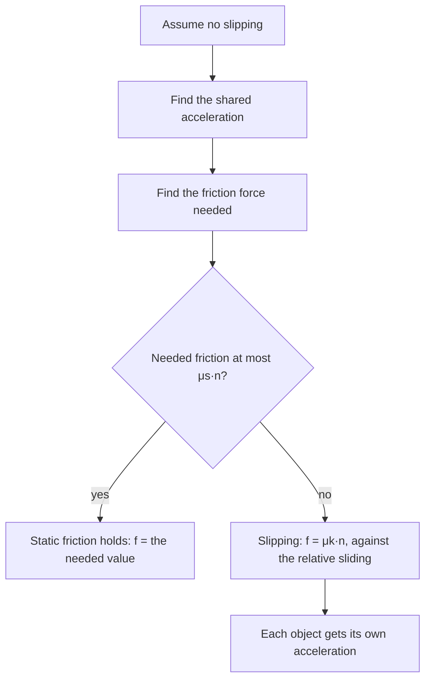

## When friction has to be figured out

In the friction lesson the direction of friction was usually obvious: a box slides right, so kinetic friction points left. In the tension lesson, ropes connected objects whose direction of motion was given. Harder problems combine the two, and then the obvious answers stop working. Which way does friction push on a book resting on an accelerating cart? Will a block on a ramp, tied to a hanging weight, slide up, slide down or stay put? How fast can a car take a banked curve before it skids? This honors lesson gives one method that answers all three, and shows that friction can just as easily speed an object up as slow it down.

## Static friction is an unknown, not a formula

The single most useful idea is this: static friction is whatever force is needed to keep two surfaces from sliding over each other, up to a limit. So in a static problem you treat its size and direction as unknowns, find them from Newton's second law, and only then compare the size with the limit $\mu_s n$. The procedure:

1. Assume the surfaces in question do not slip. Then the objects in contact share the same acceleration.
2. Solve for that acceleration and for the friction force $f$ needed to make it happen, letting the sign of $f$ tell you its direction.
3. Check: if $|f| \le \mu_s n$, the assumption was right and you are done.
4. If $|f| > \mu_s n$, the surfaces slip. Start over with kinetic friction, $f_k = \mu_k n$, pointing against the *relative* sliding, and with different accelerations for the two objects.

The moment when static friction is exactly at its limit, $f_s = \mu_s n$, is called **impending motion**. It marks the boundary between "holds" and "slips", so questions that ask for "the largest force before …" or "the steepest angle at which …" are impending-motion problems: set $f_s = \mu_s n$ and solve for the boundary value.

## Stacked blocks: friction that drives

Put a small block of mass $m$ on top of a large block of mass $M$ that sits on a frictionless floor, and push the bottom block with a horizontal force $F$. The only horizontal force on the top block is friction from the bottom block. If the top block is to speed up along with the bottom one, that friction must point *forward*, in the direction of motion. By the third law, the top block pushes back on the bottom block with an equal friction force pointing backward.

So friction does not always oppose motion. It opposes *relative sliding* between the two surfaces. Here the bottom block tends to slide forward out from under the top one, so friction on the top block points forward. Walking works the same way: your shoe pushes the ground backward, and static friction from the ground pushes you forward.

### Example 1

A 2.0 kg block sits on an 8.0 kg block on a frictionless floor. Between the blocks $\mu_s = 0.40$ and $\mu_k = 0.30$. A horizontal force $F$ pushes the bottom block. (a) For $F = 30$ N, do the blocks move together? (b) What is the largest $F$ for which they move together? (c) Find both accelerations for $F = 60$ N.

(a) Assume no slipping. The whole 10 kg system has external horizontal force 30 N, so $a = 30/10 = 3.0$ m/s². The top block needs $f = ma = 2.0(3.0) = 6.0$ N. The limit is $\mu_s mg = 0.40(2.0)(9.8) = 7.84$ N. Since $6.0 \le 7.84$, the assumption holds: they move together at 3.0 m/s², with 6.0 N of static friction.

(b) At impending motion, friction on the top block is $\mu_s mg$, so its acceleration is $a_{\max} = \mu_s g = 3.92$ m/s². The whole system must have that acceleration, so $F_{\max} = (m + M)\mu_s g = 10(0.40)(9.8) = 39.2$ N.

(c) 60 N is more than 39.2 N, so the blocks slip. Kinetic friction, $\mu_k mg = 0.30(2.0)(9.8) = 5.88$ N, still points forward on the top block (the bottom block slides forward relative to it) and backward on the bottom block.

Top block: $a_m = 5.88/2.0 = 2.94$ m/s².

Bottom block: $a_M = \dfrac{60 - 5.88}{8.0} = 6.77$ m/s².

The bottom block pulls ahead, and the top block slides backward *relative to it*, even though both move forward relative to the floor.

## A block on a ramp tied to a hanging weight

Now combine an incline with a pulley. Block $m_1$ rests on a ramp at angle $\theta$; a rope runs up the ramp, over a pulley at the top, and down to a hanging block $m_2$. Gravity pulls $m_1$ down the slope with $m_1 g\sin\theta$ and pulls $m_2$ down with $m_2 g$, which (through the rope) tries to drag $m_1$ up the slope. Which way does friction on $m_1$ point? It depends on which way the system *would* move without friction, so compare the two driving forces first:

- If $m_2 g > m_1 g\sin\theta$, the system tends to move with $m_2$ going down, and friction on $m_1$ points down the slope.
- If $m_2 g < m_1 g\sin\theta$, it tends to move with $m_1$ sliding down, and friction points up the slope.

Then check whether static friction can hold it. The largest static friction on $m_1$ is $\mu_s m_1 g\cos\theta$. The system stays at rest if the difference between the two driving forces is no bigger than that:

$$|m_2 g - m_1 g\sin\theta| \le \mu_s m_1 g\cos\theta.$$

Dividing by $g$ gives the range of hanging masses that leave everything at rest:

$$m_1(\sin\theta - \mu_s\cos\theta) \le m_2 \le m_1(\sin\theta + \mu_s\cos\theta).$$

### Example 2

A 5.0 kg block is on a $30^\circ$ ramp with $\mu_s = 0.30$ and $\mu_k = 0.20$, tied over a pulley at the top to a hanging 4.0 kg block. Does it move? If so, find the acceleration and the tension.

Driving forces: $m_2 g = 39.2$ N versus $m_1 g\sin 30^\circ = 24.5$ N. So the tendency is for $m_2$ to fall and $m_1$ to go up the slope, and friction on $m_1$ points down the slope.

Can static friction hold it? The imbalance is $39.2 - 24.5 = 14.7$ N, and the most static friction can give is $0.30(5.0)(9.8)\cos 30^\circ = 12.7$ N. Since $14.7 > 12.7$, the system moves.

Now kinetic friction: $\mu_k m_1 g\cos 30^\circ = 0.20(5.0)(9.8)(0.866) = 8.49$ N, down the slope. Take the direction of motion as positive for each block (up the slope for $m_1$, down for $m_2$):

- $m_1$: $T - m_1 g\sin\theta - f_k = m_1 a$
- $m_2$: $m_2 g - T = m_2 a$

Adding: $a = \dfrac{39.2 - 24.5 - 8.49}{9.0} = 0.690$ m/s². Then $T = m_2(g - a) = 4.0(9.8 - 0.690) = 36.4$ N.

For comparison, the same ramp holds the system at rest for any hanging mass between $5.0(0.5 - 0.30 \times 0.866) = 1.20$ kg and $5.0(0.5 + 0.30 \times 0.866) = 3.80$ kg. Below 1.20 kg, $m_1$ slides down the ramp; above 3.80 kg, it is dragged up.

## Banked curves with friction

The circular motion lesson found the banking angle at which a car needs no friction: $\tan\theta = v^2/(rg)$. The speed that satisfies this for a given curve, $v_0 = \sqrt{rg\tan\theta}$, is its **design speed**. Real roads have friction, which widens the range of safe speeds in both directions.

Take the center of the curve to be horizontal and to the left, and let the road surface rise toward the outside. Going *faster* than the design speed, the car tends to slide up and outward, so static friction points down the slope. With friction at its limit $\mu_s n$, the two components of Newton's second law are:

- vertical: $n\cos\theta - \mu_s n\sin\theta = mg$
- toward the center: $n\sin\theta + \mu_s n\cos\theta = \dfrac{mv^2}{r}$

Dividing the second by the first cancels $n$ and $m$:

$$v_{\max}^2 = rg\,\frac{\sin\theta + \mu_s\cos\theta}{\cos\theta - \mu_s\sin\theta}.$$

Going *slower*, the car tends to slide down the bank, friction points up the slope, and the signs of the $\mu_s$ terms flip:

$$v_{\min}^2 = rg\,\frac{\sin\theta - \mu_s\cos\theta}{\cos\theta + \mu_s\sin\theta}.$$

Two checks: with $\mu_s = 0$ both reduce to $v^2 = rg\tan\theta$, the design speed; with $\theta = 0$ (a flat road) $v_{\max}^2 = \mu_s rg$, the flat-curve result. If $\mu_s \ge \tan\theta$, the top of the $v_{\min}$ fraction is zero or negative: there is no minimum speed, and a car can even park on the bank without sliding down.

### Example 3

A curve of radius 60 m is banked at $15^\circ$. (a) Find its design speed. (b) Find the speed range on a dry day with $\mu_s = 0.30$. (c) Repeat (b) on an icy day with $\mu_s = 0.10$.

(a) $v_0 = \sqrt{60(9.8)\tan 15^\circ} = \sqrt{157.6} = 12.6$ m/s (about 45 km/h).

(b) $v_{\max} = \sqrt{60(9.8)\,\dfrac{0.2588 + 0.30(0.9659)}{0.9659 - 0.30(0.2588)}} = \sqrt{588 \times 0.6176} = 19.1$ m/s (about 69 km/h). Since $\mu_s = 0.30$ is larger than $\tan 15^\circ = 0.268$, there is no minimum: any speed from 0 to 19.1 m/s is safe.

(c) $v_{\max} = \sqrt{588 \times \dfrac{0.2588 + 0.0966}{0.9659 - 0.0259}} = 14.9$ m/s, and $v_{\min} = \sqrt{588 \times \dfrac{0.2588 - 0.0966}{0.9659 + 0.0259}} = 9.8$ m/s. On ice, only speeds between about 35 and 54 km/h keep the car on its lane: too slow and it slides down toward the inside, too fast and it slides out.

## Friction that drives a car

A car's engine turns the wheels, but the engine cannot push on the road; only the tires touch it. A driven tire pushes backward on the road at the contact patch, and the road's static friction pushes the car forward. (The tire's contact patch is momentarily at rest on the road when it rolls without skidding, so the friction is static.) The largest forward force is therefore $\mu_s n$ on the driven wheels. For a car whose weight is spread over all four driven wheels on a level road, the maximum acceleration is about $\mu_s g$: with $\mu_s = 0.9$ on dry pavement, about 8.8 m/s². Braking has the same limit, which is why tires, not brakes, set the shortest stopping distance. This is a simplified model; real tires also depend on load, temperature and how much they slip.

## Common mistakes

- Assuming friction always points opposite to the motion. It opposes *relative sliding* (or the tendency to slide), so it can point forward.
- Writing $f_s = \mu_s n$ before checking that the surfaces are at the point of slipping.
- Assuming a ramp-and-pulley system moves in a particular direction without comparing $m_2 g$ with $m_1 g\sin\theta$ first.
- Using the same acceleration for stacked blocks after they slip.
- On a banked curve, taking $n = mg\cos\theta$ as on an ordinary incline. The car's acceleration is horizontal, not along the slope, so find $n$ from the vertical and inward equations; at and above the design speed it is larger than $mg\cos\theta$.

## Key points

- Treat static friction as an unknown: assume no slipping, find the friction needed, then check it against $\mu_s n$.
- Impending motion: $f_s = \mu_s n$ exactly; use it for "largest" or "steepest" questions.
- Friction opposes relative sliding between the surfaces; it can drive an object forward (stacked blocks, walking, a car's tires).
- Stacked blocks move together while $F \le (m + M)\mu_s g$ (force on the bottom block, frictionless floor).
- Ramp tied to a hanging mass stays at rest for $m_1(\sin\theta - \mu_s\cos\theta) \le m_2 \le m_1(\sin\theta + \mu_s\cos\theta)$.
- Banked curve with friction: $v_{\max}^2 = rg\dfrac{\sin\theta + \mu_s\cos\theta}{\cos\theta - \mu_s\sin\theta}$, $v_{\min}^2 = rg\dfrac{\sin\theta - \mu_s\cos\theta}{\cos\theta + \mu_s\sin\theta}$.
