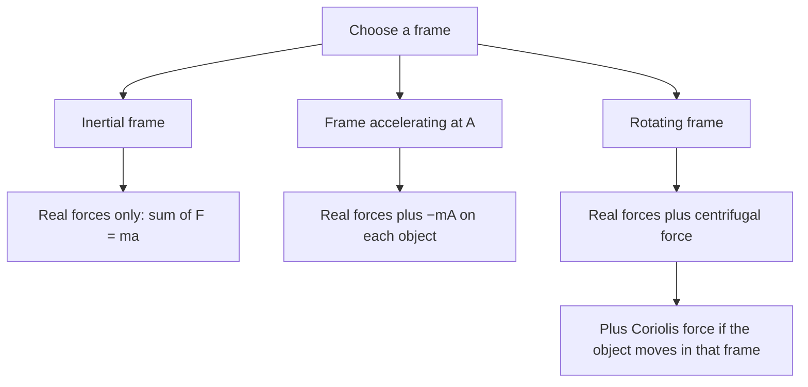

## Newton's laws from inside a moving car

The Newton's laws lesson said the laws hold in inertial (non-accelerating) frames, and gave a hint of what goes wrong otherwise: in an accelerating car, a coffee cup slides backward with nothing pushing it. The circular motion lesson added that "centrifugal force" is something you feel in a turning car, not a real force. This honors lesson takes those feelings seriously. It shows how to do correct physics while standing in an accelerating or rotating frame, by adding **fictitious forces**, and how that makes some problems (a pendulum in a car, artificial gravity in a space station, the deflection of winds on the rotating Earth) much easier to think about.

## Why Newton's laws fail in an accelerating frame

Suppose a train accelerates forward at $A$ while a ball sits on a frictionless table in one of its cars. In the ground frame, which is inertial (to a very good approximation), nothing pushes the ball horizontally, so it stays where it is while the train moves forward under it. In the train's frame, the ball starts from rest and accelerates *backward* at $A$, yet no real force acts on it horizontally. Newton's second law, $\sum\vec F = m\vec a$, is broken in the train frame: the acceleration is there, but the force is not.

A frame that accelerates relative to an inertial frame is a **non-inertial frame**. The acceleration of an object measured in it, $\vec a'$, differs from its inertial acceleration $\vec a$ by the frame's own acceleration $\vec A$:

$$\vec a' = \vec a - \vec A.$$

## Fictitious forces repair the second law

Multiply by $m$ and use $m\vec a = \sum\vec F_{\text{real}}$:

$$m\vec a' = \sum\vec F_{\text{real}} + (-m\vec A).$$

So the second law works in the accelerating frame if you add one extra "force", $-m\vec A$, to every object: proportional to the object's mass and pointing opposite to the frame's acceleration. This is a fictitious force (also called a pseudo-force or inertial force). It is fictitious in a precise sense: no object exerts it, so it has no third-law partner, and an observer in an inertial frame never needs it. But inside the frame it behaves exactly like a real force, and it is what you feel: pressed back into your seat as a car speeds up, thrown forward when it brakes.

Because it is proportional to mass, a fictitious force acts just like extra gravity. In the accelerating frame, every object behaves as if gravity were the **effective gravity**

$$\vec g_{\text{eff}} = \vec g - \vec A.$$

In a car accelerating forward, "down" tilts backward. In an elevator accelerating upward, $g_{\text{eff}} = g + A$ and everything feels heavier; in free fall, $\vec A = \vec g$ and $g_{\text{eff}} = 0$, which is why astronauts in orbit float.

Use one frame per problem. In the inertial frame there are no fictitious forces; in the accelerating frame there are, and accelerations are measured relative to it. Mixing the two (for instance, writing both a centripetal acceleration and a centrifugal force for the same object) double-counts.

### Example 1: a pendulum as an accelerometer

A 0.20 kg ball hangs on a string from the roof of a car that accelerates forward at a steady 3.0 m/s². At what angle from the vertical does the string hang, and what is its tension?

*Car frame.* The ball hangs at rest, so the net force including the fictitious one is zero. The forces are $mg$ down, $mA$ backward and tension $T$ along the string. Balancing: $T\cos\theta = mg$ and $T\sin\theta = mA$. Dividing, $\tan\theta = A/g = 3.0/9.8$, so $\theta = 17.0^\circ$, tilted *backward*. The tension is $T = m\sqrt{g^2 + A^2} = 0.20\sqrt{9.8^2 + 3.0^2} = 2.05$ N.

*Ground frame.* The ball accelerates forward at 3.0 m/s² with the car. Vertically $T\cos\theta - mg = 0$; horizontally $T\sin\theta = mA$, which is the same pair of equations. Both frames give the same answer, as they must. The car frame simply turns a dynamics problem into an equilibrium problem: the string lines up with $\vec g_{\text{eff}}$. Measuring the angle measures the acceleration, which is how a simple pendulum accelerometer works.

### Example 2: dropping a ball in an elevator

An elevator accelerates upward at 2.0 m/s². A passenger lets go of a ball 1.5 m above the floor. How long does it take to hit the floor?

*Elevator frame.* Effective gravity is $g + A = 11.8$ m/s² downward, and the ball starts at rest in this frame. So $1.5 = \tfrac12(11.8)t^2$ and $t = \sqrt{3.0/11.8} = 0.504$ s, quicker than the 0.553 s it would take in an elevator at rest or moving at constant speed.

*Ground frame.* The ball falls with acceleration $g$ while the floor rises to meet it with acceleration $A$; their relative acceleration is $g + A$, giving the same 0.504 s. The elevator frame gets there in one line.

## Rotating frames and the centrifugal force

A frame that rotates at angular speed $\omega$ is also non-inertial: every point on it is accelerating toward the axis with $\omega^2 r$. An object at rest in the rotating frame needs a real inward net force $m\omega^2 r$. Seen from inside the rotating frame, that object is at rest, so something must balance the real inward force: the **centrifugal force**, a fictitious force of size $m\omega^2 r = mv^2/r$ pointing directly away from the axis. It is exactly the outward push you feel in a turning car, and like all fictitious forces it exists only in the rotating frame.

### Example 3: artificial gravity

A ring-shaped space station of radius 100 m rotates so that astronauts standing on the inside of the outer rim feel normal Earth gravity. Find the required angular speed, the rotation period and the rate in rpm.

*Inertial frame.* The floor's normal force is the only force on the astronaut and supplies the centripetal force: $n = m\omega^2 r$. She feels a "weight" $n$, so we want $\omega^2 r = g$.

*Rotating frame.* She is at rest; the centrifugal force $m\omega^2 r$ outward is her effective weight, and the floor pushes back with $n$. Same condition.

$\omega = \sqrt{g/r} = \sqrt{9.8/100} = 0.313$ rad/s, so the period is $2\pi/\omega = 20.1$ s, or about 3.0 rpm. Because $g_{\text{eff}} = \omega^2 r$ shrinks toward the hub, a 1.8 m tall astronaut's head (at $r = 98.2$ m) feels 98.2% of the gravity her feet do. "Down" in the station is outward, away from the hub. The design of rotating stations that would be comfortable for people is still studied; how much rotation people can tolerate is uncertain, with figures of a few rpm often quoted.

The Earth itself is a rotating frame, turning once per sidereal day ($\omega = 7.29 \times 10^{-5}$ rad/s). At the equator the centrifugal term is $\omega^2 R_E = 0.034$ m/s², about 0.35% of $g$. This is part of the reason measured $g$ is smaller at the equator than at the poles; the planet's equatorial bulge accounts for the rest.

## The Coriolis force

One more fictitious force appears in a rotating frame, but only for objects that *move* relative to it: the **Coriolis force**. Picture a merry-go-round turning counterclockwise (seen from above) and a ball rolled straight outward from the center on a frictionless surface. From the ground the ball travels in a straight line; but the merry-go-round turns underneath it, so riders see the ball curve off to their right. In the rotating frame, the Coriolis force accounts for that curving. For motion perpendicular to the rotation axis its size is $2m\omega v$, where $v$ is the speed relative to the rotating frame; it always acts at right angles to that velocity, deflecting to the right when the rotation is counterclockwise.

On Earth, seen from above the North Pole the planet turns counterclockwise, so in the Northern Hemisphere moving air and water are deflected to the right (to the left in the Southern Hemisphere). For horizontal motion at latitude $\phi$ the horizontal part of the Coriolis acceleration is $2\omega v\sin\phi$. For a car at 20 m/s at latitude $45^\circ$ that is $2(7.29\times10^{-5})(20)(0.707) = 0.0021$ m/s², far too small to notice. It matters for motions that are large and last a long time: it is why large storm systems rotate counterclockwise in the Northern Hemisphere and clockwise in the Southern, and why long-range artillery and ballistic calculations must include it. It is much too weak to set the direction a sink drains; that is decided by how the water happened to be moving.

## Common mistakes

- Using a fictitious force in an inertial frame, or forgetting it in an accelerating one. Decide on the frame first.
- Putting both "centripetal force" and "centrifugal force" on the same free-body diagram: the first is the inertial-frame description, the second the rotating-frame one.
- Pointing the fictitious force along the frame's acceleration. It is $-m\vec A$, opposite to it, which is why a pendulum in a car accelerating forward hangs backward.
- Looking for the third-law partner of a fictitious force. There isn't one; no object exerts it.
- Thinking the Coriolis force acts on objects at rest in the rotating frame. It acts only on objects moving relative to that frame.

## Key points

- In a frame accelerating at $\vec A$, add a fictitious force $-m\vec A$ to every object; then $\sum\vec F = m\vec a'$ works with accelerations measured in that frame.
- Effective gravity $\vec g_{\text{eff}} = \vec g - \vec A$: a hanging string lines up with it ($\tan\theta = A/g$ in a car); in an elevator accelerating up, $g_{\text{eff}} = g + A$.
- Rotating frame: centrifugal force $m\omega^2 r$ outward on every object, plus the Coriolis force (size $2m\omega v$ for motion perpendicular to the axis) on moving objects.
- Artificial gravity at radius $r$ needs $\omega = \sqrt{g/r}$.
- Fictitious forces have no third-law partners and are never needed in an inertial frame; both frames give the same physical answers.
