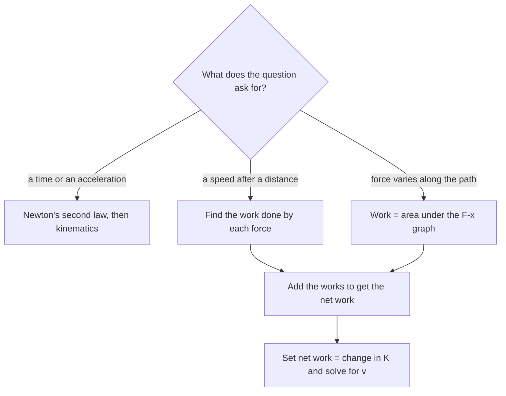

## A second way to solve mechanics problems

Newton's laws connect force to acceleration at each instant. That's powerful but sometimes clumsy: if a force changes along the path, or the path curves, tracking the acceleration moment by moment gets hard. Energy methods sidestep that. They relate forces acting over a *distance* to changes in *speed*, using scalars instead of vectors. This lesson defines work and kinetic energy and shows why the theorem linking them is true; the next adds potential energy and conservation.

## Work done by a constant force

When a constant force $\vec F$ acts on an object that undergoes a displacement $\vec d$, the **work** done by that force is

$$W = Fd\cos\theta,$$

where $\theta$ is the angle between $\vec F$ and $\vec d$. Only the component of the force along the displacement does work. Work is a scalar measured in **joules** ($1\text{ J} = 1\text{ N·m}$).

The sign of work matters:

- $0 \le \theta < 90^\circ$: $W > 0$. The force helps the motion (pulling a sled forward).
- $\theta = 90^\circ$: $W = 0$. The force is perpendicular to the motion: the normal force on a block sliding across a floor, or the tension in a string whirling a ball in a circle, does no work.
- $90^\circ < \theta \le 180^\circ$: $W < 0$. The force opposes the motion (friction on a sliding box, $\theta = 180^\circ$).

Note that holding a heavy bag still does zero work on it in the physics sense, however tiring it is: there's no displacement.

When several forces act, the **net work** is the sum of the work each one does, which equals the work done by the net force.

### Example 1

A 15 kg sled is pulled 20 m across level snow by a rope with tension 50 N at $25^\circ$ above horizontal. Kinetic friction is 30 N. Find the work done by each force and the net work.

- Tension: $W_T = 50(20)\cos 25^\circ = 906$ J.
- Friction (opposite the motion): $W_f = 30(20)\cos 180^\circ = -600$ J.
- Gravity and the normal force are perpendicular to the displacement: 0 J each.

Net work: $906 - 600 = 306$ J.

The picture shows the four forces on the sled and its displacement. Only the rope's tension (through its horizontal component) and friction have components along $\vec d$, so only they do work.


## Kinetic energy and the work–energy theorem

**Kinetic energy** is the energy of motion:

$$K = \tfrac12 mv^2.$$

It is a scalar, never negative, and also measured in joules. A 1000 kg car at 20 m/s has $K = 200\,000$ J $= 200$ kJ.

The **work–energy theorem** says that the net work done on an object equals its change in kinetic energy:

$$W_{\text{net}} = \Delta K = \tfrac12 mv_f^2 - \tfrac12 mv_i^2.$$

*Why, for a constant force:* along the line of motion, $F_{\text{net}} = ma$ and $v_f^2 = v_i^2 + 2ad$. Multiply the second equation by $\tfrac12 m$: $\tfrac12mv_f^2 - \tfrac12mv_i^2 = mad = F_{\text{net}}d = W_{\text{net}}$.

Positive net work speeds an object up, negative net work slows it down, zero net work leaves its speed unchanged (which is why uniform circular motion keeps a constant speed: the inward force does no work).

### Example 2

Continue Example 1. If the sled starts from rest, how fast is it moving after 20 m?

$W_{\text{net}} = \tfrac12 mv_f^2 - 0$, so $v_f = \sqrt{\dfrac{2(306)}{15}} = 6.39$ m/s.

No acceleration or time was needed. The energy route is especially efficient when a question asks "how fast after a certain distance."

### Example 3

A 1200 kg car moving at 25 m/s skids to a stop with friction force 9000 N. How far does it skid?

$W_{\text{net}} = -9000\,d = 0 - \tfrac12(1200)(25)^2 = -375\,000$ J, so $d = 41.7$ m. Doubling the speed quadruples $K$ and so quadruples the stopping distance, matching the kinematics result.

## Work by a varying force

If the force changes as the object moves, $W = Fd$ no longer works directly. Graphically, the work done by a force along $x$ is the area under the $F$–$x$ graph, just as displacement is the area under a $v$–$t$ graph.

The most important example is a spring. An ideal spring stretched or compressed by $x$ from its natural length pulls back with force

$$F_{\text{spring}} = -kx,$$

called **Hooke's law**, where $k$ is the **spring constant** (N/m), a measure of stiffness. The minus sign means the force is a restoring force: it always points back toward equilibrium.

To stretch a spring slowly from 0 to $x$, you apply force $kx$, which grows linearly. The work you do is the area of a triangle with base $x$ and height $kx$:

$$W = \tfrac12 kx^2.$$

```plot
{"x": [0, 0.25], "y": [0, 110], "xLabel": "stretch x (m)", "yLabel": "applied force F (N)", "functions": [{"f": "400*x", "from": 0, "to": 0.2, "label": "F = kx"}], "shade": [{"f": "400*x", "from": 0, "to": 0.2}], "caption": "Work to stretch a spring (k = 400 N/m) by 0.20 m is the triangle area: ½(0.20)(80) = 8.0 J"}
```

## Reading work from a force–position graph

The area rule works for any force graph made of straight pieces: split the area into rectangles and triangles and add them. Area below the axis (a negative force) counts as negative work.

The spring's own force points opposite to the stretch, so as a spring is stretched from $x_1$ to $x_2$ the spring does negative work equal to minus the trapezoid area, $W_s = -\left(\tfrac12kx_2^2 - \tfrac12kx_1^2\right)$. When it relaxes, the spring does positive work and gives that energy back.

The work–energy theorem was shown above for a constant force, but it holds for any force: break the motion into many short steps, each with a nearly constant force, and add up $\Delta K$ for each step. So once you have the net work from a graph's area, $W_{\text{net}} = \Delta K$ still gives the speed.

```plot
{"x": [0, 6], "y": [0, 25], "xLabel": "position x (m)", "yLabel": "force F (N)", "functions": [{"f": "10*x", "from": 0, "to": 2}, {"f": "20", "from": 2, "to": 5}], "shade": [{"f": "10*x", "from": 0, "to": 2}, {"f": "20", "from": 2, "to": 5}], "segments": [{"from": [5, 20], "to": [5, 0], "dashed": true}], "caption": "Force rising from 0 to 20 N over 2 m, then constant to 5 m: the work is the shaded area, 20 J + 60 J = 80 J"}
```

### Example 4

A 4.0 kg cart starts from rest on a frictionless track. The net force on it, along its motion, rises steadily from 0 to 20 N over the first 2.0 m, then stays at 20 N until $x = 5.0$ m (the graph above). Find the work done and the cart's speed at 5.0 m.

Triangle from 0 to 2.0 m: $\tfrac12(2.0)(20) = 20$ J. Rectangle from 2.0 to 5.0 m: $(3.0)(20) = 60$ J. Total $W_{\text{net}} = 80$ J.

Work–energy theorem: $80 = \tfrac12(4.0)v^2$, so $v = \sqrt{40} = 6.32$ m/s. Using the final force for the whole distance, $20(5.0) = 100$ J, would overestimate the work.

## Choosing a method

Energy and Newton's laws describe the same physics, so either can solve many problems. The chart shows which one is usually quicker.



## Common mistakes

- Using the full force instead of its component along the displacement.
- Forgetting that friction does negative work.
- Writing $W = kx^2$ or $W = kx \cdot x$ for a spring (the force grows from zero, hence the $\tfrac12$).
- Calling work a vector; it's a scalar, though it can be negative.
- Using $W = Fd$ for a force that changes with position.

## Key points

- $W = Fd\cos\theta$ for a constant force; perpendicular forces do no work.
- $K = \tfrac12mv^2$; work–energy theorem: $W_{\text{net}} = \Delta K$.
- Hooke's law $F = -kx$; work to stretch a spring by $x$ is $\tfrac12kx^2$.
- For a force that varies, the work is the area under the $F$–$x$ graph.
