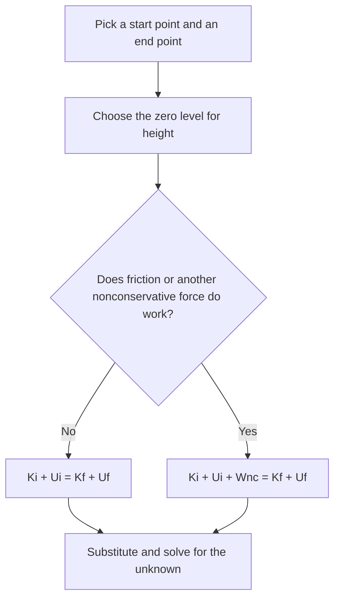

## Stored energy

Lift a book and the work you do isn't lost: let go and gravity gives it back as kinetic energy. Compress a spring and it pushes your hand back when released. This stored energy of position is **potential energy**, and together with kinetic energy it gives us one of the most useful principles in physics: conservation of energy. Problems that are very hard with Newton's laws, like the speed at the bottom of a curved slide, become a line of algebra.

## Conservative forces and potential energy

Some forces have a special property: the work they do on an object moving between two points depends only on the endpoints, not the path. These are **conservative forces**. Gravity and spring forces are conservative; friction is not (dragging a box along a longer path does more negative work).

For a conservative force we define a potential energy $U$ so that the work done by the force equals the decrease in $U$:

$$W_{\text{cons}} = -\Delta U.$$

**Gravitational potential energy** near Earth's surface: gravity does work $-mg\Delta y$ when an object rises by $\Delta y$, so

$$U_g = mgy,$$

measured from any convenient reference level ($y = 0$). Only changes in $U$ matter, so the choice of zero is yours; just keep it fixed during a problem.

**Elastic potential energy** of a spring stretched or compressed by $x$:

$$U_s = \tfrac12kx^2,$$

which equals the work needed to deform it (last lesson).

## Conservation of mechanical energy

**Mechanical energy** is $E = K + U$. Combining the work–energy theorem ($W_{\text{net}} = \Delta K$) with $W_{\text{cons}} = -\Delta U$: if only conservative forces do work, $\Delta K = -\Delta U$, so

$$K_i + U_i = K_f + U_f.$$

This is **conservation of mechanical energy**. Energy changes form, kinetic to potential and back, but the total stays fixed. Forces that do no work (like a normal force perpendicular to the motion) don't spoil it.

### Example 1

A skateboarder starts from rest at the top of a smooth ramp 4.0 m high. How fast is she going at the bottom? Ignore friction.

Take $y = 0$ at the bottom. $mgh = \tfrac12mv^2$, so

$$v = \sqrt{2gh} = \sqrt{2(9.8)(4.0)} = 8.85\text{ m/s}.$$

The ramp's shape doesn't matter, steep or gentle, straight or curved: the normal force does no work, and gravity's work depends only on the height drop. The mass cancels too.

An **energy bar chart** is a quick way to picture this bookkeeping. In the figure a skateboarder starts from rest at A on a frictionless track. The total height of the bars stays the same everywhere: all potential at A, all kinetic at the lowest point B, half and half at C (halfway up), and all potential again at D, a turning point at the starting height.


### Example 2

A 0.20 kg ball is pressed against a vertical spring ($k = 500$ N/m), compressing it 0.10 m, and released. How high above its release point does it rise?

Energy stored: $\tfrac12(500)(0.10)^2 = 2.5$ J. At the highest point, $K = 0$ and all of it is gravitational: $mgh = 2.5$ J, so $h = \dfrac{2.5}{0.20(9.8)} = 1.28$ m.

Every energy problem follows the same few steps:



## When friction acts

Friction and other **nonconservative forces** (air drag, your muscles, a motor) change the mechanical energy. Including their work $W_{\text{nc}}$,

$$K_i + U_i + W_{\text{nc}} = K_f + U_f.$$

Kinetic friction always has $W_{\text{nc}} = -f_k d < 0$; that mechanical energy turns into thermal energy (the surfaces warm up). Total energy, including thermal, chemical and every other form, is always conserved; only mechanical energy can be lost to other forms.

### Example 3

A 2.0 kg block slides down a ramp from a height of 3.0 m, starting from rest, and reaches the bottom at 6.0 m/s. How much work did friction do?

$U_i = 2.0(9.8)(3.0) = 58.8$ J; $K_f = \tfrac12(2.0)(36) = 36$ J. So $W_{\text{nc}} = 36 - 58.8 = -22.8$ J: 22.8 J became thermal energy.

## Power

**Power** is the rate at which work is done or energy is transferred:

$$P = \frac{W}{\Delta t}, \qquad P = Fv \text{ (force along the velocity)}.$$

The SI unit is the **watt**, $1\text{ W} = 1\text{ J/s}$. One horsepower is 746 W. The second form follows from $W = F\Delta x$, so $W/\Delta t = F\,\Delta x/\Delta t = Fv$.

A kilowatt-hour (kWh) is an energy unit, not a power: $1\text{ kWh} = (1000\text{ W})(3600\text{ s}) = 3.6 \times 10^6$ J. Utilities bill for energy.

**Efficiency** compares useful output to input: $\eta = \dfrac{P_{\text{out}}}{P_{\text{in}}}$, always less than 1 for real machines.

### Example 4

An elevator motor lifts a 900 kg car at a steady 2.0 m/s. What power does it deliver? If the motor is 80% efficient, what electrical power does it draw?

At constant speed the tension equals the weight: $T = 900(9.8) = 8820$ N. $P = Tv = 8820(2.0) = 17\,640$ W $\approx 17.6$ kW. Input: $17.64/0.80 = 22.05 \approx 22$ kW.

## Energy diagrams

Plotting $U(x)$ shows the motion at a glance. With total energy $E$ drawn as a horizontal line, the kinetic energy at each point is the gap $E - U(x)$. The object can only be where $U \le E$; the points where $E = U$ are **turning points**, where it stops and reverses. Minima of $U$ are stable equilibria (like the bottom of a bowl); maxima are unstable.

```plot
{"x": [-2.2, 2.2], "y": [-1.5, 3], "xLabel": "x", "yLabel": "energy", "functions": [{"f": "x^4 - 2*x^2", "label": "U(x)"}, {"f": "1.5", "dashed": true}], "points": [{"at": [-1, -1], "label": "stable"}, {"at": [0, 0], "label": "unstable"}, {"at": [-1.607, 1.5]}, {"at": [1.607, 1.5]}], "labels": [{"at": [-0.75, 1.7], "text": "E"}, {"at": [0.8, 1.75], "text": "turning points"}], "caption": "A double-well potential: with energy E the particle moves between the outer turning points"}
```

## Force from a potential energy graph

The definition $W_{\text{cons}} = -\Delta U$ also works backward. Over a small step $\Delta x$ the force does work $F\Delta x = -\Delta U$, so

$$F = -\frac{\Delta U}{\Delta x}:$$

the force is the negative of the slope of the $U$–$x$ graph. Where $U$ slopes downhill to the right, the force points right (toward lower $U$); where it slopes uphill, the force points left. Objects are pushed toward lower potential energy, like a ball rolling downhill on a graph shaped like a landscape.

This explains the equilibrium points on an energy diagram. Where the graph is flat (slope zero), the force is zero. At a minimum, moving either way makes the slope push the object back: stable. At a maximum, a small nudge leads to a force pushing it farther away: unstable.

Check with a spring: the graph of $U = \tfrac12kx^2$ is a parabola whose slope at $x$ is $kx$, so $F = -kx$, Hooke's law. For gravity, $U = mgy$ is a straight line of slope $mg$, so $F_y = -mg$: a constant downward force.

### Example 5

A particle's potential energy falls steadily from 12 J at $x = 1.0$ m to 4.0 J at $x = 3.0$ m, then stays at 4.0 J out to $x = 5.0$ m. Find the force on it at $x = 2.0$ m and at $x = 4.0$ m.

Between 1.0 and 3.0 m the slope is $\dfrac{4.0 - 12}{3.0 - 1.0} = -4.0$ J/m, so $F = -(-4.0) = +4.0$ N: 4.0 N in the $+x$ direction, downhill on the graph. Between 3.0 and 5.0 m the graph is flat, so $F = 0$. (Note: 1 J/m = 1 N.)

## Common mistakes

- Using conservation of mechanical energy when friction does work.
- Using $mgh$ for a spring or $\tfrac12kx^2$ with $x$ measured from the wrong point (it's from the spring's natural length).
- Mixing up power and energy (kW vs kWh).
- Changing the zero of potential energy partway through.
- Forgetting that a falling object on a spring loses gravitational energy while compressing it.

## Key points

- $U_g = mgy$, $U_s = \tfrac12kx^2$; $W_{\text{cons}} = -\Delta U$.
- Only conservative forces working: $K_i + U_i = K_f + U_f$.
- With friction or other forces: $K_i + U_i + W_{\text{nc}} = K_f + U_f$.
- $P = W/\Delta t = Fv$; 1 W = 1 J/s; 1 kWh = $3.6\times10^6$ J.
- $F = -$(slope of the $U$–$x$ graph); equilibria where the graph is flat, stable at minima.
