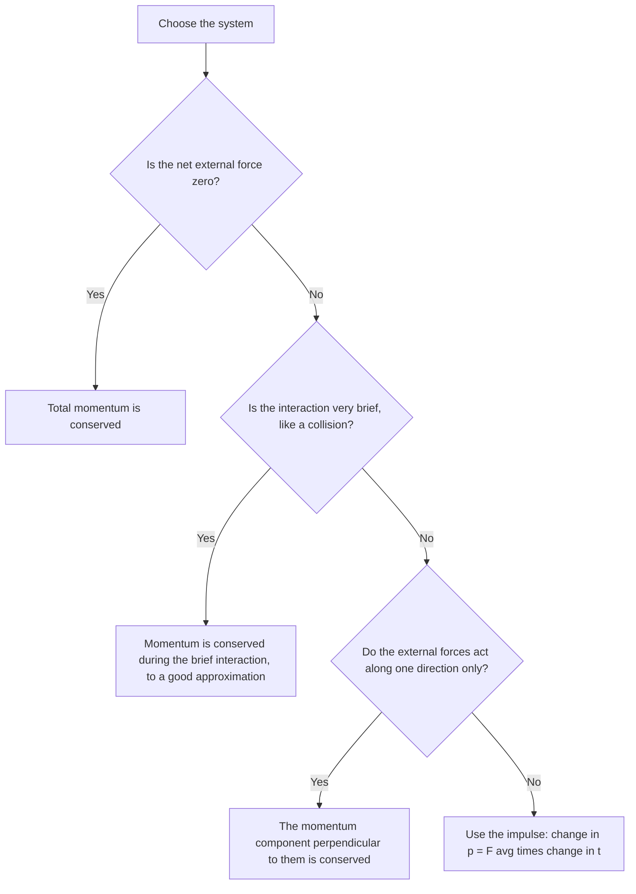

## Why we need momentum

Energy handles forces acting over distances. But in a car crash, a bat hitting a ball, or a rocket firing, huge forces act for short and complicated times, and energy is often lost to heat and deformation. Momentum is the tool for these situations. It is conserved even when mechanical energy isn't, and it leads naturally to the center of mass, the point that moves as if the whole system's mass were concentrated there.

## Linear momentum

The **momentum** (linear momentum) of an object is

$$\vec p = m\vec v,$$

a vector in the direction of the velocity, with units kg·m/s. A slow truck and a fast bullet can have similar momenta. Unlike kinetic energy, momentum has a direction, so two objects moving in opposite directions can have a total momentum of zero.

Momentum and kinetic energy are related: $K = \dfrac{p^2}{2m}$. For equal momenta, the lighter object has more kinetic energy.

## Impulse

Newton's second law in momentum form is $\vec F_{\text{net}} = \Delta\vec p/\Delta t$. Multiply through by $\Delta t$:

$$\vec J = \vec F_{\text{avg}}\,\Delta t = \Delta\vec p.$$

The product of force and time is the **impulse** $\vec J$, and it equals the change in momentum (the **impulse–momentum theorem**). Its units, N·s, are the same as kg·m/s.

The theorem explains a lot of safety engineering. To stop a moving object you must deliver a fixed impulse, $\Delta p$. Spreading it over a longer time reduces the average force: air bags, crumple zones, bending your knees when you land, and a catcher's padded glove all increase $\Delta t$. Conversely, a golf club or a hammer works because a large force acts over a very short time.

### Example 1

A 0.145 kg baseball arrives at 40 m/s and leaves the bat at 50 m/s in the opposite direction. The contact lasts 1.2 ms. Find the impulse and the average force.

Take the outgoing direction as positive: $v_i = -40$ m/s, $v_f = +50$ m/s.

$\Delta p = 0.145(50 - (-40)) = 0.145(90) = 13.05$ kg·m/s.

$F_{\text{avg}} = \dfrac{13.05}{1.2\times10^{-3}} = 1.09\times10^4$ N, roughly the weight of a small car, for about a millisecond. Forgetting the reversal of direction (using $50 - 40$) would underestimate the impulse by a factor of 9.

The picture names the parts of a typical collision force graph. The impulse is the shaded area; the average force is the height of a rectangle with the same area over the same contact time.


## Conservation of momentum

Consider a system of objects. Forces between objects inside the system (internal forces) come in third-law pairs, equal and opposite, so their impulses cancel. Only external forces can change the system's total momentum. If the net external force is zero,

$$\vec p_{\text{total, initial}} = \vec p_{\text{total, final}}.$$

This is **conservation of momentum**. It holds for each component separately: if external forces are only vertical (gravity and normal forces), horizontal momentum is still conserved. It also holds approximately during brief collisions and explosions even when external forces exist, because the internal forces are so much larger for that short time.

Before using conservation of momentum, check that it applies. This chart walks through the usual questions:



### Example 2: recoil

A 70 kg skater standing on frictionless ice throws a 5.0 kg ball forward at 12 m/s. How fast does she recoil?

Initially everything is at rest: total momentum 0. Afterward: $5.0(12) + 70v = 0$, so $v = -0.857$ m/s. She glides backward at 0.86 m/s. Kinetic energy was not conserved (it increased from 0, supplied by her muscles), but momentum was.

The same physics drives a rifle's recoil and a rocket: expelled gas carries momentum backward, so the rocket gains momentum forward. A rocket doesn't need anything to push against.

## Center of mass

For a system of particles, the **center of mass** (CM) is the mass-weighted average position:

$$x_{\text{cm}} = \frac{m_1x_1 + m_2x_2 + \cdots}{m_1 + m_2 + \cdots} = \frac{\sum m_ix_i}{M},$$

and likewise for $y_{\text{cm}}$ and $z_{\text{cm}}$. For a symmetric uniform object (a sphere, rod or plate), the CM is at the geometric center. The CM can lie outside the material, as in a ring or a boomerang.

### Example 3

Masses of 2.0 kg at $(0, 0)$, 3.0 kg at $(4, 0)$ and 5.0 kg at $(0, 2)$ (meters). Find the center of mass.

$M = 10$ kg. $x_{\text{cm}} = \dfrac{2(0) + 3(4) + 5(0)}{10} = 1.2$ m; $y_{\text{cm}} = \dfrac{2(0) + 3(0) + 5(2)}{10} = 1.0$ m. The CM is at $(1.2, 1.0)$ m, pulled toward the heavier masses.

*Motion of the center of mass.* Over a short time $\Delta t$, each mass moves by $\Delta x_i = v_i\Delta t$, so the CM moves by $\sum m_i v_i\Delta t/M$. Dividing by $\Delta t$ gives $M\vec v_{\text{cm}} = \sum m_i\vec v_i = \vec p_{\text{total}}$: the total momentum is the total mass times the CM velocity. Since only external forces change the total momentum,

$$\vec F_{\text{net, ext}} = M\vec a_{\text{cm}}.$$

So the CM of any system moves like a single particle of mass $M$ acted on by the external forces alone, no matter how the parts move. When a firework shell explodes in midair, the fragments fly apart but their CM continues along the original parabola (until fragments hit the ground). With no external force, $\vec v_{\text{cm}}$ is constant: that's conservation of momentum in another form.

### Example 4

A 60 kg person stands at one end of a 120 kg, 4.0 m raft at rest on still water (no friction with the water). She walks to the other end. How far does the raft move?

No external horizontal forces, and the system starts at rest, so the CM stays put. If she moves 4.0 m relative to the raft and the raft moves $d$ backward, her ground displacement is $4.0 - d$. Setting the CM displacement to zero: $60(4.0 - d) - 120d = 0$, so $d = 240/180 = 1.33$ m.

## Force–time graphs

Real collision forces are not constant: a bat's force on a ball rises from zero, peaks and falls back to zero in about a millisecond. The impulse is still easy to find from a graph of force against time: just as displacement is the area under a $v$–$t$ graph, *impulse is the area under the $F$–$t$ graph*. The average force is the constant force that would give the same area over the same time, $F_{\text{avg}} = J/\Delta t$.

```plot
{"x": [0, 12], "y": [0, 1200], "xLabel": "time t (ms)", "yLabel": "force F (N)", "functions": [{"f": "200*x", "from": 0, "to": 5}, {"f": "2000 - 200*x", "from": 5, "to": 10}, {"f": "500", "from": 0, "to": 10, "dashed": true, "label": "average"}], "shade": [{"f": "200*x", "from": 0, "to": 5}, {"f": "2000 - 200*x", "from": 5, "to": 10}], "caption": "A kick: force rising to 1000 N and back to zero in 10 ms. The triangle's area is the impulse."}
```

### Example 5

A kick delivers the triangular force pulse in the graph to a 0.45 kg ball at rest: the force rises steadily from 0 to 1000 N in 5.0 ms and falls back to 0 over the next 5.0 ms. Find the impulse, the ball's speed and the average force.

Impulse = triangle area $= \tfrac12(\text{base})(\text{height}) = \tfrac12(0.010\text{ s})(1000\text{ N}) = 5.0$ N·s.

Speed: $v = J/m = 5.0/0.45 = 11.1$ m/s.

Average force: $F_{\text{avg}} = J/\Delta t = 5.0/0.010 = 500$ N, half the peak, as expected for a triangle. Using the peak force for the whole 10 ms would double the impulse.

### Example 6: a composite object

A 2.0 m uniform rod of mass 4.0 kg lies along the $x$ axis from $x = 0$ to $x = 2.0$ m, with a 1.0 kg ball fixed at $x = 2.0$ m. Where is the system's center of mass?

Treat each piece as a point mass at its own center of mass: the rod's 4.0 kg at its midpoint, $x = 1.0$ m, and the ball at 2.0 m.

$x_{\text{cm}} = \dfrac{4.0(1.0) + 1.0(2.0)}{5.0} = 1.2$ m, shifted from the rod's center toward the ball.

## Common mistakes

- Ignoring direction: momentum and impulse are vectors, and a rebound reverses the sign of $v$.
- Assuming kinetic energy is conserved whenever momentum is.
- Applying momentum conservation when a large external force acts over the time considered.
- Weighting CM positions by distance instead of by mass.

## Key points

- $\vec p = m\vec v$; impulse $\vec J = \vec F_{\text{avg}}\Delta t = \Delta\vec p$ = area under the $F$–$t$ graph.
- With no net external force, total momentum is conserved, component by component.
- $x_{\text{cm}} = \sum m_ix_i/M$ (treat each piece of a composite object as a point at its own CM); $\vec F_{\text{ext}} = M\vec a_{\text{cm}}$.
- Longer stopping time means smaller average force for the same $\Delta p$.
