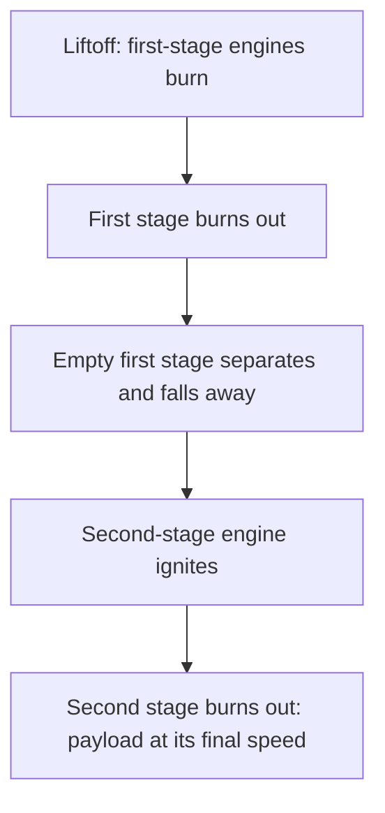

## Momentum that leaves the system

In the momentum lesson a skater threw a ball and recoiled, and we noted that a rocket works the same way: exhaust gas carries momentum backward, so the rocket gains momentum forward. A rocket is a skater who throws thousands of tiny balls every second, and the "ball pile" is most of the skater's own mass. That last fact is what makes rockets interesting. Because the mass keeps dropping, $F = ma$ with a fixed $m$ no longer describes the motion, and the speed a rocket can reach depends on its mass in a surprising, logarithmic way.

This lesson works out three things using only momentum conservation: the **thrust** of a rocket engine, the speed a rocket gains from burning its propellant (the rocket equation), and why real rockets are built in stages. It ends with other systems whose mass changes, such as sand pouring onto a conveyor belt or rain filling an open rail car, where momentum and energy give strikingly different answers.


## Thrust from momentum

Suppose an engine expels gas at a steady **mass flow rate** $R = \Delta m/\Delta t$ (kilograms per second), and the gas leaves at **exhaust speed** $u$ *relative to the rocket*. Look at the rocket during a short time $\Delta t$, in a frame moving with the rocket at that instant. In that frame the rocket starts at rest. A small mass $\Delta m$ of gas leaves backward at speed $u$, carrying momentum $\Delta m\,u$ backward. The gas got that momentum because the rocket pushed on it; by Newton's third law the gas pushes the rocket forward with an equal and opposite impulse. Dividing the impulse by $\Delta t$ gives the forward force:

$$T = u\,\frac{\Delta m}{\Delta t} = uR.$$

So thrust is exhaust speed times mass flow rate. Units check: (m/s)(kg/s) = kg·m/s² = N. (Simplification: a real nozzle also gets a push or loses one from the difference between the exhaust pressure and the outside air pressure. That pressure term is usually a modest correction and is left out here.)

A rocket sitting on a launch pad only lifts off if the thrust beats its weight. The net upward force is $T - mg$, so the upward acceleration is

$$a = \frac{T - mg}{m} = \frac{T}{m} - g.$$

The ratio $T/(mg)$ is the thrust-to-weight ratio; it must exceed 1 at liftoff.

### Example 1

A rocket of mass $5.0\times10^4$ kg burns 250 kg of propellant per second with an exhaust speed of 3000 m/s. Find the thrust and the acceleration at liftoff.

Thrust: $T = uR = (3000)(250) = 7.5\times10^5$ N.

Weight: $mg = (5.0\times10^4)(9.8) = 4.9\times10^5$ N, so the thrust-to-weight ratio is $7.5/4.9 = 1.53$.

Acceleration: $a = \dfrac{7.5\times10^5 - 4.9\times10^5}{5.0\times10^4} = 5.2$ m/s² upward.

One second later the rocket is 250 kg lighter but the thrust is the same, so the acceleration has grown slightly. By the end of the burn, with most of the mass gone, the acceleration is several times larger. (This is one reason crewed rockets throttle down or shut off some engines late in a burn: to keep the acceleration tolerable for the crew.)

## How much speed? The rocket equation

Now take a rocket far out in space, with no gravity or drag, and ask how much its speed changes while it burns propellant. Apply momentum conservation to one small step. In the rocket's instantaneous rest frame, a rocket of current mass $m$ throws out $\Delta m$ backward at speed $u$; to keep the total momentum zero, the remaining rocket gains

$$\Delta v \approx \frac{u\,\Delta m}{m}.$$

The key word is *current* mass. The first kilogram of propellant has to accelerate the whole full rocket, so it changes the speed only a little. The last kilogram pushes a nearly empty rocket and changes its speed a lot. To add up the steps, try a rocket with initial mass $m_0 = 1000$ kg that burns 600 kg of propellant ($m_f = 400$ kg) with $u = 2000$ m/s. Splitting the burn into equal steps and adding $u\,\Delta m/m$ for each one, using the mass at the start or at the end of the step:

| Steps | Using mass at start of each step | Using mass at end of each step |
|---|---|---|
| 6 (100 kg each) | 1691 m/s | 1991 m/s |
| 60 (10 kg each) | 1818 m/s | 1848 m/s |
| 600 (1 kg each) | 1831 m/s | 1834 m/s |

As the steps shrink, both columns close in on 1833 m/s. That limiting value is $u\ln(m_0/m_f) = 2000\ln 2.5 = 1833$ m/s, where $\ln$ is the natural logarithm. This is the **rocket equation**:

$$\Delta v = u\ln\frac{m_0}{m_f}.$$

(A calculus course gets the same result by integrating $dv = -u\,dm/m$.) The quantity $m_0/m_f$ is the **mass ratio**, the mass when the burn starts divided by the mass when it stops. The change in speed $\Delta v$ a rocket can produce is called its **delta-v**, and mission planners keep a "delta-v budget" much like a money budget.

The equation was first derived by the British mathematician William Moore around 1810 for military rockets. It is named after Konstantin Tsiolkovsky, who published it in 1903 and was the first to use it to ask whether rockets could reach space; Robert Goddard and Hermann Oberth later derived it independently.

Three features stand out:

- **Thrust and burn time don't appear.** In free space, burning fast or slowly gives the same $\Delta v$; only $u$ and the mass ratio matter. (Near a planet this changes: a slow burn wastes propellant fighting gravity.)
- **$\Delta v$ can exceed $u$.** When $m_0/m_f > e \approx 2.72$, the rocket ends up moving faster than its own exhaust leaves it. There is no contradiction: $u$ is measured relative to the rocket.
- **The mass ratio grows exponentially with the goal.** Solving for it, $m_0/m_f = e^{\Delta v/u}$. Each extra $u$ of delta-v multiplies the required mass ratio by another factor of $e$.

```plot
{"x": [1, 20], "y": [0, 3.2], "xLabel": "mass ratio m0/mf", "yLabel": "Δv / u", "functions": [{"f": "ln(x)", "from": 1, "to": 20, "label": "Δv/u = ln(m0/mf)"}], "points": [{"at": [2.718, 1]}, {"at": [7.389, 2]}], "labels": [{"at": [5.2, 0.85], "text": "ratio e: Δv = u"}, {"at": [4.9, 2.35], "text": "ratio 7.4: Δv = 2u"}], "caption": "The rocket equation: each extra u of Δv multiplies the mass ratio needed by e ≈ 2.7"}
```

### Example 2: why reaching orbit is hard

A rocket in low Earth orbit moves at about 7.8 km/s, and with the extra speed lost to gravity and air drag during the climb, a launch needs a delta-v of roughly 9 to 10 km/s. Take 9.4 km/s, and a good chemical engine with $u = 3.5$ km/s (chemical rockets have exhaust speeds of roughly 2.5 to 4.5 km/s). What fraction of the liftoff mass can be anything other than propellant?

$\dfrac{m_0}{m_f} = e^{9.4/3.5} = e^{2.69} = 14.7$, so $\dfrac{m_f}{m_0} = \dfrac{1}{14.7} = 0.068$.

Only about 7% of the rocket can be tanks, engines, structure *and* payload; 93% must be propellant. Building tanks that light is nearly impossible, which leads to the main trick of rocketry.

## Staging

A single-stage rocket has to carry its empty first tanks all the way to the end of the burn, and accelerating that dead weight wastes propellant. **Staging** fixes this: the rocket is built as a stack of rockets, and each stage is dropped when its propellant runs out, so the next stage starts with a much smaller mass.



### Example 3

Two rockets each have a liftoff mass of 100 t, carry 80 t of propellant and 15 t of structure (tanks and engines), and deliver a 5 t payload, with $u = 3000$ m/s throughout. Rocket A is a single stage. Rocket B splits the same totals into two stages: stage 1 has 60 t of propellant and 11 t of structure; stage 2 has 20 t of propellant and 4 t of structure. Compare their delta-v in free space.

*Rocket A:* burns from 100 t to 20 t. $\Delta v = 3000\ln(100/20) = 3000\ln 5 = 4830$ m/s.

*Rocket B, stage 1:* burns 60 t, from 100 t to 40 t. $\Delta v_1 = 3000\ln(100/40) = 2749$ m/s.

Drop the empty 11 t first stage: $40 - 11 = 29$ t remain.

*Stage 2:* burns 20 t, from 29 t to 9 t. $\Delta v_2 = 3000\ln(29/9) = 3510$ m/s.

Total: $2749 + 3510 = 6259$ m/s, about 30% more than the single stage with exactly the same propellant, structure and payload. The only difference is that rocket B stops carrying 11 t of empty structure partway through.

## Other systems that gain or lose mass

The same momentum bookkeeping handles anything that picks up or sheds mass. The trap is to write $F = ma$ for an object whose mass is changing; instead, track the momentum of everything involved.

**Rain into an open rail car.** A rail car coasts on a level track with negligible friction while rain falls straight down into it. The rain has no horizontal momentum, and there is no horizontal external force, so the horizontal momentum of car plus water stays the same: $m_0v_0 = (m_0 + \Delta m)v$. The car slows down, because the same momentum is shared by more mass. This is a slow-motion perfectly inelastic collision.

**Sand leaking out of a rail car.** Now let sand drain straight down through a hole in the floor. The sand leaves with the car's own horizontal velocity, so it takes away exactly its share of the momentum and the car's speed doesn't change. Losing mass this way is not like a rocket, because the sand is not pushed backward relative to the car.

**Sand dropped onto a conveyor belt.** Sand falls vertically onto a belt moving at a constant speed $v$, at a rate $R$ kg/s. Each second, $R$ kilograms of sand must be brought up to speed $v$, which takes horizontal momentum $Rv$ per second. So the motor must push the belt with a force $F = Rv$, and it delivers power

$$P = Fv = Rv^2.$$

But the kinetic energy given to the sand each second is only $\tfrac12Rv^2$. Exactly half of the motor's power goes into kinetic energy and the other half becomes heat, as the sand skids on the belt before it catches up. Remarkably, the half-and-half split doesn't depend on how rough the belt is: rougher sand catches up sooner, but the friction force is larger, and the two effects cancel.

### Example 4

Sand falls onto a conveyor belt at 40 kg/s, and the belt moves at a steady 2.5 m/s. Find the extra force the motor must supply, the extra power, and the rate at which heat is produced.

Force: $F = Rv = (40)(2.5) = 100$ N.

Power: $P = Fv = (100)(2.5) = 250$ W.

Kinetic energy given to the sand each second: $\tfrac12Rv^2 = \tfrac12(40)(2.5)^2 = 125$ W. Heat: $250 - 125 = 125$ W.

Using energy alone ("the motor supplies $\tfrac12Rv^2$") would give half the right power. Momentum sets the force; the energy then follows from $P = Fv$.

### Example 5

An open 20 000 kg rail car coasts at 3.0 m/s on a level track. Rain falling straight down adds 2000 kg of water. How fast is it moving now?

Horizontal momentum is conserved: $(20\,000)(3.0) = (22\,000)v$, so $v = 2.73$ m/s.

The kinetic energy drops from 90 000 J to $\tfrac12(22\,000)(2.73)^2 = 81\,800$ J. The missing 8200 J became heat in the sloshing water.

## Ion engines: high exhaust speed, tiny thrust

Because $\Delta v$ grows with $u$, a higher exhaust speed is the most powerful way to get more delta-v from a given mass ratio. Electric (ion) thrusters accelerate charged atoms to exhaust speeds of tens of kilometers per second, roughly ten times a chemical rocket. Their mass flow rate is tiny, though, so the thrust is a fraction of a newton: an ion engine could never lift itself off the ground. They suit long missions in space, where a gentle push for months adds up to a large $\Delta v$ using little propellant.

## Common mistakes

- Writing $F = ma$ with a constant mass for a rocket, or for a cart gaining or losing mass.
- Forgetting that $u$ is the exhaust speed *relative to the rocket*, not relative to the ground.
- Using the total initial mass in every step, which gives $\Delta v = u(m_0 - m_f)/m_0$ and badly underestimates the speed gained.
- Thinking a bigger thrust gives a bigger $\Delta v$ in free space; with the same $u$ and mass ratio it only gets there sooner.
- Forgetting gravity at liftoff: the acceleration is $T/m - g$, not $T/m$.
- Assuming a car that leaks mass speeds up like a rocket. Mass that leaves with the car's own velocity carries away no extra momentum.
- Computing a conveyor's power from kinetic energy alone; half the power becomes heat.

## Key points

- Thrust $T = uR$: exhaust speed (relative to the rocket) times mass flow rate. Liftoff needs $T > mg$; then $a = T/m - g$.
- Rocket equation (free space): $\Delta v = u\ln(m_0/m_f)$. It comes from adding $u\,\Delta m/m$ over many small steps.
- The mass ratio needed grows exponentially: $m_0/m_f = e^{\Delta v/u}$. Reaching orbit needs most of the rocket to be propellant.
- Staging drops empty tanks and engines, so later stages accelerate less dead weight and the total $\Delta v$ rises.
- For any system that gains or loses mass, follow the momentum of everything involved. Picking up mass that starts at rest is a perfectly inelastic process and loses kinetic energy; a conveyor's motor turns half its power into heat.
