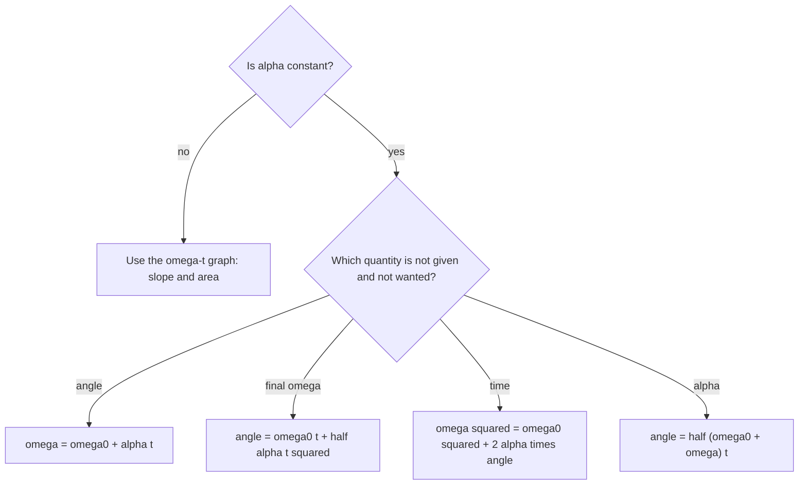

## Spinning instead of sliding

So far objects have been treated as points. Real objects also rotate: wheels, turbines, planets, figure skaters. The good news is that rotation about a fixed axis mirrors one-dimensional motion almost exactly, with angles in place of positions. This lesson builds that dictionary and introduces the rotational version of mass, the moment of inertia, which leads to rotational kinetic energy.

## Angular position, velocity and acceleration

Measure a rotating object's orientation by the angle $\theta$ that a reference line on it makes with a fixed direction. Physics uses **radians**: an angle in radians is arc length divided by radius, $\theta = s/r$, so a full turn is $2\pi$ rad ($= 360^\circ$). Radians are dimensionless, which is why they can quietly disappear from units.

- **Angular displacement**: $\Delta\theta$ (rad). Counterclockwise is usually positive.
- **Angular velocity**: $\omega = \dfrac{\Delta\theta}{\Delta t}$ (rad/s).
- **Angular acceleration**: $\alpha = \dfrac{\Delta\omega}{\Delta t}$ (rad/s²).

Every point on a rigid object shares the same $\theta$, $\omega$ and $\alpha$, which is what makes them useful. Rotation rates are often quoted in revolutions per minute: $1\text{ rpm} = \dfrac{2\pi\text{ rad}}{60\text{ s}} = 0.1047$ rad/s. And $\omega = 2\pi f = 2\pi/T$.

## Linking rotation to linear motion

A point at distance $r$ from the axis moves along a circle. Because $s = r\theta$,

$$v = r\omega, \qquad a_t = r\alpha, \qquad a_c = \frac{v^2}{r} = r\omega^2.$$

Here $v$ is the point's speed (tangential), $a_t$ its tangential acceleration (speeding up or slowing) and $a_c$ its centripetal acceleration. Points farther from the axis move faster. These relations need $\omega$ in rad/s; plugging in rpm or degrees per second gives nonsense.

The picture shows these quantities for one point P on a disk turning counterclockwise about its axis.


## Constant angular acceleration

With $\alpha$ constant, the kinematic equations carry over symbol by symbol:

| Linear | Rotational |
|---|---|
| $v = v_0 + at$ | $\omega = \omega_0 + \alpha t$ |
| $\Delta x = v_0t + \tfrac12at^2$ | $\Delta\theta = \omega_0t + \tfrac12\alpha t^2$ |
| $v^2 = v_0^2 + 2a\Delta x$ | $\omega^2 = \omega_0^2 + 2\alpha\Delta\theta$ |
| $\Delta x = \tfrac12(v_0 + v)t$ | $\Delta\theta = \tfrac12(\omega_0 + \omega)t$ |

Each equation leaves out one of the five quantities $\omega_0$, $\omega$, $\alpha$, $t$ and $\Delta\theta$. Pick the one that leaves out the quantity you neither know nor want:



### Example 1

A ceiling fan spinning at 240 rpm is switched off and slows uniformly to rest in 12 s. Find its angular acceleration and how many revolutions it makes while stopping.

$\omega_0 = 240 \times 0.1047 = 25.13$ rad/s; $\omega = 0$.

$\alpha = \dfrac{0 - 25.13}{12} = -2.09$ rad/s².

$\Delta\theta = \tfrac12(\omega_0 + \omega)t = \tfrac12(25.13)(12) = 150.8$ rad, which is $150.8/2\pi = 24$ revolutions. (Shortcut in rev units: average 120 rpm $= 2$ rev/s for 12 s gives 24 rev.)

### Example 2

The fan's blade tips are 0.60 m from the axis. At the moment the fan is switched off, what are a tip's speed, tangential acceleration and centripetal acceleration?

$v = r\omega = 0.60(25.13) = 15.1$ m/s. $a_t = r\alpha = 0.60(-2.09) = -1.26$ m/s². $a_c = r\omega^2 = 0.60(25.13)^2 = 379$ m/s². The centripetal part dominates; it's what would fling a loose blade off.

## Rotational kinetic energy and moment of inertia

A spinning wheel has kinetic energy even though its center doesn't move. Add up $\tfrac12mv^2$ for every particle, using $v_i = r_i\omega$:

$$K = \sum\tfrac12m_ir_i^2\omega^2 = \tfrac12\left(\sum m_ir_i^2\right)\omega^2 = \tfrac12I\omega^2.$$

The quantity

$$I = \sum m_ir_i^2$$

is the **moment of inertia** about the chosen axis (kg·m²). It plays the role of mass for rotation: it measures how hard it is to change an object's rotation. Crucially, it depends not just on the mass but on *how far the mass is from the axis*, and so on which axis you choose.

Standard results for uniform objects of mass $M$ (the round and solid shapes take advanced math to add up; use these as given):

| Object | Axis | $I$ |
|---|---|---|
| Point mass at distance $R$ | — | $MR^2$ |
| Thin hoop or ring, radius $R$ | through center, perpendicular to the plane | $MR^2$ |
| Solid disk or cylinder, radius $R$ | through center, along the axis | $\tfrac12MR^2$ |
| Solid sphere, radius $R$ | through center | $\tfrac25MR^2$ |
| Thin spherical shell, radius $R$ | through center | $\tfrac23MR^2$ |
| Thin rod, length $L$ | through center, perpendicular | $\tfrac1{12}ML^2$ |
| Thin rod, length $L$ | through one end, perpendicular | $\tfrac13ML^2$ |

A hoop has all its mass at distance $R$, so $I = MR^2$; a disk has much of its mass closer in, so less. A flywheel designer who wants to store energy puts the mass in the rim.

### Example 3

Three small 0.50 kg masses sit at the ends and middle of a light 1.2 m rod. Find $I$ about (a) an axis through the middle mass, perpendicular to the rod, and (b) an axis through one end.

(a) Distances 0.6, 0, 0.6 m: $I = 0.50(0.36) + 0 + 0.50(0.36) = 0.36$ kg·m².

(b) Distances 0, 0.6, 1.2 m: $I = 0 + 0.50(0.36) + 0.50(1.44) = 0.90$ kg·m². Same object, different axis, two and a half times the moment of inertia.

*Parallel-axis theorem.* If $I_{\text{cm}}$ is the moment of inertia about an axis through the center of mass, then about any parallel axis a distance $d$ away,

$$I = I_{\text{cm}} + Md^2.$$

For a rod about one end: $\tfrac1{12}ML^2 + M\left(\tfrac L2\right)^2 = \tfrac13ML^2$, matching the table. The CM axis always gives the smallest $I$ among parallel axes.

### Example 4

A 2.0 kg solid disk of radius 0.25 m spins at 300 rpm. What is its rotational kinetic energy?

$I = \tfrac12(2.0)(0.25)^2 = 0.0625$ kg·m². $\omega = 300(0.1047) = 31.4$ rad/s. $K = \tfrac12(0.0625)(31.4)^2 = 30.8$ J.

## Graphs of rotational motion

The graph rules from linear kinematics carry over too:

- the slope of a $\theta$–$t$ graph is the angular velocity $\omega$;
- the slope of an $\omega$–$t$ graph is the angular acceleration $\alpha$;
- the area under an $\omega$–$t$ graph is the angular displacement $\Delta\theta$.

These work even when $\alpha$ is not constant, which the equations in the table can't handle.

```plot
{"x": [0, 11], "y": [0, 14], "xLabel": "time t (s)", "yLabel": "ω (rad/s)", "functions": [{"f": "3*x", "from": 0, "to": 4}, {"f": "12", "from": 4, "to": 10}], "shade": [{"f": "3*x", "from": 0, "to": 4}, {"f": "12", "from": 4, "to": 10}], "caption": "A motor spins up for 4 s, then runs at a steady 12 rad/s; the shaded area is the angle turned"}
```

### Example 5

A motor shaft starts from rest, speeds up steadily to 12 rad/s in 4.0 s, then turns at a constant 12 rad/s for 6.0 s more (the graph above). Find the angular acceleration during the first 4.0 s and the total number of revolutions.

Slope of the first segment: $\alpha = 12/4.0 = 3.0$ rad/s².

Area: triangle $\tfrac12(4.0)(12) = 24$ rad plus rectangle $(6.0)(12) = 72$ rad, so $\Delta\theta = 96$ rad $= 96/2\pi = 15.3$ rev.

## Common mistakes

- Using rpm or degrees in $v = r\omega$ or $K = \tfrac12I\omega^2$ (convert to rad/s).
- Treating moment of inertia as a property of the object alone; it depends on the axis.
- Using $MR^2$ for every round object.
- Applying the parallel-axis theorem between two axes neither of which passes through the CM.

## Key points

- $\theta$ in radians; $\omega = \Delta\theta/\Delta t$, $\alpha = \Delta\omega/\Delta t$; constant-$\alpha$ equations mirror linear ones.
- Slope of $\theta$–$t$ is $\omega$, slope of $\omega$–$t$ is $\alpha$, area under $\omega$–$t$ is $\Delta\theta$.
- $v = r\omega$, $a_t = r\alpha$, $a_c = r\omega^2$.
- $I = \sum m_ir_i^2$ (table values for standard shapes); rotational KE $= \tfrac12I\omega^2$.
- Parallel-axis theorem: $I = I_{\text{cm}} + Md^2$.
