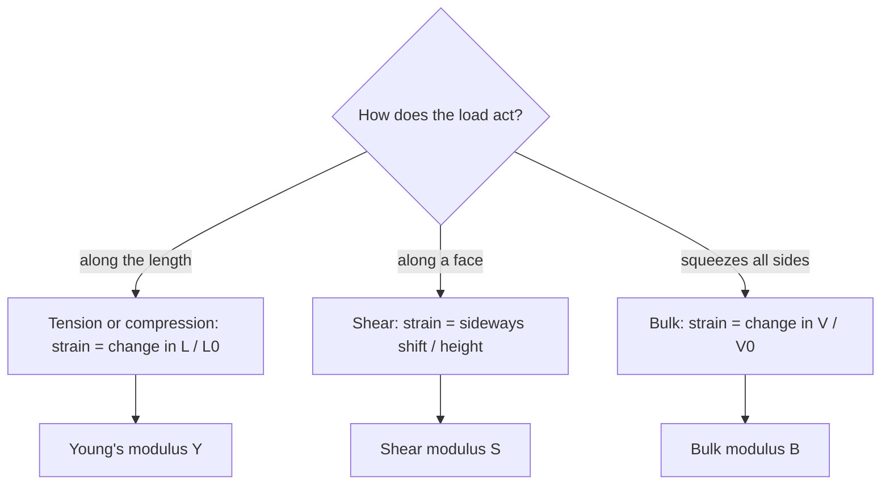

## When rigid objects give a little

The previous lesson treated beams, cables and ladders as perfectly rigid: forces were balanced, and nothing changed shape. Real materials always deform a little under load. A steel elevator cable stretches by millimeters, a bridge sags slightly under traffic, and a bone shortens when you land from a jump. Usually these changes are too small to see, but they matter. They decide whether a cable snaps, whether a shelf bends for good, and how fast sound travels through a material. This lesson describes how much an object deforms and what limits how far it can be pushed.

## Stress and strain

Hang a load from a wire and it stretches. How much depends on the load, but also on the wire's size, so we need measures that don't depend on size.

Two identical wires side by side share a load, so each carries half the force and stretches half as much. What matters is the force *per unit cross-sectional area*. That quantity is the **stress**:

$$\text{stress} = \frac{F}{A},$$

measured in pascals (1 Pa = 1 N/m²), the same unit as pressure. Pulling stress is **tensile stress**; pushing stress, as in a column holding up a roof, is **compressive stress**.

Now join two identical wires end to end. Each piece feels the full load and stretches by the same amount, so the doubled wire stretches twice as much. What matters is the stretch *per unit original length*, the **strain**:

$$\text{strain} = \frac{\Delta L}{L_0}.$$

Strain is a ratio of two lengths, so it has no units. A strain of $0.001$ means the wire grew by 0.1% of its length.

## Young's modulus

For small deformations, stress is proportional to strain. This is Hooke's law from the work lesson, written so that it no longer depends on the object's size:

$$\frac{F}{A} = Y\,\frac{\Delta L}{L_0}.$$

The constant $Y$ is **Young's modulus**, the material's stiffness in tension or compression. It has the units of stress (Pa), because strain has none. A large $Y$ means a stiff material that needs a large stress for a given strain.

Solving for the stretch gives the most useful form:

$$\Delta L = \frac{FL_0}{YA}.$$

Long, thin rods of a flexible material stretch most. Comparing with $F = kx$ shows that a rod behaves like a spring with $k = YA/L_0$.

| Material | Young's modulus $Y$ (Pa) |
|---|---|
| Steel | $2.0\times10^{11}$ |
| Copper | $1.1\times10^{11}$ |
| Aluminum | $7.0\times10^{10}$ |
| Glass | $7.0\times10^{10}$ |
| Concrete (compression) | $3.0\times10^{10}$ |
| Bone (tension) | $1.5\times10^{10}$ |
| Rubber | about $1\times10^{6}$ |

These values are typical; real samples vary by several percent. Most metals have the same $Y$ in tension and compression. Concrete and bone don't: concrete is far weaker when pulled than when pushed. That is why concrete beams have steel rods cast inside them to carry the tension.

### Example 1: a hanging wire

A steel wire 2.0 m long and 1.0 mm in diameter hangs from the ceiling with a 10 kg mass at its end. Find the stress, the strain and the stretch.

The area uses the *radius*, 0.50 mm $= 5.0\times10^{-4}$ m:

$$A = \pi r^2 = \pi(5.0\times10^{-4})^2 = 7.85\times10^{-7}\text{ m}^2.$$

The tension equals the weight, $F = 10(9.8) = 98$ N. Then

$$\text{stress} = \frac{98}{7.85\times10^{-7}} = 1.25\times10^{8}\text{ Pa}, \qquad \text{strain} = \frac{1.25\times10^{8}}{2.0\times10^{11}} = 6.24\times10^{-4},$$

$$\Delta L = (6.24\times10^{-4})(2.0\text{ m}) = 1.25\times10^{-3}\text{ m} = 1.25\text{ mm}.$$

A large stress gives only a tiny strain, because steel's modulus is enormous. As a spring, this wire has $k = YA/L_0 = 7.9\times10^{4}$ N/m.

## Beyond the straight line: elastic limit and breaking

Hooke's law holds only up to a point. The stress–strain graph of a typical metal looks like this:

```plot
{"x": [0, 10], "y": [0, 4.8], "xLabel": "strain (not to scale)", "yLabel": "stress", "functions": [{"f": "x", "from": 0, "to": 2.5}, {"f": "4 - 0.0740741*(x - 7)^2", "from": 2.5, "to": 9}, {"f": "x - 1.2963", "from": 1.2963, "to": 5, "dashed": true}], "points": [{"at": [2.5, 2.5], "label": "elastic limit"}, {"at": [7, 4], "label": "ultimate strength"}, {"at": [9, 3.7037], "label": "fracture"}, {"at": [1.2963, 0], "label": "permanent set"}], "caption": "Stress against strain for a metal: straight (Hooke's law) up to the elastic limit, then plastic flow until it breaks. Unloading from beyond the limit (dashed) leaves a permanent stretch."}
```

- In the straight part, the deformation is **elastic deformation**: remove the load and the object returns exactly to its original shape. The slope of this part is $Y$.
- The **elastic limit** is the largest stress the material can take and still spring fully back. (For most metals it is close to the end of the straight part.)
- Beyond it, atoms slide past one another, a **plastic deformation**. Unload the material and it comes back along a line parallel to the original one, ending with a permanent stretch. This is how a paper clip stays bent.
- The highest point of the curve is the **ultimate strength**, the greatest stress the material can withstand. After that the sample thins at one spot ("necks") and fractures.

For structural steel the elastic limit is roughly $2.5\times10^{8}$ Pa and the ultimate strength roughly $4\times10^{8}$ to $5\times10^{8}$ Pa. Engineers design so that working stresses stay well below the elastic limit, often by a safety factor of 3 or more.

### Example 2: how much can a rod hold?

A steel rod 3.0 m long and 4.0 mm in diameter has an elastic limit of $2.5\times10^{8}$ Pa. What is the largest mass it can hang without permanent stretching, and how much does it stretch at that load?

$A = \pi(2.0\times10^{-3})^2 = 1.26\times10^{-5}$ m². The largest force is

$$F = (\text{stress})A = (2.5\times10^{8})(1.26\times10^{-5}) = 3.1\times10^{3}\text{ N},$$

which is the weight of $3.1\times10^{3}/9.8 = 320$ kg.

Strain at the limit: $2.5\times10^{8}/2.0\times10^{11} = 1.25\times10^{-3}$, so $\Delta L = (1.25\times10^{-3})(3.0) = 3.8\times10^{-3}$ m $= 3.8$ mm. Steel can be stretched only about 0.1% before it stops springing back.

## Shear

Push sideways on the top of a block whose bottom is held fixed, and the block leans into a slanted shape without changing its height much. The force is parallel to the face it acts on, so this is a **shear stress**, again force over area, $F/A$, where $A$ is the area of the face the force is spread over (the top face, not the side). The top slides a distance $\Delta x$ relative to the bottom, and the **shear strain** is $\Delta x/L_0$, where $L_0$ is the height between the two faces.

```shape
{"segments": [{"from": [-1, 0], "to": [6, 0]}, {"from": [0, 0], "to": [0, 3], "dashed": true}, {"from": [0, 3], "to": [4, 3], "dashed": true}, {"from": [4, 3], "to": [4, 0], "dashed": true}, {"from": [1.6, 3.5], "to": [4.4, 3.5], "arrow": true, "label": "F"}, {"from": [3.4, -0.5], "to": [0.6, -0.5], "arrow": true, "label": "F"}, {"from": [-0.5, 0], "to": [-0.5, 3], "label": "L₀"}], "polygons": [{"points": [[0, 0], [4, 0], [5, 3], [1, 3]]}], "labels": [{"at": [4.5, 2.6], "text": "Δx"}], "caption": "Shear: equal and opposite forces along the top and bottom faces slant the block. The dashed outline is the original shape."}
```

The **shear modulus** $S$ links them:

$$\frac{F}{A} = S\,\frac{\Delta x}{L_0}.$$

Shear moduli are typically about a third to a half of Young's modulus (steel about $8.0\times10^{10}$ Pa, aluminum $2.5\times10^{10}$ Pa). Liquids and gases have no shear modulus at all: push sideways on a fluid and it simply flows. That is really what makes something a fluid.

### Example 3: an earthquake pad

Some buildings rest on rubber pads that shear during an earthquake. One pad is 0.50 m by 0.50 m on top and 0.10 m thick, with $S = 1.0\times10^{6}$ Pa. A sideways force of $2.0\times10^{4}$ N acts on its top. How far does the top shift?

The force acts on the top face: $A = 0.25$ m², so the shear stress is $2.0\times10^{4}/0.25 = 8.0\times10^{4}$ Pa. Then

$$\Delta x = \frac{FL_0}{SA} = \frac{(2.0\times10^{4})(0.10)}{(1.0\times10^{6})(0.25)} = 8.0\times10^{-3}\text{ m} = 8.0\text{ mm}.$$

Soft rubber lets the building shift gently instead of transmitting the full jolt.

## Bulk compression

Squeeze an object from all sides, as water does to a submarine, and its volume shrinks. Here the stress is a pressure increase $\Delta P$, the strain is the fractional volume change $\Delta V/V_0$, and the constant is the **bulk modulus** $B$:

$$\Delta P = -B\,\frac{\Delta V}{V_0}.$$

The minus sign says that more pressure means less volume, so $B$ itself is positive. Water's bulk modulus is about $2.2\times10^{9}$ Pa; steel's about $1.6\times10^{11}$ Pa. Gases are easy to compress, liquids and solids very hard.

The three kinds of deformation side by side, with the original shape dashed:




### Example 4: water at the ocean floor

By what percentage is water compressed at a depth of 4000 m? Use $\rho = 1000$ kg/m³ and ignore the atmosphere.

Pressure in a fluid grows with depth $h$ by $\Delta P = \rho gh$, the weight of the overlying column per unit area (the fluid-statics lesson derives it). Here the extra pressure is $\Delta P = (1000)(9.8)(4000) = 3.9\times10^{7}$ Pa, almost 400 atmospheres. Then

$$\frac{\Delta V}{V_0} = -\frac{\Delta P}{B} = -\frac{3.9\times10^{7}}{2.2\times10^{9}} = -0.018.$$

The water is compressed by only about 1.8%, which is why we treat liquids as incompressible in the fluids lessons.

## Stiffness and the speed of sound

A stiff material passes a push along quickly, while a heavy one responds sluggishly. That is why wave speeds have the form $\sqrt{\text{stiffness}/\text{density}}$: $v = \sqrt{Y/\rho}$ along a thin solid rod and $v = \sqrt{B/\rho}$ in a fluid. For steel, $\sqrt{2.0\times10^{11}/7800} \approx 5100$ m/s, about 15 times the speed of sound in air. The sound lesson uses the fluid version.

## Common mistakes

- Using the diameter as the radius in $A = \pi r^2$ (the area comes out 4 times too big).
- Forgetting to convert mm² or cm² to m² before dividing.
- Writing the strain as $\Delta L$ alone, or dividing by the final length instead of the original length.
- In shear, using the side face (the one that tilts) as the area instead of the face the force acts along.
- Thinking a material that has been loaded past its elastic limit will return to its original length.

## Key points

- Stress $= F/A$ (Pa); strain $= \Delta L/L_0$ (no units).
- Young's modulus: $F/A = Y\,\Delta L/L_0$, so $\Delta L = FL_0/(YA)$; a rod acts as a spring with $k = YA/L_0$.
- Shear: $F/A = S\,\Delta x/L_0$, with $A$ the face the force lies along. Fluids have no shear modulus.
- Bulk: $\Delta P = -B\,\Delta V/V_0$.
- Past the elastic limit the deformation is permanent; at the ultimate strength the material is about to break.
