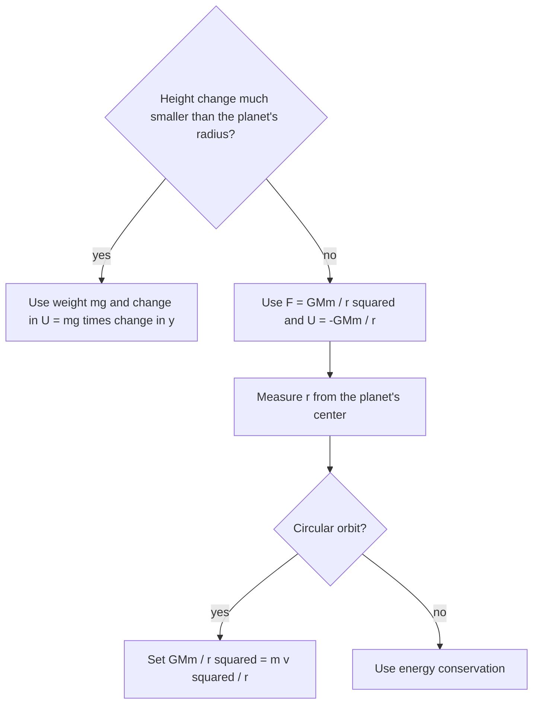

## One law for apples and planets

Until now, gravity has been the constant $g = 9.8$ m/s² near Earth's surface. Newton's great insight was that the force pulling an apple down is the same one holding the Moon in orbit, and that it weakens with distance in a precise way. This lesson states his law of universal gravitation and uses it, with circular-motion ideas, to explain orbits and Kepler's laws.

## Newton's law of universal gravitation

Every two masses attract each other with a force along the line joining them:

$$F = \frac{Gm_1m_2}{r^2},$$

where $r$ is the distance between their centers and $G = 6.67\times10^{-11}$ N·m²/kg² is the **gravitational constant**. This is **Newton's law of gravitation**. Each mass feels the same magnitude of force (third law). The force is an **inverse-square law**: double the distance and the force drops to a quarter.

$G$ is tiny, so gravity between everyday objects is negligible: two 70 kg people 1 m apart attract with about $3\times10^{-7}$ N. It dominates astronomy only because planets and stars are enormous. For spherical bodies, the force acts as if all the mass were at the center (Newton proved this; see the end of the lesson).

## Surface gravity

At Earth's surface, an object's weight is the gravitational force from Earth: $mg = \dfrac{GM_Em}{R_E^2}$, so

$$g = \frac{GM}{R^2}.$$

With $M_E = 5.97\times10^{24}$ kg and $R_E = 6.37\times10^6$ m, this gives 9.8 m/s². At height $h$ above the surface, replace $R$ with $R + h$: $g$ decreases, but slowly at first. At the International Space Station's altitude (about 400 km), $g$ is still about 8.7 m/s², 89% of its surface value. Astronauts float not because gravity is absent but because they and the station are in free fall together.

### Example 1

Find the acceleration due to gravity on Mars ($M = 6.42\times10^{23}$ kg, $R = 3.39\times10^6$ m).

$$g = \frac{(6.67\times10^{-11})(6.42\times10^{23})}{(3.39\times10^6)^2} = \frac{4.28\times10^{13}}{1.149\times10^{13}} = 3.73\text{ m/s}^2,$$

about 38% of Earth's.

## Circular orbits

A satellite in a circular orbit of radius $r$ around a planet of mass $M$ is in uniform circular motion, with gravity supplying the centripetal force:

$$\frac{GMm}{r^2} = \frac{mv^2}{r} \quad\Rightarrow\quad v = \sqrt{\frac{GM}{r}}.$$

The satellite's mass cancels, and lower orbits are faster. The period is the circumference over the speed, $T = 2\pi r/v$, and squaring:

$$T^2 = \frac{4\pi^2}{GM}r^3.$$

### Example 2

Find the speed and period of a satellite orbiting 400 km above Earth's surface.

$r = 6.37\times10^6 + 4.0\times10^5 = 6.77\times10^6$ m.

$$v = \sqrt{\frac{(6.67\times10^{-11})(5.97\times10^{24})}{6.77\times10^6}} = \sqrt{5.88\times10^7} = 7.67\times10^3\text{ m/s}.$$

$T = \dfrac{2\pi(6.77\times10^6)}{7670} = 5.55\times10^3$ s $= 92$ min. The ISS circles Earth about 16 times a day.

A **geostationary** satellite has a 24 h period, so it stays above one spot on the equator. Solving $T^2 = \dfrac{4\pi^2}{GM}r^3$ with $T = 86\,400$ s gives $r = 4.22\times10^7$ m, about 36 000 km above the surface.

## Kepler's laws

Decades before Newton, Johannes Kepler distilled Tycho Brahe's observations into three laws of planetary motion. Newton's gravitation explains all three.

1. *Orbits are ellipses* with the Sun at one focus. (A circle is the special case of zero eccentricity. Inverse-square forces produce conic-section orbits.)
2. *Equal areas in equal times*: the line from the Sun to a planet sweeps out equal areas in equal times, so a planet moves fastest at its closest point (perihelion). This is conservation of angular momentum, because gravity points toward the Sun and exerts no torque about it.
3. *$T^2 \propto a^3$*: the square of the period is proportional to the cube of the orbit's semimajor axis $a$ (its radius, for a circle), with the same constant $\dfrac{4\pi^2}{GM_{\text{Sun}}}$ for every planet.

```shape
{"x": [-4.6, 2.8], "y": [-1.8, 1.8], "curves": [{"x": "-1 + 2*cos(t)", "y": "1.6*sin(t)", "t": [0, "2pi"]}], "points": [[0.2, 0], [1, 0], [-3, 0]], "labels": [{"at": [0.2, -0.35], "text": "Sun (focus)"}, {"at": [1.85, -0.07], "text": "perihelion"}, {"at": [-3.8, -0.07], "text": "aphelion"}], "caption": "An elliptical orbit: the planet moves fastest at perihelion and slowest at aphelion"}
```


The shaded sectors above are drawn to scale for this fairly elongated orbit: the planet covers the long arc near perihelion in the same time as the short arc near aphelion.

### Example 3

Mars orbits the Sun at 1.52 times Earth's orbital radius. How long is a Martian year?

Kepler's third law as a ratio: $\dfrac{T_M^2}{T_E^2} = \dfrac{a_M^3}{a_E^3}$, so $T_M = (1.52)^{3/2}(1\text{ yr}) = 1.87$ yr. No constants needed when comparing orbits around the same body.

## Gravitational potential energy and escape speed

The formula $U = mgy$ assumes constant $g$. Far from the surface we need the general form:

$$U = -\frac{GMm}{r},$$

with $U = 0$ at infinite separation. It's negative because work must be done to pull the masses apart. For small height changes near the surface, $\Delta U \approx mg\Delta y$.

The minimum launch speed that lets an object coast to infinity (arriving with zero speed) is the **escape speed**. Set the total energy to zero: $\tfrac12mv^2 - \dfrac{GMm}{R} = 0$, so

$$v_{\text{esc}} = \sqrt{\frac{2GM}{R}}.$$

For Earth, $v_{\text{esc}} = 11.2$ km/s, exactly $\sqrt2$ times the speed of a low circular orbit. In a circular orbit the total energy is $E = K + U = \tfrac12\dfrac{GMm}{r} - \dfrac{GMm}{r} = -\dfrac{GMm}{2r}$: negative, meaning bound.

The choice between the two sets of formulas comes up in every gravity problem:



## Where the formulas come from

Two results in this lesson were stated rather than derived, because their proofs need more advanced math than this course uses.

*Spheres act like points.* A uniform spherical shell attracts any mass outside it as if all the shell's mass sat at its center (Newton's shell theorem). A planet is a set of nested shells, so outside it the planet acts like a point mass at its center. That's why $r$ in $F = GMm/r^2$ is measured from the center.

*Why $U = -GMm/r$.* The work to pull a mass from $r$ out to infinity is the area under the $F$–$r$ graph from $r$ outward. Because the force falls off as $1/r^2$, that area is finite and equals $GMm/r$. With $U = 0$ at infinity, $U$ at distance $r$ must be $GMm/r$ lower: $-GMm/r$. Near the surface, a small height change $\Delta y$ changes $r$ only slightly, and this formula reduces to $\Delta U \approx mg\Delta y$.

### Example 4

How much energy does it take to lift a 1000 kg payload from Earth's surface to a height of one Earth radius (ignoring its speed)? Compare with $mgh$.

$\Delta U = -\dfrac{GMm}{2R} - \left(-\dfrac{GMm}{R}\right) = \dfrac{GMm}{2R}$. With $GM/R = gR = 9.8(6.37\times10^6) = 6.24\times10^7$ J/kg, $\Delta U = \tfrac12(1000)(6.24\times10^7) = 3.1\times10^{10}$ J.

Using $mgh$ with $h = R$ gives $6.2\times10^{10}$ J, twice too much, because $g$ weakens with height. For heights much smaller than $R$ the two agree.

## Common mistakes

- Measuring $r$ from the surface instead of the center.
- Forgetting to square $r$ (or squaring it twice).
- Thinking astronauts in orbit are weightless because there's no gravity.
- Using $U = mgh$ for orbits or escape problems.
- Converting km to m incorrectly in $r$.

## Key points

- $F = Gm_1m_2/r^2$, $G = 6.67\times10^{-11}$ N·m²/kg²; $g = GM/R^2$.
- Circular orbit: $v = \sqrt{GM/r}$, $T^2 = \dfrac{4\pi^2}{GM}r^3$.
- Kepler: ellipses, equal areas (angular momentum conservation), $T^2 \propto a^3$.
- $U = -GMm/r$; $v_{\text{esc}} = \sqrt{2GM/R}$; orbital energy $-GMm/(2r)$.
