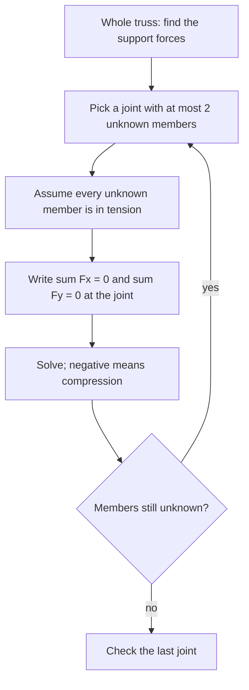

## Equilibrium as an engineering tool

The static equilibrium lesson balanced single objects: a seesaw, a plank, a hinged beam. Real structures are built from many parts joined together, and the question an engineer asks is not just "what holds it up?" but "how hard is each part pushed or pulled?" This lesson applies the same two conditions, $\sum\vec F = 0$ and $\sum\tau = 0$, to three classic problems: the forces inside a **truss**, the ladder that slips, and the box that tips before it slides.

The models here are idealized (pin joints with no friction, weightless members, rigid bodies), and we'll say so where it matters. They are the same first models engineering students learn, and they give answers close to reality for well-built structures.

## Two-force members

A truss is a framework of straight bars (members) joined at their ends by pins, with loads applied only at the joints. Roof frames, railway bridges, cranes and transmission towers are trusses. Treat each member as weightless (its weight is small next to the loads, or is split between its two joints) and each pin as frictionless.

Then each member is a **two-force member**: it feels exactly two forces, one from the pin at each end. For it to be in equilibrium, the two forces must be equal and opposite (so $\sum\vec F = 0$), and they must lie along the same line (so they have no net torque). The only line through both pins is the member itself. So every member simply pulls on both its pins (it is in **tension**) or pushes on both (it is in **compression**), with a force along its length.

That's what makes trusses efficient and easy to analyze: each member has a single unknown, the size of its force. A positive answer, with tension assumed, means tension; a negative one means compression.

## The method of joints

Each pin is a tiny object in equilibrium. Forces from the members act along the members, and any load or support acts there too. With all forces through one point, there is no torque to worry about, so each joint gives two equations, $\sum F_x = 0$ and $\sum F_y = 0$.



### Example 1: an A-frame roof

Two rafters meet at the peak of a roof and make $30^\circ$ with the horizontal. A horizontal tie joins their feet, which rest on walls that push straight up. A 12 kN load acts at the peak. Find the force in each rafter and in the tie.

```shape
{"polygons": [{"points": [[0, 0], [6, 0], [3, 1.732]]}], "segments": [{"from": [3, 3.3], "to": [3, 1.85], "arrow": true, "label": "12 kN"}, {"from": [0, -1.2], "to": [0, -0.1], "arrow": true, "label": "6 kN"}, {"from": [6, -1.2], "to": [6, -0.1], "arrow": true, "label": "6 kN"}], "labels": [{"at": [0.9, 0.18], "text": "30°"}, {"at": [3, -0.35], "text": "tie"}, {"at": [1.1, 1.15], "text": "rafter"}, {"at": [4.9, 1.15], "text": "rafter"}], "caption": "A symmetric A-frame: a 12 kN load at the peak, each wall pushing up 6 kN"}
```

*Supports.* By symmetry, each wall pushes up $6$ kN.

*Peak joint.* Each rafter pushes along its length with force $F$. Their horizontal parts cancel; their vertical parts hold the load: $2F\sin 30^\circ = 12$ kN, so $F = 12$ kN, **compression** (the rafters push up on the peak).

*Foot joint.* The rafter pushes down and outward on the foot with 12 kN. Vertically, $12\sin 30^\circ = 6$ kN is balanced by the wall. Horizontally, $12\cos 30^\circ = 10.4$ kN outward must be balanced by the tie pulling inward: the tie is in tension, 10.4 kN.

Each rafter carries the *whole* 12 kN load, and the tie nearly as much. Make the roof steeper, $60^\circ$, and the rafter force drops to $12/(2\sin 60^\circ) = 6.93$ kN and the tie to 3.46 kN. Shallow angles mean large internal forces, the same lesson the hinged-beam cable taught.

### Example 2: a small bridge truss

The truss below is built from equilateral triangles with 4.0 m sides. It rests on a pin at A and a roller at E (the roller pushes only vertically). A 30 kN load hangs from joint C. Find the forces in members AB, AC, BC and BD.


*Supports.* Symmetry (or torques about A) gives 15 kN upward at A and at E. The pin at A has no horizontal force, since no load has a horizontal part.

*Joint A* has two unknowns, AB (at $60^\circ$) and AC (horizontal). Assume both in tension, pulling A toward B and toward C. Vertical: $15 + F_{AB}\sin 60^\circ = 0$, so $F_{AB} = -17.3$ kN, **compression**. Horizontal: $F_{AC} + F_{AB}\cos 60^\circ = 0$, so $F_{AC} = +8.66$ kN, tension.

*Joint B* now has two unknowns, BC and BD. AB, in compression, pushes B away from A: up $17.3\sin 60^\circ = 15$ kN and right $17.3\cos 60^\circ = 8.66$ kN. BC (tension assumed) pulls B down and right toward C. Vertical: $15 - F_{BC}\sin 60^\circ = 0$, so $F_{BC} = 17.3$ kN, tension. Horizontal: $8.66 + 17.3\cos 60^\circ + F_{BD} = 0$, so $F_{BD} = -17.3$ kN, compression.

By symmetry DE and CD mirror AB and BC. *Check at C*: the two slanted members each pull up $17.3\sin 60^\circ = 15$ kN, holding the 30 kN load ✓, and AC and CE pull equally in opposite directions ✓.

The pattern is the same as in a bent beam: the top chord (BD) is squeezed and the bottom chord (AC, CE) is stretched. That's why steel bridges often use slim rods or plates for tension members but thicker, braced sections for compression members, which can buckle.

## Ladders that slip

The core lesson described the ladder qualitatively. Now the numbers. A uniform ladder of length $L$ and weight $W$ leans against a smooth (frictionless) wall at angle $\theta$ above the floor. The floor supplies a normal force $n = W$ and static friction $f$ toward the wall; the wall supplies a horizontal normal force $N_w$.

Torques about the foot (eliminating $n$ and $f$): the wall force acts at height $L\sin\theta$, the weight at horizontal distance $\tfrac L2\cos\theta$:

$$N_wL\sin\theta = W\tfrac L2\cos\theta \quad\Rightarrow\quad N_w = \frac{W}{2\tan\theta}.$$

Horizontal balance: $f = N_w$. The ladder stays put only if $f \le \mu_sn = \mu_sW$, which gives

$$\tan\theta \ge \frac{1}{2\mu_s}.$$

The smallest safe angle depends only on the friction coefficient, not on the ladder's length or weight. (This treats the wall as frictionless, which is the cautious assumption: real wall friction helps.)

### Example 3: how high can the painter climb?

A uniform 5.0 m ladder of mass 15 kg leans at $60^\circ$ against a smooth wall; $\mu_s = 0.40$ at the floor. (a) What is the smallest angle at which the empty ladder can stand? (b) A 75 kg painter climbs it. How far along the ladder can she go before it slips?

(a) $\tan\theta \ge \dfrac{1}{0.80} = 1.25$, so $\theta \ge 51.3^\circ$.

(b) The floor's normal force is now $(15 + 75)(9.8) = 882$ N, so friction can be at most $0.40(882) = 353$ N, and at the slipping point $N_w = f = 353$ N. Torques about the foot, with the painter a distance $x$ along the ladder:

$$353(5.0\sin 60^\circ) = 147(2.5\cos 60^\circ) + 735\,x\cos 60^\circ.$$

$1528 = 184 + 367.5x$, so $x = 3.66$ m. She can climb about three quarters of the way; higher, her weight's lever arm about the foot is too large. Climbing raises the friction needed even though the angle hasn't changed, which is why the top rungs are the dangerous ones.

## Tip or slide?

Push sideways on a tall box, or tilt the surface it rests on, and one of two things happens first: it slides, or it tips over its bottom edge. Each has its own condition, and whichever threshold is lower wins.

**On a tilting ramp.** A uniform box of width $w$ (along the slope) and height $h$ sits on a ramp of angle $\theta$. It slides when $\tan\theta > \mu_s$ (the incline lesson). It tips when the vertical line through its center of gravity passes outside the downhill edge of its base. Measured in the box's own frame, the center is $\tfrac h2$ above the base and $\tfrac w2$ from the edge, and the vertical through it reaches the edge when $\tan\theta = \dfrac{w/2}{h/2} = \dfrac wh$. So:

- it slides first if $\mu_s < w/h$;
- it tips first if $w/h < \mu_s$.

A crate 0.60 m wide and 1.5 m tall ($w/h = 0.40$) on a surface with $\mu_s = 0.50$ tips at $21.8^\circ$, before it could slide at $26.6^\circ$.

**Pushed on level ground.** Push horizontally with force $F$ at height $H$ on a box of mass $m$ and depth $w$ (in the direction of the push). Sliding starts when $F = \mu_smg$. Tipping starts about the front bottom edge, when the push's torque beats the weight's: $FH = mg\tfrac w2$, so $F = \dfrac{mgw}{2H}$. It tips first if $\dfrac{w}{2H} < \mu_s$, that is, if you push above the height $H = \dfrac{w}{2\mu_s}$.

### Example 4: moving a refrigerator

A 90 kg refrigerator is 0.70 m deep, front to back; $\mu_s = 0.45$ with the floor. You push on its front face at a height of 1.2 m. Does it slide or tip? Where should you push instead?

Sliding needs $0.45(90)(9.8) = 397$ N. Tipping needs $\dfrac{90(9.8)(0.70)}{2(1.2)} = 257$ N. Tipping wins: it starts to topple at 257 N before it ever slides. To slide it, push below $H = \dfrac{0.70}{2(0.45)} = 0.78$ m. (This assumes the center of gravity is at the middle of the box; a real fridge with a heavy compressor at the bottom has a lower center of gravity and is a little harder to tip.)

## Common mistakes

- Drawing a truss member's force at an angle to the member. In a pin-jointed truss loaded at the joints, every member force lies along the member.
- Mixing up which way a compression force acts on a joint: a compressed member *pushes* on the joint, away from the member's other end.
- Starting the method of joints at a joint with three unknowns: two equations can't solve it. Find the supports first, then start where only two are unknown.
- Using the ladder's own weight alone for the floor's normal force after someone climbs on.
- Assuming a box always slides before it tips: compare $\mu_s$ with $w/h$ (ramp) or with $w/(2H)$ (push).

## Key points

- In a pin-jointed truss loaded at its joints, each member is a two-force member: pure tension or compression along its length.
- Method of joints: supports first, then $\sum F_x = 0$, $\sum F_y = 0$ at joints with at most two unknowns; negative means compression.
- Shallow members carry large forces: an A-frame's rafter force is $P/(2\sin\theta)$.
- Ladder on a smooth wall: stands if $\tan\theta \ge 1/(2\mu_s)$; a climber raises the friction needed.
- Box on a ramp tips first if $w/h < \mu_s$; pushed at height $H$, it tips first if $w/(2H) < \mu_s$.
