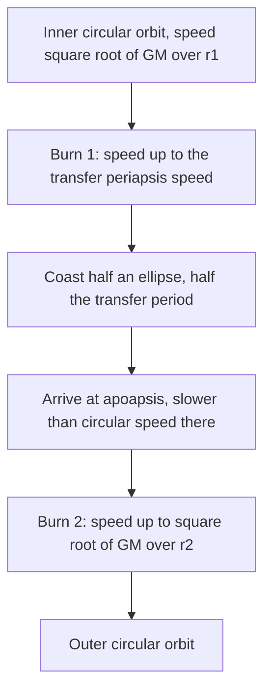

## From circles to ellipses

The gravitation lesson worked out circular orbits in detail and stated Kepler's laws for elliptical ones. Most real orbits are ellipses: comets, transfer orbits to the Moon and planets, many satellites. This lesson combines the two conservation laws you already have, energy and angular momentum, to get the speed anywhere on an ellipse. Then it uses that to plan the cheapest move from one orbit to another, and finally turns Kepler's third law around to measure the masses of planets, stars and a black hole.

Throughout, a small body of mass $m$ orbits a much heavier body of mass $M$, which we treat as fixed. (For two stars of similar mass that isn't true; we fix it in the last section.)

## Describing an ellipse

An ellipse has a long axis and two special points on it, the foci; the central body sits at one focus. Three lengths describe an orbit:

- the **periapsis** distance $r_p$, the closest approach to the central body (called perigee for orbits around Earth and perihelion around the Sun);
- the **apoapsis** distance $r_a$, the farthest point (apogee, aphelion);
- the **semimajor axis** $a$, half the long axis. Since the long axis runs from periapsis through the focus to apoapsis, $2a = r_p + r_a$, so $a = \tfrac12(r_p + r_a)$.

A circle is the special case $r_p = r_a = a$. All distances are measured from the *center* of the central body, not its surface.

## Speed at the two ends: two conservation laws

Gravity points at the central body, so it exerts no torque about it, and angular momentum is conserved (Kepler's second law). At periapsis and apoapsis the velocity is perpendicular to the line from the focus, so $r_\perp = r$ and $L = mvr$ there:

$$r_pv_p = r_av_a.$$

Gravity is also conservative, so the energy $\tfrac12mv^2 - \dfrac{GMm}{r}$ is the same at both ends:

$$\tfrac12v_p^2 - \frac{GM}{r_p} = \tfrac12v_a^2 - \frac{GM}{r_a}.$$

Substitute $v_a = v_pr_p/r_a$ and solve. After some algebra (multiply out and use $r_a^2 - r_p^2 = (r_a - r_p)(r_a + r_p)$):

$$v_p^2 = \frac{2GM\,r_a}{r_p(r_p + r_a)}.$$

Now find the total energy at periapsis:

$$E = \tfrac12mv_p^2 - \frac{GMm}{r_p} = \frac{GMm}{r_p}\left(\frac{r_a}{r_p + r_a} - 1\right) = -\frac{GMm}{r_p + r_a} = -\frac{GMm}{2a}.$$

This is a remarkable result: the **orbital energy** depends only on the semimajor axis, not on the shape. A circle of radius $a$ and a long thin ellipse with the same $a$ have the same energy (and, by Kepler's third law, the same period). For a circle it reduces to the core lesson's $-GMm/(2r)$.

## The vis-viva equation

Since the energy at any point is $-GMm/(2a)$, write energy conservation at an arbitrary distance $r$:

$$\tfrac12mv^2 - \frac{GMm}{r} = -\frac{GMm}{2a} \quad\Rightarrow\quad v^2 = GM\left(\frac2r - \frac1a\right).$$

This is the **vis-viva equation** (Latin for "living force," an old name for $mv^2$, twice what we now call kinetic energy). It gives the speed anywhere on an orbit from just the distance and the semimajor axis. Check the special cases: for a circle ($r = a$) it gives $v^2 = GM/r$; for escape ($a \to \infty$, a parabola) it gives $v^2 = 2GM/r$. Both match the core lesson.

### Example 1: a satellite on an ellipse

A satellite orbits Earth with perigee 7.0 × 10⁶ m and apogee 1.40 × 10⁷ m from Earth's center. Find its speeds at perigee and apogee and its period. ($GM_E = 3.98\times10^{14}$ m³/s².)

$a = \tfrac12(7.0\times10^6 + 1.40\times10^7) = 1.05\times10^7$ m.

Perigee: $v_p^2 = 3.98\times10^{14}\left(\dfrac{2}{7.0\times10^6} - \dfrac{1}{1.05\times10^7}\right) = 7.58\times10^7$, so $v_p = 8.71$ km/s.

Apogee, from angular momentum: $v_a = v_p\dfrac{r_p}{r_a} = 8.71 \times \dfrac{7.0}{14.0} = 4.35$ km/s.

Period, from Kepler's third law with $a$: $T = 2\pi\sqrt{\dfrac{a^3}{GM}} = 2\pi\sqrt{\dfrac{(1.05\times10^7)^3}{3.98\times10^{14}}} = 1.07\times10^4$ s $= 2.98$ h.

Compare a circular orbit at the perigee distance: $\sqrt{GM/r_p} = 7.54$ km/s. At perigee the satellite moves faster than circular speed, which is exactly why it swings out to a larger distance.

## Changing orbits: the Hohmann transfer

A spacecraft changes its orbit by firing its engine briefly, changing its velocity by an amount called **delta-v** ($\Delta v$). Fuel use grows with the total $\Delta v$, so mission planners hunt for the smallest one.

To go from a low circular orbit of radius $r_1$ to a higher circular orbit of radius $r_2$ in the same plane, the classic answer (usually the cheapest when $r_2$ is less than about 12 times $r_1$) is the **Hohmann transfer**, worked out by Walter Hohmann in 1925:

1. *First burn*, at the inner orbit: speed up along the direction of motion. The craft is now at the periapsis of a **transfer orbit**, an ellipse with $r_p = r_1$ and $r_a = r_2$, so $a_t = \tfrac12(r_1 + r_2)$.
2. *Coast* half an ellipse to apoapsis, a time of half the transfer orbit's period.
3. *Second burn*, at the outer orbit: speed up again, to the circular speed there. Without it, the craft would fall back along the ellipse.

Odd but true: the craft speeds up twice, yet it ends up moving *slower* than it started, because the outer orbit's circular speed is lower. The burns add energy; the climb converts kinetic energy into potential energy.

### Example 2: from low orbit to geostationary

Plan a Hohmann transfer from a circular orbit of radius $r_1 = 6.67\times10^6$ m (300 km up) to geostationary radius $r_2 = 4.22\times10^7$ m. Find both burns and the trip time.

With $GM_E = 3.98\times10^{14}$ m³/s² as before, the circular speeds are $v_1 = \sqrt{GM/r_1} = 7.72$ km/s and $v_2 = \sqrt{GM/r_2} = 3.07$ km/s.

Transfer orbit: $a_t = \tfrac12(6.67\times10^6 + 4.22\times10^7) = 2.44\times10^7$ m. Vis-viva at its two ends:

$$v_{tp} = \sqrt{GM\left(\frac2{r_1} - \frac1{a_t}\right)} = 10.15\text{ km/s}, \qquad v_{ta} = \sqrt{GM\left(\frac2{r_2} - \frac1{a_t}\right)} = 1.60\text{ km/s}.$$

Burns: $\Delta v_1 = 10.15 - 7.72 = 2.43$ km/s, $\Delta v_2 = 3.07 - 1.60 = 1.47$ km/s, total 3.89 km/s.

Trip time: half the transfer period, $\pi\sqrt{a_t^3/GM} = 1.90\times10^4$ s $= 5.3$ h.

(Real launches from Florida must also tilt the orbit into the equatorial plane, which adds to the second burn. We've kept the orbits in one plane.)

The same idea, with the Sun as the central body, plans trips between planets. A Hohmann transfer from Earth's orbit (1.00 AU) to Mars's (1.52 AU) has $a_t = 1.26$ AU; by Kepler's third law in years and AU, its full period is $1.26^{3/2} = 1.41$ yr, so the trip takes half that, about 0.71 yr or 8.5 months. That's why the launch windows to Mars, when the planets are lined up for this path, come only about every 26 months.

## Weighing the heavens

Kepler's third law in Newton's form, $T^2 = \dfrac{4\pi^2}{GM}a^3$, can be turned around:

$$M = \frac{4\pi^2a^3}{GT^2}.$$

Measure the size and period of any orbit, and you have the mass of the body being orbited. The orbiting body's own mass doesn't appear, as long as it is small. This is how astronomers know the masses of the Sun, the planets with moons, and much more.

### Example 3: the mass of Jupiter

Jupiter's moon Io orbits at $a = 4.22\times10^8$ m with a period of 1.769 days. Find Jupiter's mass.

$T = 1.769(86\,400) = 1.528\times10^5$ s.

$$M_J = \frac{4\pi^2(4.22\times10^8)^3}{(6.67\times10^{-11})(1.528\times10^5)^2} = 1.90\times10^{27}\text{ kg},$$

about 318 times Earth's mass.

*Binary stars.* When two bodies of similar mass orbit each other, both move around their common center of mass, and the heavier one is not fixed. Newton's analysis then gives the same law with the total mass, and with $a$ now the semimajor axis of their *separation*:

$$M_1 + M_2 = \frac{4\pi^2a^3}{GT^2}.$$

In convenient units (a in AU, T in years, masses in Sun masses) the constants cancel for the Earth–Sun case, so $M_1 + M_2 = a^3/T^2$.

### Example 4: Sirius and the black hole at the galaxy's center

Sirius, the brightest star in the night sky, has a faint white-dwarf companion. Their separation has a semimajor axis of about 19.8 AU and the period is about 50.1 yr. Total mass: $19.8^3/50.1^2 = 3.1$ solar masses. Separate measurements of how each star wobbles about the center of mass split this into about 2.1 and 1.0 solar masses.

The same method weighs the black hole at the center of the Milky Way. The star S2 orbits it with a semimajor axis of roughly 1000 AU and a period of about 16 years: $1000^3/16^2 \approx 4\times10^6$ solar masses, packed into a region far smaller than the solar system. (Careful fits to decades of S2 data give about $4.3\times10^6$; this measurement was part of the work honored by the 2020 Nobel Prize in Physics.)

## Common mistakes

- Using altitude above the surface as $r$ or $a$; orbits are measured from the center of the central body.
- Taking $a$ to be $r_a$, or $r_p + r_a$; it is *half* the sum.
- Assuming the speed on an ellipse is $\sqrt{GM/r}$. That's only for circles; use vis-viva.
- Thinking a craft that ends in a higher orbit must be moving faster: it is moving slower, with more total (less negative) energy.
- Forgetting the companion's mass in a binary: the formula gives the *total* mass.

## Key points

- Ellipse: $a = \tfrac12(r_p + r_a)$; $r_pv_p = r_av_a$ (angular momentum).
- Orbital energy $E = -\dfrac{GMm}{2a}$, set by the semimajor axis alone.
- Vis-viva: $v^2 = GM\left(\dfrac2r - \dfrac1a\right)$.
- Hohmann transfer: two forward burns joined by half an ellipse with $a_t = \tfrac12(r_1 + r_2)$; trip time is half its period.
- Mass from an orbit: $M = \dfrac{4\pi^2a^3}{GT^2}$; for a binary this is the total mass; in AU, years and solar masses, $M = a^3/T^2$.
