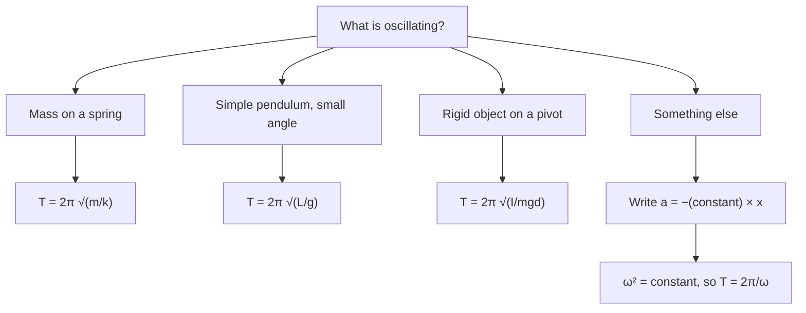

## Motion that repeats

A mass bouncing on a spring, a swinging pendulum, a vibrating guitar string, atoms jiggling in a crystal, the alternating current in your walls: nature is full of oscillations. The simplest and most important kind is simple harmonic motion, and it's worth mastering because almost any system nudged slightly from a stable equilibrium oscillates this way. It's also the bridge to waves, the subject of the next two lessons.

## The restoring force

Recall Hooke's law: a spring pulls back with $F = -kx$, proportional to the displacement and opposite to it. Any motion driven by a force of this form is **simple harmonic motion** (SHM). Newton's second law gives

$$a = -\frac{k}{m}x.$$

The acceleration always points toward equilibrium and is largest at the extremes. The object overshoots equilibrium (it has speed there, and inertia carries it on), slows as the spring stretches the other way, stops, and returns. The cycle repeats forever if there's no friction.

The picture shows three moments in one cycle. At each end the block is momentarily at rest and the acceleration is largest; at equilibrium the block is fastest and the acceleration is zero.


## Describing the oscillation

The position follows a sine or cosine curve:

$$x(t) = A\cos(\omega t + \phi).$$

- **Amplitude** $A$: the maximum displacement from equilibrium.
- **Angular frequency** $\omega$ (rad/s), related to the period $T$ and frequency $f$ by $\omega = 2\pi f = 2\pi/T$.
- **Phase constant** $\phi$: sets where in the cycle the motion starts. Released from rest at $x = A$, $\phi = 0$.

```plot
{"x": [0, 4.2], "y": [-1.5, 1.5], "xLabel": "t (s)", "yLabel": "x (m)", "functions": [{"f": "1.2*cos(2*pi*x/2)"}], "labels": [{"at": [1.0, 1.33], "text": "x(t) = A cos(ωt)"}], "points": [{"at": [2, 1.2], "label": "one period T = 2 s"}], "segments": [{"from": [0, 0], "to": [0, 1.2], "arrow": true, "label": "A"}], "caption": "SHM with amplitude 1.2 m and period 2.0 s"}
```

For a mass on a spring,

$$\omega = \sqrt{\frac km}, \qquad T = 2\pi\sqrt{\frac mk}.$$

A stiffer spring or lighter mass oscillates faster. Remarkably, *the period doesn't depend on the amplitude*: stretch the spring twice as far and the mass travels twice as far, but with twice the force, so it takes the same time. That's what makes oscillators good clocks.

### Example 1

A 0.50 kg block on a frictionless surface is attached to a spring with $k = 200$ N/m. It's pulled 0.10 m from equilibrium and released. Find the period, frequency, maximum speed and maximum acceleration.

$\omega = \sqrt{200/0.50} = 20$ rad/s. $T = 2\pi/20 = 0.314$ s; $f = 3.18$ Hz.

Maximum speed (at equilibrium): $v_{\max} = A\omega = 0.10(20) = 2.0$ m/s.

Maximum acceleration (at the ends): $a_{\max} = A\omega^2 = 0.10(400) = 40$ m/s². Check with force: $kA/m = 200(0.10)/0.50 = 40$ ✓.

## Energy in SHM

With no friction, mechanical energy is conserved and shuttles between kinetic and spring potential energy:

$$E = \tfrac12mv^2 + \tfrac12kx^2 = \tfrac12kA^2.$$

At the turning points ($x = \pm A$) it's all potential; at equilibrium it's all kinetic, so $\tfrac12mv_{\max}^2 = \tfrac12kA^2$, giving $v_{\max} = A\sqrt{k/m} = A\omega$. At any position, $v = \omega\sqrt{A^2 - x^2}$.

### Example 2

For the block in Example 1, what is its speed when it's 0.06 m from equilibrium?

$v = 20\sqrt{0.10^2 - 0.06^2} = 20(0.08) = 1.6$ m/s.

*Vertical springs.* Hanging a mass on a vertical spring shifts the equilibrium down by $mg/k$, but measured from the new equilibrium the motion is the same SHM with the same $\omega = \sqrt{k/m}$. Gravity just moves the center.

## The simple pendulum

A **simple pendulum** is a point mass on a light string of length $L$. Displaced by angle $\theta$, gravity's component along the arc is $-mg\sin\theta$. The picture splits the weight into a part along the string, which the tension balances (when the bob is moving, the tension is a little larger, and the extra supplies the centripetal force), and a part along the arc, which pulls the bob back toward the bottom.


For small angles, $\sin\theta \approx \theta$ (in radians; accurate to 1% up to about $14^\circ$), and with arc length $s = L\theta$ the restoring force is $-\dfrac{mg}{L}s$, Hooke's-law form with effective $k = mg/L$. So

$$\omega = \sqrt{\frac gL}, \qquad T = 2\pi\sqrt{\frac Lg}.$$

The mass cancels (heavy and light bobs swing together, just as they fall together), and the amplitude doesn't matter as long as it's small. Pendulum clocks are adjusted by moving the bob to change $L$.

### Example 3

How long must a pendulum be to have a period of exactly 2.00 s (a "seconds pendulum," which ticks once per second each way)? Use $g = 9.80$ m/s².

$L = g\left(\dfrac{T}{2\pi}\right)^2 = 9.80\left(\dfrac{2.00}{2\pi}\right)^2 = 0.993$ m.

On the Moon ($g = 1.62$ m/s²) the same pendulum would have $T = 2\pi\sqrt{0.993/1.62} = 4.92$ s.

A **physical pendulum**, any rigid object swinging about a pivot a distance $d$ from its center of mass, has $T = 2\pi\sqrt{\dfrac{I}{mgd}}$, where $I$ is the moment of inertia about the pivot. For a point mass, $I = mL^2$ and $d = L$, recovering the simple pendulum.

## Damping and resonance

Real oscillators lose energy to friction and air drag. With **damping**, the amplitude shrinks a little with each cycle as mechanical energy turns into thermal energy. Light damping leaves the frequency almost unchanged; heavy damping can stop the oscillation altogether (car shock absorbers are tuned to return the car to equilibrium quickly without bouncing, which is called critical damping).

A periodic push can feed energy in. When the driving frequency matches the system's natural frequency $\omega_0 = \sqrt{k/m}$, the amplitude grows large: **resonance**. You use it pushing a child on a swing at just the right moments. Engineers must avoid it in bridges and buildings (wind or footsteps at the natural frequency can cause dangerous swaying) and exploit it in radios, which tune by resonating with one station's frequency.

## SHM and circular motion

Why does a cosine describe SHM, and where do $v_{\max} = A\omega$ and $a_{\max} = A\omega^2$ come from? Picture a peg moving at constant angular speed $\omega$ around a circle of radius $A$, and look at its shadow on the $x$ axis (light shining from above, or the peg seen edge-on). The peg's angle is $\omega t$, so the shadow is at $x = A\cos(\omega t)$.

- The peg's speed is $A\omega$. The shadow moves with just the $x$ part of that velocity, which is largest (the full $A\omega$) as the shadow passes the center: $v_{\max} = A\omega$.
- The peg's centripetal acceleration, $A\omega^2$, points toward the center of the circle. Its $x$ part is $-\omega^2 x$: always toward equilibrium, proportional to the displacement, and largest ($A\omega^2$) at the ends.

So the shadow's acceleration obeys $a = -\omega^2x$, exactly the SHM rule $a = -\tfrac km x$ with $\omega^2 = k/m$. Any system whose acceleration is $a = -(\text{constant})\,x$ oscillates in SHM with $\omega^2$ equal to that constant, which is a quick way to find the period of a new oscillator. For the pendulum, $a = -\tfrac gL s$, so $\omega^2 = g/L$.

### Example 4

An oscillator's acceleration is $a = -49x$ (SI units) and its amplitude is 0.040 m. Find its period, maximum speed and maximum acceleration.

$\omega^2 = 49$, so $\omega = 7.0$ rad/s and $T = 2\pi/7.0 = 0.898$ s.

$v_{\max} = A\omega = 0.040(7.0) = 0.28$ m/s; $a_{\max} = A\omega^2 = 0.040(49) = 1.96$ m/s².

The chart sums up how to find the period of any oscillator in this lesson.



## Common mistakes

- Thinking a larger amplitude means a longer period.
- Using degrees in $\omega t$ or in $\sin\theta \approx \theta$.
- Putting the mass into the pendulum formula or the length into the spring formula.
- Saying the acceleration is zero at the turning points (it's maximal there; the velocity is zero).
- Confusing $\omega$ (rad/s) with $f$ (Hz): $\omega = 2\pi f$.

## Key points

- SHM arises from a restoring force $F = -kx$: $x = A\cos(\omega t + \phi)$.
- Spring: $T = 2\pi\sqrt{m/k}$. Pendulum (small angles): $T = 2\pi\sqrt{L/g}$. Period is independent of amplitude.
- $v_{\max} = A\omega$, $a_{\max} = A\omega^2$, $E = \tfrac12kA^2$.
- Damping makes amplitude decay; driving at the natural frequency causes resonance.
- In SHM, $a = -\omega^2x$; $x = A\cos(\omega t)$ is the shadow of uniform circular motion.
