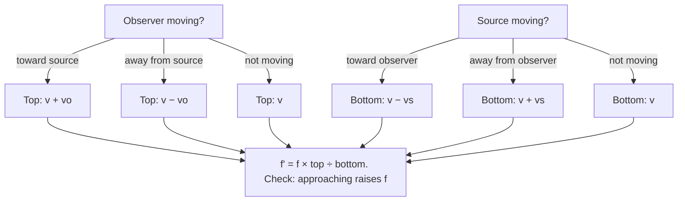

## Waves you can hear

Sound is a longitudinal pressure wave: a vibrating object pushes on neighboring air, creating alternating compressions (slightly higher pressure) and rarefactions (slightly lower), which travel outward. Everything from the last lesson applies, $v = f\lambda$, superposition, beats and standing waves, plus three new ideas specific to how we hear: loudness on the decibel scale, resonance in air columns (how wind instruments work), and the Doppler effect.

## Speed and pitch

The speed of sound depends on the medium: about 343 m/s in air at 20°C, 1480 m/s in water, around 5000 m/s in steel. In air it increases with temperature, roughly $v \approx 331 + 0.6\,T_C$ m/s (where $T_C$ is the Celsius temperature), because faster-moving molecules pass the disturbance along more quickly.

What we perceive as **pitch** corresponds to frequency. Humans hear roughly 20 Hz to 20 kHz. Below that is **infrasound** (used by elephants), above it is **ultrasound** (used by bats and medical imaging). An octave is a doubling of frequency.

## Intensity and the decibel scale

Sound intensity $I$ (W/m²) is the power per unit area carried by the wave. From a point source radiating equally in all directions, $I = P/(4\pi r^2)$: double the distance, a quarter of the intensity.

The ear responds to an enormous range: from the threshold of hearing, $I_0 = 10^{-12}$ W/m², to the threshold of pain, about 1 W/m², a factor of $10^{12}$. Our perception of loudness is roughly logarithmic, so we use the **sound intensity level** in **decibels** (dB):

$$\beta = 10\log_{10}\frac{I}{I_0}.$$

Every factor of 10 in intensity adds 10 dB; doubling the intensity adds $10\log 2 = 3$ dB. Normal conversation is about 60 dB ($10^{-6}$ W/m²), a rock concert 110 dB, and prolonged exposure above about 85 dB damages hearing.

### Example 1

A speaker produces 80 dB at 2.0 m. (a) What is the intensity there? (b) What is the level at 20 m (ignoring reflections)? (c) What is the level if a second identical speaker is added at the 2.0 m spot?

(a) $I = I_0\,10^{\beta/10} = 10^{-12}\times10^{8} = 10^{-4}$ W/m².

(b) Ten times farther means $1/100$ the intensity: $10^{-6}$ W/m², which is 60 dB. (Each factor of 10 in distance subtracts 20 dB.)

(c) Two speakers double the intensity: $80 + 3 = 83$ dB, not 160 dB.

## Standing waves in air columns

Wind instruments and organ pipes work by standing sound waves in a tube. The boundary conditions are about the air's displacement: at a closed end, air can't move, so there's a displacement node; at an open end, air moves freely, so there's an antinode (approximately at the opening).

*Open at both ends* (flute): antinodes at both ends, like a string with the roles swapped. A whole number of half-wavelengths fits:

$$f_n = \frac{nv}{2L}, \qquad n = 1, 2, 3, \ldots$$

*Closed at one end* (clarinet, a bottle you blow across): node at the closed end, antinode at the open end, so an odd number of quarter-wavelengths fits:

$$f_n = \frac{nv}{4L}, \qquad n = 1, 3, 5, \ldots \text{ (odd only)}$$

A closed pipe's fundamental is an octave lower than an open pipe of the same length, and it lacks the even harmonics, which gives it a darker sound.

The picture draws the air's displacement pattern for the first two modes of each kind of pipe. Count the quarter-wavelengths: each node-to-antinode stretch is $\lambda/4$.

![Four tubes of the same length, with curves showing how far the air moves along each. Open at both ends, fundamental: antinodes at both ends and one node in the middle, L = λ/2. Open at both ends, second harmonic: antinodes at both ends and the middle, two nodes, L = λ. Closed at the left end, fundamental: a node at the closed end and an antinode at the open end, L = λ/4. Closed at the left end, third harmonic: node at the closed end, then an antinode, a node and an antinode at the open end, L = 3λ/4.](images/phys-m6-pipe-modes.svg)

### Example 2

An organ pipe 0.85 m long is closed at one end. With $v = 343$ m/s, find its fundamental and the next two frequencies it can produce. What would the fundamental be if the pipe were open at both ends?

Closed: $f_1 = \dfrac{343}{4(0.85)} = 100.9$ Hz; then $f_3 = 303$ Hz and $f_5 = 504$ Hz.

Open: $f_1 = \dfrac{343}{2(0.85)} = 202$ Hz, an octave higher.

## The Doppler effect

The pitch of an ambulance siren rises as it approaches and drops as it recedes. This is the **Doppler effect**: relative motion between source and observer changes the observed frequency.

- A moving *source* crowds the waves together ahead of it (shorter wavelength) and spreads them out behind.
- A moving *observer* runs into wave crests more often when approaching, less often when receding.

With $v$ the speed of sound, $v_o$ the observer's speed and $v_s$ the source's speed (both relative to the air),

$$f' = f\,\frac{v \pm v_o}{v \mp v_s}.$$

Sign rule: use the upper signs (+ on top, − on the bottom) for motion *toward* the other party, which raises the frequency; lower signs for motion *away*. Check: approaching should always give a higher pitch.

### Example 3

An ambulance's siren emits 800 Hz. It drives at 30 m/s. What frequency does a stationary pedestrian hear (a) as it approaches and (b) after it passes? Use $v = 343$ m/s.

(a) Source toward observer: $f' = 800\dfrac{343}{343 - 30} = 800(1.0958) = 877$ Hz.

(b) Source away: $f' = 800\dfrac{343}{343 + 30} = 736$ Hz.

The pitch drops by about 141 Hz as it passes, which is the familiar "neee-owww."

When a source moves faster than sound, the wavefronts pile up into a cone, a **shock wave**, heard as a sonic boom. The cone's half-angle satisfies $\sin\theta = v/v_s$; the ratio $v_s/v$ is the Mach number.

Doppler shifts are used in radar speed guns, Doppler ultrasound of blood flow, and (for light) measuring how fast galaxies recede.

## Pressure and displacement

A sound wave can be described in two ways: by how far the air molecules are displaced from their usual positions, or by how much the pressure rises and falls. The two patterns are a quarter wavelength out of step. Where neighboring air moves toward a point from both sides, the air bunches up and the pressure swings are largest, yet the air right at that point barely moves. So a displacement node is a pressure antinode, and vice versa. That's why the closed end of a pipe, where the air can't move (displacement node), is where the pressure swings most (pressure antinode), and the open end, held near atmospheric pressure, is a pressure node.

The speed of sound in a fluid is $v = \sqrt{B/\rho}$, where $B$ is the bulk modulus (how hard the fluid is to compress; see the elasticity lesson) and $\rho$ its density: the same "stiffness over inertia" pattern as $\sqrt{F_T/\mu}$ for a string. Water is much denser than air but far harder to compress, so sound travels over four times faster in it.

### Example 4

A pipe closed at one end resonates at 255 Hz and next at 425 Hz, with nothing in between. Is that consistent with a closed pipe, and how long is it? Use $v = 343$ m/s.

A closed pipe's resonances are odd multiples of $f_1$, so neighboring ones differ by $2f_1$: $2f_1 = 425 - 255 = 170$ Hz, giving $f_1 = 85$ Hz. Then $255 = 3(85)$ and $425 = 5(85)$, both odd multiples ✓. Length: $L = \dfrac{v}{4f_1} = \dfrac{343}{4(85)} = 1.01$ m.

## Common mistakes

- Adding decibel levels directly (two 80 dB sources give 83 dB, not 160 dB).
- Using $nv/(2L)$ for a pipe closed at one end, or including even harmonics for it.
- Getting Doppler signs backward (approach must raise the frequency).
- Using $v_s$ and $v_o$ relative to each other instead of relative to the air.

## Key points

- Sound is a longitudinal pressure wave; $v \approx 343$ m/s in air at 20°C.
- $\beta = 10\log(I/I_0)$, $I_0 = 10^{-12}$ W/m²; ×10 in $I$ adds 10 dB; ×2 adds 3 dB.
- Open–open: $f_n = nv/(2L)$, all $n$. Closed–open: $f_n = nv/(4L)$, odd $n$.
- Doppler: $f' = f\dfrac{v \pm v_o}{v \mp v_s}$, upper signs for approaching.
