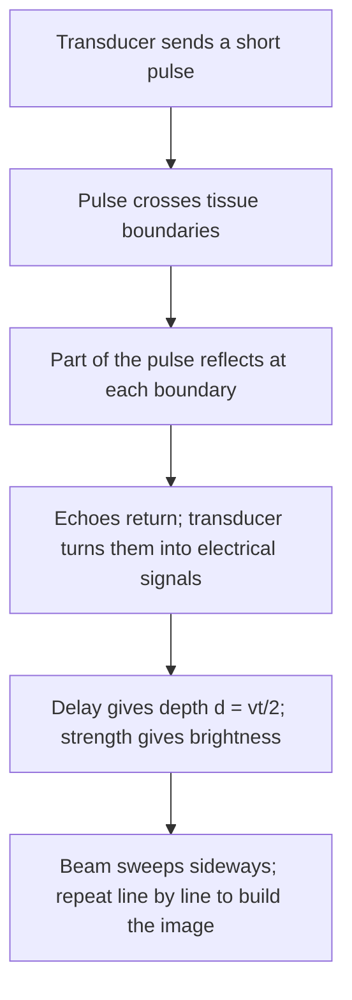

## Echoes from inside the body

The waves lesson showed that a pulse on a string reflects upside down from a fixed end and right side up from a free end. Most real boundaries are in between: a light rope tied to a heavy one, sound passing from fat into muscle, or from air into skin. Part of the wave goes on and part bounces back. This lesson finds out *how much*, using one number per medium called its impedance, and then applies the result, together with the wave speed and the Doppler effect from the sound lesson, to medical ultrasound, which builds pictures of the inside of the body from echoes.

## Impedance: how hard a medium is to shake

When a wave arrives at a boundary, the two media must move together at the boundary point. If the second medium is "harder to shake" than the first, the boundary moves less than the incoming wave wants, and the difference is sent back as a reflection. The measure of how hard a medium is to shake is its **wave impedance** $Z$.

- For a string: $Z = \mu v = \sqrt{F_T\mu}$ (units kg/s). A heavier or tighter string is harder to move.
- For sound in a fluid or soft material: the **acoustic impedance** is $Z = \rho v$, density times speed of sound, in kg/(m²·s), a unit called the rayl.

Only the *ratio* of the two impedances matters. At a boundary hit straight on, the fraction of the wave's intensity (power) that reflects is

$$R = \left(\frac{Z_2 - Z_1}{Z_2 + Z_1}\right)^2,$$

and the rest, $T = 1 - R$, is transmitted. (Here and below, "straight on" means the wave hits the boundary perpendicularly; that's the case for imaging along a beam.) The fraction is the same in either direction across the boundary, and $R = 0$ when $Z_1 = Z_2$: matched media let a wave through without any echo, even if their densities and speeds differ.

For displacement on a string, the reflected wave's amplitude is $\dfrac{Z_1 - Z_2}{Z_1 + Z_2}$ times the incoming amplitude. If $Z_2 > Z_1$ this is negative: the reflection is inverted. A fixed end is the limit $Z_2 \to \infty$ (amplitude ratio $-1$, inverted), and a free end is $Z_2 \to 0$ (ratio $+1$, upright), the two cases from the waves lesson.

```plot
{"x": [0, 10], "y": [0, 1], "xLabel": "impedance ratio Z2 / Z1", "yLabel": "fraction reflected R", "functions": [{"f": "((x - 1)/(x + 1))^2"}], "points": [{"at": [1, 0], "label": "matched: no echo"}], "caption": "Reflected fraction of intensity against impedance ratio; a ratio of 1/r gives the same R as r"}
```

### Example 1

A rope with $\mu_1 = 0.010$ kg/m is tied to one with $\mu_2 = 0.040$ kg/m, both under 100 N tension. A pulse comes along the light rope. Describe the reflected pulse and find the fractions of energy reflected and transmitted.

Impedances: $Z_1 = \sqrt{100 \times 0.010} = 1.0$ kg/s and $Z_2 = \sqrt{100 \times 0.040} = 2.0$ kg/s.

Amplitude ratio: $\dfrac{1.0 - 2.0}{1.0 + 2.0} = -\tfrac13$, so the reflected pulse is inverted with one-third the height.

$R = \left(\tfrac{1}{3}\right)^2 = \tfrac19 = 11\%$ of the energy reflects and $T = 89\%$ goes on into the heavy rope (where the wave is slower: $v_2 = \sqrt{100/0.040} = 50$ m/s versus 100 m/s).

## Acoustic impedances in the body

| Medium | Density (kg/m³) | Speed (m/s) | $Z$ (kg/(m²·s)) |
|---|---|---|---|
| Air | 1.2 | 343 | $4.1\times10^{2}$ |
| Water | 1000 | 1480 | $1.48\times10^6$ |
| Fat | 950 | 1450 | $1.38\times10^6$ |
| Soft tissue (average) | 1060 | 1540 | $1.63\times10^6$ |
| Muscle | 1070 | 1580 | $1.69\times10^6$ |
| Bone | 1900 | 4080 | $7.8\times10^6$ |

These are typical values: real tissues vary by a few percent, and bone varies much more. The pattern is what matters. Soft tissues are all close to water, so boundaries between them reflect only about 1% or less; bone is about five times higher; air is about four thousand times *lower*.

### Example 2

(a) What fraction of an ultrasound pulse reflects at a fat–muscle boundary, and at a muscle–bone boundary? (b) Why must the probe be coupled to the skin with gel?

(a) Fat–muscle: $R = \left(\dfrac{1.69 - 1.38}{1.69 + 1.38}\right)^2 = (0.101)^2 = 0.010$, about 1%. Small, but measurable, which is why organ boundaries show up in an image.

Muscle–bone: $R = \left(\dfrac{7.8 - 1.69}{7.8 + 1.69}\right)^2 = (0.644)^2 = 0.41$, about 40%. Bone throws back a strong echo and leaves a "shadow" behind it, which is one reason ultrasound is poor at imaging through bone.

(b) If a thin layer of air is trapped between probe and skin: $R = \left(\dfrac{1.63\times10^6 - 412}{1.63\times10^6 + 412}\right)^2 = 0.999$. Only 0.1% gets in, and of an echo coming back out, only 0.1% gets through again, a round trip of about one part in a million. The gel, whose impedance is close to water's, fills the gap: gel to tissue gives $R \approx \left(\tfrac{1.63 - 1.48}{1.63 + 1.48}\right)^2 = 0.002$.

Inside the probe, a similar problem arises between the **transducer** (a piezoelectric crystal that converts electrical signals to sound and back, with $Z$ in the tens of millions) and the skin. Probes add one or more **matching layers** with intermediate impedance; a layer a quarter-wavelength thick with $Z = \sqrt{Z_1Z_2}$ cancels the reflection at one frequency, the same trick as the anti-reflection coatings in the wave optics lesson. (Simplified: real probes use several layers to work over a range of frequencies.)

## Pulse-echo imaging

An ultrasound scanner sends a very short pulse into the body and listens. Each boundary returns a weak echo, and the arrival time tells how deep it is. The pulse travels to the boundary and back, so with speed $v$ and round-trip time $t$,

$$d = \frac{vt}{2}.$$

Scanners assume $v = 1540$ m/s for all soft tissue (a simplification that causes small distance errors in fat, where sound is slower). The strength of the echo sets the brightness of the dot at that depth, and sweeping the beam across builds a two-dimensional image.




**Frequency is a trade-off.** Medical scanners use roughly 2 to 15 MHz. The wavelength $\lambda = v/f$ sets the finest detail: at 5 MHz in tissue, $\lambda = 1540/(5\times10^6) = 0.31$ mm. Higher frequency gives finer detail but is absorbed faster: a common rule of thumb for soft tissue is a loss of about 0.5 dB per cm per MHz (it varies with tissue type). So deep organs are scanned at low frequency and shallow structures (tendons, thyroid) at high frequency.

### Example 3

A 5.0 MHz pulse produces an echo that returns 65 μs after it was sent. (a) How deep is the reflecting boundary? (b) Using the rule of thumb above, how much weaker (in dB) is the echo from absorption alone?

(a) $d = \dfrac{vt}{2} = \dfrac{1540 \times 65\times10^{-6}}{2} = 0.050$ m $= 5.0$ cm.

(b) The pulse travels 10 cm in total (down and back). Loss $\approx 0.5 \times 10 \times 5.0 = 25$ dB, a factor of about 300 in intensity. At 15 MHz it would be 75 dB, which is why high frequencies only image shallow tissue.

## Doppler ultrasound

Moving reflectors, such as red blood cells, shift the echo's frequency. The Doppler effect happens twice: the moving blood receives the wave as a moving observer, then re-emits it as a moving source. For a reflector moving toward the probe at speed $u$, much slower than the sound speed $v$, the two shifts add to

$$\Delta f \approx \frac{2fu}{v}\cos\theta,$$

where $\theta$ is the angle between the beam and the direction of motion. (From the sound lesson's formula, the full result is $f' = f\dfrac{v + u}{v - u}$ along the beam, and for $u \ll v$ this is $f(1 + 2u/v)$.) Motion across the beam ($\theta = 90^\circ$) gives no shift, so operators angle the probe along the vessel.

### Example 4

A 5.0 MHz beam points along an artery in which blood flows toward the probe at 0.50 m/s. Find the frequency shift, and the shift if the beam makes a 60° angle with the flow.

$\Delta f = \dfrac{2(5.0\times10^6)(0.50)}{1540} = 3.2\times10^3$ Hz $= 3.2$ kHz. At 60°: $3.2 \times \cos 60^\circ = 1.6$ kHz.

The shift is a tiny fraction of 5 MHz, but it falls in the audible range, so many scanners play it through a speaker: the "whoosh" of blood flow is a 1 to 3 kHz Doppler tone.

## Common mistakes

- Thinking reflection depends on density or speed alone. Only the impedance $Z = \rho v$ matters: two media with equal $Z$ give no echo.
- Forgetting to halve the round-trip time when finding depth from an echo.
- Squaring the amplitude ratio for the amplitude, or not squaring it for the intensity. $R$ (intensity) is the square of the amplitude ratio.
- Using the Doppler shift for a moving source only. A moving reflector shifts the frequency twice, giving the factor 2.
- Forgetting the $\cos\theta$: a beam perpendicular to the flow measures no Doppler shift.

## Key points

- Impedance: string $Z = \mu v = \sqrt{F_T\mu}$; sound $Z = \rho v$.
- Straight-on reflection: $R = \left(\dfrac{Z_2 - Z_1}{Z_2 + Z_1}\right)^2$, $T = 1 - R$; matched impedances give no echo.
- String into a heavier string ($Z_2 > Z_1$): reflected pulse inverted.
- Soft tissues reflect about 1% or less; bone about 40%; air nearly 100%, hence coupling gel.
- Pulse-echo depth $d = vt/2$ with $v = 1540$ m/s; higher frequency, finer detail, less depth.
- Doppler ultrasound: $\Delta f \approx 2fu\cos\theta/v$.
