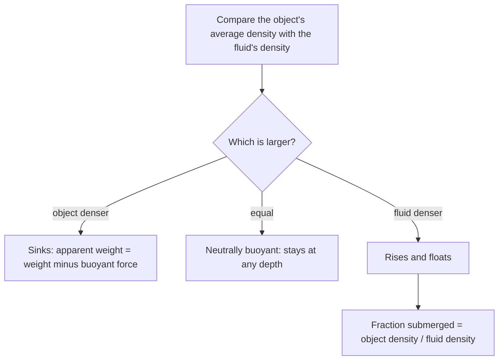

## Mechanics for things that flow

Liquids and gases don't keep a shape, so tracking forces on individual pieces is impractical. Instead we describe fluids with two quantities spread over space: density and pressure. This lesson covers fluids at rest: why pressure grows with depth, how hydraulic lifts multiply force, and why ships float. The next lesson sets fluids in motion.

## Density and pressure

**Density** is mass per unit volume, $\rho = m/V$ (kg/m³). Water is 1000 kg/m³ (1 g/cm³), air at sea level about 1.2 kg/m³, mercury 13 600 kg/m³.

**Pressure** is the perpendicular force per unit area a fluid exerts on a surface:

$$P = \frac FA.$$

Its SI unit is the **pascal**, $1\text{ Pa} = 1\text{ N/m}^2$. Atmospheric pressure at sea level is $1\text{ atm} = 1.013\times10^5$ Pa, about 14.7 pounds per square inch. Pressure in a fluid at rest acts equally in all directions at a point and always pushes perpendicular to any surface it touches.

## Pressure increases with depth

Picture a column of fluid of height $h$ and cross-section $A$. The fluid below must support the column's weight, $\rho(Ah)g$, plus the pressure pushing down on top. Dividing by $A$:

$$P = P_0 + \rho g h,$$

where $P_0$ is the pressure at the surface. Every 10 m of water adds about 1 atm, so a diver at 30 m feels about 4 atm in total. The pressure depends only on depth, not on the container's shape or width: water 2 m deep in a narrow tube and in a swimming pool exerts the same pressure at the bottom.

**Gauge pressure** is pressure above atmospheric, $P - P_{\text{atm}}$; tire gauges read it. **Absolute pressure** is the total. A tire "at 32 psi" has an absolute pressure of about 47 psi.

### Example 1

What is the absolute pressure 12 m below the surface of a lake? What net force does it exert on a diver's mask of area 0.020 m² (with air inside at 1 atm)?

$P = 1.013\times10^5 + 1000(9.8)(12) = 1.013\times10^5 + 1.176\times10^5 = 2.19\times10^5$ Pa.

Net force: the gauge pressure times area, $(1.176\times10^5)(0.020) = 2350$ N inward, about the weight of 240 kg. That's why masks must be equalized by breathing into them.

## Barometers and manometers

A mercury **barometer** is a sealed tube inverted in a dish of mercury. The column falls until its weight balances atmospheric pressure: $P_{\text{atm}} = \rho_{\text{Hg}}gh$, giving $h = 760$ mm at sea level. That's why pressure is also quoted in mm Hg (blood pressure of "120/80" is in mm Hg, gauge). A water barometer would need a column over 10 m tall.

## Pascal's principle and hydraulics

A change in pressure applied to an enclosed fluid is transmitted undiminished to every part of the fluid. This is **Pascal's principle**. In a hydraulic lift, a small force $F_1$ on a small piston of area $A_1$ creates a pressure $F_1/A_1$, which acts on a large piston of area $A_2$:

$$\frac{F_1}{A_1} = \frac{F_2}{A_2} \quad\Rightarrow\quad F_2 = F_1\frac{A_2}{A_1}.$$

Force is multiplied, but energy isn't created: the volume pushed in equals the volume pushed out, $A_1d_1 = A_2d_2$, so the small piston moves much farther. Work in equals work out, $F_1d_1 = F_2d_2$, just as with pulleys.

The picture shows the parts of a hydraulic lift. The same pressure acts on both pistons, so the larger piston gets the larger force.

### Example 2

A car lift has pistons of diameter 2.0 cm and 30 cm. What force on the small piston lifts a 1500 kg car? How far must it move to raise the car 0.10 m?

Area ratio $= (30/2.0)^2 = 225$ (areas scale with diameter squared). $F_1 = \dfrac{1500(9.8)}{225} = 65.3$ N.

Distance: $d_1 = 225(0.10) = 22.5$ m, achieved in practice by many short pump strokes.

## Archimedes' principle and buoyancy

A submerged object has higher pressure on its bottom than its top, because the bottom is deeper. The net upward force is the **buoyant force**. **Archimedes' principle** gives its size:

$$F_B = \rho_{\text{fluid}}\,V_{\text{displaced}}\,g,$$

the weight of the fluid the object displaces. *Why:* imagine replacing the object by fluid of the same shape. That fluid would sit in equilibrium, so the surrounding fluid must push up on it with exactly its weight. The surrounding fluid doesn't know what's inside, so it pushes the same on the object.

Compare $F_B$ with the object's weight $\rho_{\text{obj}}Vg$ when fully submerged:

- $\rho_{\text{obj}} > \rho_{\text{fluid}}$: sinks (a rock in water).
- $\rho_{\text{obj}} < \rho_{\text{fluid}}$: rises and floats.
- Equal: neutrally buoyant (a fish adjusting its swim bladder, a submarine).

A floating object sinks until it displaces its own weight of fluid, so the submerged fraction is

$$\frac{V_{\text{sub}}}{V} = \frac{\rho_{\text{obj}}}{\rho_{\text{fluid}}}.$$

Ice (917 kg/m³) floats in seawater (1025 kg/m³) with $917/1025 = 89\%$ submerged: the tip of the iceberg is about a tenth. A steel ship floats because its hull encloses lots of air, so its average density is below water's.

The chart sums up how to decide what an object in a fluid will do.

### Example 3

A 2.0 kg block of aluminum ($\rho = 2700$ kg/m³) hangs from a spring scale, fully submerged in water. What does the scale read?

Volume: $V = 2.0/2700 = 7.41\times10^{-4}$ m³. Buoyant force: $1000(7.41\times10^{-4})(9.8) = 7.26$ N. Weight: 19.6 N. Scale reading (apparent weight): $19.6 - 7.26 = 12.3$ N.

Archimedes is said to have used this idea to test whether a crown was pure gold: compare its weight in air and in water to find its density.

### Example 4

A wooden raft of density 600 kg/m³ is 3.0 m × 2.0 m × 0.20 m. How much additional mass can it carry before its top is level with the water?

Fully submerged, it displaces $1.2$ m³ of water: $F_B = 1000(1.2)(9.8) = 11\,760$ N. The raft weighs $600(1.2)(9.8) = 7056$ N. The difference, 4704 N, supports a load of $4704/9.8 = 480$ kg.

## Pressure on a wall, and pressure in the air

On a vertical wall the pressure isn't the same everywhere: the gauge pressure is zero at the water's surface and $\rho gD$ at the bottom, rising in proportion to depth. A graph of gauge pressure against depth is a straight line, so the *average* gauge pressure over the wall is just halfway between the two ends, $\tfrac12\rho gD$. The total force on a wall of width $w$ is that average times the wetted area $wD$:

$$F = \tfrac12\rho gD\cdot wD = \tfrac12\rho gwD^2.$$

The force grows with the *square* of the depth, which is why dams are much thicker at the base than at the top.

### Example 5

A swimming pool is 2.0 m deep. What is the total force of the water on one end wall that is 5.0 m wide?

Average gauge pressure: $\tfrac12(1000)(9.8)(2.0) = 9800$ Pa. Area: $(5.0)(2.0) = 10$ m². Force: $(9800)(10) = 9.8\times10^4$ N, roughly the weight of 10 tonnes. (The air pushes on both sides of the wall equally, so only gauge pressure counts.)

The rule $P = P_0 + \rho gh$ assumes the density is the same at every depth, which is true for liquids. Air is compressible: the air near the ground is squeezed by everything above it, so it's denser than the air higher up. As a result, atmospheric pressure falls quickly at first and then more and more gradually as you climb. It drops to about half its sea-level value near 5.5 km, roughly the height of the highest permanent settlements.

## Common mistakes

- Thinking pressure at depth depends on the container's shape or total volume.
- Mixing gauge and absolute pressure.
- Using the object's density, not the fluid's, in the buoyant force.
- Using the object's full volume for a floating object (only the submerged volume displaces fluid).
- Scaling piston areas with diameter instead of diameter squared.

## Key points

- $\rho = m/V$; $P = F/A$; 1 atm $= 1.013\times10^5$ Pa.
- $P = P_0 + \rho gh$; gauge = absolute − atmospheric.
- Pascal: $F_1/A_1 = F_2/A_2$.
- Archimedes: $F_B = \rho_{\text{fluid}}V_{\text{disp}}g$; floating fraction $= \rho_{\text{obj}}/\rho_{\text{fluid}}$.
- Force on a vertical wall: average gauge pressure $\tfrac12\rho gD$ times the area.
