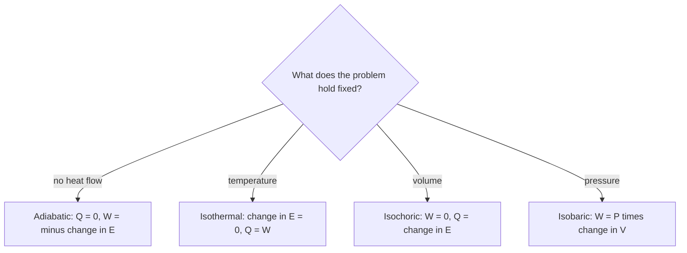

## Energy conservation, thermal edition

A gas in a cylinder can be heated, and it can push a piston. Heat flows in, work flows out, and the gas's internal energy changes. The first law of thermodynamics is the energy-conservation statement that ties these together. It's the foundation for understanding engines, refrigerators and the weather, and it builds directly on the ideal gas model from the last lesson.

## Work done by a gas

When a gas at constant pressure $P$ pushes a piston of area $A$ out a distance $\Delta x$, it exerts force $F = PA$ through that distance, doing work $F\Delta x = PA\,\Delta x$. Since $A\,\Delta x$ is the change in volume,

$$W = P\,\Delta V.$$

On a **PV diagram** (pressure vs volume), a constant-pressure process is a horizontal line, and $P\,\Delta V$ is the area of the rectangle under it. When the pressure changes during the process, the work is still the area under the curve: split the process into many small steps, each nearly at constant pressure, and add up the thin rectangles. Expanding gas does positive work on its surroundings; compressed gas has negative work done by it (positive work done on it). The work depends on the path between two states, not just the endpoints: going from state A to state B by different routes encloses different areas.

## The first law

The **internal energy** $E_{\text{int}}$ (often written $U$) of a system is the total energy of its molecules. Energy can enter as heat $Q$ or leave as work $W$ done by the system. The **first law of thermodynamics** states

$$\Delta E_{\text{int}} = Q - W,$$

with the sign convention: $Q > 0$ when heat flows *into* the system, $W > 0$ when the system does work *on* its surroundings. This course uses that physics-textbook convention throughout. The AP Physics 2 exam (and most chemistry books) instead lets $W$ stand for the work done *on* the gas, and so writes $\Delta U = Q + W$, with $W = -P\Delta V$ at constant pressure. The two $W$'s are the same size with opposite signs, so the physics is identical; just check which one a problem means. In this lesson, $W$ always means work done *by* the gas.

The picture shows the bookkeeping for a gas heated from below: heat $Q$ flows in, the gas pushes the piston up and does work $W$ lifting the weight, and whatever is left over raises the gas's internal energy.


Internal energy is a **state variable**: it depends only on the current state (for an ideal gas, only on $T$), not on history. $Q$ and $W$ individually depend on the path, but their difference doesn't.

### Example 1

A gas absorbs 500 J of heat while doing 200 J of work expanding against a piston. What is the change in its internal energy? Then the gas is compressed: 300 J of work is done on it while it releases 100 J of heat. What is the change now?

First process: $\Delta E_{\text{int}} = 500 - 200 = +300$ J.

Second: $W = -300$ J (work done *by* the gas is negative), $Q = -100$ J. $\Delta E_{\text{int}} = -100 - (-300) = +200$ J.

## Four standard processes

For an ideal gas (monatomic, $E_{\text{int}} = \tfrac32nRT$), four idealized processes cover most problems.

| Process | Held fixed | Work by gas $W$ | Key fact |
|---|---|---|---|
| **Isobaric** | $P$ | $P\Delta V$ | $Q = nC_P\Delta T$ |
| **Isochoric** (isovolumetric) | $V$ | 0 | $Q = \Delta E_{\text{int}} = nC_V\Delta T$ |
| **Isothermal** | $T$ | $nRT\ln(V_f/V_i)$ | $\Delta E_{\text{int}} = 0$, so $Q = W$ |
| **Adiabatic** | no heat flow, $Q = 0$ | $-\Delta E_{\text{int}}$ | $PV^\gamma$ = constant |

The **molar specific heats** of an ideal monatomic gas are $C_V = \tfrac32R$ at constant volume and $C_P = C_V + R = \tfrac52R$ at constant pressure. Heating at constant pressure takes more heat for the same temperature rise because some of the energy goes into work as the gas expands. The ratio $\gamma = C_P/C_V$ is $\tfrac53$ for monatomic and about $\tfrac75$ for diatomic gases.

To recognize the process in a word problem, look for what is held fixed:



```plot
{"x": [0, 5], "y": [0, 5], "xLabel": "V", "yLabel": "P", "functions": [{"f": "4", "from": 1, "to": 4, "label": "isobaric"}, {"f": "4/x", "from": 1, "to": 4.5, "label": "isothermal", "dashed": true}, {"f": "4/x^(5/3)", "from": 1, "to": 4.5, "label": "adiabatic"}], "segments": [{"from": [1, 0.3], "to": [1, 4]}], "labels": [{"at": [1.4, 2.2], "text": "isochoric (vertical)"}], "caption": "Processes starting from the same state on a PV diagram; the adiabat falls more steeply than the isotherm"}
```

In an adiabatic expansion the gas does work using its own internal energy, so it cools. That's why air rising in the atmosphere cools and clouds form, and why a spray can gets cold. Adiabatic compression heats a gas: diesel engines ignite fuel this way without spark plugs.

### Example 2

Two moles of a monatomic ideal gas are heated at constant pressure (1.0 atm) from 300 K to 400 K. Find $W$, $\Delta E_{\text{int}}$ and $Q$.

$W = P\Delta V = nR\Delta T = 2(8.314)(100) = 1663$ J.

$\Delta E_{\text{int}} = \tfrac32nR\Delta T = 2494$ J.

$Q = \Delta E_{\text{int}} + W = 4157$ J (check: $nC_P\Delta T = 2(\tfrac52)(8.314)(100) = 4157$ J ✓).

## Cycles

In a **cyclic process** the gas returns to its starting state, so $\Delta E_{\text{int}} = 0$ over the cycle and the net heat absorbed equals the net work done: $Q_{\text{net}} = W_{\text{net}}$. On a PV diagram the net work is the area enclosed by the loop, positive if the loop runs clockwise. Engines run clockwise cycles, turning heat into work; that's the subject of the next lesson.

## Work as area on a PV diagram

Whenever a process is drawn on a PV diagram, find the work by finding the area under its path, using rectangles, triangles and trapezoids where the path is made of straight lines. Expansion (moving right) gives positive work by the gas; compression (moving left) gives negative work. A vertical line (constant volume) has no area under it, so no work.

### Example 3

A gas goes from state A (1.0 L, 300 kPa) to state B (4.0 L, 100 kPa) along a straight line on a PV diagram. How much work does it do?

The region under the line is a trapezoid. Its width is $\Delta V = 3.0\text{ L} = 3.0\times10^{-3}$ m³ and its average height is $\tfrac12(300 + 100) = 200$ kPa. So

$W = (2.0\times10^5)(3.0\times10^{-3}) = 600$ J.

Had the gas instead first been cooled at constant volume from 300 kPa down to 100 kPa and then expanded at 100 kPa, the area (and work) would be only $(1.0\times10^5)(3.0\times10^{-3}) = 300$ J: the same two endpoints, a different path, different work.

```plot
{"x": [0, 5], "y": [0, 350], "xLabel": "V (L)", "yLabel": "P (kPa)", "functions": [{"f": "300 - (200/3)*(x - 1)", "from": 1, "to": 4}], "shade": [{"f": "300 - (200/3)*(x - 1)", "from": 1, "to": 4}], "points": [{"at": [1, 300], "label": "A"}, {"at": [4, 100], "label": "B"}], "caption": "The work done from A to B is the shaded trapezoid under the path"}
```

For the curved isothermal and adiabatic paths, adding up the area takes more advanced math, but the results are worth knowing. For an ideal gas expanding isothermally (constant temperature) from $V_i$ to $V_f$, the area under the curve $P = nRT/V$ is

$$W = nRT\ln\frac{V_f}{V_i},$$

where $\ln$ is the natural logarithm. For an adiabatic process, $PV^\gamma$ stays constant (equivalently, $TV^{\gamma - 1}$ stays constant). The adiabat is steeper than the isotherm through the same point because the gas also cools as it expands, so its pressure falls for two reasons at once.

### Example 4

One mole of an ideal gas expands isothermally at 300 K from 10 L to 30 L. How much work does it do, and how much heat does it absorb?

$W = (1)(8.314)(300)\ln 3 = 2494(1.0986) = 2740$ J. Isothermal means $\Delta E_{\text{int}} = 0$, so $Q = W = 2740$ J: all the heat absorbed is converted to work during this one stroke.

### Example 5

A monatomic gas at 1.0 atm and 300 K is compressed adiabatically to one-eighth of its volume. What are its final pressure and temperature?

$P_f = P_i(V_i/V_f)^\gamma = 1.0(8)^{5/3} = 32$ atm. $T_f = T_i(V_i/V_f)^{\gamma - 1} = 300(8)^{2/3} = 1200$ K. A modest compression heats the gas enormously, the principle behind the diesel engine.

## Common mistakes

- Mixing sign conventions for $W$ (decide whether $W$ is by or on the gas and stick to it).
- Thinking isothermal means no heat flow (it means no temperature change; adiabatic means no heat flow).
- Using $W = P\Delta V$ when the pressure changes.
- Using $\Delta E_{\text{int}} = nC_P\Delta T$; for an ideal gas it's always $nC_V\Delta T$, whatever the process.

## Key points

- $\Delta E_{\text{int}} = Q - W$ ($Q$ into the system, $W$ by the system).
- Work by a gas = area under the PV curve; path-dependent.
- Isobaric $W = P\Delta V$; isochoric $W = 0$; isothermal $\Delta E_{\text{int}} = 0$, $W = nRT\ln(V_f/V_i)$; adiabatic $Q = 0$, $PV^\gamma$ const.
- Monatomic ideal gas: $C_V = \tfrac32R$, $C_P = \tfrac52R$, $\gamma = \tfrac53$.
- Cycle: $\Delta E_{\text{int}} = 0$, net work = enclosed area.
