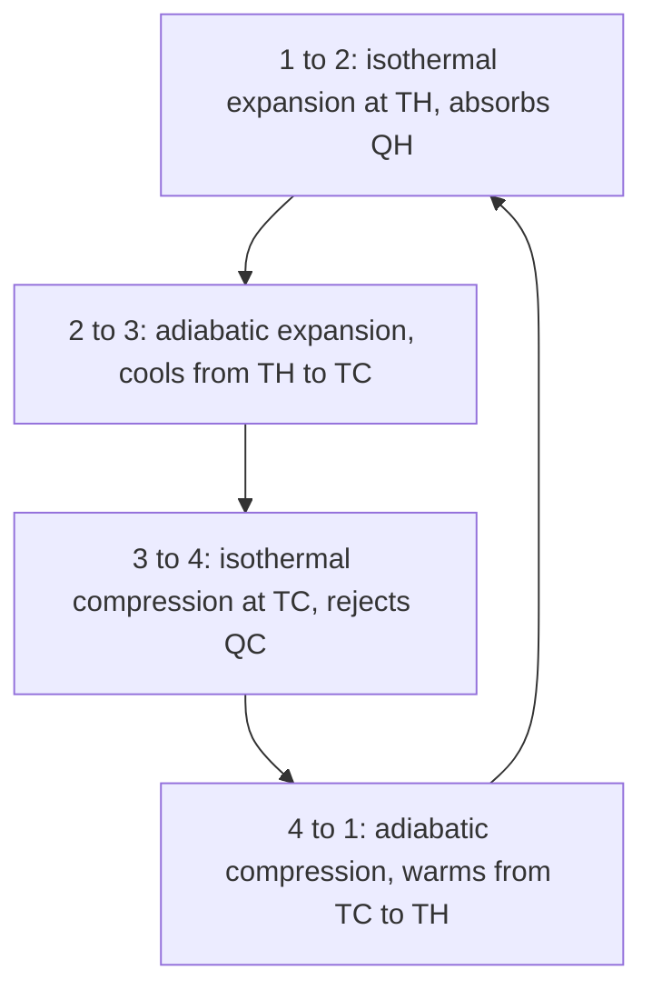

## The direction of time

The first law says energy is conserved, but it doesn't forbid a cold drink from spontaneously getting colder while the room warms up, or a broken egg reassembling. Those things never happen. The second law of thermodynamics captures which processes go in which direction, and it puts a hard limit on how efficiently any engine can turn heat into work. Entropy is the quantity that makes the law precise.

## Heat engines

A **heat engine** takes in heat $Q_H$ from a hot reservoir at temperature $T_H$, converts part of it to work $W$, and dumps the rest, $Q_C$, to a cold reservoir at $T_C$. Running in a cycle, its internal energy returns to the start, so by the first law

$$W = Q_H - Q_C.$$

Its **thermal efficiency** is the fraction of input heat converted to work:

$$e = \frac{W}{Q_H} = 1 - \frac{Q_C}{Q_H}.$$

Car engines manage about 25–35%, power plants 33–45%. Why not 100%? That's the second law.

The energy-flow diagrams below compare an engine with a refrigerator (described later in this lesson). The arrow widths hint at the sizes: in an engine the heat in is split into work and exhaust heat; in a refrigerator the work and the heat removed add up to the heat dumped.

## The second law

The **second law of thermodynamics** has several equivalent statements:

- *Kelvin–Planck (engine) statement*: no cyclic device can convert heat entirely into work. Some heat must always be rejected to a colder reservoir.
- *Clausius (refrigerator) statement*: heat does not flow spontaneously from a colder object to a hotter one. Moving heat "uphill" requires work.

If either could be violated, the other could be too, by hooking devices together. They're two faces of one law.

## The Carnot engine

What's the best possible efficiency between two given temperatures? Sadi Carnot showed that it belongs to a **reversible** engine, one with no friction and with heat flowing only across infinitesimal temperature differences. The **Carnot cycle** uses two isothermal and two adiabatic steps, and its efficiency depends only on the reservoir temperatures (in kelvins):

$$e_{\text{Carnot}} = 1 - \frac{T_C}{T_H}.$$

The four steps run in a loop:

No real engine operating between $T_H$ and $T_C$ can beat this. To raise the efficiency limit you must widen the temperature gap, which is why power plants run hot steam and why cold cooling water helps. Even an ideal engine between 500 K and 300 K tops out at 40%.

### Example 1

A power plant's steam enters the turbine at 550°C and leaves to a condenser at 30°C. (a) What is the Carnot efficiency? (b) If the plant actually achieves 38% efficiency and produces 500 MW of electrical power, how much heat does it dump to the environment each second?

(a) $T_H = 823$ K, $T_C = 303$ K. $e_C = 1 - 303/823 = 0.632$, or 63%.

(b) $Q_H$ per second $= 500/0.38 = 1316$ MW. Rejected: $1316 - 500 = 816$ MW, which warms the river or cooling towers. More heat is thrown away than turned into electricity.

## Refrigerators and heat pumps

Run an engine backward and it becomes a **refrigerator**: work $W$ moves heat $Q_C$ out of a cold space and dumps $Q_H = Q_C + W$ into a warmer one. Its performance is measured by the **coefficient of performance**,

$$K = \frac{Q_C}{W}, \qquad K_{\text{Carnot}} = \frac{T_C}{T_H - T_C}.$$

A **heat pump** is the same device used to warm a house; its useful output is $Q_H$, so its COP is $Q_H/W$, with Carnot limit $\dfrac{T_H}{T_H - T_C}$. A heat pump delivering 3 J of heat per joule of electricity isn't violating anything: it moves heat rather than making it.

### Example 2

A freezer keeps its interior at −18°C in a 22°C kitchen. What's the maximum possible COP? If its actual COP is 2.5, how much electrical energy does it use to remove 1.0 MJ of heat?

$K_{\text{Carnot}} = \dfrac{255}{295 - 255} = 6.4$. Actual: $W = Q_C/K = 1.0/2.5 = 0.40$ MJ.

## Entropy

**Entropy** $S$ is a state variable that measures disorder, or more precisely the number of microscopic arrangements consistent with a system's macroscopic state. For heat $Q$ transferred reversibly at constant absolute temperature $T$, the entropy change is

$$\Delta S = \frac{Q}{T}$$

(units J/K). The most general statement of the second law is in terms of entropy: *the total entropy of an isolated system never decreases*. It stays constant in reversible processes and increases in every irreversible one (friction, free expansion, heat flowing across a finite temperature difference). Entropy increase is what gives time its direction.

### Example 3

1.0 kg of ice melts at 0°C. What is its entropy change? If the heat came from a large room at 25°C, what is the total entropy change?

Ice: $Q = mL_f = 3.34\times10^5$ J at $T = 273$ K, so $\Delta S_{\text{ice}} = +1223$ J/K.

Room: loses the same heat at 298 K, $\Delta S_{\text{room}} = -1121$ J/K.

Total: $+103$ J/K (extra digits were kept above because we subtract two nearly equal numbers). Positive, as the second law requires for heat flowing from hot to cold. Reversed (water freezing by giving heat to a warmer room), the total would be negative, which is why it doesn't happen.

## Entropy and the Carnot limit

Entropy explains where the Carnot formula comes from. In one cycle a reversible engine takes entropy $Q_H/T_H$ from the hot reservoir and gives entropy $Q_C/T_C$ to the cold one. The working gas returns to its starting state, so its own entropy is unchanged, and a reversible process creates no new entropy. The two amounts must therefore be equal:

$$\frac{Q_H}{T_H} = \frac{Q_C}{T_C} \quad\Rightarrow\quad \frac{Q_C}{Q_H} = \frac{T_C}{T_H},$$

and substituting into $e = 1 - Q_C/Q_H$ gives $e_{\text{Carnot}} = 1 - T_C/T_H$. A real engine creates extra entropy (friction, heat leaking across finite temperature differences), so it must dump *more* heat to the cold side and its efficiency is lower.

### Example 4

A Carnot engine absorbs 1200 J per cycle from a reservoir at 600 K and rejects heat at 300 K. How much heat does it reject, and how much work does it do? What is the total entropy change of the two reservoirs?

$Q_C = Q_H\dfrac{T_C}{T_H} = 1200\left(\dfrac{300}{600}\right) = 600$ J, so $W = 1200 - 600 = 600$ J ($e = 50\%$).

Entropy: the hot reservoir loses $1200/600 = 2.0$ J/K and the cold one gains $600/300 = 2.0$ J/K. Total: zero, as it must be for a reversible engine.

## Entropy and probability

Why should entropy always increase? Entropy counts arrangements. Gas released into the corner of an empty room spreads out because there are vastly more ways for the molecules to be spread through the whole room than to be bunched in a corner. A free expansion, where a gas rushes into a vacuum, does no work and absorbs no heat, yet it increases entropy, because the gas ends up in a far more probable state. Nothing forbids every molecule returning to the corner, but with $10^{23}$ molecules it is so improbable that it never happens. The second law is a statistical law that is, in practice, never broken.

## Common mistakes

- Using Celsius in $1 - T_C/T_H$ or $Q/T$.
- Thinking a 100% efficient engine is just an engineering problem; the second law forbids it.
- Assuming entropy can never decrease anywhere (it can locally, like a freezing ice tray, as long as the total increases).
- Confusing COP (can exceed 1) with efficiency (can't).

## Key points

- Engine: $W = Q_H - Q_C$, $e = W/Q_H = 1 - Q_C/Q_H$.
- Carnot limit: $e = 1 - T_C/T_H$ (kelvins); refrigerator $K = Q_C/W \le T_C/(T_H - T_C)$.
- Second law: no perfect engines; heat doesn't flow cold to hot by itself; total entropy never decreases.
- $\Delta S = Q/T$ for heat $Q$ transferred at constant absolute temperature $T$.
- Carnot engine: $Q_H/T_H = Q_C/T_C$ (no net entropy change).
