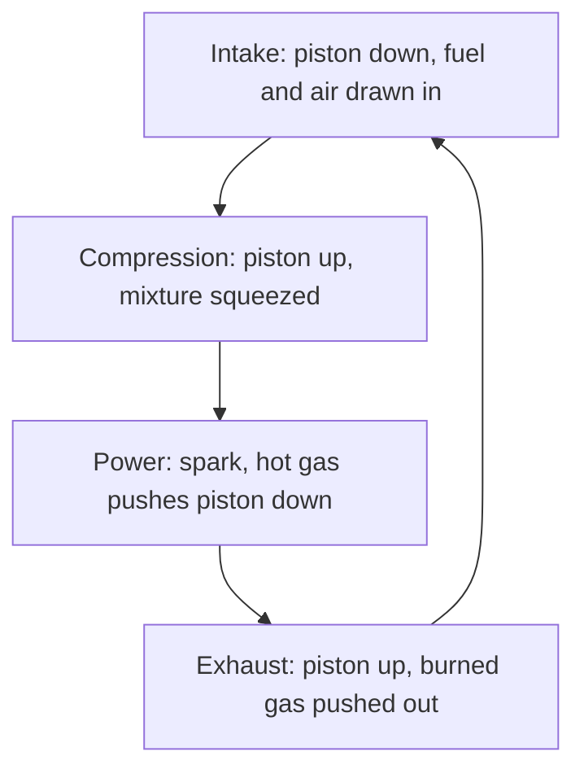

## From the Carnot limit to real machines

The second-law lesson showed that no engine working between two temperatures can beat the Carnot efficiency $1 - T_C/T_H$. Real engines don't run Carnot cycles, though: isothermal steps are far too slow for a car engine whose cylinders can each fire 50 times a second. This lesson analyzes the cycles real machines approximate. It puts together everything from the first-law lesson (work as area, $\Delta E_{\text{int}} = nC_V\Delta T$, adiabats with $TV^{\gamma-1}$ constant) to find the efficiency of a gasoline engine from one number, its compression ratio, and then runs the idea backward to see how a kitchen refrigerator works.

## Analyzing any cycle, step by step

For a cycle made of standard processes, a table keeps the bookkeeping straight. For each step:

1. Find the work done by the gas, $W$: the area under that part of the path (zero at constant volume, $P\Delta V$ at constant pressure).
2. Find $\Delta E_{\text{int}}$. For a monatomic ideal gas, $E_{\text{int}} = \tfrac32nRT = \tfrac32PV$, so $\Delta E_{\text{int}} = \tfrac32\Delta(PV)$; you don't even need the temperatures.
3. Get the heat from the first law: $Q = \Delta E_{\text{int}} + W$.

Then check that $\Delta E_{\text{int}}$ adds to zero over the cycle and that the net work equals the enclosed area. The efficiency is the net work divided by the heat *taken in*, which means adding only the positive values of $Q$:

$$e = \frac{W_{\text{net}}}{Q_{\text{in}}}.$$

### Example 1

One sample of monatomic ideal gas runs the rectangular cycle A → B → C → D → A: A is (100 kPa, 1.0 L), B is (300 kPa, 1.0 L), C is (300 kPa, 3.0 L) and D is (100 kPa, 3.0 L). Find its efficiency. (A handy fact: 1 kPa·L = 1 J.)

| Step | Process | $W$ (J) | $\Delta E_{\text{int}} = \tfrac32\Delta(PV)$ (J) | $Q$ (J) |
|---|---|---|---|---|
| A → B | constant volume, heated | 0 | $1.5(300 - 100) = 300$ | +300 |
| B → C | constant pressure, expands | $300(2.0) = 600$ | $1.5(900 - 300) = 900$ | +1500 |
| C → D | constant volume, cooled | 0 | $1.5(300 - 900) = -900$ | −900 |
| D → A | constant pressure, compressed | $100(-2.0) = -200$ | $1.5(100 - 300) = -300$ | −500 |

Check: the $\Delta E_{\text{int}}$ column adds to zero, and $W_{\text{net}} = 600 - 200 = 400$ J equals the rectangle's area, $(200\text{ kPa})(2.0\text{ L})$. Heat taken in: $300 + 1500 = 1800$ J. So

$$e = \frac{400}{1800} = 0.222 = 22\%.$$

Since $T \propto PV$, the hottest point (C, $PV = 900$) is 9 times hotter in kelvins than the coldest (A, $PV = 100$). A Carnot engine between those extremes would reach $1 - \tfrac19 = 89\%$. This cycle does far worse because it takes in much of its heat while the gas is well below its top temperature and rejects heat while the gas is well above its lowest one. Heat flowing across big temperature differences creates entropy and wastes the chance to do work.

## The gasoline engine and the Otto cycle

A **four-stroke engine** repeats four piston strokes: *intake* (the piston moves down and draws in fuel and air), *compression* (the piston moves up and squeezes the mixture), *power* (a spark ignites the mixture and the hot gas drives the piston down) and *exhaust* (the piston moves up and pushes the burned gas out).



The **Otto cycle** is the idealized version, treating the gas as air that is heated and cooled rather than burned and replaced (a simplification):

- 1 → 2: adiabatic compression from the largest volume $V_1$ to the smallest $V_2$;
- 2 → 3: heat $Q_H$ added at constant volume (the fuel burns almost instantly at the top of the stroke);
- 3 → 4: adiabatic expansion back to $V_1$ (the power stroke);
- 4 → 1: heat $Q_C$ rejected at constant volume (exhaust replaced by fresh, cool air).

```plot
{"x": [0, 9], "y": [0, 60], "xLabel": "volume V (relative)", "yLabel": "pressure P (relative)", "functions": [{"f": "8^1.4/x^1.4", "from": 1, "to": 8}, {"f": "2.5*8^1.4/x^1.4", "from": 1, "to": 8}], "segments": [{"from": [1, 18.38], "to": [1, 45.95]}, {"from": [8, 1], "to": [8, 2.5]}], "points": [{"at": [8, 1], "label": "1"}, {"at": [1, 18.38], "label": "2"}, {"at": [1, 45.95], "label": "3"}, {"at": [8, 2.5], "label": "4"}], "caption": "An ideal Otto cycle with r = 8: two adiabats joined by two constant-volume steps"}
```

The key number is the **compression ratio**, $r = V_1/V_2$. The efficiency follows in a few lines. Heat flows only in the constant-volume steps, so

$$Q_H = nC_V(T_3 - T_2), \qquad Q_C = nC_V(T_4 - T_1).$$

On each adiabat $TV^{\gamma-1}$ is constant, which gives $T_2 = T_1r^{\gamma-1}$ and $T_3 = T_4r^{\gamma-1}$. Subtracting, $T_3 - T_2 = r^{\gamma-1}(T_4 - T_1)$, so $Q_C/Q_H = 1/r^{\gamma-1}$ and

$$e_{\text{Otto}} = 1 - \frac{1}{r^{\gamma-1}}.$$

The ideal efficiency depends only on the compression ratio and on $\gamma$, not on how much fuel is burned. For air, $\gamma \approx 1.4$.

### Example 2

A gasoline engine has a compression ratio of 10. What is its ideal Otto efficiency? If air enters at 300 K, how hot is it at the end of the compression stroke?

$$e = 1 - \frac{1}{10^{0.4}} = 1 - 0.398 = 0.60.$$

$T_2 = T_1r^{\gamma-1} = 300(10)^{0.4} = 754$ K, about 480°C, before any fuel has burned.

Real gasoline engines reach roughly 30 to 40%, well below 60%: friction, heat leaking through the cylinder walls, burning that takes time, and real gases with smaller $\gamma$ at high temperature all cost efficiency. Why not raise $r$ further? Because the compression would heat the fuel-air mixture enough to ignite on its own before the spark, an uncontrolled explosion called **engine knock** that can damage the engine. Most gasoline car engines use compression ratios of roughly 9 to 14.

## Diesel engines

A diesel engine compresses *air alone*, so it can't knock, and uses compression ratios of roughly 15 to 22. The air gets hot enough (as in the first-law lesson's Example 5) to ignite the fuel the instant it is sprayed in; no spark plug is needed. Because the fuel is injected over part of the power stroke, the heat is added at roughly constant pressure rather than constant volume. That is the **Diesel cycle**. At the *same* compression ratio its ideal efficiency is lower than the Otto cycle's, but its much higher compression ratio makes diesel engines more efficient overall.

### Example 3

A diesel engine with $r = 18$ takes in air at 300 K. Taking $\gamma = 1.4$, what is the air temperature at the end of compression?

$$T_2 = 300(18)^{0.4} = 953\text{ K} \approx 680°\text{C},$$

hundreds of degrees above the roughly 200 to 250°C at which diesel fuel ignites by itself. For comparison, the ideal Otto efficiency formula at $r = 18$ gives $1 - 18^{-0.4} = 69\%$, an upper bound for the diesel engine.

## Running a cycle backward: the refrigerator

A kitchen refrigerator runs the **vapor-compression cycle**. Its working fluid, the **refrigerant**, is chosen to boil at a low temperature, so the cycle can use the large latent heat of a phase change to move heat:


1. **Compressor:** the cool, low-pressure vapor is compressed (nearly adiabatically), which makes it hot. This is where the electrical work $W$ goes in.
2. **Condenser:** the hot vapor flows through coils on the back or bottom of the fridge, gives off heat $Q_H$ to the kitchen, and condenses to a liquid.
3. **Expansion valve:** the liquid squeezes through a narrow opening into a low-pressure region. Part of it flashes to vapor, and that cools it sharply.
4. **Evaporator:** the cold liquid runs through coils inside the fridge, absorbs heat $Q_C$ from the food and evaporates completely, then returns to the compressor.

Energy conservation over the cycle gives $Q_H = Q_C + W$, so the coils at the back always release more heat than is removed from inside. That's why an open refrigerator door warms a closed kitchen.

### Example 4

A refrigerator with a coefficient of performance of 3.0 cools 2.0 kg of water from 20°C to 4°C. How much electrical energy does it use, and how much heat goes into the kitchen? How does its COP compare with the Carnot limit if the inside is at 4°C and the kitchen at 22°C?

Heat removed: $Q_C = mc\Delta T = 2.0(4186)(16) = 1.34\times10^5$ J. Work: $W = Q_C/K = 4.47\times10^4$ J. Heat to the kitchen: $Q_H = Q_C + W = 1.79\times10^5$ J.

Carnot limit: $K_{\text{Carnot}} = \dfrac{T_C}{T_H - T_C} = \dfrac{277}{295 - 277} = 15$. The real machine reaches only about a fifth of the ideal, for the same kinds of reasons as engines: heat must flow across sizable temperature differences in the coils, and the compressor has losses.

## Common mistakes

- Dividing the net work by the *net* heat. Over a cycle those are equal, which would always give 100%; divide by the heat taken in.
- Using $1 - 1/r$ or $1 - 1/r^\gamma$ instead of $1 - 1/r^{\gamma-1}$.
- Using Celsius in $T_2 = T_1r^{\gamma-1}$.
- Comparing an engine with a Carnot engine between the wrong temperatures; use the hottest and coldest temperatures the gas reaches.
- Thinking a refrigerator destroys heat; it moves heat and adds the work, so $Q_H > Q_C$.

## Key points

- Cycle analysis: for each step find $W$ (area), $\Delta E_{\text{int}}$ (for a monatomic gas $\tfrac32\Delta(PV)$), then $Q = \Delta E_{\text{int}} + W$; $e = W_{\text{net}}/Q_{\text{in}}$.
- Otto cycle: two adiabats and two constant-volume steps; $e = 1 - 1/r^{\gamma-1}$ with compression ratio $r = V_{\max}/V_{\min}$.
- Knock limits a gasoline engine's compression ratio; diesel engines compress air alone and use higher ratios.
- Real engines and refrigerators reach well under their ideal limits.
- Vapor-compression refrigerator: compressor, condenser (releases $Q_H$), expansion valve, evaporator (absorbs $Q_C$); $Q_H = Q_C + W$.
