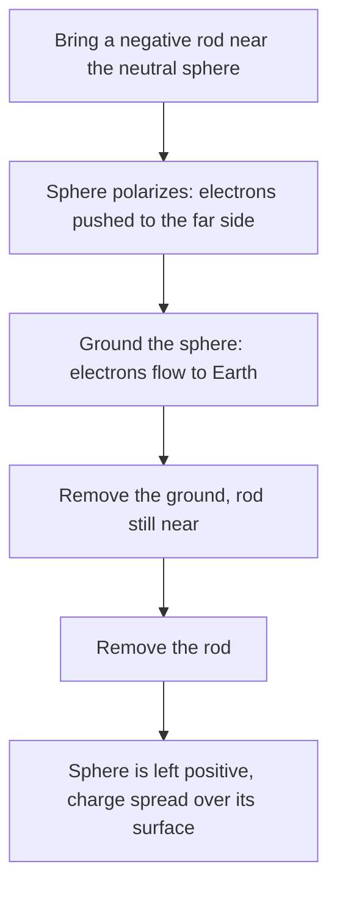

## A new fundamental force

Rub a balloon on your hair and it sticks to the wall; peel tape off a roll and it attracts dust. These are electric forces, and they hold atoms together, govern chemistry, and power every electronic device. This lesson introduces electric charge and Coulomb's law, the electric counterpart of Newton's law of gravitation. Much of what you learned about gravity carries over, with one big difference: charge comes in two kinds.

## Electric charge

**Electric charge** is a property of matter, like mass, that makes particles exert electric forces. There are two kinds, called positive and negative:

- like charges repel; unlike charges attract.
- Protons carry charge $+e$ and electrons $-e$, where the **elementary charge** is $e = 1.602\times10^{-19}$ C. The SI unit of charge is the **coulomb** (C).
- Charge is *quantized*: every free charge is a whole-number multiple of $e$, $q = ne$.
- Charge is *conserved*: it can move from one object to another, but the total in an isolated system never changes. Rubbing a balloon on hair transfers electrons to the balloon (making it negative) and leaves the hair equally positive.

A coulomb is a large charge. Static charges on everyday objects are typically nanocoulombs (nC, $10^{-9}$ C) to microcoulombs (μC, $10^{-6}$ C).

## Conductors and insulators

In a **conductor** (metals, salt water, your body) some electrons move freely through the material. In an **insulator** (rubber, glass, plastic, dry air) charges stay put. Semiconductors sit in between.

A charged object can attract a neutral one by **polarization**: bring a negative rod near a neutral metal sphere and the sphere's free electrons are pushed to the far side, leaving the near side positive. The near positive side is closer, so attraction wins. That's why a charged balloon picks up bits of paper. The picture shows the arrangement.


**Grounding** a conductor connects it to Earth, a huge reservoir of charge. **Charging by induction** uses polarization plus grounding: hold a negative rod near a sphere, ground the sphere (electrons flee to Earth), remove the ground, then the rod; the sphere is left positive without ever being touched.



The order matters: if the rod were removed before the ground, electrons would flow back from Earth and the sphere would end up neutral.

## Coulomb's law

The electric force between two point charges $q_1$ and $q_2$ separated by distance $r$ has magnitude

$$F = k\frac{|q_1q_2|}{r^2}, \qquad k = 8.99\times10^9\text{ N·m}^2/\text{C}^2.$$

This is **Coulomb's law**. The force acts along the line joining the charges: repulsive for like signs, attractive for unlike. The constant is often written $k = \dfrac{1}{4\pi\varepsilon_0}$, where $\varepsilon_0 = 8.85\times10^{-12}$ C²/(N·m²) is the **permittivity of free space**; that form tidies up later formulas.

Like gravity, it's an inverse-square law, and the forces obey Newton's third law. Unlike gravity, it can repel, and it's enormously stronger: the electric repulsion between two protons is about $10^{36}$ times their gravitational attraction. Gravity dominates astronomy only because large objects are almost perfectly neutral.

### Example 1

In a hydrogen atom the electron and proton are about $5.3\times10^{-11}$ m apart. Find the electric force between them.

$$F = (8.99\times10^9)\frac{(1.602\times10^{-19})^2}{(5.3\times10^{-11})^2} = \frac{2.307\times10^{-28}}{2.809\times10^{-21}} = 8.2\times10^{-8}\text{ N},$$

attractive. Tiny in absolute terms, but it gives the electron an acceleration around $9\times10^{22}$ m/s².

## Superposition: several charges

Electric forces add as vectors. The net force on one charge is the vector sum of the forces from each of the others, each computed with Coulomb's law as if the others weren't there. This **superposition principle** is what makes multi-charge problems tractable.

Strategy: find the magnitude of each force from Coulomb's law (using magnitudes of charges), decide its direction from attract/repel, then add components.

### Example 2

Charges $q_1 = +4.0$ μC at $x = 0$ and $q_2 = -2.0$ μC at $x = 0.30$ m. A third charge $q_3 = +1.0$ μC sits at $x = 0.10$ m. Find the net force on $q_3$.

From $q_1$ (0.10 m away, repulsive, pushes $q_3$ in $+x$):
$F_{13} = (8.99\times10^9)\dfrac{(4.0\times10^{-6})(1.0\times10^{-6})}{(0.10)^2} = 3.60$ N.

From $q_2$ (0.20 m away, attractive, pulls $q_3$ toward $q_2$, also $+x$):
$F_{23} = (8.99\times10^9)\dfrac{(2.0\times10^{-6})(1.0\times10^{-6})}{(0.20)^2} = 0.45$ N.

Net: $4.05$ N in the $+x$ direction. Both forces point the same way here; a charge placed outside the pair would feel opposing forces.

### Example 3

Two identical small spheres each carry $+3.0$ μC, sitting at two corners of an equilateral triangle with 0.50 m sides. Find the force on a $+1.0$ μC charge at the third corner.

Each force has magnitude $F = (8.99\times10^9)\dfrac{(3.0\times10^{-6})(1.0\times10^{-6})}{0.25} = 0.108$ N, directed away from its source. Put the two sources on the $x$ axis; then the horizontal components cancel by symmetry and the vertical components add. Each force makes $30^\circ$ with the vertical: $F_{\text{net}} = 2(0.108)\cos 30^\circ = 0.187$ N, straight away from the midpoint of the other two.

```shape
{"polygons": [{"points": [[0, 0], [0.5, 0], [0.25, 0.433]]}], "points": [{"at": [0, 0], "label": "+3.0 μC"}, {"at": [0.5, 0], "label": "+3.0 μC"}, {"at": [0.25, 0.433], "label": "+1.0 μC"}], "segments": [{"from": [0.25, 0.433], "to": [0.4, 0.693], "arrow": true, "label": "0.108 N"}, {"from": [0.25, 0.433], "to": [0.1, 0.693], "arrow": true, "label": "0.108 N"}, {"from": [0.25, 0.433], "to": [0.25, 0.953], "arrow": true, "label": "net 0.187 N"}], "caption": "Example 3: each force points away from its source; the sideways parts cancel and the net force points straight up"}
```

## Reasoning with proportions

Many questions about Coulomb's law need no calculator, only the way $F$ scales with each quantity:

- Double one charge: $F$ doubles. Double both: $F$ quadruples.
- Double the distance: $F$ drops to $\tfrac14$. Triple it: $\tfrac19$. Halve it: $4\times$.
- Change several things at once by multiplying the factors. Doubling both charges *and* doubling the distance leaves $F$ unchanged: $\dfrac{2\times2}{2^2} = 1$.

Newton's third law also holds whatever the charges are. A $+5$ μC charge and a $+1$ μC charge push on each other with forces of equal size; the smaller charge doesn't feel a bigger or smaller force, though if it has less mass it will accelerate more.

### Example 4

A $+4.0$ μC charge sits at $x = 0$ and a $+1.0$ μC charge at $x = 0.30$ m. Where between them could a third charge sit with zero net electric force on it?

Between two like charges, the two forces on the third charge point in opposite directions, so they can cancel. Call the position $x$. Equal magnitudes require

$$\frac{k(4.0)q}{x^2} = \frac{k(1.0)q}{(0.30 - x)^2}.$$

The $k$, $q$ and the μC units cancel. Taking square roots of both sides (all distances positive): $\dfrac{2}{x} = \dfrac{1}{0.30 - x}$, so $0.60 - 2x = x$ and $x = 0.20$ m.

The balance point is closer to the *smaller* charge, which makes sense: being nearer makes up for its weaker pull. The answer doesn't depend on the third charge's size or sign, since both forces scale with it equally.

## Common mistakes

- Forgetting to convert μC or nC to coulombs, or cm to m.
- Forgetting to square $r$.
- Adding force magnitudes instead of vector components.
- Plugging signed charges into $F = k|q_1q_2|/r^2$ and then also flipping directions by hand (use magnitudes for the size; decide direction from attract or repel).
- Thinking a neutral object can't be attracted (polarization).

## Key points

- Charge is quantized ($e = 1.602\times10^{-19}$ C) and conserved; like charges repel, unlike attract.
- Coulomb: $F = k|q_1q_2|/r^2$, $k = 8.99\times10^9$ N·m²/C² $= 1/(4\pi\varepsilon_0)$.
- Net force on a charge is the vector sum of the individual Coulomb forces.
- Conductors let charge move; insulators don't; neutral objects are attracted by polarization.
