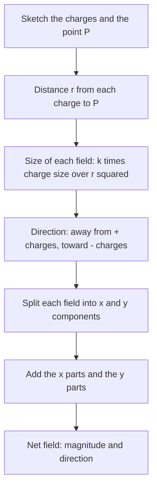

## Force at a distance, made local

Coulomb's law tells us the force between charges, but it raises a puzzle: how does one charge "know" about another across empty space? The field idea answers it. Each charge fills the space around it with an electric field, and other charges respond to the field where they are. Fields turn out to be real physical things (they carry energy, and changing fields make light), and they make calculations far easier: work out the field once, then find the force on any charge placed in it.

## Definition of the electric field

Place a small positive **test charge** $q_0$ at a point. The **electric field** there is the force per unit charge:

$$\vec E = \frac{\vec F}{q_0},$$

measured in N/C (equivalently V/m, as we'll see). Then the force on any charge $q$ at that point is

$$\vec F = q\vec E.$$

A positive charge is pushed along $\vec E$, a negative charge opposite to it.

## Field of a point charge

From Coulomb's law, a point charge $q$ produces a field of magnitude

$$E = k\frac{|q|}{r^2}$$

at distance $r$, pointing radially away from a positive charge and toward a negative one. The field exists whether or not a test charge is there.

### Example 1

What is the electric field 0.20 m from a $+5.0$ nC charge? What force would an electron feel there?

$E = (8.99\times10^9)\dfrac{5.0\times10^{-9}}{(0.20)^2} = 1124$ N/C, pointing away from the charge.

Electron: $F = eE = (1.602\times10^{-19})(1124) = 1.80\times10^{-16}$ N, directed toward the charge (opposite to $\vec E$).

## Superposition of fields

The field from several charges is the vector sum of their individual fields. For two charges, compute each field at the point of interest, find components, and add. Points where the fields cancel can exist: between two equal positive charges, the field is zero at the midpoint.

The procedure is the same for any number of charges:



### Example 2

A $+2.0$ μC charge is at the origin and a $-2.0$ μC charge at $x = 0.10$ m (an **electric dipole**). Find the field at the midpoint, $x = 0.050$ m.

Positive charge's field at the midpoint points away from it, in $+x$: $E_1 = (8.99\times10^9)\dfrac{2.0\times10^{-6}}{(0.050)^2} = 7.19\times10^6$ N/C.

Negative charge's field points toward it, also $+x$, with the same magnitude.

Total: $1.44\times10^7$ N/C in the $+x$ direction (from the positive toward the negative charge).

## Field lines

**Electric field lines** picture the field: they're drawn tangent to $\vec E$ at every point, with density proportional to the field's strength. Rules:

- Lines start on positive charges and end on negative charges (or at infinity).
- The number of lines leaving or entering a charge is proportional to its magnitude.
- Lines never cross (the field has one direction at each point).

```plot
{"x": [-3, 3], "y": [-2.2, 2.2], "equal": true, "vectorField": {"u": "((x+1)/((x+1)^2+y^2)^1.5 - (x-1)/((x-1)^2+y^2)^1.5)/(((x+1)/((x+1)^2+y^2)^1.5 - (x-1)/((x-1)^2+y^2)^1.5)^2+(y/((x+1)^2+y^2)^1.5 - y/((x-1)^2+y^2)^1.5)^2)^0.4", "v": "(y/((x+1)^2+y^2)^1.5 - y/((x-1)^2+y^2)^1.5)/(((x+1)/((x+1)^2+y^2)^1.5 - (x-1)/((x-1)^2+y^2)^1.5)^2+(y/((x+1)^2+y^2)^1.5 - y/((x-1)^2+y^2)^1.5)^2)^0.4", "step": 0.5}, "points": [{"at": [-1, 0], "label": "+q"}, {"at": [1, 0], "label": "−q"}], "caption": "Field of a dipole: arrows point away from +q and toward −q (arrow lengths are compressed so weak regions stay visible)"}
```

## Uniform fields and charged particles

Two large parallel plates with equal and opposite charges produce a nearly **uniform field** between them: the same magnitude and direction everywhere (pointing from the positive plate to the negative). A charged particle there feels a constant force $qE$ and so has constant acceleration

$$a = \frac{qE}{m}.$$

All the constant-acceleration kinematics from earlier applies. An electron fired sideways between deflection plates follows a parabola, exactly like a projectile, which is how old cathode-ray tubes steered their beams. (Gravity on an electron is negligible: even in a weak field of 100 N/C the electric force is about $2\times10^{12}$ times the electron's weight.)

### Example 3

An electron starts from rest in a uniform field of $2.0\times10^4$ N/C. (a) What is its acceleration? (b) How fast is it moving after traveling 1.0 cm?

(a) $a = \dfrac{eE}{m_e} = \dfrac{(1.602\times10^{-19})(2.0\times10^4)}{9.11\times10^{-31}} = 3.52\times10^{15}$ m/s².

(b) $v = \sqrt{2ad} = \sqrt{2(3.52\times10^{15})(0.010)} = 8.4\times10^6$ m/s, about 3% of the speed of light, in a centimeter.

## Conductors in electrostatic equilibrium

When charges in a conductor have stopped moving (**electrostatic equilibrium**):

- The field inside the conductor's material is zero (otherwise free charges would still move).
- Any excess charge sits on the outer surface.
- Just outside, the field is perpendicular to the surface.
- Charge concentrates where the surface curves most sharply, which is why lightning rods are pointed.

A hollow metal box shields its interior from outside fields: a **Faraday cage**. That's why you're safe in a car during a lightning storm and why your phone loses signal in an elevator.

## Deflecting a moving charge

When a charged particle enters a uniform field moving perpendicular to it, treat the motion exactly like a horizontally launched projectile: constant velocity along the plates, constant acceleration $a = qE/m$ across them.


Between the plates the path is a parabola; after the plates there is no force, so the electron travels in a straight line to the screen, and the spot's position shows how strong the field was.

### Example 4

An electron enters the region between two horizontal plates moving horizontally at $2.0\times10^7$ m/s. The plates are 4.0 cm long and the field between them is $1.0\times10^4$ N/C, pointing up. How far, and in which direction, is the electron deflected by the time it leaves the plates?

Time between the plates (horizontal velocity is constant): $t = \dfrac{0.040}{2.0\times10^7} = 2.0\times10^{-9}$ s.

Acceleration: $a = \dfrac{eE}{m_e} = \dfrac{(1.602\times10^{-19})(1.0\times10^4)}{9.11\times10^{-31}} = 1.76\times10^{15}$ m/s², directed *down*, because the electron is negative and the field points up.

Deflection: $y = \tfrac12at^2 = \tfrac12(1.76\times10^{15})(2.0\times10^{-9})^2 = 3.5\times10^{-3}$ m, about 3.5 mm downward.

Proportional reasoning helps here: the deflection is proportional to $E$ and to $t^2$, so doubling the electron's speed (halving its time between the plates) cuts the deflection to a quarter.

Where does the uniform field between plates come from? Far from its edges, a large flat sheet of charge makes a field whose field lines are straight and parallel, so they don't spread out, and the field doesn't weaken with distance. Two oppositely charged plates add their fields between them and cancel outside. The next lesson finds the field's size with Gauss's law: $E = \sigma/\varepsilon_0$ between the plates, where $\sigma$ is the charge per unit area on each plate.

## Common mistakes

- Confusing the field (a property of a location) with the force (on a particular charge).
- Pointing the force on a negative charge along $\vec E$.
- Adding field magnitudes instead of vectors.
- Using the charge that feels the field when computing the field it feels.

## Key points

- $\vec E = \vec F/q_0$; $\vec F = q\vec E$. Units N/C = V/m.
- Point charge: $E = k|q|/r^2$, away from $+$, toward $-$.
- Superpose fields as vectors; field lines run from $+$ to $-$ and never cross.
- Uniform field: constant acceleration $a = qE/m$; a particle entering sideways follows a parabola, like a projectile.
- Conductors in equilibrium: zero field inside, excess charge on the surface.
