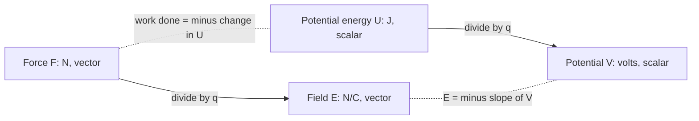

## Energy methods for electricity

In mechanics, energy conservation often beat force calculations. The same is true for electricity. The electric force is conservative, so it has a potential energy, and dividing by charge gives the electric potential, the quantity better known as voltage. Batteries, wall outlets and nerve cells are all described in volts. Potential is also a scalar, so adding up contributions from many charges is easier than adding field vectors.

## Electric potential energy

Moving a charge against an electric force stores energy, just as lifting a mass stores gravitational energy. For two point charges separated by $r$, the **electric potential energy** is

$$U = k\frac{q_1q_2}{r},$$

with $U = 0$ at infinite separation. Note the signs are kept: like charges have positive $U$ (you had to push them together; let go and they fly apart), unlike charges negative $U$ (they're bound). For a group of charges, add $U$ for every pair.

## Electric potential

The **electric potential** $V$ at a point is the potential energy per unit charge a test charge would have there:

$$V = \frac{U}{q}.$$

Its unit is the **volt**: $1\text{ V} = 1\text{ J/C}$. What matters physically is the **potential difference** (voltage) between two points, $\Delta V = V_B - V_A$. When a charge $q$ moves through a potential difference $\Delta V$, its potential energy changes by

$$\Delta U = q\,\Delta V,$$

and if only electric forces act, its kinetic energy changes by $-q\Delta V$. Positive charges naturally move toward lower potential ("downhill"), negative charges toward higher potential.

For a point charge, $V = k\dfrac{q}{r}$ (zero at infinity), positive near positive charges and negative near negative ones. For several charges, potentials add as plain numbers:

$$V = k\sum\frac{q_i}{r_i}.$$

### Example 1

Charges of $+3.0$ nC and $-5.0$ nC sit 0.40 m apart. Find the potential at the midpoint, and the work needed to bring a $+2.0$ nC charge there from far away.

Each charge is 0.20 m from the midpoint: $V = (8.99\times10^9)\dfrac{3.0\times10^{-9} - 5.0\times10^{-9}}{0.20} = -89.9$ V.

Work $= q\Delta V = (2.0\times10^{-9})(-89.9 - 0) = -1.8\times10^{-7}$ J. It's negative: the field pulls the charge in, so you'd have to hold it back.

## The electron volt

Accelerating a particle of charge $e$ through 1 V gives it $1.602\times10^{-19}$ J of kinetic energy. This amount is the **electron volt**: $1\text{ eV} = 1.602\times10^{-19}$ J. It's the natural energy unit for atoms (eV), nuclei (MeV) and particle accelerators (GeV, TeV).

### Example 2

An electron starts from rest and is accelerated through a potential difference of 500 V. What is its final speed?

It gains $K = e\Delta V = 500$ eV $= 8.01\times10^{-17}$ J. Then $v = \sqrt{\dfrac{2K}{m_e}} = \sqrt{\dfrac{2(8.01\times10^{-17})}{9.11\times10^{-31}}} = 1.33\times10^7$ m/s. (The electron moves toward higher potential, since it's negative.)

## Potential in a uniform field

Between parallel plates with a uniform field $E$, moving a distance $d$ along the field drops the potential by

$$\Delta V = Ed, \qquad E = \frac{\Delta V}{d}.$$

This shows why field is measured in volts per meter: 1 N/C = 1 V/m. A 12 V battery connected across plates 2.0 mm apart makes a field of 6000 V/m.

## Equipotentials

An **equipotential surface** is a surface on which $V$ is constant. No work is done moving a charge along one. Equipotentials are always perpendicular to field lines, and the field points from high potential toward low, strongest where equipotentials are closely spaced (like contour lines on a steep hillside). Around a point charge they're concentric spheres; between parallel plates they're parallel planes. A conductor in electrostatic equilibrium is an equipotential throughout.


Between parallel plates the equipotentials are evenly spaced because the field is uniform: each step of equal distance along the field drops the potential by the same amount.

```plot
{"x": [-2.5, 2.5], "y": [-2.5, 2.5], "equal": true, "curves": [{"x": "0.5cos(t)", "y": "0.5sin(t)", "t": [0, "2pi"], "dashed": true}, {"x": "1cos(t)", "y": "1sin(t)", "t": [0, "2pi"], "dashed": true}, {"x": "2cos(t)", "y": "2sin(t)", "t": [0, "2pi"], "dashed": true}], "segments": [{"from": [0.2, 0], "to": [2.4, 0], "arrow": true}, {"from": [-0.2, 0], "to": [-2.4, 0], "arrow": true}, {"from": [0, 0.2], "to": [0, 2.4], "arrow": true}, {"from": [0, -0.2], "to": [0, -2.4], "arrow": true}, {"from": [0.14, 0.14], "to": [1.7, 1.7], "arrow": true}, {"from": [-0.14, -0.14], "to": [-1.7, -1.7], "arrow": true}], "points": [{"at": [0, 0], "label": "+q"}], "caption": "Equipotentials (dashed circles) are perpendicular to the field lines of a point charge"}
```

## Field from potential: reading slopes

The relation $E = \Delta V/d$ works in reverse as a way to find the field from a graph of potential. Along the $x$ direction,

$$E_x = -\frac{\Delta V}{\Delta x}:$$

the field is the *negative of the slope* of the $V$-versus-$x$ graph. A steep graph means a strong field; a flat graph means zero field; and the field points in the direction in which $V$ decreases. Note that zero *field* doesn't mean zero *potential*: a flat graph at 40 V has no field.

### Example 3

The graph shows the potential along the $x$ axis in some region. Find the electric field in each of the three straight sections, and the force on a proton at $x = 0.10$ m.

```plot
{"x": [0, 0.7], "y": [0, 50], "xLabel": "x (m)", "yLabel": "V (volts)", "functions": [{"f": "200*x", "from": 0, "to": 0.2}, {"f": "40", "from": 0.2, "to": 0.5}, {"f": "40 - 400*(x - 0.5)", "from": 0.5, "to": 0.6}], "points": [{"at": [0.2, 40], "label": "(0.20, 40)"}, {"at": [0.5, 40], "label": "(0.50, 40)"}, {"at": [0.6, 0]}], "labels": [{"at": [0.6, 6], "text": "(0.60, 0)"}], "caption": "Potential along the x axis"}
```

From 0 to 0.20 m: slope $= 40/0.20 = 200$ V/m, so $E_x = -200$ V/m (200 V/m pointing in $-x$, toward lower potential).

From 0.20 to 0.50 m: the graph is flat, so $E = 0$.

From 0.50 to 0.60 m: slope $= -40/0.10 = -400$ V/m, so $E_x = +400$ V/m: the strongest field, where the graph is steepest.

Force on a proton at $x = 0.10$ m: $F = eE = (1.602\times10^{-19})(200) = 3.2\times10^{-17}$ N in the $-x$ direction, pushing it "downhill" toward lower potential.

## How the four quantities fit together

This module now has four closely related quantities. Two belong to a *point in space* (field and potential) and two to a *charge placed there* (force and potential energy); two are vectors and two are scalars.



## Common mistakes

- Dropping the signs of charges in $U = kq_1q_2/r$ or $V = kq/r$ (unlike for force magnitudes, signs matter here).
- Using $1/r^2$ for potential (it's $1/r$).
- Adding potentials as vectors (they're scalars).
- Confusing potential (J/C, a property of a point) with potential energy (J, a property of a charge at that point).
- Getting the direction wrong: positive charges accelerate toward lower $V$, electrons toward higher $V$.

## Key points

- $U = kq_1q_2/r$; $V = U/q$; point charge $V = kq/r$; potentials add as scalars.
- $\Delta U = q\Delta V$; energy gained from rest $= |q\Delta V|$; 1 eV $= 1.602\times10^{-19}$ J.
- Uniform field: $\Delta V = Ed$; 1 V/m = 1 N/C.
- Equipotentials are perpendicular to field lines.
- $E_x = -\Delta V/\Delta x$: the field is the negative slope of a $V$-versus-$x$ graph and points toward lower potential.
