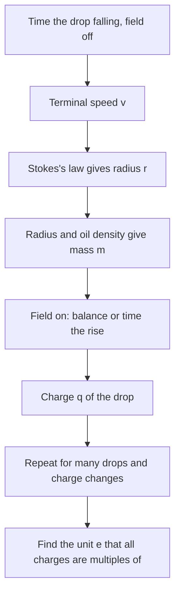

## How do we know charge comes in lumps?

Lesson 30 stated, as a fact, that every free charge is a whole-number multiple of $e = 1.602\times10^{-19}$ C. That is a strong claim: nobody can see a single electron. This lesson follows the experiment that made the claim convincing, the oil-drop experiment carried out at the University of Chicago between about 1909 and 1913 by Robert Millikan and his graduate student Harvey Fletcher. It uses nothing beyond this module and Newton's laws: a uniform field between plates (lesson 31), $E = V/d$ (lesson 33), balanced forces, and air drag. It is also a good case study in how a famous result was obtained, corrected and argued over.

## Background

By 1897 J. J. Thomson had shown that cathode rays are streams of tiny negative particles and measured their charge-to-mass ratio $e/m$, but not $e$ or $m$ separately. Early attempts to measure $e$ watched a whole cloud of charged water droplets fall, which gave only an average and suffered from the droplets evaporating. Millikan's group switched to watching *single* drops, and to oil, which hardly evaporates. (Fletcher later wrote that using oil was his idea and that Millikan kept sole authorship of the key paper; how the credit was shared is still debated by historians.)

## The apparatus

An atomizer sprays a fine mist of oil above two horizontal metal plates. A few drops drift through a small hole in the top plate into the space between them. Spraying charges many of the drops by friction, and the charge on a drop can be changed during a run by ionizing the air (with X-rays or a radioactive source) so that the drop picks up or loses an ion. Light from the side makes the drops visible as bright points in a microscope with a scale in the eyepiece, so the experimenter can time a single drop moving between two marks. A voltage $V$ across plates a distance $d$ apart makes a uniform field $E = V/d$.

## Method 1: balance the drop

With the top plate positive, the field points down, so a *negatively* charged drop feels an upward electric force $qE$. Adjust $V$ until the drop hangs still. Then the electric force balances the weight:

$$qE = mg \quad\Rightarrow\quad q = \frac{mgd}{V}.$$

Measure $V$ and $d$, know $m$, and you have the charge. (Air's buoyancy reduces the effective weight by the ratio of air density to oil density, about 0.13%; we'll ignore it.)

### Example 1

A drop of mass $3.3\times10^{-15}$ kg hangs motionless between plates 1.2 cm apart when the voltage is 808 V. Find its charge and the number of excess electrons.

$q = \dfrac{mgd}{V} = \dfrac{(3.3\times10^{-15})(9.8)(0.012)}{808} = 4.80\times10^{-19}$ C.

$n = q/e = 4.80\times10^{-19}/1.602\times10^{-19} = 3.00$. The drop carries three extra electrons.

## Finding the mass: terminal speed and Stokes's law

The weak point of Method 1 is the mass. A drop about a micrometer across is far too small to weigh, and too small to measure reliably with the microscope. The trick is to let it fall with the field off. Air drag grows with speed, so within a tiny fraction of a second the drop reaches a constant **terminal velocity** $v$, where drag balances weight.

For a small sphere moving slowly through a fluid, the drag force is given by **Stokes's law**:

$$F_{\text{drag}} = 6\pi\eta rv,$$

where $r$ is the radius and $\eta$ the viscosity of the fluid (for air at room temperature, $\eta \approx 1.8\times10^{-5}$ Pa·s). The weight is $mg = \tfrac43\pi r^3\rho g$, with $\rho$ the oil's density. Setting them equal:

$$6\pi\eta rv = \tfrac43\pi r^3\rho g \quad\Rightarrow\quad r = \sqrt{\frac{9\eta v}{2\rho g}}.$$

So timing the fall gives the radius, and the radius gives the mass. The fall is slow, which is what makes it measurable: a drop two micrometers across falls only about a tenth of a millimeter per second.

### Example 2

With the field off, an oil drop ($\rho = 900$ kg/m³) falls 1.00 mm in 12.0 s. With the field on, it hangs still at 926 V between plates 1.2 cm apart. Find its radius, mass and charge.

Terminal speed: $v = 1.00\times10^{-3}/12.0 = 8.33\times10^{-5}$ m/s.

Radius: $r = \sqrt{\dfrac{9(1.8\times10^{-5})(8.33\times10^{-5})}{2(900)(9.8)}} = \sqrt{7.65\times10^{-13}} = 8.75\times10^{-7}$ m, under a micrometer.

Mass: $m = \tfrac43\pi r^3\rho = \tfrac43\pi(8.75\times10^{-7})^3(900) = 2.52\times10^{-15}$ kg.

Charge: $q = \dfrac{mgd}{V} = \dfrac{(2.52\times10^{-15})(9.8)(0.012)}{926} = 3.21\times10^{-19}$ C $= 2.00\,e$.

(Simplified: for drops this small, the drop is not much bigger than the average distance air molecules travel between collisions, about 0.07 μm, and Stokes's law overestimates the drag, here by roughly 10%. Millikan measured and applied a correction for this. Our examples ignore it.)

## Method 2: rising and falling

Holding a drop perfectly still is hard, so Millikan mostly timed drops moving both ways. With the field off the drop falls at $v_{\downarrow}$, so $mg = 6\pi\eta rv_{\downarrow}$. With the field on and strong enough, it rises at $v_{\uparrow}$, so $qE = mg + 6\pi\eta rv_{\uparrow}$. Substituting for $mg$:

$$q = \frac{6\pi\eta r\,(v_{\downarrow} + v_{\uparrow})}{E}.$$

One drop could be kept in view for hours, rising and falling over and over. Each time it captured an ion, its rising speed jumped to a new value, and the *changes* in $q$ came out as whole multiples of the same small charge. That's the most direct evidence: the charge on one object changes only in steps of $e$.

## Finding $e$ from the data

The experiment gives a list of charges, each supposedly a whole number times $e$. To find $e$, look for the largest charge that divides all of them.

### Example 3

Five drops have charges (in units of $10^{-19}$ C) of 3.22, 4.81, 6.39, 8.02 and 11.24. Estimate $e$.

Differences between neighbors: $4.81 - 3.22 = 1.59$, $6.39 - 4.81 = 1.58$, $8.02 - 6.39 = 1.63$, $11.24 - 8.02 = 3.22$. The differences cluster around 1.6 (and 3.2, twice that), so try $e \approx 1.6$.

Dividing each charge by 1.6 gives 2.01, 3.01, 3.99, 5.01 and 7.02: all close to whole numbers, so the drops carry 2, 3, 4, 5 and 7 electrons. The best estimate uses all the data at once:

$$e = \frac{\text{total charge}}{\text{total }n} = \frac{33.68}{21}\times10^{-19} = 1.604\times10^{-19}\text{ C}.$$

Could the true unit be half that, 0.80? Then the counts would be 4, 6, 8, 10, 14, all even, which would be a strange coincidence with nothing ever odd. The smallest unit that fits, with no gaps, is the natural answer; with many drops, the case for 1.6 becomes overwhelming.

## The result and the arguments

Millikan's final value, published in 1913 and quoted again in his Nobel lecture of 1924 (for the 1923 prize), was $e = 1.592\times10^{-19}$ C, with a claimed uncertainty well under 0.5%. The modern value is about 0.6% higher. The main cause was the value of air's viscosity that Millikan used, which was slightly too low; once better viscosity data appeared, the oil-drop value moved into agreement with other methods. Richard Feynman later used the slow drift of published values toward the right answer as a warning about how experimenters can be influenced by an earlier, authoritative result.

There is also a long-running argument about Millikan's data. His notebooks, studied by the historian Gerald Holton in 1978, record many drops that he did not use, although the 1913 paper says the drops reported were not a selected group. Later analyses (by the physicist and historian Allan Franklin, among others) concluded that including the excluded drops would not change the value of $e$ much, but would make its uncertainty larger; others argue that Millikan's choices were reasonable judgments about faulty runs. The question of whether his reporting was fair is contested, but no one now doubts the main result: charge is quantized.

At the time, the physicist Felix Ehrenhaft in Vienna claimed to see "subelectrons", charges smaller than $e$. Later work showed his measurements were affected by problems such as irregularly shaped particles. Today quarks are known to have charges of $\pm\tfrac13e$ and $\pm\tfrac23e$, but they are always bound inside particles such as protons and neutrons, so every free charge ever measured is a whole multiple of $e$. Since 2019, $e$ has an exact value by definition in the SI: $1.602176634\times10^{-19}$ C.

## Common mistakes

- Forgetting the field direction: to hold up a negative drop the field must point *down* (top plate positive).
- Using the drop's diameter in place of its radius in Stokes's law or the volume formula.
- Assuming the measured charges must be exactly $1e, 2e, 3e, \dots$ in order. Any whole numbers can turn up; it's the common unit that matters.
- Reading the 0.6% error as a flaw in the method. It came mostly from one input constant (air viscosity), not from the idea.
- Treating quarks as a counterexample to quantization of free charge. They're never found isolated.

## Key points

- Balancing a drop: $qV/d = mg$, so $q = mgd/V$.
- The mass comes from the terminal speed with the field off: Stokes's law $6\pi\eta rv = \tfrac43\pi r^3\rho g$ gives $r = \sqrt{9\eta v/(2\rho g)}$.
- Rising and falling: $q = 6\pi\eta r(v_{\downarrow} + v_{\uparrow})/E$; changes in a single drop's charge come in steps of $e$.
- $e$ is the largest common unit of all measured charges; Millikan's 1913 value was about 0.6% low, mainly because of a wrong air viscosity.
- Since 2019, $e = 1.602176634\times10^{-19}$ C exactly, by definition.
