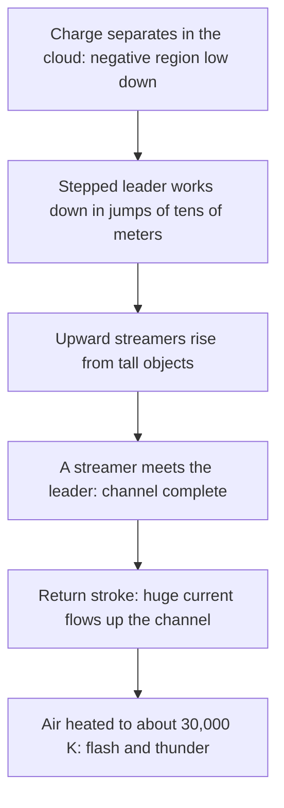

## When insulators stop insulating

Lesson 34 mentioned in passing that air sparks at about $3\times10^6$ V/m and that dielectrics resist this "breakdown". Every spark you've felt from a doorknob, every Van de Graaff demonstration and every lightning flash is that limit being reached. This lesson asks three questions using only this module's tools: how much charge can a conductor hold before the air around it gives way, why does charge pile up on sharp points, and what is happening in a thunderstorm?

## Dielectric breakdown

Air is a good insulator because almost all of its molecules are neutral. A few free electrons and ions are always around, made by cosmic rays and natural radioactivity. In a field, a free electron accelerates between collisions with molecules. If the field is strong enough, it gains enough energy between collisions to knock an electron out of the next molecule it hits. Now there are two free electrons, then four, then eight: an **electron avalanche**. In a fraction of a microsecond the air along a path becomes a conducting channel of ionized gas, and charge rushes through it. That's **dielectric breakdown**, and you see the hot, glowing channel as a spark.

The field at which this happens is the material's **dielectric strength**. For dry air at sea-level pressure, across gaps of a centimeter or so, it is about $3\times10^6$ V/m (3 kV per millimeter). That's a rule of thumb, not a constant: the value depends on pressure, humidity, the gap's size and the shape of the electrodes. Thin air breaks down more easily, which is why high-voltage equipment on aircraft needs more care. Good solid insulators such as many plastics withstand tens of millions of volts per meter, which is one reason capacitors use them.

## How much charge can a sphere hold?

For an isolated conducting sphere of radius $R$ carrying charge $Q$, the field just outside is $E = kQ/R^2$ and the potential is $V = kQ/R$. Dividing,

$$E_{\text{surface}} = \frac{V}{R}.$$

The air breaks down when $E_{\text{surface}}$ reaches the dielectric strength $E_{\max}$, so the highest potential the sphere can reach is

$$V_{\max} = E_{\max}R.$$

A bigger sphere can be charged to a higher voltage. This is why a **Van de Graaff generator**, which uses a moving belt to carry charge continuously up into a hollow metal dome, has a large, smooth, rounded dome.

### Example 1

A Van de Graaff dome is a sphere of radius 20 cm. Taking $E_{\max} = 3.0\times10^6$ V/m, find the highest potential and charge it can hold.

$V_{\max} = E_{\max}R = (3.0\times10^6)(0.20) = 6.0\times10^5$ V, 600 kV.

$Q_{\max} = \dfrac{V_{\max}R}{k} = \dfrac{(6.0\times10^5)(0.20)}{8.99\times10^9} = 1.3\times10^{-5}$ C, about 13 μC.

Real classroom generators reach less than this (a few hundred kilovolts) because charge leaks off through bumps, dust and humid air. Notice how little charge it takes: 13 μC is about $8\times10^{13}$ electrons, a tiny fraction of the dome's own electrons.

## Why charge crowds onto sharp points

Lesson 31 stated that charge on a conductor concentrates where the surface curves most sharply. Two connected spheres show why.

Join a sphere of radius $R_1$ to a much smaller one of radius $R_2$ by a long thin wire, far enough apart that each sphere's charge spreads evenly over it. Connected conductors in equilibrium are at one potential, so

$$\frac{kQ_1}{R_1} = \frac{kQ_2}{R_2} \quad\Rightarrow\quad \frac{Q_1}{Q_2} = \frac{R_1}{R_2}.$$

The big sphere holds more charge, in proportion to its radius. But the surface field is $E = V/R$, the same $V$ for both, so

$$\frac{E_2}{E_1} = \frac{R_1}{R_2}.$$

The *small* sphere has the stronger field at its surface, and the surface charge density $\sigma = \varepsilon_0E$ is higher there too. A sharp point on a conductor behaves like a very small sphere attached to a larger body, so the field near it can be huge even when the conductor's potential is modest. (Simplified: real points aren't spheres and the shapes affect each other, but the trend, stronger field where the radius of curvature is smaller, holds for any conductor.)

### Example 2

A sphere of radius 10 cm and one of radius 2.0 cm are joined by a long wire and share 60 nC. (a) Find each sphere's charge, their common potential and each surface field. (b) What total charge makes the small sphere's surface field reach $3.0\times10^6$ V/m?

(a) $Q_1 = 60\cdot\dfrac{10}{10 + 2.0} = 50$ nC and $Q_2 = 10$ nC. $V = \dfrac{kQ_1}{R_1} = \dfrac{(8.99\times10^9)(50\times10^{-9})}{0.10} = 4.5\times10^3$ V. Surface fields: $E_1 = V/R_1 = 4.5\times10^4$ V/m and $E_2 = V/R_2 = 2.2\times10^5$ V/m, five times stronger at the small sphere.

(b) Breakdown at the small sphere needs $V = E_{\max}R_2 = (3.0\times10^6)(0.020) = 6.0\times10^4$ V. The spheres hold $Q_1 + Q_2 = V(R_1 + R_2)/k = (6.0\times10^4)(0.12)/(8.99\times10^9) = 8.0\times10^{-7}$ C, 0.80 μC. At that point the big sphere's surface field is only $6.0\times10^4/0.10 = 6.0\times10^5$ V/m, a fifth of the breakdown value. Air fails at the small sphere first.

## Corona discharge, sparks and their uses

Near a sharp point the field can exceed the breakdown value in a small region while the field a little farther away is too weak for a full spark. The air ionizes only in that thin layer, giving a faint glow and a hiss: **corona discharge**. Sailors called the glow on masts in stormy weather St. Elmo's fire. Corona slowly leaks charge away, which is why high-voltage power lines and Van de Graaff domes are kept smooth and rounded, and why the tips of some aircraft wings carry small "static wicks" designed to bleed off charge.

Corona is also useful. In an **electrostatic precipitator**, thin high-voltage wires create corona that charges smoke particles in a factory chimney; the charged particles are then pulled onto collecting plates instead of going up the stack. Older photocopiers and laser printers used a corona wire to spray charge evenly onto the light-sensitive drum.

## The atmosphere as a capacitor

On a clear day there is an electric field of about 100 V/m pointing down at Earth's surface: the ground carries negative charge and the atmosphere above it, on balance, positive. Thunderstorms around the world are thought to keep this charge topped up, and it slowly leaks back through the weakly conducting air in fair-weather regions. This "global circuit" picture is the standard one, though the details are still being studied.

### Example 3

Taking the fair-weather field as 100 V/m everywhere, estimate the surface charge density on the ground and the total charge on Earth ($R = 6.37\times10^6$ m).

The ground is a conductor, so just outside it $E = \sigma/\varepsilon_0$ (lesson 32): $\sigma = \varepsilon_0E = (8.85\times10^{-12})(100) = 8.9\times10^{-10}$ C/m².

Total: $Q = \sigma(4\pi R^2) = (8.85\times10^{-10})(4\pi)(6.37\times10^6)^2 = 4.5\times10^5$ C, negative. That's a rough estimate, since the field varies a lot with place and weather, but it shows Earth carries a few hundred thousand coulombs.

## Lightning

In a thunderstorm, collisions between small ice crystals and soft hail (graupel) in the presence of supercooled water droplets are thought to separate charge, with the lighter positively charged crystals carried up to the top of the cloud and a region of negative charge left lower down. This mechanism is the leading explanation, but the details are still being researched.

Most cloud-to-ground flashes lower negative charge to the ground. A faint **stepped leader** of ionized air works its way down in jumps; when it nears the ground, upward streamers rise from tall objects to meet it. Once they join, a **return stroke** surges along the channel, with a peak current typically around 30 kA, heating the air to roughly 30,000 K. The heated air expands violently, and that's the thunder. A flash often contains several strokes along the same channel, which is why lightning flickers.

One puzzle remains. Measured fields inside thunderclouds rarely exceed a few hundred kilovolts per meter, well below the breakdown strength of air, even allowing for the lower air pressure at altitude. How lightning gets started anyway is an open research question; proposed answers include fields strengthened locally near ice particles and avalanches started by fast electrons from cosmic rays.

### Example 4

A typical flash transfers several to a few tens of coulombs; take 10 C moved through a potential difference of about $10^8$ V (estimates vary widely). Estimate the energy released, and how long it could run a 100 W light bulb.

Energy $\approx Q\,\Delta V = (10)(1\times10^8) = 1\times10^9$ J, an order-of-magnitude estimate (the potential difference falls as charge flows, so the true figure is somewhat less). Time: $\dfrac{1\times10^9\text{ J}}{100\text{ W}} = 1\times10^7$ s, about 4 months. Lightning is spectacular but carries less energy than you might expect, delivered in a fraction of a second.

**Lightning rods**, introduced by Benjamin Franklin in the 1750s, are pointed metal rods on a building connected to the ground by heavy conductors. Franklin hoped a point would quietly drain charge from clouds and prevent strikes; the modern view is that a rod cannot stop lightning but gives the strike a safe, low-resistance path to ground that bypasses the building. (Claims that special rod designs attract or prevent strikes far better than ordinary ones are disputed.)

## Common mistakes

- Thinking the larger of two connected spheres has the stronger surface field. It has more charge but the weaker field: $E = V/R$.
- Treating 3 MV/m as an exact constant. It depends on pressure, humidity and the gap.
- Using $E = \sigma/(2\varepsilon_0)$ at a conductor's surface. Just outside a conductor $E = \sigma/\varepsilon_0$.
- Thinking a lightning rod works mainly by preventing strikes. Its job is to carry the strike safely to ground.
- Confusing a flash's peak current (tens of kiloamperes) with its total charge (only a few to tens of coulombs).

## Key points

- Breakdown: free electrons gain enough energy between collisions to ionize molecules, starting an avalanche; dry air's dielectric strength is about $3\times10^6$ V/m.
- A sphere's surface field is $V/R$, so $V_{\max} = E_{\max}R$; big smooth domes hold high voltages.
- Connected conductors share one potential: $Q \propto R$ but $E_{\text{surface}} \propto 1/R$, so sharp points have strong fields and leak charge by corona discharge.
- Earth's fair-weather field is about 100 V/m downward; the ground carries roughly $5\times10^5$ C of negative charge.
- Lightning: stepped leader, upward streamer, return stroke (about 30 kA, about 30,000 K). How it starts at fields below air's breakdown strength is still being studied.
