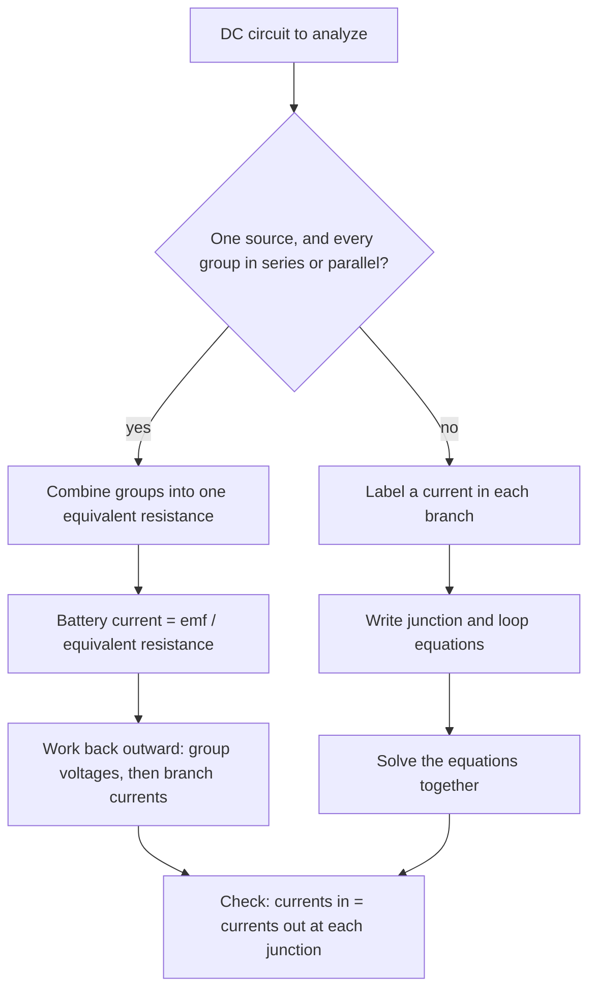

## From one resistor to networks

Real circuits combine many components: the bulbs in a string of lights, the resistors on a circuit board, the appliances on a household circuit. This lesson shows how to reduce series and parallel combinations to a single equivalent resistance, how a battery's internal resistance affects what it delivers, and how Kirchhoff's two rules solve any circuit, even ones that can't be simplified.

Circuits are shown in diagrams below and also described in words: "in series" means one after another along a single path; "in parallel" means side by side, each connected across the same two points.

The worked examples below also come with circuit diagrams, which use the standard symbols in this key. On a battery the longer plate is the $+$ terminal. Lines are ideal wires with no resistance, and a dot marks a junction where wires join.


## Resistors in series

In series, the same current $I$ passes through each resistor (there's only one path, and charge can't pile up). The voltages add: $V = IR_1 + IR_2 + \cdots$ So the equivalent resistance is

$$R_{\text{eq}} = R_1 + R_2 + R_3 + \cdots$$

Series resistors act like one longer wire. The voltage divides in proportion to resistance: the biggest resistor gets the biggest share. One drawback: if one element breaks (an old-style string of holiday lights), the whole path is broken and everything goes out.

## Resistors in parallel

In parallel, each resistor has the same voltage $V$ across it (both ends connect to the same two points). The currents add: $I = V/R_1 + V/R_2 + \cdots$ So

$$\frac{1}{R_{\text{eq}}} = \frac{1}{R_1} + \frac{1}{R_2} + \frac{1}{R_3} + \cdots$$

Parallel paths are like extra lanes: the equivalent resistance is less than the smallest individual resistance. For two resistors, $R_{\text{eq}} = \dfrac{R_1R_2}{R_1 + R_2}$ ("product over sum"). Current divides in inverse proportion to resistance: most of it takes the easiest path. Household outlets are wired in parallel so every appliance gets the full 120 V and can be switched independently. Adding more appliances lowers the total resistance and raises the total current, which is why circuits have breakers.

### Example 1

A 6.0 Ω resistor is in series with a parallel pair of 4.0 Ω and 12 Ω, all connected to a 12 V battery (no internal resistance). Find the current from the battery, the voltage across each resistor, and the current in each branch.

Parallel pair: $\dfrac{4.0(12)}{4.0 + 12} = 3.0$ Ω. Total: $6.0 + 3.0 = 9.0$ Ω.

Battery current: $I = 12/9.0 = 1.33$ A.

Voltage across the 6.0 Ω: $1.33(6.0) = 8.0$ V. Across the pair: $1.33(3.0) = 4.0$ V (check: $8.0 + 4.0 = 12$ V ✓).

Branch currents: $4.0/4.0 = 1.0$ A and $4.0/12 = 0.33$ A, adding to 1.33 A ✓.


## EMF and internal resistance

A real battery has some **internal resistance** $r$ inside it. When it delivers current $I$, part of its emf is lost inside, so the **terminal voltage** available to the circuit is

$$V_{\text{terminal}} = \mathcal{E} - Ir.$$

With an external load $R$, the current is $I = \dfrac{\mathcal{E}}{R + r}$. A car battery's headlights dim when the starter motor draws hundreds of amperes, because the $Ir$ drop becomes large. Only when no current flows does the terminal voltage equal the emf.

### Example 2

A 9.0 V battery with internal resistance 0.50 Ω is connected to a 4.0 Ω resistor. Find the current, the terminal voltage, and the power delivered to the resistor.

$I = \dfrac{9.0}{4.5} = 2.0$ A. $V_{\text{terminal}} = 9.0 - 2.0(0.50) = 8.0$ V. $P = I^2R = 4.0(4.0) = 16$ W (another 2.0 W is wasted heating the battery).

## Kirchhoff's rules

Some circuits, such as two batteries in different branches, can't be reduced with series and parallel rules. **Kirchhoff's rules** handle every case:

1. **Junction rule** (conservation of charge): the total current into any junction equals the total current out, $\sum I_{\text{in}} = \sum I_{\text{out}}$.
2. **Loop rule** (conservation of energy): around any closed loop, the sum of potential changes is zero, $\sum\Delta V = 0$.

Sign conventions for the loop rule, traversing the loop in a chosen direction:

- Crossing a resistor *in the direction of* its assumed current: $\Delta V = -IR$ (going downhill). Against the current: $+IR$.
- Crossing a battery from $-$ to $+$: $\Delta V = +\mathcal{E}$. From $+$ to $-$: $-\mathcal{E}$.

Procedure: label a current (with an assumed direction) in each branch, write junction equations, write enough loop equations to have as many independent equations as unknown currents, and solve. A current that comes out negative simply flows opposite to your guess.

### Example 3

Two batteries power a shared resistor. Branch 1 has a 12 V battery and a 2.0 Ω resistor; branch 2 has a 6.0 V battery and a 3.0 Ω resistor; branch 3 is a single 6.0 Ω resistor. The three branches connect between the same two junctions, A (top) and B (bottom). Both batteries have their $+$ terminals toward A. Find the current in each branch.


Let $I_1$ and $I_2$ flow up through branches 1 and 2 (from B to A), and $I_3$ flow down through the 6.0 Ω resistor (A to B).

Junction A: $I_1 + I_2 = I_3$.

Loop through branches 1 and 3, going up branch 1 then down branch 3: $+12 - 2.0I_1 - 6.0I_3 = 0$.

Loop through branches 2 and 3: $+6.0 - 3.0I_2 - 6.0I_3 = 0$.

From the loops: $I_1 = 6 - 3I_3$ and $I_2 = 2 - 2I_3$. Substituting in the junction equation: $6 - 3I_3 + 2 - 2I_3 = I_3$, so $I_3 = 8/6 = 1.33$ A. Then $I_1 = 2.0$ A and $I_2 = -0.67$ A.

The negative $I_2$ means current flows *down* through the 6.0 V battery: the stronger 12 V battery is charging it.

Which tool should you reach for? The flowchart sums up the choice.



## Meters

An **ammeter** measures current and is placed in series with the branch; it must have very small resistance so it doesn't change the current. A **voltmeter** measures potential difference and is connected in parallel across the component; it must have very large resistance so it draws almost no current. Connecting an ammeter in parallel short-circuits the component and can damage the meter.


## Maximum power transfer

What load resistance $R$ draws the most power from a source with emf $\mathcal{E}$ and internal resistance $r$? The load power is $P = I^2R = \dfrac{\mathcal{E}^2R}{(R + r)^2}$. A tiny $R$ draws a big current but has almost no voltage across it; a huge $R$ has nearly the full emf across it but almost no current. Somewhere in between is a best value. A table for $\mathcal{E} = 12$ V and $r = 2.0$ Ω shows where:

| $R$ (Ω) | 0.5 | 1.0 | 2.0 | 4.0 | 8.0 |
|---|---|---|---|---|---|
| $P$ (W) | 11.5 | 16.0 | 18.0 | 16.0 | 11.5 |

The power peaks when the load matches the internal resistance, $R = r$, a result called **impedance matching** (used in audio amplifiers and antennas). At that point the source wastes as much power inside itself as it delivers, so the efficiency is only 50%.

```plot
{"x": [0, 16], "y": [0, 24], "xLabel": "load resistance R (Ω)", "yLabel": "power to the load P (W)", "functions": [{"f": "144*x/(x + 2)^2"}], "points": [{"at": [2, 18]}], "labels": [{"at": [6.5, 20], "text": "peak at R = r = 2.0 Ω"}, {"at": [11, 13.5], "text": "P = E²R/(R + r)²"}], "caption": "Power delivered to the load by a 12 V source with r = 2.0 Ω: largest when the load matches the internal resistance"}
```

### Example 4

Three identical light bulbs are connected to an ideal battery: bulb A is in series with a parallel pair, B and C. (a) Rank the bulbs by brightness. (b) Bulb C is unscrewed. What happens to A and B?


Treat each bulb as a resistor $R$; brightness follows power, $I^2R$.

(a) The full battery current $I$ passes through A, and then splits equally between B and C, $I/2$ each. B and C each get $(I/2)^2R = \tfrac14I^2R$, a quarter of A's power. A is brightest; B and C are equal and dimmer.

(b) With C removed, A and B are simply in series: total resistance rises from $1.5R$ to $2R$, so the battery current drops from $\mathcal{E}/(1.5R)$ to $\mathcal{E}/(2R)$. A gets less current and dims. B now carries the whole current, $\mathcal{E}/(2R)$, more than its previous share of $\mathcal{E}/(3R)$, so B gets *brighter*. Reasoning about current and voltage, not memorized rules, gets these questions right.

## Common mistakes

- Adding parallel resistances directly or series resistances as reciprocals.
- Forgetting to take the reciprocal at the end of the parallel formula.
- Inconsistent signs in the loop rule; pick a direction and follow the convention strictly.
- Assuming the terminal voltage always equals the emf.
- Treating a negative current from Kirchhoff's rules as an error.

## Key points

- Series: same current, $R_{\text{eq}} = \sum R_i$. Parallel: same voltage, $1/R_{\text{eq}} = \sum 1/R_i$.
- Terminal voltage $V = \mathcal{E} - Ir$; $I = \mathcal{E}/(R + r)$.
- Junction rule: currents in = currents out. Loop rule: $\sum\Delta V = 0$ around any loop.
- Ammeters in series (low $R$); voltmeters in parallel (high $R$).
- Maximum power transfer when $R = r$.
