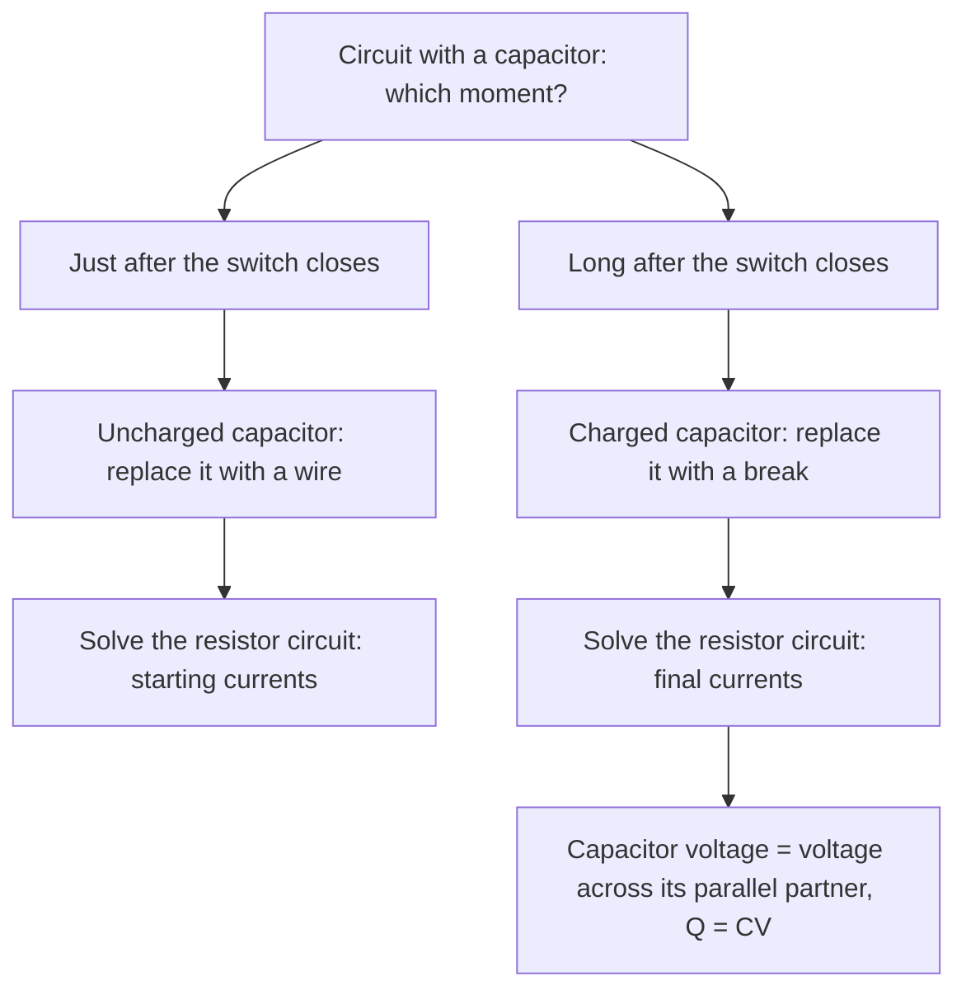

## When currents change

In every circuit so far the currents were steady. Put a capacitor in a circuit with a resistor and things change with time: the capacitor charges gradually, and the current starts large and dies away. RC circuits set the timing in blinking lights, camera flashes, pacemakers and windshield wipers, and they filter signals in audio equipment. This lesson combines capacitance with Kirchhoff's rules and introduces the exponential behavior that shows up throughout physics.

## Charging a capacitor

Connect an uncharged capacitor $C$ in series with a resistor $R$ and a battery of emf $\mathcal{E}$, and close the switch at $t = 0$.

A convenient way to do both experiments in this lesson is a two-way switch, as in the diagram. In position a, the battery, $R$ and $C$ form one loop and the capacitor charges. In position b, the battery is bypassed, and the charged capacitor discharges through $R$ alone.


- At the first instant the capacitor has no charge, so no voltage across it; it acts like a plain wire. The full emf is across the resistor, and the current jumps to $I_0 = \mathcal{E}/R$.
- As charge builds up, the capacitor's voltage $q/C$ rises, leaving less for the resistor, so the current shrinks.
- Eventually the capacitor's voltage equals $\mathcal{E}$, the current stops, and the capacitor holds $Q = C\mathcal{E}$. A fully charged capacitor acts like a break in the circuit.

The charge and current follow exponential curves:

$$q(t) = C\mathcal{E}\left(1 - e^{-t/RC}\right), \qquad I(t) = \frac{\mathcal{E}}{R}e^{-t/RC}.$$

The capacitor's voltage is $V_C = \mathcal{E}(1 - e^{-t/RC})$.

## The time constant

The product

$$\tau = RC$$

has units of seconds (Ω·F = (V/A)(C/V) = C/A = s) and is called the **time constant**. It sets the speed of the whole process:

- after one time constant, the capacitor reaches $1 - e^{-1} = 63.2\%$ of its final charge, and the current has dropped to 36.8% of its initial value;
- after $2\tau$: 86.5%; after $3\tau$: 95.0%; after $5\tau$: 99.3%, effectively full.

A larger resistor slows the flow of charge; a larger capacitor needs more charge. Either way, larger $RC$ means slower charging.

```plot
{"x": [0, 5.2], "y": [0, 1.1], "xLabel": "t / RC", "yLabel": "fraction of final value", "functions": [{"f": "1 - exp(-x)", "label": "charge q / CE"}, {"f": "exp(-x)", "dashed": true, "label": "current I / I₀"}], "points": [{"at": [1, 0.632], "label": "63%"}, {"at": [1, 0.368], "label": "37%"}], "caption": "Charging an RC circuit: charge rises and current decays with time constant RC"}
```

### Example 1

A 4.0 μF capacitor charges through a 50 kΩ resistor from a 12 V battery. Find (a) the time constant, (b) the initial current, (c) the final charge, and (d) the capacitor's voltage after 0.30 s.

(a) $\tau = (50\times10^3)(4.0\times10^{-6}) = 0.20$ s.

(b) $I_0 = 12/(50\times10^3) = 2.4\times10^{-4}$ A $= 0.24$ mA.

(c) $Q = C\mathcal{E} = (4.0\times10^{-6})(12) = 48$ μC.

(d) $V_C = 12(1 - e^{-0.30/0.20}) = 12(1 - 0.223) = 9.32$ V.

## Discharging a capacitor

Now disconnect the battery and let a charged capacitor (initial charge $Q_0$) discharge through a resistor. The capacitor acts as the source; its voltage drives a current that drains its own charge:

$$q(t) = Q_0e^{-t/RC}, \qquad I(t) = \frac{Q_0}{RC}e^{-t/RC} = \frac{V_0}{R}e^{-t/RC}.$$

Both decay by the same factor in each equal time interval. The time for the charge to fall to half is $t_{1/2} = RC\ln 2 = 0.693\,RC$.

```plot
{"x": [0, 5.2], "y": [0, 1.1], "xLabel": "t / RC", "yLabel": "fraction remaining q / Q₀", "functions": [{"f": "exp(-x)"}], "labels": [{"at": [3.5, 0.55], "text": "q / Q₀ = e^(−t/RC)"}], "segments": [{"from": [0.693, 0], "to": [0.693, 0.5], "dashed": true}, {"from": [0, 0.5], "to": [0.693, 0.5], "dashed": true}], "points": [{"at": [0.693, 0.5], "label": "half at 0.693 RC"}, {"at": [1, 0.368], "label": "37% at RC"}, {"at": [1.386, 0.25], "label": "quarter at 1.386 RC"}], "caption": "Discharging: the charge halves every 0.693 RC, whatever the starting charge"}
```

### Example 2

A camera flash's 100 μF capacitor charged to 300 V discharges through a 2.0 Ω flash tube. What's the time constant, and how long until the voltage drops to 10 V?

$\tau = 2.0(100\times10^{-6}) = 2.0\times10^{-4}$ s $= 0.20$ ms.

$10 = 300e^{-t/\tau}$, so $t = \tau\ln 30 = (0.20\text{ ms})(3.40) = 0.68$ ms. A brief, intense burst: that's the point of storing energy in a capacitor.

## Energy in an RC circuit

When a capacitor charges to $\mathcal{E}$, the battery supplies energy $Q\mathcal{E} = C\mathcal{E}^2$, but the capacitor stores only $\tfrac12C\mathcal{E}^2$. The other half is dissipated as heat in the resistor, whatever the value of $R$. (A smaller $R$ means a larger current for a shorter time, and the total heat comes out the same.)

## RC circuits in practice

Because $\tau = RC$ can be set anywhere from nanoseconds to minutes by choosing components, RC circuits are the standard way to make electronics wait. A car's turn-signal flasher, a smoke detector's chirp interval and the delay before a bathroom fan shuts off all come from a capacitor charging until its voltage crosses a threshold, which triggers a switch that discharges it and starts the cycle over.

RC circuits also act as filters. A capacitor needs time to respond, so it can't follow voltage changes much faster than $1/\tau$. Take the output across the capacitor and rapid fluctuations are smoothed away while slow changes pass through: a **low-pass filter**, used to remove hiss from audio and to smooth the ripple from a power supply. Take the output across the resistor instead and only the rapid changes get through, a high-pass filter. The crossover frequency is about $f = \dfrac{1}{2\pi RC}$. A 10 kΩ resistor with a 16 nF capacitor gives roughly 1 kHz.

## The loop rule at any instant

Why does the current die away gradually instead of stopping suddenly? Apply the loop rule to the charging circuit at any moment, when the capacitor holds charge $q$:

$$\mathcal{E} - IR - \frac qC = 0 \quad\Rightarrow\quad I = \frac{\mathcal{E} - q/C}{R}.$$

The current is driven by whatever voltage the capacitor hasn't yet "used up". As $q$ grows, that leftover voltage shrinks, so the current shrinks, so the charge grows more slowly, and so on. The capacitor approaches full charge more and more slowly, without ever quite reaching it. Any quantity whose rate of change is proportional to how far it still has to go behaves this way, which is why the same exponential shapes describe radioactive decay and a hot drink cooling toward room temperature.

The same reasoning handles the energy claim above. The battery pushes all the charge $Q = C\mathcal{E}$ through its full emf, supplying $Q\mathcal{E}$. The capacitor's voltage rose from 0 to $\mathcal{E}$, so on average each bit of charge was stored at only half the emf, giving $\tfrac12Q\mathcal{E}$. The other half became heat in the resistor.

For circuits with several resistors, two snapshots answer most questions without any exponentials: *just after* the switch closes, treat an uncharged capacitor as a plain wire; *long after*, treat it as a break.



### Example 3

A 12 V battery, a 2.0 kΩ resistor $R_1$ and a switch are in series with a parallel pair: a 4.0 kΩ resistor $R_2$ and an uncharged 5.0 μF capacitor connected across it. Find the battery current (a) just after the switch closes and (b) long after, and (c) the final charge on the capacitor.


(a) The uncharged capacitor acts as a wire, shorting out $R_2$, so only $R_1$ limits the current: $I = 12/2000 = 6.0$ mA, all of it flowing into the capacitor.

(b) Fully charged, the capacitor is a break; current flows through $R_1$ and $R_2$ in series: $I = 12/6000 = 2.0$ mA.

(c) The capacitor has the same voltage as $R_2$, which is (2.0 mA)(4.0 kΩ) = 8.0 V. So $Q = CV$ = (5.0 μF)(8.0 V) = 40 μC. Note it does *not* charge to the full 12 V.

## Common mistakes

- Treating an RC circuit as instantly charged (or the capacitor as always an open circuit).
- Using $e^{-t/RC}$ for the charge while charging (it's $1 - e^{-t/RC}$).
- Forgetting unit prefixes: kΩ × μF = ms, MΩ × μF = s.
- Thinking the current in a charging RC circuit grows over time (it decays).

## Key points

- $\tau = RC$ (seconds).
- Charging: $q = C\mathcal{E}(1 - e^{-t/RC})$, $I = (\mathcal{E}/R)e^{-t/RC}$.
- Discharging: $q = Q_0e^{-t/RC}$, $I = (V_0/R)e^{-t/RC}$; half-life $RC\ln 2$.
- Uncharged capacitor: acts like a wire at first; fully charged: acts like a break.
- Charging from a battery wastes half the energy as heat in $R$.
