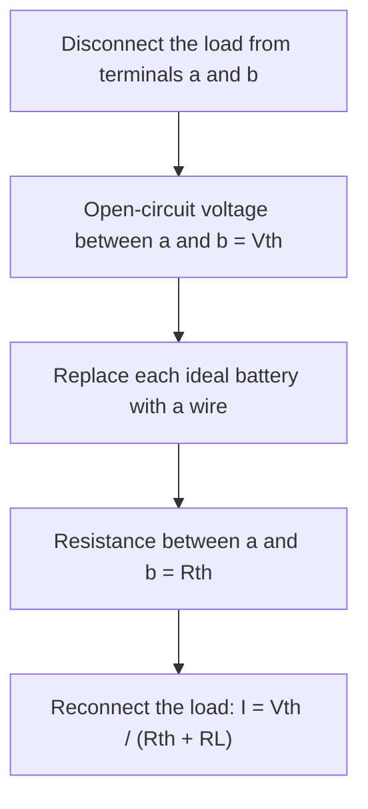

## Beyond series and parallel

Lesson 36 gave you two tools: combining resistors in series and parallel, and Kirchhoff's rules for everything else. Kirchhoff's rules always work, but they can bury a simple question under a pile of simultaneous equations. Engineers rarely solve a whole network from scratch. They use a few ideas that make circuits easier to think about: the voltage divider, the balanced bridge, the Thévenin equivalent and superposition. This lesson develops each one, shows why it works using only the rules you already know, and applies them to a practical question: why does connecting a meter change the reading it is trying to take?

Everything here assumes a **linear circuit**, one built from ideal batteries and ohmic resistors. Diodes and filament bulbs, whose resistance changes with current, are not covered by these shortcuts.

## The voltage divider

Two resistors in series across an emf $\mathcal{E}$ share the voltage in proportion to their resistances. The same current $I = \mathcal{E}/(R_1 + R_2)$ flows through both, so the voltage across $R_2$ is

$$V_{\text{out}} = \mathcal{E}\,\frac{R_2}{R_1 + R_2}.$$

This arrangement is called a **voltage divider**. It is how a volume knob or a light sensor produces a voltage that depends on a setting or on the light level: one of the two resistors changes, and the output voltage changes with it.

The formula has a catch. It assumes nothing else is connected across $R_2$. Attach a load in parallel with $R_2$ and the combination has a smaller resistance than $R_2$ alone, so the output voltage drops. How much it drops is exactly what the Thévenin equivalent, later in this lesson, tells you.

## The Wheatstone bridge

Suppose you need to measure an unknown resistance $R_x$ accurately. Measuring $V$ and $I$ with meters gives $R = V/I$, but each meter has its own error. The **Wheatstone bridge** avoids that by comparing $R_x$ with known resistors. It was invented by Samuel Hunter Christie in 1833 and made popular by Charles Wheatstone a decade later.

The bridge is two voltage dividers side by side, both across the same battery: $R_1$ above $R_2$ on the left, $R_3$ above $R_x$ on the right. A **galvanometer**, a very sensitive current meter, connects their midpoints P and Q. You adjust $R_3$ until the galvanometer reads zero. The bridge is then balanced.

Why does that tell you $R_x$? No current through the galvanometer means P and Q are at the same potential. Measuring potentials from the bottom corner, the two divider formulas give

$$\mathcal{E}\,\frac{R_2}{R_1 + R_2} = \mathcal{E}\,\frac{R_x}{R_3 + R_x}.$$

Cancel $\mathcal{E}$, cross-multiply, and the $R_2R_x$ terms cancel, leaving $R_2R_3 = R_1R_x$:

$$\frac{R_1}{R_2} = \frac{R_3}{R_x}, \qquad R_x = \frac{R_2R_3}{R_1}.$$

The emf canceled out, so the battery's voltage, its internal resistance, and even the galvanometer's own resistance don't affect the result. The galvanometer is used only as a *null detector*: it only has to tell zero from not zero, which a sensitive meter does far more accurately than it measures a value.

### Example 1

In the bridge shown, $R_1 = 200$ Ω and $R_2 = 500$ Ω. The galvanometer reads zero when the adjustable resistor is set to $R_3 = 132$ Ω. Find $R_x$.

The ratio on the left side is $R_1/R_2 = 200/500 = 0.40$. Balance needs the same ratio on the right, $R_3/R_x = 0.40$, so $R_x = 132/0.40 = 330$ Ω. (Directly: $R_x = R_2R_3/R_1 = 500 \times 132/200 = 330$ Ω.)

A common slip is to pair the resistors wrongly, for example $R_x = R_1R_3/R_2 = 52.8$ Ω. Check by asking which resistors share a side: $R_1$ and $R_2$ form one divider, $R_3$ and $R_x$ the other, and balance means the two dividers split the voltage in the same ratio.

### Example 2: A bridge as a sensor

An unbalanced bridge is useful too. A strain gauge is a thin wire pattern glued to a beam; when the beam stretches, the wire gets longer and thinner and its resistance rises slightly. Put it in a bridge in place of $R_x$, with all four resistors 100 Ω and $\mathcal{E} = 10$ V. Balanced, P and Q are both at 5.000 V. If strain raises the gauge to 102 Ω, find the voltage between P and Q (assume the meter draws no current).

P is still at $10 \times 100/200 = 5.000$ V. Q is at $10 \times 102/202 = 5.050$ V. The difference is about 0.050 V, or 50 mV. A 2% change in one resistance became a clear signal against a zero background. That is how bathroom scales, load cells and many pressure sensors work.

## Thévenin's theorem

You saw in lesson 36 that a real battery behaves like an ideal emf in series with an internal resistance. A remarkable theorem says that *any* linear network, however tangled, looks like that from the outside.

**Thévenin's theorem**: as seen from any two terminals, a linear network of batteries and resistors behaves exactly like a single emf $V_{\text{th}}$ in series with a single resistance $R_{\text{th}}$. Any load connected to those terminals gets the same current and voltage from the simple equivalent as from the real network. The French telegraph engineer Léon Charles Thévenin published it in 1883; Hermann von Helmholtz had stated an equivalent result in 1853.

Why should it be true? For a linear network, the voltage across the terminals falls by the same amount for each extra ampere drawn, so a graph of terminal voltage against current is a straight line. A straight line is fixed by two numbers: where it starts (the voltage with no current drawn) and how steeply it falls (volts lost per ampere, a resistance). Those two numbers are $V_{\text{th}}$ and $R_{\text{th}}$.

How to find them:

- $V_{\text{th}}$ is the **open-circuit voltage**: the voltage between the terminals with nothing connected.
- $R_{\text{th}}$ is the resistance between the terminals after replacing each ideal battery with a plain wire. (Equivalently, $R_{\text{th}} = V_{\text{oc}}/I_{\text{sc}}$, where the **short-circuit current** $I_{\text{sc}}$ is the current that would flow through a wire connected straight across the terminals.)

### Example 3

A 12 V battery drives a voltage divider of $R_1 = 6.0$ kΩ (top) and $R_2 = 3.0$ kΩ, with terminals a and b across $R_2$. Find the Thévenin equivalent, then the voltage across a 2.0 kΩ load and across a 6.0 kΩ load connected to a and b.

Open-circuit voltage: with nothing attached, this is the plain divider, $V_{\text{th}} = 12 \times 3.0/9.0 = 4.0$ V.

Resistance: replace the battery with a wire. From a and b you now see $R_1$ and $R_2$ side by side, both connecting a to b: $R_{\text{th}} = \dfrac{6.0 \times 3.0}{6.0 + 3.0} = 2.0$ kΩ.

Check with the short-circuit current: a wire across a and b bypasses $R_2$, so $I_{\text{sc}} = 12/6.0 = 2.0$ mA, and $V_{\text{oc}}/I_{\text{sc}} = 4.0/2.0 = 2.0$ kΩ ✓.

2.0 kΩ load: $I = 4.0/(2.0 + 2.0) = 1.0$ mA, so $V_L = (1.0\text{ mA})(2.0\text{ kΩ}) = 2.0$ V.

6.0 kΩ load: $I = 4.0/(2.0 + 6.0) = 0.50$ mA, so $V_L = 3.0$ V.

The "4.0 V divider" gives 4.0 V only with no load. Because $R_{\text{th}}$ acts like an internal resistance, the maximum-power result from lesson 36 applies too: this divider delivers the most power, 2.0 mW, to a 2.0 kΩ load.

## Meters disturb what they measure

A voltmeter is itself a load: a real one has a large but finite resistance $R_V$. Connect it across two points of a circuit, replace the circuit by its Thévenin equivalent as seen from those points, and the meter becomes the load resistor. The reading is

$$V_{\text{read}} = V_{\text{th}}\frac{R_V}{R_V + R_{\text{th}}},$$

always a little below the true open-circuit value. This is the **loading effect**. It is small when $R_V$ is much larger than $R_{\text{th}}$, which is why a voltmeter needs a high resistance. A typical digital multimeter has about 10 MΩ. An ammeter disturbs a circuit the opposite way: its small resistance adds to the series resistance of the branch it sits in.

### Example 4

Two 1.0 MΩ resistors form a divider across 10 V. What should a voltmeter across the lower resistor read, and what does a 10 MΩ meter actually read?

Ideal: $V_{\text{th}} = 5.0$ V. Seen from the lower resistor, $R_{\text{th}} = 1.0 \parallel 1.0 = 0.50$ MΩ.

Real meter: $V_{\text{read}} = 5.0 \times \dfrac{10}{10 + 0.50} = 4.76$ V, about 5% low. With a 1.0 MΩ meter (common in older analog meters) the reading would be $5.0 \times 1.0/1.5 = 3.3$ V, a third low. In circuits of a few kilohms, $R_{\text{th}}$ is thousands of times smaller than 10 MΩ and the error is negligible; in megohm circuits it is not.

## Superposition

The **superposition theorem** gives another route through circuits with several batteries: in a linear circuit, the current in any branch is the sum of the currents each battery would produce acting alone, with every other ideal battery replaced by a wire. Each one-battery circuit usually reduces with series and parallel rules, so no simultaneous equations are needed.

### Example 5

Redo lesson 36's Example 3 by superposition: a 12 V battery with 2.0 Ω (branch 1), a 6.0 V battery with 3.0 Ω (branch 2), and 6.0 Ω (branch 3), all between junctions A and B. Find the current $I_3$ down through the 6.0 Ω resistor.

12 V acting alone (6.0 V battery replaced by a wire): the 3.0 Ω and 6.0 Ω are in parallel, $3.0 \parallel 6.0 = 2.0$ Ω, in series with 2.0 Ω. The battery current is $12/4.0 = 3.0$ A, the parallel pair has $3.0 \times 2.0 = 6.0$ V across it, and the 6.0 Ω resistor carries $6.0/6.0 = 1.0$ A downward.

6.0 V acting alone: $2.0 \parallel 6.0 = 1.5$ Ω in series with 3.0 Ω, so the battery current is $6.0/4.5 = 1.33$ A, the pair has $1.33 \times 1.5 = 2.0$ V across it, and the 6.0 Ω resistor carries $2.0/6.0 = 0.33$ A downward.

Together: $I_3 = 1.0 + 0.33 = 1.33$ A, matching the Kirchhoff result. The other branches work the same way, as long as you keep track of directions: in the 3.0 Ω branch, the 12 V battery alone drives 2.0 A *down*, while the 6.0 V battery alone drives 1.33 A *up*, giving 0.67 A down, the negative $I_2$ found before.

Superposition works for currents and voltages, not for power: power goes as $I^2R$, and $(I_1 + I_2)^2$ is not $I_1^2 + I_2^2$.

## Common mistakes

- Using the unloaded divider formula after a load is attached.
- Pairing the wrong resistors in the bridge balance condition. $R_1$ and $R_2$ share one side, $R_3$ and $R_x$ the other.
- Finding $R_{\text{th}}$ with the batteries still in place, or replacing them with breaks instead of wires. (A real battery's internal resistance stays in.)
- Adding powers from superposition instead of adding currents first.
- Applying these methods to non-ohmic parts such as diodes and filament bulbs.

## Key points

- Divider: $V_{\text{out}} = \mathcal{E}R_2/(R_1 + R_2)$ with no load; a load lowers it.
- Balanced Wheatstone bridge: $R_1/R_2 = R_3/R_x$, independent of the emf.
- Thévenin: any linear two-terminal network acts like $V_{\text{th}}$ in series with $R_{\text{th}}$; $V_{\text{th}}$ is the open-circuit voltage, $R_{\text{th}}$ is the resistance with ideal batteries replaced by wires, or $V_{\text{oc}}/I_{\text{sc}}$.
- A voltmeter reads $V_{\text{th}}R_V/(R_V + R_{\text{th}})$; it needs $R_V$ much larger than $R_{\text{th}}$.
- Superposition: add the currents from each battery acting alone (never the powers).
