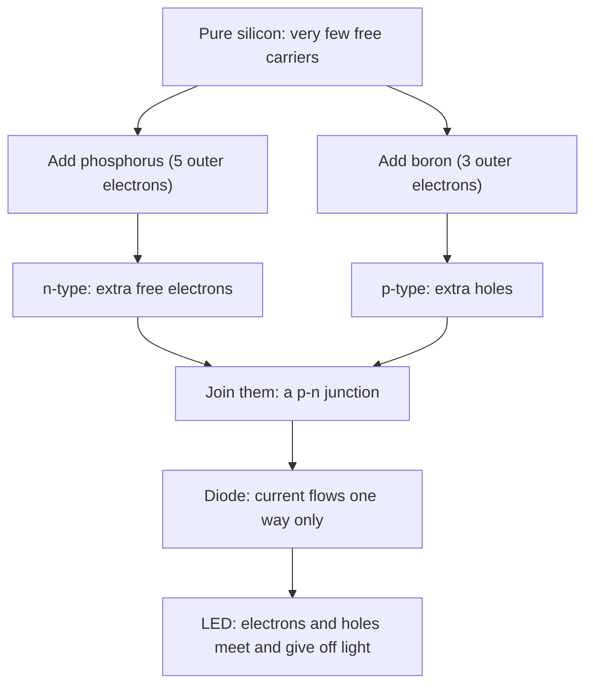

## Why do materials resist?

Lesson 35 treated resistivity as a number you look up: $1.7\times10^{-8}$ Ω·m for copper, around $10^{12}$ Ω·m for glass. It also stated, without explaining, that metals resist more when hot, that electrons drift at a fraction of a millimeter per second, and that some materials lose their resistance completely when cold. This lesson looks inside the material. A simple model of electrons bouncing through a lattice of ions explains Ohm's law and the size of copper's resistivity. The same picture, with a different number of free charges, explains semiconductors, the materials inside every diode, LED and computer chip.

The models here are simplified, and the text says where. A full account needs quantum mechanics, but the simplified picture gets the main ideas and the orders of magnitude right.

## Ohm's law, point by point

Start with a uniform wire of length $L$ and cross-section $A$ carrying current $I$. The current per unit area is the current density $J = I/A$, and lesson 35's formula $I = nqv_dA$ becomes $J = nqv_d$. The voltage across the wire sets up an electric field inside it, $E = V/L$. (Inside a conductor *in a circuit*, the field is not zero; the zero-field rule of electrostatics applies only when no current flows.)

Now rewrite Ohm's law. $V = IR = I\rho L/A$, so dividing both sides by $L$:

$$E = \rho J \qquad\text{or}\qquad J = \sigma E,$$

where $\sigma = 1/\rho$ is the **conductivity**, in $(\Omega\cdot\text{m})^{-1}$, also called siemens per meter. This form describes a single point of the material and contains no length or area: the field at a point pushes the current at that point. The question "why is a material ohmic?" becomes "why is $J$ proportional to $E$?"

## The Drude model

In 1900 Paul Drude proposed the **Drude model**, also called the free-electron model. A metal contains a fixed lattice of positive ions and a "gas" of free electrons, about one or a few per atom, that move through it. The model has three rules:

1. Between collisions, an electron accelerates in the field: $a = eE/m$.
2. Electrons collide, on average once every **mean free time** $\tau$ (here $\tau$ is a collision time, not the $RC$ time constant).
3. Each collision scrambles the electron's direction, so on average it starts again with no velocity along the field.


So each electron gains, on average, an extra velocity $a\tau$ along the field before its next collision wipes it out. That average extra velocity is the drift velocity:

$$v_d = \frac{eE\tau}{m}.$$

The drift is opposite to $E$ for a negative electron, as in the picture. Put this into $J = nev_d$:

$$J = \frac{ne^2\tau}{m}E, \qquad \sigma = \frac{ne^2\tau}{m}, \qquad \rho = \frac{m}{ne^2\tau}.$$

Ohm's law falls out: $J$ is proportional to $E$ as long as $\tau$ doesn't depend on $E$. In a metal it doesn't, because the drift speed is tiny compared with the electrons' random speed of about $10^6$ m/s, so the field hardly changes how often they collide. The ratio $v_d/E = e\tau/m$ is called the **mobility**, $\mu$: the drift speed per unit field, in m²/(V·s). (The symbol $\mu$ is reused here; it's not the friction coefficient or $\mu_0$.)

### Example 1: Collisions in copper

Copper has $n = 8.5\times10^{28}$ free electrons per m³ and $\rho = 1.7\times10^{-8}$ Ω·m. Find the mean free time, the mobility, and the drift speed in a field of 0.017 V/m. ($m = 9.11\times10^{-31}$ kg, $e = 1.602\times10^{-19}$ C.)

$$\tau = \frac{m}{ne^2\rho} = \frac{9.11\times10^{-31}}{(8.5\times10^{28})(1.602\times10^{-19})^2(1.7\times10^{-8})} = 2.5\times10^{-14}\text{ s}.$$

Mobility: $\mu = e\tau/m = (1.602\times10^{-19})(2.5\times10^{-14})/(9.11\times10^{-31}) = 4.3\times10^{-3}$ m²/(V·s).

Drift: $v_d = \mu E = (4.3\times10^{-3})(0.017) = 7.3\times10^{-5}$ m/s.

That field is the one in lesson 35's copper wire carrying 1.0 A through 1.0 mm² ($E = \rho J = (1.7\times10^{-8})(1.0\times10^6) = 0.017$ V/m), and the drift speed matches the $7.4\times10^{-5}$ m/s found there from $I = nqv_dA$ (the small difference is rounding of $\tau$). At $10^6$ m/s, an electron covers $(1.6\times10^6)(2.5\times10^{-14}) \approx 4\times10^{-8}$ m, about 40 nm, between collisions. That is the **mean free path**, roughly 150 atomic spacings.

Where the model is simplified: Drude assumed electrons bounce off the ions themselves. Quantum mechanics shows that electron waves pass through a *perfect*, motionless lattice without scattering at all. What scatters them is anything that breaks the perfect pattern: the vibrations of the ions, impurity atoms and defects. That is why the mean free path is so much longer than the spacing between atoms, and it leads directly to the temperature dependence.

## Temperature and resistance

Heat a metal and its ions vibrate more, so electrons scatter more often, $\tau$ shrinks and $\rho$ rises. Over moderate ranges the rise is close to linear:

$$\rho = \rho_0\left[1 + \alpha(T - T_0)\right],$$

where $\alpha$ is the **temperature coefficient of resistivity**. Approximate values near room temperature, per °C: copper $3.9\times10^{-3}$, tungsten $4.5\times10^{-3}$, platinum $3.9\times10^{-3}$ (thermometer-grade platinum is made to $3.85\times10^{-3}$), and nichrome only about $0.4\times10^{-3}$. Nichrome's small $\alpha$ is one reason it's used in heaters: its resistance stays nearly the same as it warms up. For a wire, $R$ follows the same formula as $\rho$ (its size changes much less).

### Example 2: A platinum thermometer

A platinum resistance thermometer has $R_0 = 100.0$ Ω at 0 °C and $\alpha = 3.85\times10^{-3}$ per °C. It reads 138.5 Ω. What is the temperature?

$R = R_0(1 + \alpha T)$, so $T = \dfrac{R/R_0 - 1}{\alpha} = \dfrac{1.385 - 1}{3.85\times10^{-3}} = 100$ °C.

Resistance thermometers like this (often called Pt100) are standard in labs and industry because platinum is stable and its resistance can be measured very precisely, for example with a bridge.

### Example 3: Switching on a light bulb

A 60 W, 120 V incandescent bulb has $R = 240$ Ω when lit, with its tungsten filament near 2500 °C. Estimate its resistance at 20 °C and the current at the instant it is switched on.

$R_{\text{cold}} = \dfrac{240}{1 + (4.5\times10^{-3})(2500 - 20)} = \dfrac{240}{12.2} \approx 20$ Ω. The first instant's current is about $120/20 = 6$ A, twelve times the 0.50 A running current. This is a rough estimate, since $\alpha$ isn't constant over such a large range, but measured cold resistances of such bulbs are indeed a tenth or less of the hot value. It is also why the filament's I–V graph in lesson 35 bends over.

### Superconductors

Cooling a metal lowers its resistance, but for most metals it levels off at a small value set by impurities. In 1911 Heike Kamerlingh Onnes found that mercury's resistance drops abruptly to zero below about 4.2 K. Below its **critical temperature**, a superconductor has exactly zero resistivity: a current started in a superconducting loop keeps flowing with no battery, and has been observed to persist for years. Not every metal does this; copper, silver and gold have not been found to superconduct at ordinary pressure. The magnets in MRI scanners use niobium–titanium wire cooled by liquid helium. Since 1986, "high-temperature" superconductors (ceramics containing copper oxide) have been found; some, such as YBCO, superconduct at about 90 K, above the 77 K boiling point of cheap liquid nitrogen. Superconductivity is a quantum effect that the Drude model cannot explain.

## Semiconductors

| Material | Resistivity at 20 °C (Ω·m) |
|---|---|
| Silver | $1.6\times10^{-8}$ |
| Copper | $1.7\times10^{-8}$ |
| Nichrome | about $1\times10^{-6}$ |
| Pure silicon | about $2\times10^{3}$ |
| Glass | about $10^{10}$ to $10^{14}$ |

A **semiconductor** such as silicon lies between metals and insulators. Each silicon atom shares its four outer electrons in bonds with four neighbors, so almost all electrons are tied up. At room temperature, heat shakes a few loose: in pure silicon about $10^{16}$ free electrons per m³, compared with $10^{28}$ to $10^{29}$ in a metal. Each freed electron leaves behind a gap in a bond, a **hole**. A neighboring bonded electron can hop into the hole, which moves the hole the other way, so holes behave like mobile positive charges.

Heating a semiconductor frees *many* more carriers, and that effect outweighs the extra scattering. So a semiconductor's resistivity *falls* as temperature rises, the opposite of a metal. A **thermistor** is a semiconductor resistor designed to use this: its resistance changes strongly with temperature, which makes it a sensitive thermometer in thermostats and digital thermometers.

Semiconductors become useful through **doping**: adding a tiny, controlled amount of another element.

- Phosphorus or arsenic atoms have five outer electrons. Four go into bonds; the fifth is almost free. This makes **n-type** silicon, with extra free electrons (n for negative carriers).
- Boron or gallium atoms have three outer electrons, leaving one bond short: a hole. This makes **p-type** silicon, with extra holes (p for positive carriers).

### Example 4: How much doping changes

Silicon has about $5.0\times10^{28}$ atoms per m³. Phosphorus is added at one atom per million silicon atoms, and each phosphorus atom frees one electron. The electron mobility at this doping is about $0.10$ m²/(V·s). Find the free-electron density and the resistivity, and compare with pure silicon and copper.

Free electrons: $n = (5.0\times10^{28})/10^6 = 5.0\times10^{22}$ per m³, about five million times more than pure silicon's $10^{16}$.

Conductivity: with one kind of carrier, $\sigma = ne\mu = (5.0\times10^{22})(1.602\times10^{-19})(0.10) = 8.0\times10^2$ (Ω·m)⁻¹, so $\rho = 1/\sigma = 1.2\times10^{-3}$ Ω·m.

That is about a million times lower than pure silicon's, yet still about 70,000 times copper's. Notice that the electrons in silicon are *more* mobile than copper's ($0.10$ versus $0.0043$ m²/(V·s)); silicon conducts worse only because it has around a million times fewer carriers.



## Diodes and LEDs

Join p-type and n-type silicon and you have a **p–n junction**. Near the boundary, electrons from the n side fill holes on the p side, leaving a thin layer with no free carriers and a built-in voltage across it. Apply a voltage that makes the p side positive (forward bias) and the carriers are pushed into the junction, so current flows readily once the voltage exceeds about 0.6 to 0.7 V for silicon. Reverse the voltage and the carrier-free layer widens, so almost no current flows. The device is a **diode**, a one-way valve for current. Its I–V graph is about as far from Ohm's law as a component gets:

```plot
{"x": [-1, 1], "y": [-0.2, 1.2], "xLabel": "voltage V (V)", "yLabel": "current I (A)", "functions": [{"f": "1e-7*(exp(x/0.045) - 1)", "to": 0.73}, {"f": "x", "dashed": true}], "labels": [{"at": [0.88, 0.2], "text": "diode"}, {"at": [0.25, 0.55], "text": "1 Ω resistor"}], "caption": "A silicon diode (illustrative shape) passes almost no current in reverse and very little below about 0.6 V forward, then conducts readily; the dashed line is a 1 Ω resistor for comparison"}
```

Diodes turn AC into DC in chargers and power supplies. In a **light-emitting diode** (LED), made from semiconductors such as gallium nitride or gallium arsenide phosphide rather than silicon, electrons crossing the junction drop into holes and release the energy as light. The forward voltage is roughly the light's photon energy in electron volts divided by the charge $e$: about 2 V for red LEDs and about 3 V for blue ones (more on photons in the modern physics module). LEDs waste far less energy as heat than filament bulbs, which is the 9 W versus 60 W comparison in lesson 35.

## Common mistakes

- Thinking the field inside a wire is zero while current flows. That rule is for conductors in electrostatic equilibrium.
- Mixing up the two meanings of $\tau$ (mean free time here, $RC$ time constant in lesson 37) and of $\mu$.
- Assuming every material's resistance rises with temperature. Semiconductors and thermistors go the other way.
- Thinking holes are positrons or missing atoms. A hole is a missing bonding electron, and it moves when neighboring electrons fill it.
- Treating a diode as a resistor with a fixed $R$.

## Key points

- Point form of Ohm's law: $J = \sigma E$, with $\sigma = 1/\rho$.
- Drude model: $v_d = eE\tau/m$, $\sigma = ne^2\tau/m$; mobility $\mu = v_d/E = e\tau/m$. Copper: $\tau \approx 2.5\times10^{-14}$ s, mean free path about 40 nm.
- Metals: $\rho = \rho_0[1 + \alpha(T - T_0)]$, rising with temperature because vibrations scatter electrons.
- Superconductors: exactly zero resistivity below a critical temperature.
- Semiconductors: few carriers, resistivity falls with temperature; doping makes n-type (electrons) or p-type (holes); $\sigma = ne\mu$.
- A p–n junction is a diode: current flows one way above about 0.6–0.7 V (silicon). LEDs emit light at the junction.
