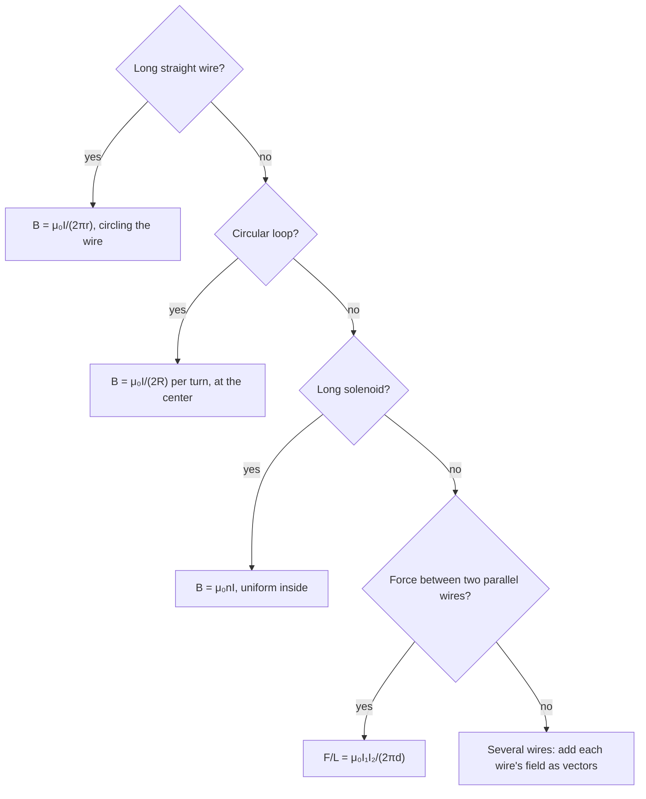

## Currents make magnetic fields

In 1820 Hans Christian Ørsted noticed a compass needle swing when he switched on a nearby current. Every magnetic field, including a bar magnet's, ultimately comes from moving charges. This lesson finds the fields of the most useful current shapes: a long straight wire, a loop, and a coil (solenoid), and shows how parallel currents push and pull on each other.

## Field of a long straight wire

A long straight wire carrying current $I$ makes a magnetic field that circles the wire. At distance $r$, its magnitude is

$$B = \frac{\mu_0I}{2\pi r},$$

where $\mu_0 = 4\pi\times10^{-7}$ T·m/A is the **permeability of free space**. (That value was exact until the SI units were redefined in 2019; $\mu_0$ is now a measured constant, but it still agrees with $4\pi\times10^{-7}$ to about ten digits, so the formula is used unchanged.) The field weakens as $1/r$, like the electric field of a line charge.

*Direction (right-hand grip rule).* Grasp the wire with your right thumb along the current; your fingers curl in the direction of $\vec B$. Seen from above with current coming toward you, the field circles counterclockwise.

```plot
{"x": [-2.6, 2.6], "y": [-2.6, 2.6], "equal": true, "vectorField": {"u": "-y/(x^2+y^2)", "v": "x/(x^2+y^2)", "step": 0.65}, "points": [{"at": [0, 0], "label": "I out of page"}], "caption": "Field around a wire carrying current out of the page: counterclockwise circles, weaker farther out"}
```

### Example 1

A power line carries 200 A. What is the magnetic field 10 m below it? Compare with Earth's field.

$B = \dfrac{(4\pi\times10^{-7})(200)}{2\pi(10)} = 4.0\times10^{-6}$ T, about 8% of Earth's field ($5\times10^{-5}$ T).

## Field at the center of a loop and inside a solenoid

Bending the wire into a circular loop of radius $R$ concentrates the field. At the center,

$$B = \frac{\mu_0I}{2R},$$

times $N$ for a flat coil of $N$ turns. The field threads through the loop, with direction given by curling your right-hand fingers along the current: your thumb points along $\vec B$ at the center. A loop acts like a small bar magnet, with the side the field exits being its north pole.

A **solenoid** is a long coil of wire. Inside, far from the ends, the field is nearly uniform and parallel to the axis:

$$B = \mu_0nI, \qquad n = \frac NL \text{ (turns per meter)}.$$


The cross-section shows why: inside, the fields of all the turns point the same way and add; outside, the field lines spread out over a large region, so the field there is weak. The end the field lines leave is the north pole.

Outside, the field is weak. The interior field doesn't depend on the solenoid's radius or on where you are inside it. Wrapping the coil around an iron core multiplies the field hundreds or thousands of times, because the iron's own atomic magnets line up with it; that makes an **electromagnet**, which can be switched off, unlike a permanent magnet.

### Example 2

A solenoid 0.40 m long has 2000 turns and carries 3.0 A. What is the field inside?

$n = 2000/0.40 = 5000$ turns/m. $B = (4\pi\times10^{-7})(5000)(3.0) = 1.88\times10^{-2}$ T, about 400 times Earth's field.

## Forces between parallel currents

Each of two parallel wires sits in the field of the other, so each feels a force. Wire 1's field at wire 2 (distance $d$) is $\mu_0I_1/(2\pi d)$, and the force on a length $L$ of wire 2 is $I_2LB$:

$$\frac FL = \frac{\mu_0I_1I_2}{2\pi d}.$$

Using the right-hand rules: currents in the *same* direction attract, currents in *opposite* directions repel (the reverse of electric charges). This force once defined the ampere: two wires 1 m apart, each carrying 1 A, feel $2\times10^{-7}$ N per meter.

### Example 3

Two long parallel wires 5.0 cm apart carry 10 A and 15 A in opposite directions. What is the force per meter, and is it attractive or repulsive?

$\dfrac FL = \dfrac{(4\pi\times10^{-7})(10)(15)}{2\pi(0.050)} = 6.0\times10^{-4}$ N/m, repulsive.

## Magnetic materials

Electrons spin and orbit, so atoms can be tiny magnets. In most materials these cancel or point randomly. In **ferromagnetic** materials (iron, nickel, cobalt), neighboring atoms' magnets align in regions called domains; an external field grows the domains that point with it, producing strong magnetization. Some ferromagnets keep their alignment when the field is removed: permanent magnets. Heating past the Curie temperature (770°C for iron) destroys ferromagnetism.

## Combining fields

Magnetic fields obey superposition, just like electric fields: the field at a point is the vector sum of the fields from every current. With straight wires, find each wire's field (size from $\mu_0I/(2\pi r)$, direction from the grip rule), then add them as vectors.

### Example 4

Two long parallel wires are 10 cm apart. Each carries 20 A, both out of the page. Find the field at the point midway between them, and at the midpoint if one current is reversed.

Each wire alone gives, at 5.0 cm, $B = \dfrac{(4\pi\times10^{-7})(20)}{2\pi(0.050)} = 8.0\times10^{-5}$ T.

Same directions: put wire 1 on the left and wire 2 on the right. Current out of the page circles counterclockwise, so wire 1's field at the midpoint (to its right) points up the page, and wire 2's field at the midpoint (to its left) points down. They cancel: $B = 0$ midway.

Opposite directions: reversing wire 2 reverses its field, so now both point up and add: $B = 1.6\times10^{-4}$ T.

This is why the two wires of a power cord, carrying equal currents in opposite directions, are kept close together: away from the cord their fields nearly cancel.

## Where the formulas come from: Ampère's law

The straight-wire and solenoid formulas both follow from a rule called **Ampère's law**, the magnetic counterpart of Gauss's law. In the symmetric situations we need, it says: if you walk around a closed path along which the field has a constant size $B$ and runs along the path, then

$$B \times (\text{length of path}) = \mu_0 I_{\text{enc}},$$

where $I_{\text{enc}}$ is the total current passing through the path.

- *Straight wire.* Take a circle of radius $r$ around the wire. By symmetry the field has the same size all the way around and points along the circle, so $B(2\pi r) = \mu_0I$ and $B = \dfrac{\mu_0I}{2\pi r}$.
- *Solenoid.* Take a rectangle with one side of length $\ell$ inside the coil, along the axis, and the opposite side outside. Only the inside side contributes (the field outside is nearly zero, and the short sides cross the field at right angles). The rectangle encloses $n\ell$ turns, each carrying $I$, so $B\ell = \mu_0n\ell I$ and $B = \mu_0nI$, with no dependence on where the inside side sits.

The loop-center formula $\mu_0I/(2R)$ isn't symmetric enough for this shortcut; it comes from adding up the contributions of every small piece of the loop, which all point the same way at the center.

## Choosing the right formula

Most problems start by recognizing which current shape you have.



## Common mistakes

- Using $1/r^2$ for a straight wire's field (it's $1/r$).
- Confusing $n$ (turns per meter) with $N$ (total turns) in $B = \mu_0nI$.
- Getting the parallel-wire rule backwards (like currents attract).
- Using the force right-hand rule where the grip rule is needed.

## Key points

- Straight wire: $B = \mu_0I/(2\pi r)$, circling the wire (right-hand grip).
- Loop center: $B = \mu_0I/(2R)$ per turn. Solenoid: $B = \mu_0nI$, uniform inside.
- Parallel wires: $F/L = \mu_0I_1I_2/(2\pi d)$; same direction attract.
- $\mu_0 \approx 4\pi\times10^{-7}$ T·m/A $= 1.257\times10^{-6}$ T·m/A.
- Fields add as vectors (superposition). Ampère's law for symmetric cases: $B \times (\text{path length}) = \mu_0I_{\text{enc}}$.
